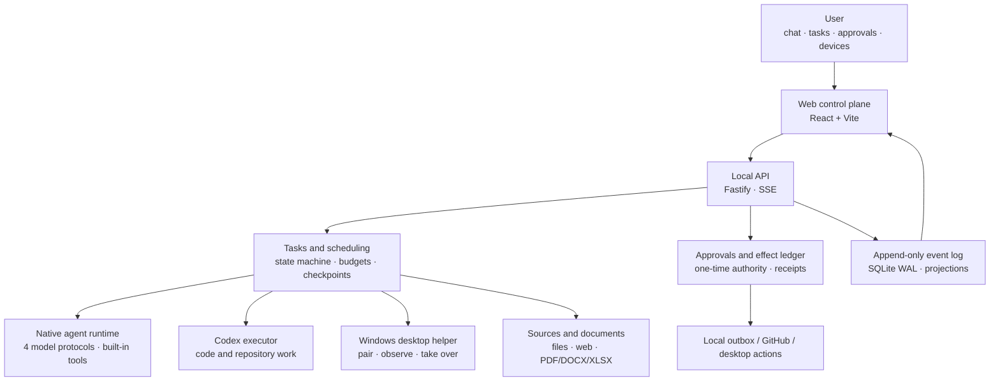

<p align="center">
  <picture>
    <source media="(prefers-color-scheme: dark)" srcset="docs/public/brand/hearth-os-logo-reverse.png">
    <source media="(prefers-color-scheme: light)" srcset="docs/public/brand/hearth-os-logo.png">
    
  </picture>
</p>

<p align="center">
  <strong>Turn digital labor into durable, auditable, recoverable tasks.</strong><br>
  A single-user, self-hosted, long-running Personal Agent OS
</p>

<p align="center">
  <a href="README.zh-CN.md">简体中文</a> ·
  <a href="https://hearthproject.github.io/hearth-os/">Documentation</a> ·
  <a href="#quick-start">Quick start</a> ·
  <a href="#project-status">Project status</a>
</p>

<p align="center">
  
  
  
  
</p>

---

Hearth is not another chat wrapper, and it is not an agent built only for code. It is a **task-centric personal control plane**: the user states an intent, and the system owns the goal, executor routing, permissions, evidence, and failure recovery. External effects require an explicit approval before they happen.

Models can change, executors can be replaced, and the interface can be rewritten, but task state, authority scope, artifact digests, and external receipts must remain. The question Hearth answers is not "can the model write something?" but "did the work actually finish, can it continue after failure, and can every external effect be audited?"

## What exists today

| Capability | Current implementation |
|---|---|
| **Chat-first control plane** | React + Vite single-page app; tasks are proposed in conversation, and task detail shows executor, phase, tokens, duration, and artifacts |
| **Native agent runtime** | A self-built single-agent tool loop supporting OpenAI Chat, OpenAI Responses, Anthropic Messages, and Gemini |
| **Seven executors** | `native`, `codex`, `hermes`, `qoder`, `workbuddy`, `zcode`, and `kimi` share one registry, launcher, health probe, install pipeline, and settings surface. Executor identity is written into every run manifest |
| **Durable task state** | State machine, budgets, checkpoints, waiting-for-input, resume, and retry; an append-only SQLite event log records every fact |
| **Approvals and receipts** | External actions produce a preview; a one-time approval is bound to a parameter fingerprint; the effect ledger executes once and stores a receipt |
| **Sources and documents** | Local files, knowledge bases, allowlisted web pages, and text extraction for TXT, Markdown, CSV, JSON, HTML, PDF, DOCX, and XLSX |
| **Windows desktop control** | Six-digit pairing, per-capability approval, screenshot observation, pause/takeover/hand-back, low-risk clicks and typing, and UIAutomation |
| **Proactive service and memory** | Six trigger types, a proactive inbox, attention budgets, memory candidates, recall, correction, forgetting, and export |
| **Method evolution** | Candidate methods, trial evidence, evaluation, promotion, rejection, and rollback |
| **Multi-device and security** | Incremental event sync, peer authentication, task leases and epoch fencing, device revocation, token rotation, and a global kill switch |
| **Backup and operations** | AES-256-GCM encrypted backups with rollback-safe restore, health snapshots, periodic maintenance, and redacted diagnostics |

## Project status

Hearth has passed the **phase-one MVP** hard gate: all 15 cross-industry real tasks ran, and 13 passed acceptance. Phases two through six have runnable code loops and automated coverage, but they have **not** completed real-user, real-device, or long-running acceptance. They are not claimed as delivered.

| Phase | Status | Proven | Still open |
|---|---|---|---|
| 1 · Minimum complete MVP | **Accepted** | 15 tasks, 13 passed; task, approval, artifact, recovery, and backup loops | T07 did not deliver a PR; T08's external comment awaits user approval |
| 2 · Everyday content work | Partial | Sources, extraction, drafts, approvals, local outbox, and receipts | No email or calendar accounts; no real sending |
| 3 · Desktop operation | Partial | Windows pairing, observation, takeover, low-risk input, UIA actions | No sensitive-area masking, isolated desktop, or high-risk compensation |
| 4 · Proactive service and mobile | Partial | Triggers, inbox, accept/ignore/snooze/convert, attention budget | No mobile PWA, phone pairing, push, or remote approval |
| 5 · Memory and evolution | Partial | Memory candidate/recall/correct/forget/export; method evaluation/promotion/rollback | No real long-term use or before/after production comparison |
| 6 · Multi-device and long-running | Partial | Incremental sync, leases, revocation, encrypted backup, health maintenance | No real two-device switch, lost-device drill, or multi-week run |

See [Delivery and progress](https://hearthproject.github.io/hearth-os/en/delivery/) and [Phase 2–6 capability status](https://hearthproject.github.io/hearth-os/en/delivery/capabilities.html) for the detailed matrix and evidence.

## Architecture



The core constraint is one sentence: **interface state comes from rebuildable records, each state has a single write authority, and every external effect is either approved or explicitly exempt, with a receipt that can be checked.**

## Quick start

Requires **Node.js 22.13+** (the server uses the built-in `node:sqlite`) and npm.

```bash
git clone https://github.com/hearthproject/hearth-os.git
cd hearth-os
npm ci
npm run dev
```

Open <http://127.0.0.1:5173>. Vite proxies `/api` to the local service at `127.0.0.1:4317`.

Production-style local run:

```bash
npm run build
npm start
```

Open <http://127.0.0.1:4317>.

### Connect a model

In **Settings → Model**, choose a preset provider (DeepSeek, Alibaba Cloud Bailian, Zhipu, Kimi, Volcengine Ark, OpenAI, Anthropic, or Gemini) or a custom endpoint. Hearth supports all four protocols through one loop. The key is stored in `.hearth/model-settings.json`; the settings page only shows a masked value and never returns the raw key to the browser.

### Use Codex

The Codex executor reads your existing `~/.codex/config.toml`. A `codex login` session is not required when a `model_provider` and its `env_key` are configured: the key only needs to be present in the terminal that starts Hearth. The Settings page reports the active provider, model, and authentication source.

### Use additional executors

Open **Settings → 执行器管理** to install, probe, configure, and set concurrency for every executor from one place. The chat composer has a single executor picker: a conversation-level choice overrides the global preferred executor and falls back to the task-matched executor when that choice is disabled, missing, or lacks a required capability.

| Executor | How Hearth connects |
|---|---|
| `native` | Built in; uses the model configured under Settings → Model |
| `codex` | Reads the existing Codex profile and authentication source |
| `hermes` | Uses the `hermes` command on `PATH`, or a command path configured in Settings |
| `qoder` | Managed install of `@qoder-ai/qoder-agent-sdk`; reuses a local `qodercli` login or a personal access token |
| `workbuddy` | Managed install of `@tencent-ai/codebuddy-code`; reuses the local CodeBuddy/WorkBuddy login |
| `zcode` | Experimental integration with the bundled ZCode desktop `zcode.cjs` runtime |
| `kimi` | Managed install of `@moonshot-ai/kimi-code`; runs non-interactive stream-json sessions |

Managed packages live under `.hearth/executors/<id>/`; configuration and preferred routing live in `.hearth/executor-settings.json`. Run `npm test` after adding an executor to verify routing, launch resolution, install jobs, adapter parsing, and health checks together.

## Data and backup

| Path | Contents |
|---|---|
| `.hearth/hearth.sqlite` | Tasks, runs, approvals, effects, memory, methods, sync state, and events |
| `.hearth/workspaces/` | Isolated task workspaces |
| `.hearth/artifacts/` | Managed artifacts |
| `.hearth/outbox/` | Local outbox and receipts |
| `.hearth/backups/` | Encrypted backup archives |
| `eval/runs/` | Phase-one acceptance runs and artifacts |

The server exposes AES-256-GCM encrypted backup creation and restore, validating schema and `integrity_check` before replacing the database. The chat-first UI does not yet surface the backup entry, so use the API described in [Data, backup, and restore](https://hearthproject.github.io/hearth-os/en/guide/data.html). The archive includes the database and required metadata, but **not artifact bodies, workspaces, source bodies, or external attachments**. For a complete archive, also copy `.hearth/artifacts/`, `.hearth/workspaces/`, and `eval/runs/`.

## Repository layout

```text
apps/
  server/              Fastify API, scheduler, approvals, sources, desktop, memory, sync, backup, operations
  web/                 React + Vite chat-first control plane
packages/
  core/                State machine, domain types, and DTOs
  eventlog/            Append-only SQLite event log and projections
  agent-runtime/       Native single-agent tool loop, budgets, checkpoints, and compaction
  codex-executor/      Codex SDK adapter and provider probing
  templates/           Task templates and acceptance constraints
eval/                  15 real tasks, inputs, acceptance criteria, and run evidence
docs/                  Bilingual VitePress documentation site
tools/windows-helper/  Windows desktop observation and input helper
scripts/               Documentation and delivery-data helpers
```

## Documentation

The full documentation is published at **<https://hearthproject.github.io/hearth-os/>**. Chinese is the default language, and every page has an English mirror.

- [Get started](https://hearthproject.github.io/hearth-os/en/guide/) — install, connect a model, data and backup, development and tests.
- [Product design](https://hearthproject.github.io/hearth-os/en/design/) — positioning, task path, technology choices, and module boundaries.
- [Delivery and progress](https://hearthproject.github.io/hearth-os/en/delivery/) — accepted scope, deliberate gaps, and the remaining roadmap.
- [Development log](https://hearthproject.github.io/hearth-os/en/log/) — daily summaries, commits, and concrete changes.
- [Reference](https://hearthproject.github.io/hearth-os/en/reference/) — engineering, risks, decisions, glossary, checklists, and maintenance.

## Known boundaries

- Email and calendar accounts are not connected; the local outbox writes local files and does not mean a message was sent.
- The Windows helper supports same-machine, foreground, focused operation only. Sensitive-area masking, isolated desktops, and high-risk compensation are not implemented.
- Mobile entry, push notifications, and remote takeover are not implemented.
- Multi-device sync copies filtered event projections only; it does not copy artifact bodies, workspaces, or sensitive memory.
- The current main navigation exposes chat, tasks, devices, and settings. Memory, methods, sync, security, and operations have APIs and page components, but are not all wired back into the primary navigation.
- This is a working build with an accepted phase-one MVP and partially completed phases two through six, not a v1.0 release.

## Verification

```bash
npm test           # 40 test files, 199 tests
npm run typecheck
npm run build
npm run docs:build
```

Coverage spans the service layer, API, model protocols, native tool loop, budgets, permissions, checkpoints, proposal confirmation, desktop boundaries, memory, methods, sync, security, backup, and operations. Passing tests are not the same as real-world acceptance; per-task phase-one evidence lives in [`eval/phase-1-acceptance.md`](eval/phase-1-acceptance.md).

## License

Apache-2.0. See [LICENSE](LICENSE).
