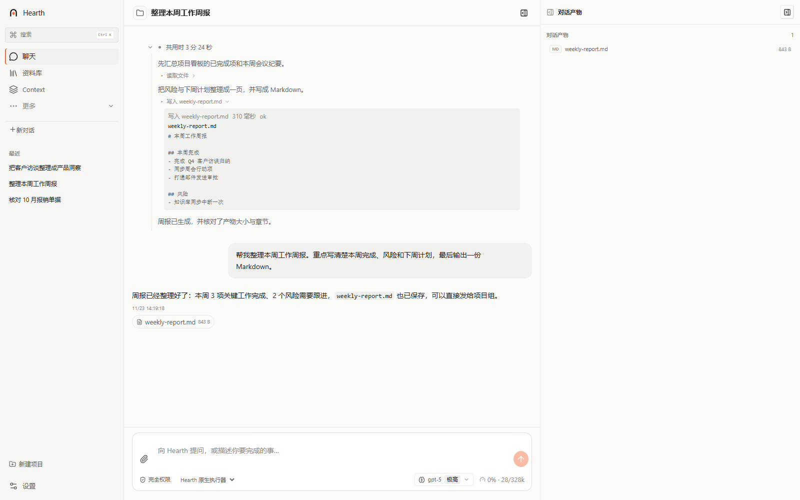
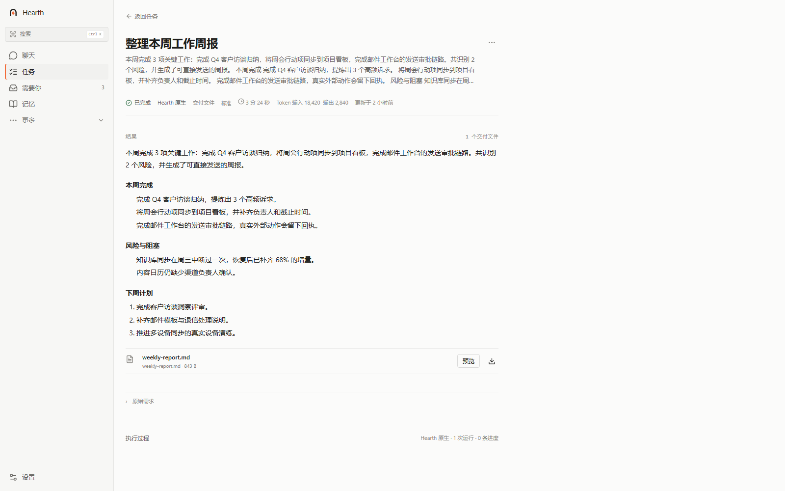
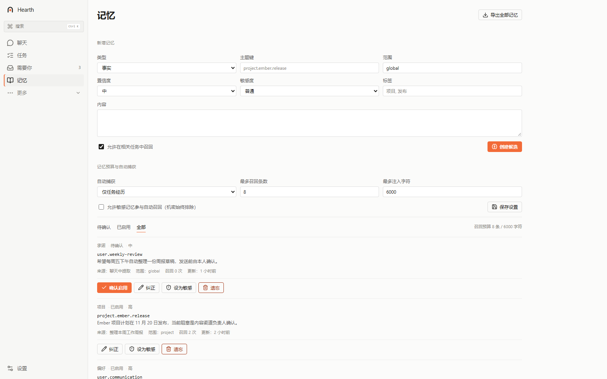
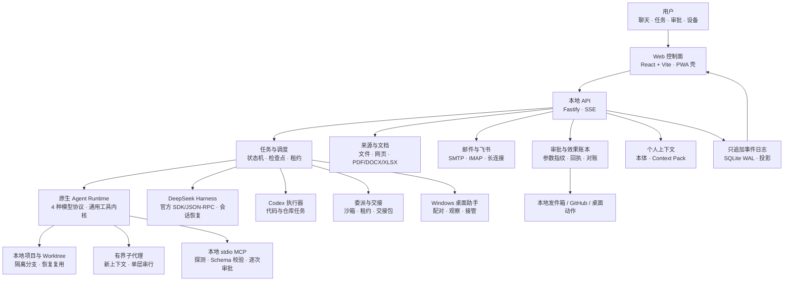

<p align="center">
  <picture>
    <source media="(prefers-color-scheme: dark)" srcset="docs/public/brand/hearth-os-logo-reverse.png">
    <source media="(prefers-color-scheme: light)" srcset="docs/public/brand/hearth-os-logo.png">
    
  </picture>
</p>

<p align="center">
  <strong>让数字劳动成为持久、可审计、可恢复的任务</strong><br>
  单用户 · 自托管 · 长期驻留的个人 Agent OS
</p>

<p align="center">
  <a href="https://hearthproject.github.io/hearth-os/"><strong>文档站</strong></a> ·
  <a href="#界面一览">界面截图</a> ·
  <a href="#现在能做什么">能力</a> ·
  <a href="#快速开始">快速开始</a> ·
  <a href="#当前进度">当前进度</a> ·
  <a href="#架构图">架构图</a> ·
  <a href="#验证">验证</a>
</p>

<p align="center">
  
  
  
  
  
</p>

---

Hearth 不是另一个聊天壳，也不是只服务于代码的 Agent。它是一个**以任务为中心的个人控制面**：用户提出意图，系统保存目标、分配执行器、约束权限、记录证据，并在外部动作发生前要求明确审批。

模型可以更换，执行器可以替换，界面可以重写，但任务状态、授权范围、完成证据、产物摘要和外部回执必须留下来。Hearth 要回答的不是“模型能不能写出一段话”，而是“这件事有没有真正完成，失败后能不能接着做，外部动作能不能被核对”。

> **当前状态（2026-11-21，v0.3.2）：** 可信执行、浏览器自动化、项目档案、首次真实任务验证、监督收件箱、自用报告、可选签名更新和发布脚本已进入 `main`。129 个测试文件、864 个用例、12 项浏览器 fixture 和 18 项离线 UI 端到端通过，Tauri updater 编译、0.3.2 NSIS 安装包（30.5 MiB）和文档构建通过。真实模型首跑被当前 key 的无权限错误阻塞；日常 Chrome 扩展桥、干净机安装、真实账户和已签名更新发布仍未验收。逐项证据见[2026-11 验收报告](https://hearthproject.github.io/hearth-os/delivery/acceptance-2026-11.html)。

## 界面一览

<p align="center">
  
  <br>
  <sub>聊天工作台：对话常驻左侧；目标、进度、产物与附件在右侧按需展开并可直接预览。</sub>
</p>

<table>
  <tr>
    <td width="50%" valign="top">
      
      <p align="center"><sub><strong>任务详情</strong><br>结果在前，原始需求、执行过程与交付文件按需展开。</sub></p>
    </td>
    <td width="50%" valign="top">
      
      <p align="center"><sub><strong>记忆</strong><br>新增、预算、待确认与最近召回都在同一页。</sub></p>
    </td>
  </tr>
  <tr>
    <td colspan="2" align="center">
      
      <p align="center"><sub><strong>设置与执行器</strong><br>左侧只做分区；模型绑定、健康状态与配置都在右侧一栏。</sub></p>
    </td>
  </tr>
</table>

## 现在能做什么

| 能力 | 当前实现 |
|---|---|
| **聊天优先的控制面** | React + Vite 单页应用，对话常驻左侧，运行中与待处理状态直接标在对话条目；右侧按需展开目标、进度、产物、附件和后台任务，并支持文本、Markdown、代码、JSON/CSV、图片与 PDF 预览；任务详情可继续查看完整执行记录 |
| **浏览器自动化** | 独立 Chrome profile、多标签页、页面元素快照与稳定 ID、16 个浏览器工具；提交/上传/下载逐次审批，动作前后截图和页面摘要进入证据目录；完成前必须有通过的页面断言。不读取 cookie 或密码 |
| **逐轮时间线与回退** | 任务详情显示每轮改了哪些文件、增删行数、测试与诊断；一键回退前校验文件哈希，用户手改默认拒绝，`force` 才覆盖 |
| **审批模式** | `necessary`、`workspace`、`full` 三档；工作区内可逆文件写入自动执行，shell、删除、邮件、桌面、陌生域名和支付类动作仍需审批 |
| **项目档案与工作方式** | 每个项目编译 `PROJECT.md`（栈、命令、约定、决策、未完成任务、坑）；`WORKSTYLE.md` 记录沟通、提交、验证和工具偏好；只注入 coding 任务 |
| **监督与自用报告** | “需要你”收件箱只放长任务、等待审批、预算停止和失败；每天 08:00 后生成回顾；`npm run dogfood:report` 汇总完成率、一次通过率、审批、轮次和 token |
| **原生 Agent Runtime** | 自研通用执行内核，支持 OpenAI Chat、OpenAI Responses、Anthropic Messages、Gemini 四种协议；读取、文档、glob/grep、写入、原子编辑、补丁、命令、联网搜索、委派、本地 MCP、询问用户和完成工具共享同一条可选预算（默认不设上限）、检查点、审批与恢复链路 |
| **项目、子代理与 MCP** | 项目可以是任意本地文件夹：Git 仓库自动使用独立 `hearth/<task-id>` Worktree，普通文件夹原地执行并在任务结束后给出改动清单；子代理使用新上下文、只读或隔离写、单层串行且最多两个；本地 stdio MCP 服务器支持启动探测、工具发现、JSON Schema 校验、逐次审批、超时和崩溃隔离 |
| **项目会话与独立对话** | 侧边栏按“项目 / 最近”分组，项目下可以直接开新对话，会话创建后固定归属；独立对话默认没有文件权限，只有消息里出现完整路径时才把该文件夹作为本次任务的工作目录 |
| **上下文与办公产物** | 模型窗口默认 128K、最大输出默认 8K；只在完整回合边界做 Token 感知压缩，压缩后写检查点；可生成 XLSX/CSV/DOCX，Shell 完整输出写入任务日志、只回填尾部并杀死超时进程树 |
| **三个执行器** | 内置 `native`，以及 `codex`、`deepseek-harness` 两个官方 SDK 执行器；共用注册表、健康检测、模型绑定和设置界面 |
| **统一模型注册表** | SQLite 模型档案与执行器绑定取代私有 JSON；各执行器按协议兼容性选择模型，Codex 固定使用 OpenAI Responses，本地模型不进入统一管理 |
| **持久任务执行** | 状态机、可选预算、检查点、等待输入、恢复与重试；只追加 SQLite 事件日志保存全部事实；运行中可“轮后继续”或中止当前轮并带补充重跑 |
| **委派、交接与沙箱** | 单层持久委派任务通过调度器推进，保留可选预算、工作区策略、租约和失败状态；执行器交接包带目标、下一步、验收项、证据、权限子集和上下文水位；沙箱检查路径、网络、进程和凭据边界 |
| **审批与回执** | 外部动作先生成预览，一次性审批绑定动作参数指纹；批准后由效果账本执行并留下回执；拒绝、过期、复用和参数变化都会失效；不确定效果进入显式对账队列 |
| **个人上下文** | 实体、别名、关系、状态、决定和承诺组成个人本体；Context Broker 按 `must_know`、`relevant`、`recallable`、`omitted` 组装上下文 |
| **首次运行、更新与发版** | 全新实例完成服务商、执行器、偏好后可跑一个真实工具任务；通过才标记完成，跳过保留警告。Tauri updater 三项签名变量齐全才启用；发布脚本生成安装包、便携 zip、发布说明和 SHA256 |
| **主导航** | 聊天、需要你、记忆三个主入口；档案、邮件、定时任务、设备、运行、个人收在“更多”；设置固定在底部 |
| **飞书消息入口** | 企业自建应用长连接、open_id 白名单、文本/图片/文件消息、任务状态、审批摘要与 `/approve`、`/reject` 文本命令；入站消息带幂等记录，不需要公网回调 |
| **邮件工作台** | SMTP 发送复用审批与效果账本，批准后发送并保存回执；IMAP 只读同步最近邮件到来源，不标记已读；账户和口令加密保存 |
| **定时任务** | 有界补跑、失败冷却、定时触发；任务直接使用自定义输入与产物约定，不再依赖模板包 |
| **来源与文档** | 本地文件、知识库、公开网页，以及 TXT/Markdown/CSV/JSON/HTML/PDF/DOCX/XLSX 文本提取 |
| **Windows 桌面控制** | 六位配对码、逐项能力审批、截图观察、暂停/接管/交还、低风险点击输入与 UIAutomation |
| **记忆** | 记忆候选、来源与可信度、召回、纠正、合并、遗忘传播与导出；可关闭自动记录，评测经历默认过滤 |
| **本机安全** | 设备撤销、令牌轮换、全局 kill switch；所有能力都在本机 SQLite 与事件日志内闭环，不依赖远程节点 |
| **备份与运维** | AES-256-GCM 加密备份与回滚式恢复、健康快照、周期维护、脱敏诊断，入口统一在设置的数据页 |
| **移动端壳与 PWA** | 可安装 Manifest、应用图标、移动底部导航和离线应用壳；尚未完成 iOS/Android 真机安装、手机配对、系统推送和远程接管验收 |

## 当前进度

2026-11 这一版不再扩展新概念，而是把已有能力收拢成可日常使用、可回退、可核对的闭环：

| 领域 | 状态 | 证据 | 留空 |
|---|---|---|---|
| 可信执行 | 完成 | 逐轮时间线、回退漂移保护、审批模式、864 个用例 | 真实用户长期回退演练 |
| 浏览器 | 代码闭环 | 16 个工具、12 项 fixture、18 个证据文件、Chrome 真实启动 | 日常 Chrome 扩展桥、验证码/风控站点 |
| 记忆与档案 | 完成 | 项目档案、工作方式、7 项档案测试、注入边界测试 | 真实长期写作/编码使用 |
| 首跑与更新 | 代码闭环 | fake-runner 测试、Tauri updater 编译、发布脚本 | 真实模型首跑、签名更新发布、干净机安装 |
| 监督与自用报告 | 完成 | 4 项监督测试、1 项报告测试、收件箱 E2E | 真实一周 dogfood 复盘 |
| 工程门禁 | 完成 | CI、commitlint、husky、PR 模板、文档构建 | 分支保护与远端 CI 实际运行记录 |

历史阶段一至六的路线和 Native 30 题评测保留在文档站，但部分描述已被当前范围收缩取代。逐项能力矩阵、验证证据和未完成验收见[当前交付状态](https://hearthproject.github.io/hearth-os/delivery/status.html)与[2026-11 验收报告](https://hearthproject.github.io/hearth-os/delivery/acceptance-2026-11.html)。

## 评测结果

评测栈已拆分到独立仓库 **<https://github.com/hearthproject/hearth-eval>**。主仓库不再保留评测桥接，case、实验编排、评分、复核、对比和控制台都由评测仓库维护。

2026-11-11 至 11-12 使用 30 个离线 case（8 个任务族均匀分布）、仅 `native` 执行器、重复 1 次、自动评分与自动重试开启、并发 4 进行测量：

| 指标 | 结果 |
|---|---:|
| 最好完整单轮 | **18/30 通过（60%）**，平均分 88.89，实验 `EXP-20261111145332-7a95ea` |
| 累计定向确认 | **19/30** 个 case 曾达到 100 分；不是一次连续实验 |
| 最近完整单轮 | 12/30 通过（40%），平均分 73.33，实验 `EXP-20261112003215-b1172b` |
| 11 月 12 日报告的修复提交 | `eb32ad5`；尚未做不中断的完整 30 题复测 |

最近完整单轮受到 provider 慢响应、评分 JSON 截断和任务超时影响，且早于最后四个归一化修复，不能直接等同于最终代码能力。CAL01、WEB01 等 case 还存在输入与评分 rubric 的语义歧义；T02、T11、WEB03 虽得到 100 分，但因 `sampled` 标记未计为正式通过。

**2026-11-14 定向验证更新**

| 验证范围 | 结果 |
|---|---|
| Native 审批、动作绑定、调度与工具循环 | 5 个测试文件，**106/106 通过** |
| `action-binding-tamper` 单场景 | **3/3 通过**，覆盖文件变化后撤销审批、拒绝执行和解除 Native 审批等待 |
| 评测控制台自检与批次接口 | 2 个测试文件，**9/9 通过**；评测项目类型检查和前端构建通过 |
| 新一轮 Native 30 题实验 | 待执行，当前可引用的完整实验成绩仍为上表记录 |

修复前的新增回归测试确认，工具审批撤销后，Native 等待的 Promise 未收到拒绝结果。修复后，Agent 能获得拒绝原因并跳过该工具。评测控制台现在支持点击“开始自检”，结束后自动更新“最近一次”批次、统计、检查项和证据，并展示 `log.md`。页面自检结果保存在内存中，下次自检替换，服务重启后清空，临时测试文件执行后清理。

本次验证基于 Hearth OS `0de76a1` 与 Hearth Eval `2a65c78` 上的本地工作区改动；审批修复和自检改动在记录时尚未提交。验证范围、复现命令及类型检查问题见[定向验证记录](docs/evaluation/native-30-final-report-2026-11-12.md#定向验证更新)。

详细报告：[最终评测报告](https://hearthproject.github.io/hearth-os/evaluation/native-30-final-report-2026-11-12.html) · [基线报告](https://hearthproject.github.io/hearth-os/evaluation/native-30-baseline-2026-11-11.html) · [评测文档站](https://hearthproject.github.io/hearth-eval/)。

## 架构图

[](https://media.githubusercontent.com/media/hearthproject/hearth-os/main/assets/Hearth-Architecture-Light.svg)

<sub>当前架构：Web 工作台 + 单进程 Fastify 控制平面 + Native Runtime/coding harness + 浏览器与外部工具 + SQLite 事件账本和本地文件。审批、效果账本和逐轮快照位于执行与外部动作之间。点击图片可查看原图。</sub>

### 运行时数据流

简化版：

[](https://media.githubusercontent.com/media/hearthproject/hearth-os/main/assets/Hearth-Flow-Simple-Light.svg)

<sub>简化版：说清目标、在安全范围内动手、自己验证、交给你决定；结果里能看到文件改动、测试、页面断言和回退入口。点击图片可查看原图。</sub>

详细版：

[](https://media.githubusercontent.com/media/hearthproject/hearth-os/main/assets/Hearth-Flow-Light.svg)

<sub>详细版：目标契约 → 执行器与权限 → 审批 → 工具执行 → 测试/页面断言 → 证据与回退。失败保留原因并进入可恢复状态，不覆盖历史。点击图片可查看原图。</sub>

同一流程的 Mermaid 版本：



评测 Agent 已拆分到独立仓库 **<https://github.com/hearthproject/hearth-eval>**。评测前端、评测服务、评测核心、case、场景运行器和评测文档都在该仓库维护；主仓库不再注册任何评测路由。

核心约束只有一句话：**界面状态来自可重建的记录，每个状态只有一个写权威，外部副作用必须经过审批或明确豁免，并留下可核对回执。**

## 快速开始

要求 **Node.js 22.13+**（服务端使用内置 `node:sqlite`）和 npm。

```bash
git clone https://github.com/hearthproject/hearth-os.git
cd hearth-os
npm ci
npm run dev
```

打开 <http://127.0.0.1:5173>。Vite 会把 `/api` 代理到本机 `127.0.0.1:4317`。

生产式本机运行：

```bash
npm run build
npm start
```

打开 <http://127.0.0.1:4317>。

### Windows 桌面版

```powershell
npm ci
npm run tauri:build
```

生成 `release\Hearth_0.3.2_x64-setup.exe`（NSIS 按用户安装，免 UAC，安装到 `%LOCALAPPDATA%\Programs\Hearth`）。安装后双击开始菜单的 Hearth 即可；关窗会隐藏到托盘，托盘菜单负责退出、环境体检、桌面助手、数据目录和日志目录。首次启动会让你选择现有 `.hearth` 或新建数据目录。

桌面版只保留 Tauri 实现：内置官方 Node 22.23.2、npm 10.9.8 和全部服务端功能，0.3.2 安装包 30.5 MiB，安装后约 131 MiB。Codex 使用系统中的 `codex.exe`，不内置 479 MiB 平台二进制。

构建、体积、数据目录、日志、托盘、环境体检和已知限制见 [docs/design/desktop.md](docs/design/desktop.md)；从 Electron 到约 131 MiB 的完整压缩过程、体积去向和使用前提见 [docs/design/desktop-compression.md](docs/design/desktop-compression.md)。

### 接入模型

在 **设置 → 模型** 中创建模型档案：选择预设服务商（DeepSeek、阿里云百炼、智谱、Kimi、火山方舟、OpenAI、Anthropic、Gemini）或自定义服务，然后在 **设置 → 执行器** 中把档案绑定到执行器。档案保存在 `.hearth/hearth.sqlite`，API Key 通过本机 `.hearth/master.key` 以 AES-256-GCM 加密，设置页只显示掩码。本地模型地址不进入统一管理。

### 使用 Codex

Codex 执行器优先使用统一模型绑定；没有绑定时读取现有的 `~/.codex/config.toml`。绑定会生成隔离的 `.hearth/executors/codex/config.toml`，固定 `wire_api = "responses"` 并通过环境变量注入密钥，因此 Codex 只能使用 OpenAI Responses 协议。配置了 `model_provider` 和对应 `env_key` 时不需要 `codex login`。设置页会显示当前 Provider、模型和认证来源。

### 使用执行器

在 **设置 → 执行器** 中完成健康检测、并发数和模型绑定。对话输入框只有一个执行器选择器：对话级选择覆盖全局默认执行器；当选择被关闭、不可用、缺少任务能力或没有有效模型绑定时，路由回到任务匹配的执行器，再寻找其他可用项。

| 执行器 | Hearth 如何接入 |
|---|---|
| `native` | 内置；使用当前聊天模型或自己的模型绑定 |
| `deepseek-harness` | 官方 `@deepseek-ai/dsh-sdk-client` SDK/JSON-RPC；原生工具、会话恢复和完整事件流 |
| `codex` | 统一 Responses 模型绑定，或现有 Codex Profile 与认证 |

模型档案、执行器绑定、默认路由和任务状态保存在 SQLite；旧 `.hearth/model-settings.json` 与 `.hearth/executor-settings.json` 会在启动时导入，备份到 `.hearth/backups/legacy-dev/` 后保留为迁移来源。

## 数据与备份

| 路径 | 内容 |
|---|---|
| `.hearth/hearth.sqlite` | 任务、运行、审批、效果、对账、记忆、上下文、设置、模型档案与事件 |
| `.hearth/master.key` | 本机 AES-256-GCM 密钥，用于加密设置字段 |
| `.hearth/context/blobs/` | 超过内联阈值的上下文正文，以 SHA-256 命名 |
| `.hearth/executors/` | 托管执行器安装目录与隔离的 Codex/DeepSeek Harness 运行目录 |
| `.hearth/workspaces/` | 隔离的任务工作区与检查点 |
| `.hearth/artifacts/` | 受管产物 |
| `.hearth/outbox/` | 本地发件箱与回执 |
| `.hearth/backups/` | 加密备份归档与旧设置迁移备份 |
| `.hearth/eval-artifacts/` | 独立评测 Agent 经桥接写入的受管评测产物 |

服务端提供 AES-256-GCM 加密备份创建与恢复，入口在 **设置 → 数据**，恢复前校验 schema 与 `integrity_check`。备份包含数据库与必要元数据，但**不包含产物正文、工作区、来源正文和外部附件**；完整归档需要一并复制 `.hearth/artifacts/` 和 `.hearth/workspaces/`。

## 📁 目录结构

```text
hearth-os/
├── apps/                                             # 应用入口
│   ├── server/                                       # Fastify 单进程控制平面
│   │   ├── src/                                      # 192 个源文件；实现与同名 *.test.ts 并列
│   │   │   ├── index.ts / app.ts                     # 进程入口与 **buildServer** 组装（REST + SSE）
│   │   │   ├── service.ts / scheduler.ts             # **任务写权威** / 租约、预算、检查点与恢复
│   │   │   ├── chat.ts / chat-routes.ts              # 意图分流与执行计划
│   │   │   ├── approvals.ts / effects.ts             # 参数指纹审批与效果账本
│   │   │   ├── reconcile.ts / security.ts            # 不确定效果对账 / 全局 kill switch
│   │   │   ├── executors.ts / native-executor.ts     # 执行器注册表与通用内核桥接
│   │   │   ├── model-client.ts                       # 模型协议客户端
│   │   │   ├── context*.ts / memory.ts               # 上下文投影与记忆治理
│   │   │   ├── ontology*.ts                          # 个人本体与标准意图
│   │   │   ├── feishu*.ts                            # 飞书长连接
│   │   │   ├── email.ts / desktop.ts                 # 邮件收发与 Windows 桌面边界
│   │   │   ├── mcp-*.ts / subagents.ts               # 本地 stdio MCP 与有界子代理
│   │   │   ├── worktrees.ts / sources.ts             # 任务隔离 Worktree 与来源提取
│   │   │   ├── backups.ts / leases.ts                # 加密备份与租约 fencing
│   │   │   ├── test-fixtures/                        # 服务端测试夹具
│   │   │   └── *.test.ts                             # 与实现并列的单元与集成测试
│   │   └── package.json                              # @hearth/server：依赖全部 workspace 包
│   ├── web/                                          # React + Vite 聊天优先控制面（PWA）
│   │   ├── src/App.tsx                               # 路由、首跑向导与事件驱动缓存失效
│   │   ├── src/pages/                                # Chat / TaskDetail / Memory / Settings 等页面
│   │   ├── src/components/                           # AppShell / ApprovalCard / Settings 面板等组件
│   │   ├── src/lib/                                  # 9 个文件：api.ts / types.ts / notifications.ts …
│   │   ├── public/                                   # manifest.webmanifest、sw.js 与 icons/
│   │   └── index.html / vite.config.ts               # SPA 入口与 /api 代理
├── packages/                                         # 可复用 workspace 包，依赖方向自下而上
│   ├── core/                                         # 领域类型、DTO 与状态机
│   │   └── src/                                      # types.ts / state.ts / dto.ts / personal-agent.ts
│   ├── eventlog/                                     # **只追加事件账本**：SQLite WAL 与投影
│   │   └── src/                                      # database.ts / index.ts / database.test.ts
│   ├── agent-runtime/                                # **通用 Agent 内核**：工具循环、预算、压缩
│   │   └── src/                                      # runtime.ts / tools.ts / compaction.ts / web-fetch.ts / documents.ts
│   ├── codex-executor/                               # Codex 适配器与 Profile 探测
│   │   └── src/                                      # executor.ts / profile.ts / index.ts
│   ├── deepseek-executor/                            # DeepSeek 适配器
│   │   └── src/                                      # index.ts
├── docs/                                             # 中英双语 VitePress 文档站
│   ├── design/                                       # 15 篇模块设计 + index.md
│   ├── architecture/                                 # 19 篇代码视角架构说明 + index.md
│   ├── delivery/                                     # 六阶段、24 个小阶段与验收状态
│   ├── evaluation/                                   # native 30 题基线与最终报告
│   ├── log/                                          # Day01–Day08 开发日志
│   ├── reference/                                    # 工程、决策、风险、术语与 source-map
│   ├── en/                                           # design / delivery / reference / log 英文镜像
│   ├── public/                                       # hero、brand/ 与 screenshots/
│   ├── brand/                                        # Logo、图标与品牌板源文件
│   ├── .vitepress/                                   # config.mts、delivery-sidebar.mjs 与主题
│   └── index.md                                      # 文档站首页
├── scripts/                                          # E2E 与 README 截图脚本
├── tools/windows-helper/                             # helper.mjs 与 windows.ps1 桌面助手
├── assets/                                           # 架构图与流程图（3 张 SVG）
├── package.json / package-lock.json                  # npm workspaces 与 dev / build / test / docs 脚本
├── tsconfig*.json / vitest.config.ts                 # 类型检查与 Vitest（单测超时 20s）
├── .gitignore / .gitattributes                       # 忽略规则与文本换行约定
└── README.md / LICENSE                               # 中文主文档与 Apache-2.0
```

> 运行时数据目录 `.hearth/`（SQLite、密钥、工作区、产物）由程序在本地生成，不纳入版本控制，不在上方仓库结构中。

## 文档

完整文档发布在 **<https://hearthproject.github.io/hearth-os/>**。中文是默认语言，设计、交付、评测、日志与附录均有英文镜像；代码架构板块目前只有中文。

- [代码架构](https://hearthproject.github.io/hearth-os/architecture/) — 完全依据源码整理的架构说明，覆盖服务组装、调度、执行器、上下文、存储、前端与渠道接入。
- [产品设计](https://hearthproject.github.io/hearth-os/design/) — 产品定位、任务链路、技术选型与模块边界。
- [委派、交接与沙箱](https://hearthproject.github.io/hearth-os/design/delegation-and-sandbox.html) — 单层持久委派、交接包、租约、路径/网络/凭据边界。
- [浏览器自动化](https://hearthproject.github.io/hearth-os/design/browser.html) — 独立 profile、页面快照、16 个工具、审批、证据和完成断言。
- [个人上下文](https://hearthproject.github.io/hearth-os/design/personal-context.html) — 个人本体、Context Pack 与记忆召回。
- [存储与上下文](https://hearthproject.github.io/hearth-os/design/storage.html) — SQLite 数据域、上下文生命周期、备份与恢复边界。
- [日常使用与自用报告](https://hearthproject.github.io/hearth-os/reference/daily-use.html) — 需要你收件箱、昨日回顾与 dogfood 报告。
- [构建、签名与发版](https://hearthproject.github.io/hearth-os/reference/releasing.html) — Tauri 构建、更新签名和发布产物。
- [交付与进度](https://hearthproject.github.io/hearth-os/delivery/) — 历史路线与当前范围。
- [当前交付状态](https://hearthproject.github.io/hearth-os/delivery/status.html) — 当前能力矩阵、验证证据与未完成验收。
- [2026-11 验收报告](https://hearthproject.github.io/hearth-os/delivery/acceptance-2026-11.html) — 测试矩阵、手动检查、留空项和回退。
- [评测与结果](https://hearthproject.github.io/hearth-os/evaluation/) — native 30 题基线、最终报告与评测边界。
- [开发日志](https://hearthproject.github.io/hearth-os/log/day-08.html) — 通用执行内核升级、评测拆分与 native 30 题结果。
- [评测 Agent（独立仓库）](https://hearthproject.github.io/hearth-eval/) — 场景、case、独立控制台、全周期轨迹、评分、复核与对比。
- [参考](https://hearthproject.github.io/hearth-os/reference/) — 工程、风险、决策、术语、清单与维护资料。

## 已知边界

- 邮件默认写本机发件箱；配置 SMTP 账户后可提交真实发送审批，但真实账户、退信和垃圾邮件语义尚未人工验收。日历账户未接入，邮件附件 UI 未实现。
- Windows 助手只支持同机、前台聚焦操作；敏感区域遮挡、隔离桌面和高风险动作补偿尚未实现。当前本地沙箱是路径、网络和进程策略检查，不是强隔离容器或虚拟机。
- 浏览器使用独立 Chrome profile，首次需要在该 profile 内登录站点；没有直接接管默认 Chrome 的 MV3 扩展桥。Chrome 136+ 默认 profile 禁止远程调试。
- 飞书长连接提供手机消息与文本审批，但不是手机 PWA、系统级推送或完整远程接管；页面关闭后不会推送。
- PWA 壳、移动底部导航和离线应用壳已存在，但手机配对、iOS/Android 真机安装、系统推送和远程接管未验收。
- 所有数据、设备与令牌边界都在本机；不提供多设备事件同步或远程节点连接。
- 主导航暴露聊天、需要你、记忆三个主入口；档案、邮件、定时任务、设备、运行和个人收在“更多”；设置固定在底部。
- 当前模型 key 调用 `deepseek-v4.1-flash-1017` 返回 `Access to model denied`，真实模型首跑未验收。安装包未做干净机安装/卸载，已签名自动更新未发布，也没有 Windows Authenticode 证书。
- 评测 case、场景和实验已迁到独立仓库；主仓库不再注册评测桥接，测试不代表真实评测实验已经运行。native 30 题的最终提交 `eb32ad5` 尚未完成连续复测，18/30 与累计 19/30 都不是最终官方单轮成绩。
- 原生运行时仍不支持远程 MCP、OAuth、图片/扫描件视觉理解、PPTX、LSP、格式化器或自动 cherry-pick。
- 这是 `0.3.2` 工作版本，不是 v1.0 正式发布。

## 验证

2026-11-21 的当前结果：

```bash
npm run typecheck     # 0 error
npm test              # 129 个测试文件、864 个用例通过
npm run build         # Web 构建通过
npm run docs:build    # 文档构建通过，无死链
HEARTH_E2E_OFFLINE=1 npm run test:e2e
                      # 12 项浏览器 fixture + 18 项 UI 检查通过
cargo check --manifest-path apps/desktop-tauri/src-tauri/Cargo.toml --features updater
```

E2E 会在随机本地端口启动服务，并使用临时 `HEARTH_DATA_DIR`，不会触碰真实 `.hearth` 数据。可用 `HEARTH_E2E_MODEL_SETTINGS` 指定其他模型配置；`HEARTH_E2E_OFFLINE=1` 跳过在线聊天；`HEARTH_E2E_KEEP=1` 保留临时数据用于排查。

`vitest.config.ts` 将单个测试超时设为 20 秒、hook 超时设为 30 秒，避免 Windows 上 Git、Worktree 和 MCP 探测测试被默认 5/10 秒超时误判。测试通过不等于真实验收完成；逐项证据和留空项见[2026-11 验收报告](https://hearthproject.github.io/hearth-os/delivery/acceptance-2026-11.html)。

独立评测仓库在 2026-11-14 完成自检服务与 API 的 9 项定向测试，`npm run typecheck` 和 `npm run build` 通过。`npm run typecheck:scenarios` 仍受 Hearth OS 的 PDF 模块类型声明问题影响；完整 30 题实验待后续复测。

## 许可

Apache-2.0。见 [LICENSE](LICENSE)。
