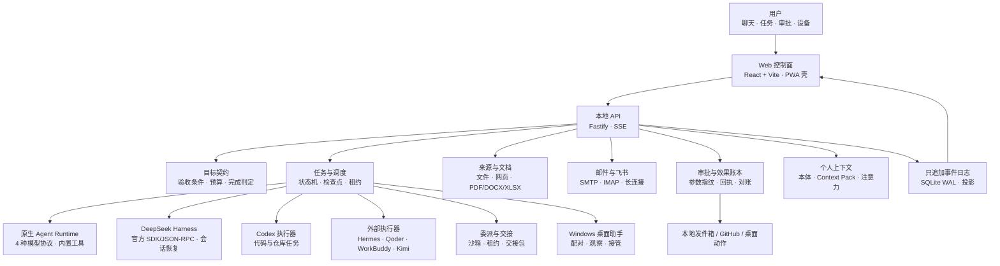

<p align="center">
  <picture>
    <source media="(prefers-color-scheme: dark)" srcset="docs/public/brand/hearth-os-logo-reverse.png">
    <source media="(prefers-color-scheme: light)" srcset="docs/public/brand/hearth-os-logo.png">
    
  </picture>
</p>

<p align="center">
  <strong>让数字劳动成为持久、可审计、可恢复的任务</strong><br>
  单用户 · 自托管 · 长期驻留的个人 Agent OS
</p>

<p align="center">
  <a href="https://hearthproject.github.io/hearth-os/"><strong>文档站</strong></a> ·
  <a href="#界面一览">界面截图</a> ·
  <a href="#现在能做什么">能力</a> ·
  <a href="#快速开始">快速开始</a> ·
  <a href="#当前进度">当前进度</a> ·
  <a href="#架构图">架构图</a> ·
  <a href="#验证">验证</a>
</p>

<p align="center">
  
  
  
  
  
</p>

---

Hearth 不是另一个聊天壳，也不是只服务于代码的 Agent。它是一个**以任务为中心的个人控制面**：用户提出意图，系统保存目标、分配执行器、约束权限、记录证据，并在外部动作发生前要求明确审批。

模型可以更换，执行器可以替换，界面可以重写，但任务状态、授权范围、完成证据、产物摘要和外部回执必须留下来。Hearth 要回答的不是“模型能不能写出一段话”，而是“这件事有没有真正完成，失败后能不能接着做，外部动作能不能被核对”。

> **当前状态（2026-11-10）：** 第一阶段 MVP 已验收；第二阶段至第六阶段已形成可运行的代码闭环和自动测试，但尚未完成真实账户、真实设备、真实长期使用和 v1.0 整体验收。本文不把代码闭环写成产品验收完成。

## 界面一览

<p align="center">
  
  <br>
  <sub>聊天工作台：一句意图即可生成任务提案；执行器、阶段、Token、耗时与审批入口都在同一处。</sub>
</p>

<table>
  <tr>
    <td width="50%" valign="top">
      
      <p align="center"><sub><strong>任务列表</strong><br>运行中、等待审批、已完成与需要处理的任务一屏可读。</sub></p>
    </td>
    <td width="50%" valign="top">
      
      <p align="center"><sub><strong>任务详情</strong><br>目标、验收条件、执行器、预算、证据、产物和最终结果完整留档。</sub></p>
    </td>
  </tr>
  <tr>
    <td width="50%" valign="top">
      
      <p align="center"><sub><strong>需要你</strong><br>主动建议进入收件箱，可以接受、忽略、稍后提醒或转为任务。</sub></p>
    </td>
    <td width="50%" valign="top">
      
      <p align="center"><sub><strong>记忆</strong><br>记忆候选、来源、可信度、召回、纠正、遗忘与导出都有明确边界。</sub></p>
    </td>
  </tr>
  <tr>
    <td colspan="2" align="center">
      
      <p align="center"><sub><strong>设置与执行器</strong><br>统一管理模型档案、执行器安装、健康检测、协议兼容与默认路由。</sub></p>
    </td>
  </tr>
</table>

## 现在能做什么

| 能力 | 当前实现 |
|---|---|
| **目标契约与完成判定** | 目标保存验收条件、约束、禁止动作、证据要求、预算、截止时间、停止条件和复核策略；完成判定支持命令、文件、schema、Git、人工和模型复核，结果以证据报告保存，不能只凭模型说“完成” |
| **聊天优先的控制面** | React + Vite 单页应用，对话中生成任务提案；任务详情展示执行器、阶段、Token、耗时、验收条件、证据、产物与最终结果；`Ctrl/Command + K` 快速跳转页面和任务 |
| **原生 Agent Runtime** | 自研单 Agent 工具循环，支持 OpenAI Chat、OpenAI Responses、Anthropic Messages、Gemini 四种协议；预算、检查点、暂停补问、恢复和产物校验在同一条链路内 |
| **七个执行器** | 三个一等执行器（`deepseek-harness`、`codex`、`native`）和四个外部执行器（`hermes`、`qoder`、`workbuddy`、`kimi`）共用注册表、启动解析、健康检测、模型绑定、上下文采集和设置界面 |
| **统一模型注册表** | SQLite 模型档案与执行器绑定取代私有 JSON；各执行器按协议兼容性选择模型，Codex 固定使用 OpenAI Responses，本地模型不进入统一管理 |
| **持久任务执行** | 状态机、预算、检查点、等待输入、恢复与重试；只追加 SQLite 事件日志保存全部事实；运行中可“轮后继续”或中止当前轮并带补充重跑 |
| **委派、交接与沙箱** | 单层持久委派任务通过调度器推进，保留预算、工作区策略、租约和失败状态；执行器交接包带目标、下一步、验收项、证据、权限子集和上下文水位；沙箱检查路径、网络、进程和凭据边界 |
| **审批与回执** | 外部动作先生成预览，一次性审批绑定动作参数指纹；批准后由效果账本执行并留下回执；拒绝、过期、复用和参数变化都会失效；不确定效果进入显式对账队列 |
| **个人上下文与注意力** | 实体、别名、关系、状态、决定和承诺组成个人本体；Context Broker 按 `must_know`、`relevant`、`recallable`、`omitted` 组装上下文；标准意图、心跳和注意力预算共同决定何时打扰 |
| **首次运行与导航** | 全新实例四步向导：服务商选择、连接测试、聊天模型保存、原生执行器绑定；主导航暴露聊天、任务、需要你、记忆、技能、定时任务、邮件、设备和设置 |
| **飞书消息入口** | 企业自建应用长连接、open_id 白名单、文本/图片/文件消息、任务状态、审批摘要与 `/approve`、`/reject` 文本命令；入站消息带幂等记录，不需要公网回调 |
| **邮件工作台** | SMTP 发送复用审批与效果账本，批准后发送并保存回执；IMAP 只读同步最近邮件到来源，不标记已读；账户和口令加密保存 |
| **定时任务与技能** | 有界补跑、失败冷却、定时触发、任务模板、技能页面与可复用方法；技能包支持导出、导入、权限范围、归档、恢复和过期清理回退 |
| **来源与文档** | 本地文件、知识库、公开网页，以及 TXT/Markdown/CSV/JSON/HTML/PDF/DOCX/XLSX 文本提取 |
| **Windows 桌面控制** | 六位配对码、逐项能力审批、截图观察、暂停/接管/交还、低风险点击输入与 UIAutomation |
| **主动服务与记忆** | 主动触发器、主动收件箱、注意力评分与反馈、噪音预算；记忆候选、来源与可信度、召回、纠正、合并、遗忘传播与导出 |
| **方法进化** | 从终态任务轨迹生成候选方法，记录基线/试跑证据，评估、晋升、拒绝、回退，并可导出为技能包 |
| **多设备与安全** | 事件增量同步、对端认证、任务租约与 epoch fencing、设备撤销、令牌轮换、全局 kill switch；连接运行时用 generation 隔离旧写、离线 outbox 和缓存投影 |
| **备份与运维** | AES-256-GCM 加密备份与回滚式恢复、健康快照、周期维护、脱敏诊断 |
| **移动端壳与 PWA** | 可安装 Manifest、应用图标、移动底部导航和离线应用壳；尚未完成 iOS/Android 真机安装、手机配对、系统推送和远程接管验收 |

## 当前进度

Hearth 已经越过**第一阶段（MVP）**的硬门槛：15 个跨行业真实任务全部执行，13 个通过验收。阶段二至六已经形成可运行的代码闭环与自动测试，但**尚未完成真实用户、真实设备和长期运行验收**，因此不宣称整体交付。

| 阶段 | 状态 | 已经跑通 | 仍然留空 |
|---|---|---|---|
| 一 · 最小完整 MVP | **已验收** | 15 项任务、13 项通过；任务、审批、产物、恢复、备份闭环 | T07 未交付 PR；T08 外部评论等待用户批准 |
| 二 · 日常内容工作 | 部分完成 | 来源、提取、草稿、审批、本地发件箱；SMTP 真实发送与 IMAP 只读同步代码闭环 | 真实邮件账户、退信与垃圾邮件语义未验收；日历账户未接入；邮件附件 UI 未实现 |
| 三 · 桌面操作 | 部分完成 | Windows 配对、观察、接管、低风险输入、UIA 动作、动作绑定当前观察帧 | 敏感区域遮罩、隔离桌面、高风险补偿未实现 |
| 四 · 主动服务与手机 | 部分完成 | 触发器、收件箱、注意力预算、应用内通知、飞书长连接与文本审批；可安装 PWA 壳和移动底部导航 | 真实飞书租户、iOS/Android 真机安装、手机配对、系统推送、远程接管未验收 |
| 五 · 记忆与进化 | 部分完成 | 记忆来源/可信度/合并/遗忘传播/导出、方法评估/晋升/回退；持久委派、可审阅交接与沙箱边界代码闭环 | 真实长期使用、错误记忆/错误方法演练、方法采用前后的生产对照未完成 |
| 六 · 多设备与长期运行 | 部分完成 | 增量同步、租约、撤销、令牌轮换、加密备份、健康维护；连接运行时 generation、离线 outbox 与缓存投影 | 真实双设备切换、真实远程节点、断网恢复、设备丢失演练、数周运行未完成 |

逐项能力矩阵、验证证据和未完成验收见[阶段二至六交付状态](https://hearthproject.github.io/hearth-os/delivery/status.html)。

## 架构图

[](https://media.githubusercontent.com/media/hearthproject/hearth-os/main/assets/Hearth-Architecture-Light.png)

<sub>当前架构：单进程 Fastify 控制平面 + SQLite 事件账本 + 可插拔执行器；覆盖触点与入口、本地控制平面、执行平面、事实层及边界约束。点击图片可查看原图。</sub>

### 运行时数据流

[](https://media.githubusercontent.com/media/hearthproject/hearth-os/main/assets/Hearth-Flow-Light.png)

<sub>一条请求从聊天、飞书、定时任务、主动建议或邮件进入，经 planExecution 与 decideRoute 分流；任务以 lease + epoch 调度，执行中可等待输入或审批，外部副作用只在审批后发生，最终经 SQLite 事件账本、SSE 与前端缓存投影回界面。点击图片可查看原图。</sub>

同一流程的 Mermaid 版本：



评测 Agent 已拆分到独立仓库 **<https://github.com/hearthproject/hearth-eval>**。评测前端、评测服务、评测核心、case、场景运行器和评测文档都在该仓库维护；主仓库只保留 `/api/eval/tasks`、`/api/eval/judge`、`HEARTH_EVAL_INPUT_ROOT` 与 `.hearth/eval-artifacts/` 这组最小桥接。

核心约束只有一句话：**界面状态来自可重建的记录，每个状态只有一个写权威，外部副作用必须经过审批或明确豁免，并留下可核对回执。**

## 快速开始

要求 **Node.js 22.13+**（服务端使用内置 `node:sqlite`）和 npm。

```bash
git clone https://github.com/hearthproject/hearth-os.git
cd hearth-os
npm ci
npm run dev
```

打开 <http://127.0.0.1:5173>。Vite 会把 `/api` 代理到本机 `127.0.0.1:4317`。

生产式本机运行：

```bash
npm run build
npm start
```

打开 <http://127.0.0.1:4317>。

### 接入模型

在 **设置 → 模型** 中创建模型档案：选择预设服务商（DeepSeek、阿里云百炼、智谱、Kimi、火山方舟、OpenAI、Anthropic、Gemini）或自定义服务，然后在 **设置 → 执行器** 中把档案绑定到执行器。档案保存在 `.hearth/hearth.sqlite`，API Key 通过本机 `.hearth/master.key` 以 AES-256-GCM 加密，设置页只显示掩码。本地模型地址不进入统一管理。

### 使用 Codex

Codex 执行器优先使用统一模型绑定；没有绑定时读取现有的 `~/.codex/config.toml`。绑定会生成隔离的 `.hearth/executors/codex/config.toml`，固定 `wire_api = "responses"` 并通过环境变量注入密钥，因此 Codex 只能使用 OpenAI Responses 协议。配置了 `model_provider` 和对应 `env_key` 时不需要 `codex login`。设置页会显示当前 Provider、模型和认证来源。

### 使用更多执行器

在 **设置 → 执行器** 中统一完成安装、健康检测、命令或脚本路径、并发数和模型绑定。对话输入框只有一个执行器选择器：对话级选择覆盖全局默认执行器；当选择被关闭、不可用、缺少任务能力或没有有效模型绑定时，路由先回到任务匹配的执行器，再寻找其他可用项。

| 执行器 | Hearth 如何接入 |
|---|---|
| `native` | 内置；使用当前聊天模型或自己的模型绑定 |
| `deepseek-harness` | 官方 `@deepseek-ai/dsh-sdk-client` SDK/JSON-RPC；原生工具、会话恢复和完整事件流 |
| `codex` | 统一 Responses 模型绑定，或现有 Codex Profile 与认证 |
| `hermes` | `PATH` 中的 `hermes` 命令，或设置中的自定义命令 |
| `qoder` | 托管安装 `@qoder-ai/qoder-agent-sdk`；复用本机 qodercli 登录或 PAT |
| `workbuddy` | 托管安装 `@tencent-ai/codebuddy-code`；复用本机 CodeBuddy/WorkBuddy 登录 |
| `kimi` | 托管安装 `@moonshot-ai/kimi-code`；以 stream-json 非交互模式运行 |

托管包和执行器运行目录位于 `.hearth/executors/<id>/`。模型档案、执行器绑定、目标契约、默认路由和任务状态保存在 SQLite；旧 `.hearth/model-settings.json` 与 `.hearth/executor-settings.json` 会在启动时导入，备份到 `.hearth/backups/legacy-dev/` 后保留为迁移来源。

## 数据与备份

| 路径 | 内容 |
|---|---|
| `.hearth/hearth.sqlite` | 任务、目标、运行、审批、效果、对账、记忆、方法、技能、同步、连接、上下文、设置、模型档案与事件 |
| `.hearth/master.key` | 本机 AES-256-GCM 密钥，用于加密设置字段 |
| `.hearth/context/blobs/` | 超过内联阈值的上下文正文，以 SHA-256 命名 |
| `.hearth/executors/` | 托管执行器安装目录与隔离的 Codex/DeepSeek Harness 运行目录 |
| `.hearth/workspaces/` | 隔离的任务工作区与检查点 |
| `.hearth/artifacts/` | 受管产物 |
| `.hearth/outbox/` | 本地发件箱与回执 |
| `.hearth/backups/` | 加密备份归档与旧设置迁移备份 |
| `.hearth/eval-artifacts/` | 独立评测 Agent 经桥接写入的受管评测产物 |

服务端提供 AES-256-GCM 加密备份创建与恢复，恢复前校验 schema 与 `integrity_check`。聊天优先界面暂未接回备份入口，具体边界见[存储与上下文架构](https://hearthproject.github.io/hearth-os/design/storage.html)。备份包含数据库与必要元数据，但**不包含产物正文、工作区、来源正文和外部附件**；完整归档需要一并复制 `.hearth/artifacts/`、`.hearth/workspaces/` 和可选的 `.hearth/eval-artifacts/`。评测数据库、case 和场景证据由独立评测仓库管理。

## 仓库结构

```text
apps/
  server/              Fastify API、调度器、目标与完成判定、审批、来源、桌面、记忆、邮件、同步、连接、备份与运维
  web/                 React + Vite 聊天优先控制面与 PWA 壳
packages/
  core/                状态机、领域类型与 DTO
  eventlog/            只追加 SQLite 事件日志与投影
  agent-runtime/       原生单 Agent 工具循环、预算、检查点与压缩
  codex-executor/      Codex SDK 适配器与 Provider 探测
  deepseek-executor/   DeepSeek Harness SDK/JSON-RPC 适配器
  templates/           任务模板与产品示例输入
docs/                  中英双语 VitePress 文档站
tools/windows-helper/  Windows 桌面观察与输入助手
scripts/               文档、交付数据、E2E 与 README 截图辅助脚本
```

## 文档

完整文档发布在 **<https://hearthproject.github.io/hearth-os/>**。中文是默认语言，每个页面都有英文镜像。

- [产品设计](https://hearthproject.github.io/hearth-os/design/) — 产品定位、任务链路、技术选型与模块边界。
- [目标、完成判定与证据](https://hearthproject.github.io/hearth-os/design/goals-and-evidence.html) — 目标契约、预算、停止条件、验证器和完成报告。
- [委派、交接与沙箱](https://hearthproject.github.io/hearth-os/design/delegation-and-sandbox.html) — 单层持久委派、交接包、租约、路径/网络/凭据边界。
- [个人上下文与注意力](https://hearthproject.github.io/hearth-os/design/personal-context.html) — 个人本体、Context Pack、记忆召回、标准意图和打扰预算。
- [存储与上下文](https://hearthproject.github.io/hearth-os/design/storage.html) — SQLite 数据域、上下文生命周期、备份与恢复边界。
- [交付与进度](https://hearthproject.github.io/hearth-os/delivery/) — 已验收能力、明确留空项与剩余路线。
- [阶段二至六状态](https://hearthproject.github.io/hearth-os/delivery/status.html) — 当前能力矩阵、验证证据与未完成验收。
- [开发日志](https://hearthproject.github.io/hearth-os/log/day-07.html) — 最近的目标判定、委派、个人上下文与评测拆分记录。
- [评测 Agent（独立仓库）](https://hearthproject.github.io/hearth-eval/) — 场景、case、独立控制台、全周期轨迹、评分、复核与对比。
- [参考](https://hearthproject.github.io/hearth-os/reference/) — 工程、风险、决策、术语、清单与维护资料。

## 已知边界

- 邮件默认写本机发件箱；配置 SMTP 账户后可提交真实发送审批，但真实账户、退信和垃圾邮件语义尚未人工验收。日历账户未接入，邮件附件 UI 未实现。
- Windows 助手只支持同机、前台聚焦操作；敏感区域遮挡、隔离桌面和高风险动作补偿尚未实现。当前本地沙箱是路径、网络和进程策略检查，不是强隔离容器或虚拟机。
- 飞书长连接提供手机消息与文本审批，但不是手机 PWA、系统级推送或完整远程接管；页面关闭后不会推送。
- PWA 壳、移动底部导航和离线应用壳已存在，但手机配对、iOS/Android 真机安装、系统推送和远程接管未验收。
- 多设备同步只同步过滤后的事件投影，不同步产物正文、工作区或敏感记忆；连接运行时也未接入真实远程节点或手机。
- 当前主导航暴露聊天、任务、需要你、记忆、技能、定时任务、邮件、设备和设置；同步、安全、运维仍有 API 与页面组件，但尚未全部接回主导航。
- 评测 case、场景和实验已迁到独立仓库；主仓库的测试不代表真实评测实验已经运行。
- 这是一个阶段一已验收、阶段二至六部分完成的工作版本，不是 v1.0 正式发布。

## 验证

2026-11-10 在当前分支运行：

```bash
npm test              # 89 个测试文件、579 个测试全部通过
npm run typecheck     # TypeScript 类型检查
npm run build         # 构建 Web 控制面
npm run docs:build    # 构建 VitePress 文档站
npm run test:e2e      # 浏览器 E2E；使用隔离数据目录
npm run screenshots:readme  # 重新生成 README 与文档站截图
```

E2E 会在随机本地端口启动服务，并使用临时 `HEARTH_DATA_DIR`，不会触碰真实 `.hearth` 数据。可用 `HEARTH_E2E_MODEL_SETTINGS` 指定其他模型配置，`HEARTH_E2E_OFFLINE=1` 跳过在线聊天，`HEARTH_E2E_KEEP=1` 保留临时数据用于排查。

测试覆盖服务层、API、模型协议、原生工具循环、预算、权限、检查点、目标契约、完成判定、审批参数绑定、效果对账、执行器交接、委派、沙箱、记忆/技能治理、个人本体、Context Broker、标准意图、注意力、连接运行时、桌面边界、同步与备份。测试通过不等于真实验收完成；阶段一逐项证据见 [hearth-eval 的第一阶段验收报告](https://github.com/hearthproject/hearth-eval/blob/main/eval/phase-1-acceptance.md)。

## 许可

Apache-2.0。见 [LICENSE](LICENSE)。
