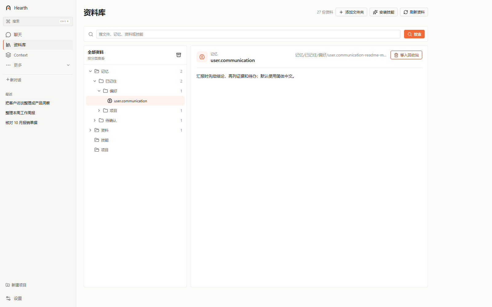
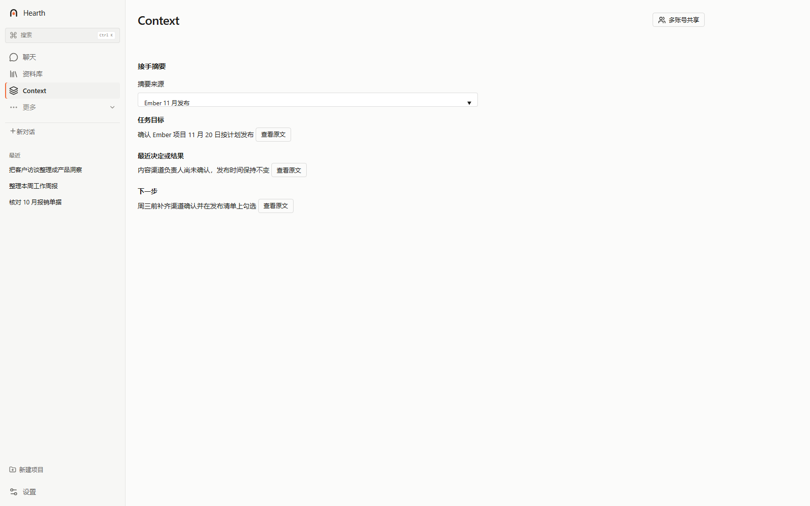
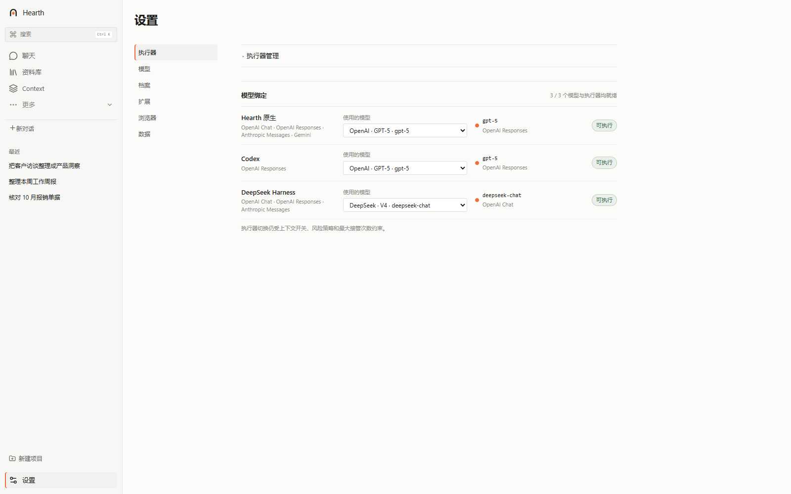
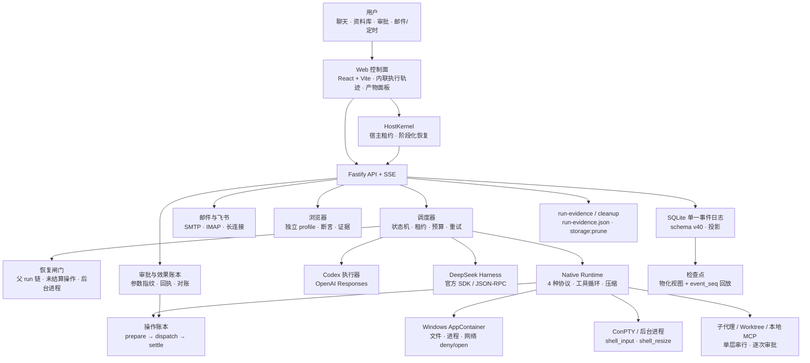

<p align="center">
  <picture>
    <source media="(prefers-color-scheme: dark)" srcset="docs/public/brand/hearth-os-logo-reverse.png">
    <source media="(prefers-color-scheme: light)" srcset="docs/public/brand/hearth-os-logo.png">
    
  </picture>
</p>

<p align="center">
  <strong>让数字劳动成为持久、可审计、可恢复的任务</strong><br>
  单用户 · 自托管 · 长期驻留的个人 Agent OS
</p>

<p align="center">
  <a href="https://hearthproject.github.io/hearth-os/"><strong>文档站</strong></a> ·
  <a href="#界面一览">界面截图</a> ·
  <a href="#现在能做什么">能力</a> ·
  <a href="#快速开始">快速开始</a> ·
  <a href="#当前进度">当前进度</a> ·
  <a href="#架构图">架构图</a> ·
  <a href="#验证">验证</a>
</p>

<p align="center">
  
  
  
  
  
  
</p>

---

Hearth 不是另一个聊天壳，也不是只服务于代码的 Agent。它是一个**以任务为中心的个人控制面**：用户提出意图，系统保存目标、分配执行器、约束权限、记录证据，并在外部动作发生前要求明确审批。

模型可以更换，执行器可以替换，界面可以重写，但任务状态、授权范围、完成证据、产物摘要和外部回执必须留下来。Hearth 要回答的不是“模型能不能写出一段话”，而是“这件事有没有真正完成，失败后能不能接着做，外部动作能不能被核对”。

> **当前状态（2026-11-23，v0.3.4）：** 本版是 0.3.x 的稳定性加固：工具副作用拆成业务结算与物理清理两条账，恢复闸门沿父 run 链拒绝重放未知副作用；服务端只写 SQLite 事件日志；`HostKernel` 管理宿主租约与阶段化恢复；Windows 改用 AppContainer 原生沙箱并支持 ConPTY 交互式 shell 与持久后台进程；新增 `run-evidence.json`、存储回收和 18 个崩溃点的长跑矩阵。验证：typecheck 0 错误、140 个测试文件 931 通过（946 总数，15 跳过）、长跑 18/18；0.3.4 NSIS 安装包（30.5 MiB）与便携 zip（47.2 MiB）已作为 [GitHub Pre-release](https://github.com/hearthproject/hearth-os/releases) 发布。自动更新签名、Authenticode、干净机卸载重装、真实账户与真实模型首跑仍未验收。逐项证据见[当前交付状态](https://hearthproject.github.io/hearth-os/delivery/status.html)。

## 界面一览

<p align="center">
  
  <br>
  <sub>聊天工作台：执行轨迹以运行卡内联在对话里，展开即可看到每一步工具与产物；右侧“对话产物”按需展开，文件可直接预览。</sub>
</p>

<table>
  <tr>
    <td width="50%" valign="top">
      
      <p align="center"><sub><strong>资料库</strong><br>文件、记忆、资料和技能在一个树里；检索、预览、回收站都在同一页。</sub></p>
    </td>
    <td width="50%" valign="top">
      
      <p align="center"><sub><strong>Context 交接</strong><br>从记忆里生成接手摘要、原记录与压缩包，交给下一个执行者或账号。</sub></p>
    </td>
  </tr>
  <tr>
    <td colspan="2" align="center">
      
      <p align="center"><sub><strong>设置与执行器</strong><br>左侧只做分区；执行器健康、模型绑定、浏览器、扩展和数据页都在右侧一栏。</sub></p>
    </td>
  </tr>
</table>

## 现在能做什么

| 能力 | 当前实现 |
|---|---|
| **聊天优先的控制面** | React + Vite 单页应用；对话常驻左侧，任务以运行卡内联在对话时间线，展开后显示叙述、工具、命令、文件与结算状态；右侧“对话产物”按需展开产物、后台任务和附件，支持文本、Markdown、代码、JSON/CSV、图片与 PDF 预览 |
| **持久任务与恢复** | `HostKernel` 持有单实例宿主租约，按 `lease → store → operations → runs → tasks → background → ready` 阶段启动；恢复完成前 `/api/ready` 返回 503、写路由返回 `HOST_NOT_READY`；工具调用走 `prepare → dispatch → settle` 操作账本，未结算操作在下一进程拒绝自动重放 |
| **单一事实源** | 服务端不再写 JSONL journal，消息、工具结算、检查点与 run 边界统一写入 SQLite `events`（schema v40）；checkpoint 文件降级为物化视图，损坏时从事件按 `event_seq` 回放重建 |
| **Windows 原生沙箱** | `apps/native/hearth-native.cs` 编译为 `hearth-native.exe`：AppContainer package SID、workspace/temp ACL 白名单、kill-on-close Job Object、父进程 watchdog；网络只支持显式 `deny` / `open`，声明域名白名单或 helper 缺失时 fail-closed；越界写、只读、junction 逃逸、密钥过滤和网络拒绝都有真实测试 |
| **交互式 shell 与后台进程** | `shell` 支持 `pty: true` 与 `cols` / `rows`，经 ConPTY 在 AppContainer 内运行；`shell_input` / `shell_resize` 可输入与调整终端；每个会话写入 SQLite `background_processes`，重启时按 PID + 创建时间判定，活的杀进程树、复用的只标 `lost` |
| **审批模式** | `necessary`、`workspace`、`full` 三档；工作区内可逆文件写入自动执行，shell、删除、邮件、桌面、陌生域名和支付/提交类动作仍需审批；参数指纹绑定一次性授权 |
| **三个执行器** | 内置 `native`，以及 `codex`、`deepseek-harness` 两个官方 SDK 执行器；共用注册表、健康检测、模型绑定和设置界面，失败后不静默互换 |
| **统一模型注册表** | SQLite 模型档案与执行器绑定取代私有 JSON；支持 OpenAI Chat、OpenAI Responses、Anthropic Messages、Gemini 四种协议；API Key 经 `.hearth/master.key` 以 AES-256-GCM 加密 |
| **项目、子代理与 MCP** | 项目可以是任意本地文件夹：Git 仓库自动使用独立 `hearth/<task-id>` Worktree，普通文件夹原地执行并给出改动清单；子代理使用新上下文、只读或隔离写、单层串行且最多两个；本地 stdio MCP 支持启动探测、工具发现、Schema 校验、逐次审批、超时和崩溃隔离 |
| **浏览器自动化** | 独立 Chrome profile、多标签页、页面元素快照与稳定 ID、13 个浏览器工具；提交/上传/下载逐次审批，动作前后截图与页面摘要进入证据目录；完成前必须有通过的页面断言；不读取 cookie 或密码 |
| **资料库与记忆** | 文件、记忆、资料和技能统一成树；支持检索、预览、回收站恢复；记忆有候选、来源与可信度、召回、纠正、遗忘传播与导出，可关闭自动记录 |
| **Context 交接** | 从活跃记忆生成接手摘要（目标、最近决定、下一步）与原文打包，可导出 zip 给下一个人或账号；多账号共享视图单独列出全部记忆与交接范围 |
| **邮件与定时任务** | SMTP 发送复用审批与效果账本，批准后发送并保存回执；IMAP 只读同步最近邮件到来源，不标记已读；定时任务有有界补跑、失败冷却和直接使用自定义输入 |
| **飞书消息入口** | 企业自建应用长连接、open_id 白名单、文本/图片/文件消息、任务状态、审批摘要与 `/approve`、`/reject` 文本命令；入站消息带幂等记录，不需要公网回调 |
| **档案与工作方式** | 每个项目编译 `PROJECT.md`（栈、命令、约定、决策、未完成任务、坑）；`WORKSTYLE.md` 记录沟通、提交、验证和工具偏好；只注入 coding 任务 |
| **上下文与办公产物** | 模型窗口默认 128K、最大输出默认 8K；只在完整回合边界做 Token 感知压缩，压缩后写检查点；可生成 XLSX/CSV/DOCX；Shell 完整输出写入任务日志、只回填尾部并杀死超时进程树 |
| **桌面、移动与开机体验** | Tauri 桌面壳内置 Node 与全部服务端功能，关窗隐藏到托盘，托盘菜单负责退出、体检、桌面助手和目录；Windows 桌面助手支持配对码、逐项能力审批、截图观察、暂停/接管与 UI 自动化；PWA 壳和移动底部导航已存在，真机安装与远程接管未验收 |
| **备份与运维** | AES-256-GCM 加密备份与回滚式恢复、健康快照、周期维护、脱敏诊断、全局 kill switch；`npm run storage:prune` 默认预演，按保留期、活跃 run、未结算操作和 checkpoint 引用回收旧 run 与未引用工具输出 |

## 当前进度

2026-11 这一版不再扩展新概念，而是把执行链收紧成可恢复、可核对、可回收的闭环：

| 领域 | 状态 | 证据 | 留空 |
|---|---|---|---|
| 运行时稳定 | 完成 | 140 个测试文件、931 个用例通过；长跑矩阵 18/18；每个终态 run 输出 `run-evidence.json` | 真实用户长期崩溃恢复演练 |
| Windows 沙箱 | 代码闭环 | 12 项真实测试：越界写、只读、junction 逃逸、密钥过滤、网络拒绝、PTY 与 Job 关闭 | 非管理员环境之外的发行版验证、企业策略兼容 |
| 持久后台任务 | 完成 | SQLite `background_processes`、PID + 创建时间恢复、`lost` 标记与进程树清理 | 跨宿主重启的终端状态恢复（明确不做） |
| 浏览器 | 代码闭环 | 13 个工具、独立 profile、证据目录与页面断言 | 日常 Chrome 扩展桥、验证码/风控站点 |
| 首跑与更新 | 代码闭环 | `npm run first:run`、0.3.4 安装包与便携 zip、SHA256 校验 | 自动更新签名、Authenticode、干净机卸载重装 |
| 资料库与 Context | 完成 | 树、检索、预览、回收站；接手摘要与导出 | 真实长期写作/编码使用 |
| 工程门禁 | 完成 | typecheck、CI 分层、commitlint、husky、PR 模板、文档构建 | 分支保护与远端 CI 实际运行记录 |

历史阶段一至六的路线和 Native 30 题评测保留在文档站，但部分描述已被当前范围收缩取代。逐项能力矩阵、验证证据和未完成验收见[当前交付状态](https://hearthproject.github.io/hearth-os/delivery/status.html)与[2026-11 验收报告](https://hearthproject.github.io/hearth-os/delivery/acceptance-2026-11.html)。

## 评测结果

评测栈已拆分到独立仓库 **<https://github.com/hearthproject/hearth-eval>**。主仓库不再保留评测桥接，case、实验编排、评分、复核、对比和控制台都由评测仓库维护。

2026-11-11 至 11-12 使用 30 个离线 case（8 个任务族均匀分布）、仅 `native` 执行器、重复 1 次、自动评分与自动重试开启、并发 4 进行测量：

| 指标 | 结果 |
|---|---:|
| 最好完整单轮 | **18/30 通过（60%）**，平均分 88.89，实验 `EXP-20261111145332-7a95ea` |
| 累计定向确认 | **19/30** 个 case 曾达到 100 分；不是一次连续实验 |
| 最近完整单轮 | 12/30 通过（40%），平均分 73.33，实验 `EXP-20261112003215-b1172b` |
| 11 月 12 日报告的修复提交 | `eb32ad5`；尚未做不中断的完整 30 题复测 |

最近完整单轮受到 provider 慢响应、评分 JSON 截断和任务超时影响，且早于最后四个归一化修复，不能直接等同于最终代码能力。CAL01、WEB01 等 case 还存在输入与评分 rubric 的语义歧义；T02、T11、WEB03 虽得到 100 分，但因 `sampled` 标记未计为正式通过。

**2026-11-14 定向验证更新**

| 验证范围 | 结果 |
|---|---|
| Native 审批、动作绑定、调度与工具循环 | 5 个测试文件，**106/106 通过** |
| `action-binding-tamper` 单场景 | **3/3 通过**，覆盖文件变化后撤销审批、拒绝执行和解除 Native 审批等待 |
| 评测控制台自检与批次接口 | 2 个测试文件，**9/9 通过**；评测项目类型检查和前端构建通过 |
| 新一轮 Native 30 题实验 | 待执行，当前可引用的完整实验成绩仍为上表记录 |

详细报告：[最终评测报告](https://hearthproject.github.io/hearth-os/evaluation/native-30-final-report-2026-11-12.html) · [基线报告](https://hearthproject.github.io/hearth-os/evaluation/native-30-baseline-2026-11-11.html) · [评测文档站](https://hearthproject.github.io/hearth-eval/)。

## 架构图

[](https://media.githubusercontent.com/media/hearthproject/hearth-os/main/assets/Hearth-Architecture-Light.svg)

<sub>当前架构：Web 工作台 + HostKernel/Fastify 控制面 + Native Runtime 与三种执行器 + AppContainer 沙箱、ConPTY 后台进程、审批与操作账本 + SQLite 单一事件日志和本地文件。点击图片可查看原图。</sub>

### 运行时数据流

简化版：

[](https://media.githubusercontent.com/media/hearthproject/hearth-os/main/assets/Hearth-Flow-Simple-Light.svg)

<sub>简化版：说清目标、在安全范围内动手、自己验证、交给你决定；结果里能看到文件改动、测试、页面断言、结算状态和回退入口。点击图片可查看原图。</sub>

详细版：

[](https://media.githubusercontent.com/media/hearthproject/hearth-os/main/assets/Hearth-Flow-Light.svg)

<sub>详细版：目标契约 → 执行器与权限 → AppContainer 沙箱 → 操作账本 → 工具执行 → 测试/页面断言 → 结算与清理 → run-evidence。失败保留原因并进入可恢复状态，不覆盖历史。点击图片可查看原图。</sub>

同一流程的 Mermaid 版本：



评测 Agent 已拆分到独立仓库 **<https://github.com/hearthproject/hearth-eval>**。评测前端、评测服务、评测核心、case、场景运行器和评测文档都在该仓库维护；主仓库不再注册任何评测路由。

核心约束只有一句话：**界面状态来自可重建的记录，每个状态只有一个写权威，外部副作用必须经过审批或明确豁免，并留下可核对回执。**

## 快速开始

要求 **Node.js 22.13+**（服务端使用内置 `node:sqlite`）和 npm。

```bash
git clone https://github.com/hearthproject/hearth-os.git
cd hearth-os
npm ci
npm run dev
```

打开 <http://127.0.0.1:5173>。Vite 会把 `/api` 代理到本机 `127.0.0.1:4317`。

生产式本机运行：

```bash
npm run build
npm start
```

打开 <http://127.0.0.1:4317>。

### Windows 桌面版

```powershell
npm ci
npm run tauri:build
```

生成 `release\Hearth_0.3.4_x64-setup.exe`（NSIS 按用户安装，免 UAC，安装到 `%LOCALAPPDATA%\Programs\Hearth`）。安装后双击开始菜单的 Hearth 即可；关窗会隐藏到托盘，托盘菜单负责退出、环境体检、桌面助手、数据目录和日志目录。首次启动会让你选择现有 `.hearth` 或新建数据目录。也可以直接从 [GitHub Releases](https://github.com/hearthproject/hearth-os/releases) 下载同一个安装包或便携 zip，下载后用 `SHA256SUMS.txt` 核对。

桌面版只保留 Tauri 实现：内置官方 Node 22.23.2、npm 10.9.8 和全部服务端功能，0.3.4 安装包 30.5 MiB、便携包 47.2 MiB。Codex 使用系统中的 `codex.exe`，不内置 479 MiB 平台二进制。

构建、体积、数据目录、日志、托盘、环境体检和已知限制见 [docs/design/desktop.md](docs/design/desktop.md)；从 Electron 到约 131 MiB 的完整压缩过程、体积去向和使用前提见 [docs/design/desktop-compression.md](docs/design/desktop-compression.md)。

### 接入模型

在 **设置 → 模型** 中创建模型档案：选择预设服务商（DeepSeek、阿里云百炼、智谱、Kimi、火山方舟、OpenAI、Anthropic、Gemini）或自定义服务，然后在 **设置 → 执行器** 中把档案绑定到执行器。档案保存在 `.hearth/hearth.sqlite`，API Key 通过本机 `.hearth/master.key` 以 AES-256-GCM 加密，设置页只显示掩码。本地模型地址不进入统一管理。

### 验证首跑

模型配置完成后，跑一次最小真实任务确认整条链路可用：

```bash
npm run first:run            # 用你配置的模型：读文件 → 写答案 → 跑测试
npm run first:run -- --fake  # 离线自检脚本自身，不涉及模型
```

退出码 `0` 通过、`1` 任务失败、`2` 环境问题（服务未启动、模型未配置等）。详见[首次运行验证](https://hearthproject.github.io/hearth-os/reference/first-run.html)。

### 使用 Codex

Codex 执行器优先使用统一模型绑定；没有绑定时读取现有的 `~/.codex/config.toml`。绑定会生成隔离的 `.hearth/executors/codex/config.toml`，固定 `wire_api = "responses"` 并通过环境变量注入密钥，因此 Codex 只能使用 OpenAI Responses 协议。配置了 `model_provider` 和对应 `env_key` 时不需要 `codex login`。设置页会显示当前 Provider、模型和认证来源。

### 使用执行器

在 **设置 → 执行器** 中完成健康检测、并发数和模型绑定。对话输入框只有一个执行器选择器：对话级选择覆盖全局默认执行器；当选择被关闭、不可用、缺少任务能力或没有有效模型绑定时，路由回到任务匹配的执行器，再寻找其他可用项。

| 执行器 | Hearth 如何接入 |
|---|---|
| `native` | 内置；使用当前聊天模型或自己的模型绑定 |
| `deepseek-harness` | 官方 `@deepseek-ai/dsh-sdk-client` SDK/JSON-RPC；原生工具、会话恢复和完整事件流 |
| `codex` | 统一 Responses 模型绑定，或现有 Codex Profile 与认证 |

模型档案、执行器绑定、默认路由和任务状态保存在 SQLite；旧 `.hearth/model-settings.json` 与 `.hearth/executor-settings.json` 会在启动时导入，备份到 `.hearth/backups/legacy-dev/` 后保留为迁移来源。

## 数据与备份

| 路径 | 内容 |
|---|---|
| `.hearth/hearth.sqlite` | 任务、运行、审批、效果、对账、记忆、上下文、设置、模型档案与事件 |
| `.hearth/master.key` | 本机 AES-256-GCM 密钥，用于加密设置字段 |
| `.hearth/context/blobs/` | 超过内联阈值的上下文正文，以 SHA-256 命名 |
| `.hearth/executors/` | 托管执行器安装目录与隔离的 Codex/DeepSeek Harness 运行目录 |
| `.hearth/workspaces/` | 隔离的任务工作区、检查点与 `run-evidence.json` |
| `.hearth/artifacts/` | 受管产物与清单 |
| `.hearth/outbox/` | 本地发件箱与回执 |
| `.hearth/backups/` | 加密备份归档与旧设置迁移备份 |

服务端提供 AES-256-GCM 加密备份创建与恢复，入口在 **设置 → 数据**，恢复前校验 schema 与 `integrity_check`。备份包含数据库与必要元数据，但**不包含产物正文、工作区、来源正文和外部附件**；完整归档需要一并复制 `.hearth/artifacts/` 和 `.hearth/workspaces/`。

长期运行可以用 `npm run storage:prune` 回收旧 run 与未被引用的工具输出：默认只预演并打印计划，`--apply` 才实际删除；保留期、活跃 run、未结算操作和 checkpoint 引用都会 pin 住对象。设置页的数据分区会显示最近一次回收路径。

## 📁 目录结构

```text
hearth-os/
├── apps/                                             # 应用入口
│   ├── server/                                       # Fastify 单进程控制面
│   │   ├── src/                                      # 112 个实现文件；与同名 *.test.ts 并列
│   │   │   ├── index.ts / app.ts                     # 进程入口与 **buildServer** 组装（REST + SSE）
│   │   │   ├── host-kernel.ts / host-lease.ts        # **宿主租约与阶段化恢复**
│   │   │   ├── service.ts / scheduler.ts             # **任务写权威** / 租约、预算、检查点与恢复
│   │   │   ├── run-recovery.ts / run-evidence.ts     # 恢复闸门 / 终态证据导出
│   │   │   ├── sqlite-operation-ledger.ts            # T1/T2 操作账本（SQLite）
│   │   │   ├── sqlite-runtime-journal.ts              # runtime 事件写入单一事件日志
│   │   │   ├── windows-native-sandbox.ts             # AppContainer 沙箱 argv 契约与探测
│   │   │   ├── background-tasks.ts / background-tools.ts  # 后台进程注册表与 shell_output/wait/kill
│   │   │   ├── storage-prune.ts / maintenance.ts      # 存储回收与周期维护
│   │   │   ├── approvals.ts / effects.ts              # 参数指纹审批与效果账本
│   │   │   ├── browser-*.ts                          # 浏览器会话、快照、工具与证据
│   │   │   ├── context*.ts / memory.ts                # 上下文投影与记忆治理
│   │   │   ├── feishu*.ts / email.ts / desktop.ts     # 飞书长连接、邮件与 Windows 桌面边界
│   │   │   ├── mcp-*.ts / subagents.ts                # 本地 stdio MCP 与有界子代理
│   │   │   ├── worktrees.ts / workspace.ts            # 任务隔离 Worktree 与工作区
│   │   │   ├── backups.ts / security.ts               # 加密备份与全局 kill switch
│   │   │   └── *.test.ts                              # 与实现并列的单元与集成测试
│   │   └── package.json                              # @hearth/server：依赖全部 workspace 包
│   ├── web/                                          # React + Vite 聊天优先控制面（PWA）
│   │   ├── src/App.tsx                               # 路由、首跑向导与事件驱动缓存失效
│   │   ├── src/pages/                                # Chat / Library / Context / Mail / Schedules / Settings 等
│   │   ├── src/components/                            # AppShell / InlineRun / ChatWorkspacePanel 等
│   │   ├── src/lib/                                  # api.ts / types.ts / navigation.ts / preview.ts …
│   │   ├── src/styles/                               # 30 个样式文件，按页面与组件拆分
│   │   ├── public/                                   # manifest.webmanifest、sw.js 与 icons/
│   │   └── index.html / vite.config.ts               # SPA 入口与 /api 代理
│   ├── native/                                       # hearth-native.cs → hearth-native.exe（沙箱/PTY/租约）
│   └── desktop-tauri/                                # Tauri 2 桌面壳、托盘与打包资源
├── packages/                                         # 可复用 workspace 包，依赖方向自下而上
│   ├── core/                                         # 领域类型、执行模式与状态机
│   ├── eventlog/                                     # **只追加事件账本**：SQLite WAL 与 schema v40
│   ├── agent-runtime/                                # **通用 Agent 内核**：工具循环、预算、压缩、沙箱契约
│   │   ├── src/harness/                              # 编码 harness：命令策略、快照、hooks、后台任务
│   │   └── src/operations/                           # T1/T2 操作合同与 JSONL 账本
│   ├── codex-executor/                               # Codex 适配器与 Profile 探测
│   └── deepseek-executor/                            # DeepSeek Harness 适配器
├── docs/                                             # 中英双语 VitePress 文档站
│   ├── design/                                       # 模块设计（含沙箱、原生运行时、桌面与压缩）
│   ├── architecture/                                 # 18 篇代码视角架构说明 + index.md
│   ├── delivery/                                     # 六阶段、24 个小阶段与验收状态
│   ├── evaluation/                                   # native 30 题基线与最终报告
│   ├── log/                                          # Day01–Day08 开发日志
│   ├── reference/                                    # 工程、决策、风险、术语与 source-map
│   ├── en/                                           # 部分英文镜像
│   ├── public/                                       # hero、brand/ 与 screenshots/
│   ├── .vitepress/                                   # config.mts、delivery-sidebar.mjs 与主题
│   └── index.md                                      # 文档站首页
├── scripts/                                          # E2E、README 截图、架构图与发版脚本
├── tools/windows-helper/                             # helper.mjs 与 windows.ps1 桌面助手
├── assets/                                           # 架构图与流程图（3 张 SVG）
├── package.json / package-lock.json                  # npm workspaces 与 dev / build / test / docs 脚本
├── tsconfig*.json / vitest.config.ts                 # 类型检查与 Vitest（单测超时 20s）
└── README.md / LICENSE                               # 中文主文档与 Apache-2.0
```

> 运行时数据目录 `.hearth/`（SQLite、密钥、工作区、产物）由程序在本地生成，不纳入版本控制，不在上方仓库结构中。

## 文档

完整文档发布在 **<https://hearthproject.github.io/hearth-os/>**。中文是默认语言，设计、交付、参考与日志的一部分有英文镜像；代码架构板块目前只有中文。

- [代码架构](https://hearthproject.github.io/hearth-os/architecture/) — 完全依据源码整理的架构说明，覆盖服务组装、调度、执行器、上下文、存储、前端与渠道接入。
- [运行时操作账本与宿主生命周期](https://hearthproject.github.io/hearth-os/architecture/runtime-operations.html) — T1/T2、单一事件日志、HostKernel、AppContainer、ConPTY 与后台进程。
- [产品设计](https://hearthproject.github.io/hearth-os/design/) — 产品定位、任务链路、技术选型与模块边界。
- [原生 Agent Runtime](https://hearthproject.github.io/hearth-os/design/native-agent-runtime.html) — 工具循环、权限、委派、MCP、Worktree、检查点与恢复。
- [Native Harness 沙箱](https://hearthproject.github.io/hearth-os/design/sandbox.html) — AppContainer、文件/进程/网络边界、失败语义与已知限制。
- [存储与上下文架构](https://hearthproject.github.io/hearth-os/design/storage.html) — SQLite 数据域、单一事件日志、上下文生命周期与备份边界。
- [数据、备份与运维](https://hearthproject.github.io/hearth-os/design/operations.html) — 备份、恢复、维护、存储回收、诊断和全局停止。
- [浏览器自动化](https://hearthproject.github.io/hearth-os/design/browser.html) — 独立 profile、页面快照、工具、审批、证据和完成断言。
- [日常使用](https://hearthproject.github.io/hearth-os/reference/daily-use.html) — 资料库、Context 交接、定时任务与自用报告。
- [首次运行验证](https://hearthproject.github.io/hearth-os/reference/first-run.html) — 用自己的模型跑一次真实的“读文件 → 跑测试”最小任务。
- [构建、签名与发版](https://hearthproject.github.io/hearth-os/reference/releasing.html) — Tauri 构建、更新签名和发布产物。
- [交付与进度](https://hearthproject.github.io/hearth-os/delivery/) — 历史路线与当前范围。
- [当前交付状态](https://hearthproject.github.io/hearth-os/delivery/status.html) — 当前能力矩阵、验证证据与未完成验收。
- [2026-11 验收报告](https://hearthproject.github.io/hearth-os/delivery/acceptance-2026-11.html) — 测试矩阵、手动检查、留空项和回退。
- [评测与结果](https://hearthproject.github.io/hearth-os/evaluation/) — native 30 题基线、最终报告与评测边界。
- [开发日志](https://hearthproject.github.io/hearth-os/log/day-08.html) — 通用执行内核升级、评测拆分与 native 30 题结果。
- [评测 Agent（独立仓库）](https://hearthproject.github.io/hearth-eval/) — 场景、case、独立控制台、全周期轨迹、评分、复核与对比。
- [参考](https://hearthproject.github.io/hearth-os/reference/) — 工程、风险、决策、术语、清单与维护资料。

## 已知边界

- 自动更新签名、Windows Authenticode、干净机安装/卸载与旧版本升级未验收；安装包首次运行可能触发 SmartScreen。
- Windows 沙箱的 `open` 网络模式只表示“允许出网”，不支持域级白名单；声明 `networkHosts` 会 fail-closed。沙箱是文件/进程/网络边界，不是虚拟机或容器级强隔离。`approvalMode=full` 的对话会把 native 任务显式切到 `danger-full-access` 并跳过沙箱；需要沙箱时使用 `necessary` 或 `workspace`。
- 后台 shell 与 PTY 不跨宿主重启恢复终端状态：重启时统一标记 `lost` 并清理孤儿进程树，不假装会话还在。
- 邮件默认写本机发件箱；配置 SMTP 后可以提交真实发送审批，但真实账户、退信和垃圾邮件语义尚未人工验收。日历账户未接入，邮件附件 UI 未实现。
- Windows 助手只支持同机、前台聚焦操作；敏感区域遮挡、隔离桌面和高风险动作补偿尚未实现。
- 浏览器使用独立 Chrome profile，首次需要在该 profile 内登录站点；没有直接接管默认 Chrome 的 MV3 扩展桥。Chrome 136+ 默认 profile 禁止远程调试。
- 飞书长连接提供手机消息与文本审批，但不是手机 PWA、系统级推送或完整远程接管；页面关闭后不会推送。
- PWA 壳、移动底部导航和离线应用壳已存在，但手机配对、iOS/Android 真机安装、系统推送和远程接管未验收。
- 所有数据、设备与令牌边界都在本机；不提供多设备事件同步或远程节点连接。
- 主导航暴露聊天、资料库、Context 三个主入口；邮件、定时任务和连接收在“更多”；设置固定在底部。
- 真实模型首跑仍取决于本机模型配置和供应商权限；没有可用 key 时只能用 `first:run --fake` 验证脚本自身。
- 评测 case、场景和实验已迁到独立仓库；主仓库不再注册评测桥接，测试不代表真实评测实验已经运行。native 30 题的最终提交 `eb32ad5` 尚未完成连续复测。
- 原生运行时仍不支持远程 MCP、OAuth、图片/扫描件视觉理解、PPTX、LSP、格式化器或自动 cherry-pick。
- cleanup 目前对已登记 shell 进程执行真实终止；subagent/worktree/browser 等资源暂无清理 handler 时会明确记 `failed` 并留下原因。
- 这是 `0.3.4` 预发布版本，以 [GitHub Pre-release](https://github.com/hearthproject/hearth-os/releases) 形式发布，不是 v1.0 正式发布。

## 验证

2026-11-23 的当前结果：

```bash
npm run version:check   # 版本一致：7 个 workspace + Cargo + Tauri + lockfile
npm run typecheck       # 0 error
npm test                # 140 个测试文件、946 个用例（931 通过、15 跳过）
npm run test:longrun    # 18/18 崩溃点与恢复矩阵
npm run build           # Web 构建通过（JS 643.06 kB / CSS 158.97 kB）
npm run docs:build      # 文档构建通过
npm run first:run -- --fake  # 首跑脚本离线自检
npm run storage:prune   # 默认预演（需已有 .hearth 数据目录）
```

E2E 会在随机本地端口启动服务，并使用临时 `HEARTH_DATA_DIR`，不会触碰真实 `.hearth` 数据。可用 `HEARTH_E2E_MODEL_SETTINGS` 指定其他模型配置；`HEARTH_E2E_OFFLINE=1` 跳过在线聊天；`HEARTH_E2E_KEEP=1` 保留临时数据用于排查。

`vitest.config.ts` 将单个测试超时设为 20 秒、hook 超时设为 30 秒，避免 Windows 上 Git、Worktree 和 MCP 探测测试被默认 5/10 秒超时误判。测试通过不等于真实验收完成；逐项证据和留空项见[当前交付状态](https://hearthproject.github.io/hearth-os/delivery/status.html)。

## 许可

Apache-2.0。见 [LICENSE](LICENSE)。

