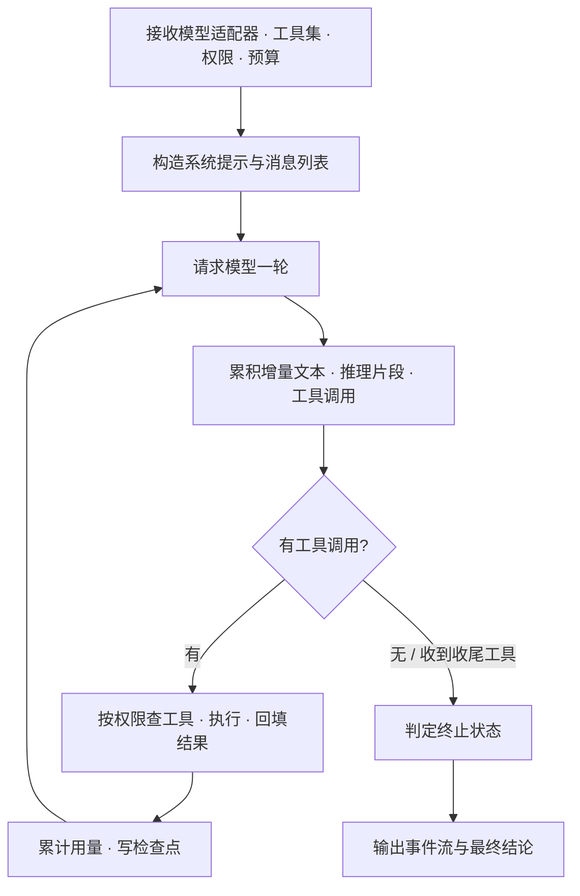

# Hearth OS · Agent 运行时设计说明

> 本文只依据项目源码整理（`packages/agent-runtime/src` 全部文件），未参考 `docs/` 与 `README.md`；文中不列举任何具体代码，括号内的文件名仅用于定位核对。
> 整理日期：2026-11-13

**本文边界（避免与本套其它说明重复）**

| 已讲过的内容 | 在哪份文档 | 本文的处理 |
|---|---|---|
| 「进程内消息压缩」与「上下文账本」是两回事 | [hearth-os-上下文管理设计](./hearth-os-上下文管理设计.md) | 只讲压缩算法本身，不重讲两者的区分 |
| 工具触发审批、向用户提问的下游路由 | [判定审批机制说明](./判定审批机制说明.md) | 只讲工具定义与权限，不重讲审批 |
| 网页抓取与 HTML 净化的完整规则 | [Hearth-数据源与联网设计说明](./Hearth-数据源与联网设计说明.md) | 这里只在工具清单中出现名字，规则交给那篇 |
| 检查点如何被调度器落盘与恢复校验 | [Hearth-任务执行调度器设计说明](./Hearth-任务执行调度器设计说明.md) | 只讲运行时产出什么，不讲落盘 |
| 模型协议与执行器怎么接 | [Hearth-模型接入与执行器适配设计说明](./Hearth-模型接入与执行器适配设计说明.md) | 不展开 |

本文只讲：**这个独立共享包里的「单 Agent 循环」是怎么转的、能用什么工具、被什么约束、怎么防止自己绕圈、怎么压缩记忆**。

---

## 0. 一句话总览

它是一个与服务端完全解耦的纯函数式循环库：给定模型适配器、一组工具、一份权限和一份预算，产出事件流、用量统计与检查点。它自己不碰数据库、不决定任务状态、不知道任务是什么——这些全由调度器负责。

---

## 1. 先定性：三个容易误解的地方

| 误解 | 代码里的实际做法 |
|---|---|
| 以为它是服务端的「运行时框架」 | 它是共享包，不持有任何全局状态；名字相近的服务端 `runtime.ts` 其实是「装 Python/Node 依赖」的脚本编排器，两者毫无关系 |
| 以为工具清单固定可用 | 工具是「恒被定义」但「按权限筛选」的，能不能调用取决于权限里的工具名单 |
| 以为防死循环靠预算配置 | 防绕圈阈值硬编码在循环里，跟外部传入的运行预算是两套东西 |

---

## 2. 主循环：一轮里发生什么

对外发出的事件类型包括：一轮开始、文本增量、完整消息、工具开始、工具结束、检查点创建/失败、已压缩、用量、预算耗尽、提示。终止状态共五种：完成、等待补充、失败、取消、预算耗尽。

**四类防绕圈保护**（都不来自外部预算）：

| 现象 | 阈值 |
|---|---|
| 相同工具调用签名连续重复 | 达到 2 次即停 |
| 只有文字声称完成、却没调收尾工具 | 连续超过 1 次判失败 |
| 模型返回空内容 | 连续 3 次判失败 |
| 收尾自检被拒 | 最多拒 2 次；模型临时错误最多重试 2 次 |

---

## 3. 检查点与续跑

检查点记录某一时刻的完整消息状态，共六种类型：一轮结束、一次工具结束、压缩后、最终结论、预算耗尽、等待补充。恢复时由调度器校验目标、权限摘要与副作用结算状态，再把用量、轮数、工具调用计数归零，避免历史消耗吃掉新一段预算。

---

## 4. 十六个内置工具

| 分组 | 工具 | 作用 |
|---|---|---|
| 读取 | 读文件、读文档、列目录、全文搜索、文件名匹配、内容正则 | 把工作区内容变成模型可消化的文本 |
| 写入 | 写文件、写表格、写文档、编辑文件、应用补丁 | 产出交付物 |
| 执行 | 命令行、截屏 | 跑脚本与获取桌面画面 |
| 联网 | 抓取网页 | 需显式网络权限才可用（净化规则见数据源文档） |
| 交互 | 向用户提问 | 触发等待补充（审批与澄清见判定审批文档） |
| 收尾 | 结束任务 | 声明本轮完成 |

权限是四要素：**可读根路径、可写根路径、允许的网络主机、允许的工具名单**。路径校验会解析真实路径以防符号链接越界；工具在执行前先按名单过滤，未列名的一律视为不存在。

一个典型例子：抓取网页工具恒被定义，但默认权限构造器只在「允许网络主机不为空」时才把它放进工具名单。所以「有这个工具」不等于「能调用」。

---

## 5. 工具侧的硬性上限

这些数字决定了模型一次能看到多少东西：

| 项 | 上限 |
|---|---|
| 单文件读取 | 2 MB |
| 目录列举 / 文件名匹配 | 各 500 条 |
| 全文搜索结果 | 100 条 |
| 正则模式长度 / 扫描时长 | 500 字符 / 10 秒 |
| 命令行输出 | 8 千字符 |
| 单个文档 | 25 MB，输出 20 万字符（读文档默认 8 万，可夹在 1 千至 20 万之间） |

命令行还有两道黑名单：一是危险命令（删除根目录、格式化磁盘、关机重启类），二是在**没有网络权限时**拒绝一切可能联网的命令（代码托管、克隆、下载、远程登录、文件传输等）。也就是说网络限制不只管抓取工具，也管 shell。

---

## 6. 两级压缩

| | 第一级：字符压缩 | 第二级：带摘要的 token 压缩 |
|---|---|---|
| 触发 | 每轮检查消息条数与总字符数 | 估算 token 超过「上下文窗口 − 保留区」 |
| 保留 | 末尾 30 条消息 | 末尾约 2 万 token 的近期消息 |
| 总量上限 | 12 万字符；超长的工具输出先截到 8 千字符并附截断说明 | 保留区取 1.6 万 token 与窗口 15% 中的较大者 |
| 特殊规则 | 消息不超过 36 条且字符未超限就直接跳过，不压缩 | token 用「字符数 ÷ 4」向上取整估算； older 部分交给模型生成摘要 |

两个容易读错的细节：字符压缩的提前返回条件是 **36 条**（保留数 + 6），不是 30 条；保留区不是固定 1.6 万，窗口越大它跟着涨。

---

## 7. 文档读写能力

读取支持纯文本、Markdown、CSV、JSON、HTML、PDF、Word、Excel；写出支持 Excel 与 Word。设计上有几个体贴的处理：

- 文本解码先严格按 UTF-8，失败再回退到 GB18030，兼容国内常见旧文件。
- CSV 会根据首行各分隔符出现次数自动判断逗号、制表符还是分号。
- Excel 逐工作表转成 Markdown 表格，PDF 逐页取文本，Word 先转 HTML 再去图片。
- **超限是「截断 + 记录缺口」，不是抛错**：抽取上限 5 MB、Excel 5000 行 / 200 列、PDF 500 页，超出部分在结果里记一条缺口说明，让模型知道自己看的是不完整内容。只有写出侧的行列数、工作表数与文档段落数才会硬报错。
- 结果带一个「覆盖度」结构：是否完整、页数/段落数/工作表数、缺口列表。

HTML 转 Markdown 时会删掉脚本、样式、导航、页脚、表单等噪声，把相对链接绝对化，再优先从正文容器中取内容。完整净化规则见[Hearth-数据源与联网设计说明](./Hearth-数据源与联网设计说明.md)。

---

## 8. 只读代码才会发现的事实

1. 「相同工具连续 2 次」「空返回 3 次」「收尾自检最多拒 2 次」都是硬编码，与运行预算无关，调预算不会改变这些行为。
2. 抓取网页工具恒存在但默认不可用，能否调用取决于权限里的网络主机列表。
3. 字符压缩的跳过阈值是 36 条消息，不是 30 条。
4. Excel / PDF 超限是截断并标注缺口，不是失败；这能保证「读得到一部分」优于「什么都读不到」。
5. 该包不认识 MCP 工具与子代理工具，它们由扩展层追加进来（见[Hearth-MCP与任务委派设计说明](./Hearth-MCP与任务委派设计说明.md)）。

---

## 9. 与其它模块的分界

| 方向 | 内容 |
|---|---|
| 输入 | 模型适配器、工具数组、权限、运行预算、取消信号、待恢复检查点 |
| 输出 | 运行时事件流、检查点、用量统计、五种终止状态 |
| 不讲 | 模型协议（模型适配）、调度与落盘（执行调度器）、上下文账本（上下文）、审批（判定审批）、网页净化（数据源） |

---

## 附：源码定位索引

| 想看什么 | 去哪找 |
|---|---|
| 主循环、防绕圈、事件与状态 | `packages/agent-runtime/src/runtime.ts` |
| 十六个工具与权限校验 | `packages/agent-runtime/src/tools.ts` |
| 两级压缩 | `packages/agent-runtime/src/compaction.ts` |
| 文档抽取与写出 | `packages/agent-runtime/src/documents.ts` |
| 网页抓取（规则见数据源文档） | `packages/agent-runtime/src/web-fetch.ts` |
| 工具 / 事件 / 检查点类型契约 | `packages/agent-runtime/src/types.ts` |
| 包的统一导出 | `packages/agent-runtime/src/index.ts` |
