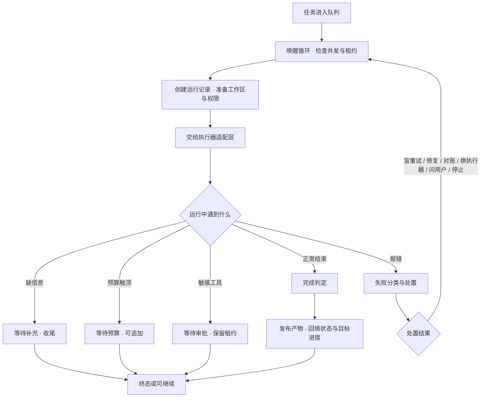

# Hearth OS · 任务执行调度器设计说明

> 本文只依据项目源码整理（`apps/server/src` 下调度、租约、失败策略、完成判定、任务图与进度相关文件），未参考 `docs/` 与 `README.md`；文中不列举任何具体代码，括号内的文件名仅用于定位核对。
> 整理日期：2026-11-13

**本文边界（避免与本套其它说明重复）**

| 已讲过的内容 | 在哪份文档 | 本文的处理 |
|---|---|---|
| 定时计划何时触发、补跑与冷却 | [定时任务设计说明](./定时任务设计说明.md) | 该文档已明确「执行调度器不是主角」，本文补足它，但不重复定时计划 |
| 审批票与等待状态如何落地 | [判定审批机制说明](./判定审批机制说明.md) | 只讲调度器在挂起期间做什么 |
| 上下文如何编译、失败如何交接 | [hearth-os-上下文管理设计](./hearth-os-上下文管理设计.md) | 只讲调度器消费这些结论的动作，不重讲接管链路 |
| 事件如何落库 | [Hearth-存储设计说明](./Hearth-存储设计说明.md) | 不展开 |
| 执行器如何接模型、怎么起进程 | [Hearth-模型接入与执行器适配设计说明](./Hearth-模型接入与执行器适配设计说明.md) | 不展开 |

本文只讲：**一个已创建的任务，是怎么被挑出来、跑起来、挂起、重试、判定完成并回收产物的**。

---

## 0. 一句话总览

它是一个**事件唤醒的单进程常驻编排循环**：自己不跑模型，只负责在并发配额与租约约束下挑任务、把任务交给执行器、接住各种中断、再决定下一步。真正干活的是执行器适配层与 Agent 运行时。

---

## 1. 先定性：三个容易误解的地方

| 误解 | 代码里的实际做法 |
|---|---|
| 以为有个定时轮询不断扫队列 | 主循环在无事可做时挂起在一个 Promise 上，靠事件唤醒，没有固定轮询间隔 |
| 以为「可以继续」是中间状态 | 它被判定为**终态**：调度器不会自动把它拉起来，必须人工重试、补充指令或跟进消息唤醒 |
| 以为租约只是个锁 | 它带递增的代次（epoch），旧代次提交的结果会被直接拒绝，是防「脑裂双写」的栅栏 |

---

## 2. 主循环与唤醒源

启动时先订阅存储层事件，然后进入循环：反复尝试「把可跑的任务安排上」，一次都没安排成就挂起等待唤醒。唤醒是一个可解析的 Promise，任何一处调用唤醒都会让它继续下一轮，因此不存在空转轮询。

唤醒来源包括：任务创建或更新、跟进消息、显式重试、交接确认、追加预算、审批完成、取消与停止、委派与交接确认。终态事件还会触发在途资源的清理。

停止时设置标志并主动解除挂起，让循环自然收敛，而不是硬杀进程。

---

## 3. 并发与配额

任务按执行器分组，每组有独立的并发上限：

| 项 | 默认值 / 规则 |
|---|---|
| 每执行器默认并发 | 3，允许配置 1–4，非整数会四舍五入后钳制 |
| 配置缺该执行器键时 | 按 **1** 处理，而不是按默认 3 |
| 子任务并行 | 另受任务图的并行上限约束，默认 3 |

「缺键按 1」是一个很容易读错的地方：默认 3 只写在配置归一化函数里，实际取并发时用的是空值回退到 1。因此新增执行器若忘记写配置，会悄悄变成串行。

---

## 4. 租约：代次栅栏与心跳

每个运行中的任务会拿到一条租约，记录持有实例、代次、过期时间。代次在每次获取时自增。

| 项 | 值 / 行为 |
|---|---|
| 有效期 | 60 秒，可配置但不得低于 1 秒 |
| 心跳 | 每 15 秒续期一次 |
| 他人持有 | 拒绝获取 |
| 租约过期 | 拒绝再提交结果 |
| 代次或持有者不匹配 | 旧结果被拒（栅栏） |

心跳失败会直接中止当前运行的取消信号，并丢弃在途结果——宁可重跑，也不接受一个可能已经被别的实例接管的写入。

**一个刻意的不对称**：任务进入「等你确认」而挂起时，收尾逻辑**不释放租约**；其它所有路径都会释放。这样审批回来后仍能用同一代次续跑，不会被另一个实例抢走。

---

## 5. 一次运行的生命周期

运行过程会持续产生进度事件，经过一层脱敏后才对外发布：单字段上限 8 千字符、总量 2 万 4 千字符，会覆盖私钥块、常见密钥前缀、云厂商访问键与 Bearer 令牌；超限后输出与文本字段会进一步压缩。

---

## 6. 检查点与续跑

原生执行器会把检查点按序号写进工作区的隐藏目录，类型包括一轮对话结束、一次工具调用结束、上下文压缩、最终结论、预算耗尽、等待补充。恢复时不是简单读回来，而是先校验：任务目标哈希是否一致、权限摘要是否一致、外部副作用是否已结算。通过后**使用量与轮次计数归零**，防止续跑后预算被历史计数吃满。

停止服务时，仍在运行、等待补充、等待审批的任务一律被置为「可以继续」，等待下一次人工唤醒。

---

## 7. 失败、重试与预算

失败分类不依赖结构化错误码，而是**对错误消息做正则匹配**：限流、容量、连接失败、超时、权限、鉴权、transport、内部错误等共 11 类；其中「副作用结果不确定」优先级最高，会压过其它一切分类。

处置决策有 6 种：停止、问用户、修复、对账、换执行器接管、重试。

| 项 | 规则 |
|---|---|
| 最多尝试 | 3 次 |
| 重试间隔 | 指数退避，基数按失败类型取 1 秒或 5 秒，上限 5 分钟 |
| 允许「盲重试」的类型 | 只有超时、容量、限流、连接问题四类；其余必须走判定 |
| 默认运行预算 | 最多 200 轮、4000 次工具调用、10 小时时长 |
| 默认 token 上限 | 数值极大，实际是占位；真正卡住执行的是轮数与时长 |

「20 亿 token」不是一个真实配额，读配置时不要把它当成预算约束。

---

## 8. 完成判定

判定结果有 4 种：通过、失败、受阻、需要人工。验收项状态分已通过/未通过/未执行/不适用，校验器有文件、结构、命令、Git、自定义五类。

命令校验器的边界很严：超时上限 2 分钟、参数个数上限、输出缓冲上限，环境变量只允许极少数系统变量；Git 校验器只接受「干净 / 指定分支 / 指定提交」三种声明，明确拒绝自由 shell。

判定失败的条件是命中了禁止动作、必需验收项未通过、或副作用判定为失败；有未结算的外部副作用则判为「受阻」。

---

## 9. 产物回收与状态文案

产物发布有总量闸门：最多 1000 个文件、合计 100 MB；只有落在受管输出目录下的文件才会被识别为产物。任务状态文案覆盖 9 种状态，但执行器专属文案只写了原生与 Codex 两个，其余执行器在界面上一律显示为泛称「执行器」。

---

## 10. 只读代码才会发现的事实

1. 「可以继续」被算作终态，必须靠外部动作唤醒，这是最容易踩的语义坑。
2. 等待审批期间保留租约，是唯一不释放租约的收尾路径。
3. 失败分类靠文本正则，且「副作用不确定」优先于所有类别。
4. 并发配置缺键时按 1 跑，不是按默认 3 跑。
5. 预算里的 token 上限是占位值，真实约束是轮数与时长。

---

## 11. 与其它模块的分界

| 方向 | 内容 |
|---|---|
| 输入 | 任务与运行记录、应用设置、事件订阅、执行器注册表、租约服务、任务图、交接与委派服务、工作区、权限 |
| 输出 | 运行记录、执行结论、进度事件、任务状态与下一步动作、目标进度、产物记录 |
| 不讲 | 执行器内部怎么跑（模型适配）、提示词怎么编译（上下文）、审批票怎么生成（判定审批）、计划何时触发（定时任务） |

---

## 附：源码定位索引

| 想看什么 | 去哪找 |
|---|---|
| 主循环、并发、检查点、挂起恢复、产物回填 | `apps/server/src/scheduler.ts` |
| 失败分类、处置决策、重试延迟 | `apps/server/src/failure-policy.ts` |
| 完成判定与验收校验器 | `apps/server/src/completion-judge.ts` |
| 子任务图与并行约束 | `apps/server/src/task-graph.ts` |
| 租约与心跳 | `apps/server/src/leases.ts` |
| 进度脱敏 | `apps/server/src/progress-detail.ts` |
| 状态文案 | `apps/server/src/task-status-messages.ts` |
| 失败接管策略与上下文默认设置 | `apps/server/src/context-policy.ts`、`packages/core/src/types.ts` |
