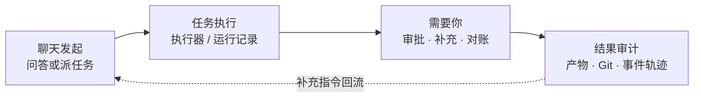
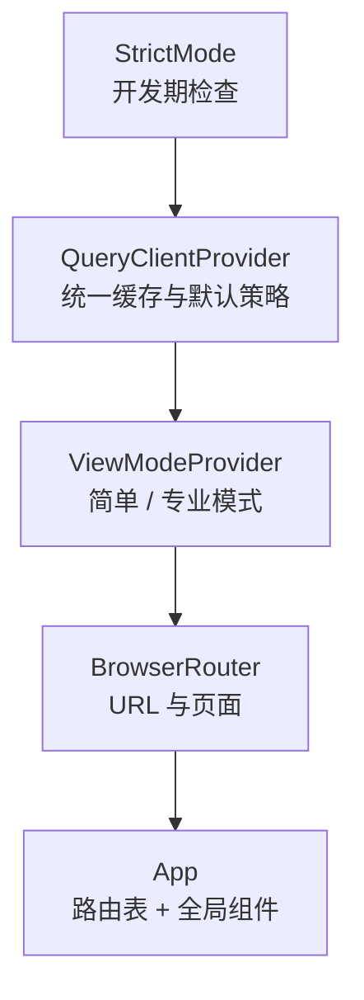
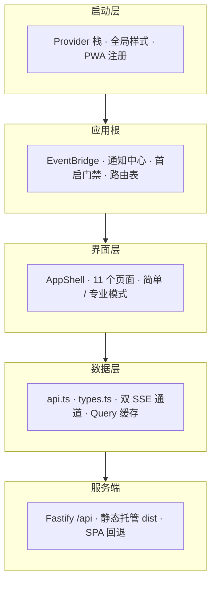
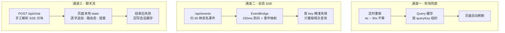

# Hearth 前端架构设计说明

> **阅读范围**：本文只依据项目源码整理（`apps/web/src`、`apps/web/public`、Vite / TS 配置，以及 `apps/server` 中托管静态资源的代码），未参考 `docs/` 与 `README.md`。
> **表达方式**：只讲设计思路与运行机制，不粘贴任何项目源码；文中括号内的文件名仅用于定位核对；示意图为结构性图示，不是代码。
> **整理日期**：2026-11-13

---

## 0. 一句话看懂

这个前端不是一套「业务表单系统」，而是一台**本地 Agent 的运行控制台**：界面围绕「聊天派活 → 任务执行 → 需要人确认 → 结果审计」组织，状态上采用 **「缓存即状态、事件只报脏」** 的模型。

整个项目只有一个前端应用 `apps/web`，是 React + TypeScript + Vite 的单页应用。它不引入 UI 组件库，也不引入 Redux / Zustand 之类的状态库，而是把 TanStack Query 的缓存当成唯一的服务端状态仓库。

---

## 1. 先定性：三个容易误解的地方

| 误解 | 代码里的实际做法 |
|---|---|
| 以为有复杂的前端状态管理 | **没有全局状态库**。服务端状态全在 Query 缓存里，瞬时交互状态是组件本地 `useState`，跨页偏好才用 Context 或 localStorage |
| 以为 SSE 推送业务数据 | 全局事件流**只当「缓存脏了」的信号**，真正的数据仍由 REST 重新拉取；只有聊天流是例外，直接把内容吐给页面 |
| 以为是个多页面网站 | 只有一个 SPA、一个 HTML 外壳；服务端把非 `/api` 的 GET 全部回退到 `index.html`，深链接靠前端路由解析 |

---

## 2. 技术选型与工程位置

| 项目 | 选择 | 说明 |
|---|---|---|
| 框架 | React 18 + TypeScript | `jsx: react-jsx`，`noEmit`，由 Vite 负责转译 |
| 构建 | Vite 7 | 开发端口 `127.0.0.1:5173`，`/api` 代理到 `127.0.0.1:4317`；构建输出 `dist` 并带 sourcemap |
| 路由 | react-router-dom v7 | BrowserRouter，嵌套布局 + `Outlet` |
| 服务端状态 | TanStack Query v5 | 全局默认：5 秒新鲜期、失败重试 1 次、窗口聚焦自动重取 |
| 其余依赖 | lucide-react / react-markdown / remark-gfm | 图标、Markdown 消息渲染（支持表格等 GFM 语法） |
| 样式 | 纯手写 CSS | 无预处理器、无 CSS-in-JS、无原子类框架 |
| 测试 | Vitest | 只覆盖 3 个纯函数模块，跑在 node 环境，无组件测试 |

**它与后端的关系**：开发时是两个进程并行（Vite + Fastify）；生产时 Fastify 检测到 `apps/web/dist/index.html` 存在就直接静态托管该目录，并对非 `/api` 的 GET 回退首页。整个产品只监听回环地址，侧栏底部也直接写明了「仅监听 127.0.0.1」。

---

## 3. 启动链：四层嵌套容器

`main.tsx` 从外到内依次包裹：

随启动一起完成的还有两件事：一次性引入**四份全局 CSS**（主样式、引导、通知、邮件），以及**仅在生产环境**注册 Service Worker（注册失败只告警，不阻断应用）。

这个顺序有实际含义：视图模式在路由之外、缓存又在视图模式之外，所以任何页面都能读到同一份查询缓存和同一个模式开关，不必层层传 props。

---

## 4. 应用骨架：三个「隐形」组件 + 一层门禁

`App.tsx` 本身很薄——除了路由表，只挂了三个不渲染界面主体的组件：

| 组件 | 职责 | 关键设计 |
|---|---|---|
| `EventBridge` | 订阅全局事件流，把事件名映射成需要失效的 queryKey | 250ms 防抖后批量失效；无条件刷新一批基础 key（任务、健康、系统、审批、收件箱等），再按事件类型精准失效定时任务 / 会话 / 当前任务详情 / Git 等 |
| `NotificationCenter` | 把特定事件翻译成右上角 Toast | 事件到通知的映射是纯函数；去重、最多 3 条、9 秒自动消失；页面隐藏且已授权时才升级为系统桌面通知 |
| `FirstRunGate` | 首次使用门禁 | 读 `/api/onboarding`，未完成配置时把根路径重定向到 `/welcome` |

**路由结构**分两层：

- `/welcome`：独立的全屏 4 步引导页（接入模型 → 检查执行器 → 自动与主动 → 开始使用），不带侧栏。
- 其余页面全部包在 `AppShell` 内，由 `Outlet` 渲染：首页聊天、任务、任务详情、需要你、个人、运行、设备、定时任务、邮件、设置；未知路径一律回首页。
- `/memory` 与 `/methods` 两条旧路径被**重定向**到设置页的「记忆与技能」标签——这是功能收敛留下的痕迹。

**`AppShell` 是全局外壳**：左侧固定侧栏（9 个导航项，任务数与「需要你」数带角标）、底部两张健康状态卡（聊天模型是否接入、执行器是否可用）、窄屏切换为 5 项底部导航，再加一个 `Ctrl/⌘ + K` 唤起的全屏命令面板。侧栏的角标数字由多个查询结果现场计算，不是后端下发的。

---

## 5. 页面层：以聊天为入口，任务为核心

约 11 个实际页面，按职责分三类：

| 类别 | 页面 | 设计要点 |
|---|---|---|
| 主链路 | 聊天（默认首页）、任务列表、任务详情、需要你 | 产品核心路径，状态变化最频繁 |
| 配置与运维 | 设置（9 个标签）、定时任务、设备、邮件、个人、运行、首启引导 | 表单与列表密集，取数以查询为主 |
| 可复用组件 | 外壳类、状态展示类、领域面板类 | 见下 |

**组件目录的分工**：

- 外壳类：`AppShell`、`CommandPalette`、`NotificationCenter`、`HearthMark`、`EmptyState`
- 状态展示类：`StatusPill` 一个文件导出十几种状态标签（任务 / 运行 / 效果 / 来源 / 发件箱 / 设备 / 桌面会话等），`TaskStatusIcon` 负责语义化图标
- 领域面板类：审批卡、任务补充面板、任务 Git 差异面板、工作区面板，以及执行器 / 飞书 / 主动设置三个设置子面板

### 5.1 聊天页：交互最密集的地方

三栏结构——左侧会话列表（每个会话还挂着自己派出的任务）、中间消息流、底部输入区。核心能力是**一次请求自动分流成「直接回答」或「派出任务」**，后端通过流式事件告知前端当前处于哪条路径。

| 细节 | 做法 |
|---|---|
| 流式事件 | 按事件名分流到不同本地状态：会话建立、用户消息、路由决策、记忆引用数、正文增量、思考过程、任务消息、任务提案、完成、错误 |
| 执行器控制 | 工具栏可**锁定某个执行器**，明确「不会自动切换」；不可用时直接阻止发送并给出诊断 |
| 权限控制 | 「必要审批 / 完全权限」一键切换，随会话保存 |
| 补充到任务 | 可把新消息补充进已有任务，并选择「轮后继续（queue）」或「中止本轮（steer）」；只有运行中任务才允许 steer |
| 附件 | 先单独上传再随消息提交，最多 5 个、单个不超过 25 MB；补充到任务的模式不支持附件 |
| 输入体验 | Enter 发送、Shift+Enter 换行，并专门处理中文输入法合成态；输入框高度自适应；发送中可用 AbortController 取消，卸载时自动中止 |
| 会话记忆 | 当前会话 ID 存 localStorage；收到 404 时自动重置为新对话并提示 |

消息正文用 Markdown 渲染，支持复制、任务卡跳转等；空状态时给出 4 个引导性示例问题。

### 5.2 任务详情页：一次取回整个视图

与聊天页思路不同：它用**单次查询拿回任务全貌**（任务本体、运行记录、审批、事件、产物、上下文），以 4 秒轮询刷新，再用大量纯函数把原始事件翻译成人话、过滤技术噪音、拆分进度。审批、Git、工作区、补充队列等面板各自独立取数、各自发起变更，变更后只失效相关 key。

### 5.3 设置页：URL 驱动的标签页

9 个标签（执行器、模型、项目、扩展、主动、记忆与技能、连接、上下文、数据）用 `?tab=` 同步选中态，因此外部可以直接深链到某个设置分区——前面提到的两条旧路径正是重定向到这里。

---

## 6. 数据层：一个 API 门面 + 三条通道

`lib/api.ts` 是**唯一出口**：一个大对象收纳上百个 REST 端点，全部经过统一的请求封装（自动补 JSON 头、按 content-type 解析响应、非 2xx 抛出带状态码与错误码的 `ApiError`）。附件上传用 FormData、导出下载用页面跳转，是少数特例。

类型定义在 `lib/types.ts`：**大部分直接从后端共享包 `@hearth/core` 重导出**，前端只补充「视图专用」类型，前后端共用一份类型契约。其余 lib 都是纯函数：中文标签字典、时间/字节/时长/相对时间格式化、事件到通知的映射、视图模式解析。

### 6.1 三条通道的分工（本套前端最核心的设计）

| 通道 | 传的是什么 | 为什么不直接用它渲染 |
|---|---|---|
| 定时轮询 | 完整业务数据 | 兜底：即使事件丢失也能收敛到正确状态 |
| 全局 SSE | **只有事件名 + 信封**，不含业务数据 | 事件只报「脏」，数据仍由 REST 拉取，避免前端维护两套状态副本 |
| 聊天流 SSE | 逐字正文、思考、路由、任务、提案、错误 | 强实时、一次性、与缓存无关，**刻意不进 Query 缓存**，只在流结束后失效会话相关 key |

聊天流用的是 `fetch` + 可读流手工分块解析（按空行切块、解析事件名与数据行、JSON 解析失败则退回原始文本），而不是 `EventSource`——因为它是 POST 且需要中途取消。

### 6.2 状态管理规则

| 状态种类 | 放在哪 | 例子 |
|---|---|---|
| 服务端状态 | Query 缓存，以 queryKey 为约定 | 任务、会话、审批、健康、设置 |
| 瞬时交互状态 | 组件本地 state | 输入内容、流式正文、弹窗开关、当前预览 |
| 跨页 UI 偏好 | Context 或 localStorage | 当前会话 ID、桌面通知开关、简单/专业模式 |
| 变更副作用 | mutation 成功后 `invalidateQueries` | 审批通过、任务取消、设置保存 |

**要点**：跨组件一致性不靠「共享 store」，靠大家遵守同一套 queryKey 命名，并在变更后显式失效。这也是这套设计最主要的隐性约束。

---

## 7. 视觉与样式体系

| 维度 | 做法 |
|---|---|
| 文件组织 | `styles.css` 是约 9000 行的单文件，按编号注释分节；另有 `wizard.css`、`notifications.css`、`mail.css` 三份按领域拆出的补充样式 |
| 分节顺序 | 设计 token → 重置与排版 → 外壳 → 按钮/标签/状态 → 面板/表格/列表 → 功能块 → 响应式 → 各功能域补丁 |
| 设计 token | 集中在 `:root`：炭黑、余烬橙、沙色、米白构成一套**浅色暖调**主题；字号 11–20px、间距、圆角、焦点环全部变量化；注释明确「橙色不承载小字」 |
| 排版 | 页面整体不滚动（`body` 溢出隐藏），由各面板内部独立滚动；数字使用等宽数字；统一中文字体栈 |
| 响应式 | 30 多处媒体查询，1040 / 900 / 820 / 760 / 720 / 640 等断点层层收窄；单独处理矮屏、移动端安全区、「减少动效」偏好与无 hover 设备 |
| 国际化 | 全站中文文案硬编码在组件与标签字典里，**没有 i18n 框架** |

---

## 8. PWA 与离线策略

manifest 配好名称、图标、`standalone` 模式与主题色；Service Worker 的策略非常克制：

- **只缓存应用外壳**（首页、manifest、三张图标），缓存名带版本号，激活时清掉旧版本
- **明确跳过所有 `/api/` 请求与非 GET 请求**——绝不缓存业务数据
- 导航请求：网络优先，失败时回落到缓存的首页（保证离线能打开界面）
- 静态资源：缓存优先，未命中则请求并把成功响应回填进缓存

也就是说，离线时能看到界面外壳，但不会看到过期的任务或审批数据。

---

## 9. 交互细节速查

| 操作 | 效果 |
|---|---|
| `Ctrl/⌘ + K` | 打开命令面板，可搜页面与任务 |
| `Alt + M` | 在「简单 / 专业」模式间切换（隐藏快捷键，界面上无开关） |
| `?mode=pro` / `?mode=simple` | 临时覆盖视图模式，且**不写回 localStorage** |
| `/settings?tab=xxx` | 直接深链到某个设置分区 |
| `Enter` / `Shift + Enter` | 发送 / 换行（含中文输入法保护） |
| `Esc` | 关闭命令面板 |
| 命令面板内 `Enter` | 打开第一项结果 |

**双视图模式**由 Context 实现：默认简单版，localStorage 记忆偏好，URL 参数优先级最高；读取/写入 localStorage 都做了异常兜底（隐私模式下降级为简单版），快捷键还会避开输入框与可编辑区域。但全项目**只有审批卡与设备页两处真正消费它**，用来显隐审计明细、原始命令等高级信息。

---

## 10. 只有读代码才会发现的事实

1. **有 5 个孤立页面**：`OperationsPage`、`SecurityPage`、`SyncPage`、`MemoryPage`、`MethodsPage` 都完整存在，但没有任何路由或 import 引用它们，功能应已并入设置页。
2. **双视图的覆盖面很小**：机制做得很完整（Context、持久化、URL 覆盖、快捷键、纯函数测试），却只有 2 处消费，且没有可见开关。
3. **测试只覆盖纯函数**：3 个测试文件分别是标签字典、通知映射、视图模式解析；没有组件渲染或交互测试。
4. **明显的「纵向堆叠」风格**：`api.ts` 近 800 行、`SettingsPage.tsx` 约 1300 行、`ChatPage.tsx` 约 1000 行、`styles.css` 约 9000 行，都是按功能域持续追加，而非严格分层拆分。
5. **轮询 + SSE 双保险**：几乎所有实时页面同时挂了定时轮询和事件失效，实时性好，代价是请求量偏大。
6. **类型是跨包共享的**：前端类型大量重导出自 `@hearth/core`，后端改数据结构会直接反映到前端编译结果上。

---

## 11. 设计取舍小结

| 得到的好处 | 付出的代价 |
|---|---|
| 无状态库，服务端状态只有一份真相 | queryKey 命名靠约定，变更后忘记失效就会出现「界面不更新」 |
| 事件只报脏、数据统一由 REST 拉取，避免两套状态副本 | 一次事件往往触发多批次重取，需要 250ms 防抖来削峰 |
| 聊天流独立处理，逐字体验好、可随时取消 | 这部分状态游离于缓存之外，页面卸载需手动中止、结束后需手动回写 |
| 前后端共享类型契约，重构有编译期保障 | 前端与后端包耦合较紧 |
| 手写 CSS + 双视图，能精确控制信息密度 | 单文件持续膨胀；高级功能藏得较深，可发现性弱 |
| PWA 外壳离线可用、业务数据绝不缓存 | 离线仅能打开界面，不能查看任何实际内容 |

**一句话总结**：这是一个「事件驱动 + 缓存即状态」的本地控制台前端——用 REST 与查询缓存承载所有持久状态，用全局 SSE 只做失效通知，用独立流式通道处理实时对话；界面围绕「聊天派活、任务审计、需要你确认」三件事组织，并用双视图模式把高级细节藏起来。

---

## 附：源码定位索引

| 想看什么 | 去哪找 |
|---|---|
| 启动与全局配置 | `apps/web/src/main.tsx`、`vite.config.ts`、`tsconfig.json` |
| 路由与全局组件 | `apps/web/src/App.tsx` |
| 外壳、导航、命令面板 | `apps/web/src/components/AppShell.tsx`、`CommandPalette.tsx` |
| 通知与事件桥 | `App.tsx` 的 `EventBridge`、`components/NotificationCenter.tsx` |
| 聊天主链路 | `pages/ChatPage.tsx` |
| 任务主链路 | `pages/TasksPage.tsx`、`TaskDetailPage.tsx` |
| API 与流式解析 | `lib/api.ts`（文件尾部是两个 SSE 相关函数） |
| 类型、文案、格式化 | `lib/types.ts`、`labels.ts`、`format.ts` |
| 视图模式 | `lib/view-mode.tsx` |
| 样式 | `styles.css`（按编号注释分节）、`wizard.css`、`notifications.css`、`mail.css` |
| PWA | `public/manifest.webmanifest`、`public/sw.js`、`index.html` |
| 静态托管 | `apps/server/src/app.ts` 中注册静态资源与 404 回退的部分 |
