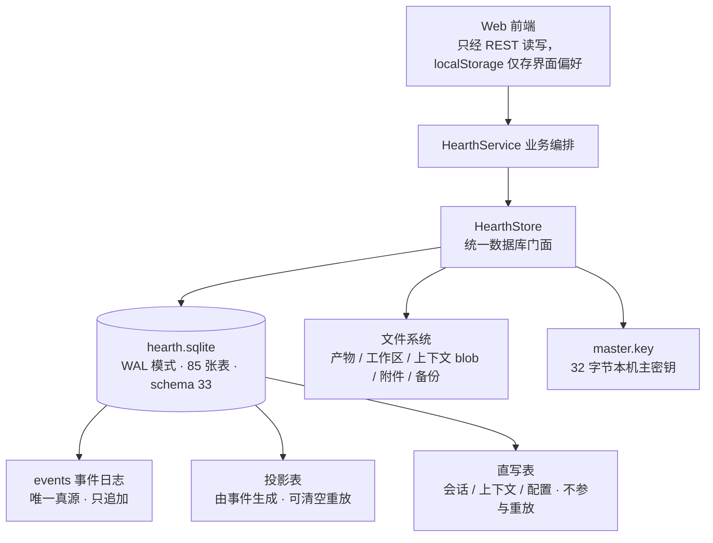

# Hearth 存储设计说明

> 本文完全依据项目源码整理，未参考 `docs/` 下的任何设计文档；文中不列举具体代码。
>
> 主要阅读范围：`packages/eventlog/src/database.ts`、`apps/server/src/` 下的 config / service / app / artifacts / context / backups / sync / maintenance / secrets / settings-migration 等实现。
>
> 整理日期：2026-11-13

---

## 先记住三句话

1. **本地优先**：全部业务数据都在一台机器的 `.hearth/` 目录里，前端不持有业务数据，只通过 REST 读写。
2. **事件为真源**：一个 SQLite 主库中，`events` 事件日志是唯一事实来源，其余大部分表是由它推导出来的「读视图」，可以随时清空重放。
3. **库只存指针**：产物正文、长文本、附件、截图留在文件系统，数据库只保存路径、哈希和元数据。

---

## 目录

- [一、整体分层](#一整体分层)
- [二、数据落在哪里](#二数据落在哪里)
- [三、核心机制：事件日志 + 读模型投影](#三核心机制事件日志--读模型投影)
- [四、85 张表的职责地图](#四85-张表的职责地图)
- [五、数据库与文件系统如何分工](#五数据库与文件系统如何分工)
- [六、一致性与数据生命周期](#六一致性与数据生命周期)
- [七、加密、备份与恢复](#七加密备份与恢复)
- [八、多设备同步](#八多设备同步)
- [九、设计取舍与边界](#九设计取舍与边界)
- [十、源码索引](#十源码索引)

---

## 一、整体分层

三层职责：

| 层 | 承担什么 | 不承担什么 |
|---|---|---|
| 前端 | 展示、交互、少量 UI 偏好 | 不存任何业务数据 |
| 服务层 | 业务编排、事件分发、文件读写 | 不直接暴露数据库给前端 |
| 存储层 | 持久化、事务、索引、加密、备份 | 不含业务逻辑判断 |

---

## 二、数据落在哪里

数据根目录（`DATA_DIR`）默认是仓库下的 `.hearth/`，可通过环境变量改到别处。整个目录以及所有 `*.sqlite*` 文件都被 `.gitignore` 排除。

| 位置 | 存放内容 |
|---|---|
| `.hearth/hearth.sqlite`（外加 `-wal` / `-shm`） | 事件日志、全部业务状态、配置、索引、元数据 |
| `.hearth/workspaces/` | 每个任务独立工作区，内含 `inputs/` 与 `out/` |
| `.hearth/artifacts/` | 发布后的产物文件与运行清单 |
| `.hearth/context/blobs/` | 按内容哈希命名的长文本 blob |
| `.hearth/attachments/` | 用户上传的附件 |
| `.hearth/sources/` | 外部来源抽取出的正文 |
| `.hearth/outbox/` | 待发送邮件及其附件 |
| `.hearth/device-frames/` | 桌面助手截图 |
| `.hearth/git-cache/` | 仓库缓存 |
| `.hearth/executors/` | 各执行器自己的 home 与状态 |
| `.hearth/backups/` | 加密备份归档与临时文件 |
| `.hearth/master.key` | 32 字节主密钥，权限仅本机可读 |
| `model-settings.json` / `executor-settings.json` | 早期遗留配置；已有迁移器把内容搬进数据库，并备份原文件、记录迁移状态 |

主库当前观测值：约 600 MB，85 张表、92 个索引，schema 版本 33。启动时开启 WAL、外键约束与 5 秒忙等待。

---

## 三、核心机制：事件日志 + 读模型投影

### 3.1 事件表长什么样

每条事件记录下列信息，字段设计同时服务「审计重放」和「跨设备同步」两个目标：

| 字段含义 | 作用 |
|---|---|
| 全局自增序号 `seq` | 全库单调递增，是重放顺序与同步游标的依据 |
| 全局唯一 ID `id` | 幂等去重，重复导入直接跳过 |
| 事件类型 `type` | 决定分发到哪张读表 |
| 关联 `task_id` / `run_id` | 支持按任务快速筛选事件流 |
| JSON 载荷 `payload_json` | 该事件发生时完整的业务对象或变更补丁 |
| 来源实例 ID + 来源序号 | 标记事件最初来自哪台设备，防止同步回环 |
| 时间戳 `created_at` | 排序、冲突判定、保留策略 |

### 3.2 一次写入发生什么

关键点：

- **原子写入**：追加事件和更新读表放在同一个 `BEGIN IMMEDIATE` 事务里，成功一起提交、失败整体回滚，不会出现「事件有了、视图没更新」。
- **同步分发**：事务内有一个按事件类型分发的大分支，把载荷写入或更新对应的读表；**遇到未登记的事件类型会直接报错**，避免静默丢数据。
- **事后广播**：提交后才通过事件总线通知订阅者，用于界面刷新、上下文采集等旁路逻辑。
- **可重放**：`rebuildProjections()` 会清空一批读表，然后按序号把全部事件重放一遍，得到同一份读视图。这是备份恢复、升级修复的兜底手段。

### 3.3 重点：这是混合模型，不是纯事件溯源

从「重建投影」实际清空哪些表，可以反推出两类数据边界：

| 走事件日志（可重放） | 直接增删改（不参与重放） |
|---|---|
| 任务、目标契约、运行记录、检查点 | 会话、聊天消息 |
| 审批、副作用台账、对账队列 | 上下文条目、上下文包、交接包 |
| 产物元数据、来源连接与条目 | 应用设置、模型配置、上下文设置 |
| 记忆及其版本、冲突、召回、遗忘记录 | 定时任务与运行记录 |
| 方法候选、评估、试验；技能与用量 | 本地项目、MCP 服务配置 |
| 常驻意图、注意力项、主动建议 | 本体实体、别名、关系、状态、决策、承诺 |
| 设备配对、桌面会话、发件箱草稿、委派 | 维护记录、连接会话、出站队列 |
| 同步对端、冲突、租约、备份记录 | 记忆实体链接、任务边等派生索引 |

**怎么理解**：需要审计、可跨设备复制、可恢复的业务状态走事件日志；高频交互数据、纯本机配置和设备态走普通表。读代码时先分清一张表属于哪一类，才不会误判数据来源。

---

## 四、85 张表的职责地图

| 分组 | 主要存什么 |
|---|---|
| 任务与执行 | 任务、目标契约与验收报告、运行记录与检查点、任务图边、Git 工作树、委派任务、交接包、任务提案与跟进 |
| 安全与副作用 | 审批单（含动作摘要、次数限制、撤销状态）、效果台账、对账队列、任务租约 |
| 对话与上下文 | 会话及其设置、聊天消息、上下文条目与任务上下文状态、上下文包、上下文设置 |
| 记忆与知识 | 记忆正文与版本、冲突、召回、遗忘回执与墓碑、整合运行记录；实体、别名、关系、实体状态、决策、承诺、提及 |
| 产物与来源 | 产物**元数据**（路径 / 哈希 / 大小 / MIME）、来源连接、来源条目及其内容哈希 |
| 方法 / 技能 / 主动性 | 方法候选、评估、试验、应用记录；技能、技能版本、用量、整理运行；常驻意图、注意力项、建议与建议事件 |
| 设备与通道 | 设备、配对请求、桌面会话 / 截图 / 命令、通道投递与游标、连接会话与出站队列、线程订阅 |
| 运维与调度 | 应用元数据、设置、设置迁移记录、备份记录、维护运行记录、同步对端与冲突、定时任务、心跳运行、看门狗事件、后台工具任务 |

设计上的共同点：几乎都带创建/更新时间、状态字段和唯一约束；大对象拆成「主表 + 版本表 / 事件表」；跨表关联用 ID 而非数据库外键级联（便于重放和局部清理）。

---

## 五、数据库与文件系统如何分工

**核心原则：数据库是索引，磁盘是正文。**

### 5.1 产物发布流程

1. 执行器在任务工作区 `out/` 产出结果。
2. 校验期望产物是否齐全：拒绝符号链接、空文件，限制最多 1000 个文件、总计 100 MB。
3. 把文件复制到受管理的产物目录；托管目录会先清空再写入，避免旧产物残留。
4. 为每个文件生成一条产物记录（相对路径、绝对路径、MIME、字节数、**sha256**、时间）。
5. 额外写一份运行清单，记录本次运行的输入哈希、执行器信息、期望产物和全部文件哈希，清单本身也登记为一条产物。

### 5.2 长文本内容寻址

上下文正文超过内联阈值时，按 **sha256 命名**存成 blob 文件；数据库里只保留截断预览、哈希和引用路径。删除时先统计还有多少条记录引用该 blob，计数归零才真正删文件。

### 5.3 路径安全

所有跨目录的文件拼接都经过「必须落在指定根目录内」的校验，并在读取产物、blob、备份、截图时二次检查解析后的绝对路径，防止路径穿越。

---

## 六、一致性与数据生命周期

| 机制 | 具体做法 |
|---|---|
| 事务 | 批量事件、消息写入、软删除、清除、备份替换都包在显式事务中，异常回滚 |
| 幂等 | 事件 ID 唯一；上下文按「运行 + 执行器事件 ID」去重；通道投递、定时任务运行等有唯一约束 |
| 软删除 | 任务与会话删除时只打删除时间 + 批次号，可按批次整体恢复；只有「彻底清除」才真删，并连带清理关联表与文件 |
| 回收站 | 提供按类型、按天数的待清除列表，恢复与清除都是显式操作 |
| schema 升级 | 每次启动执行幂等建表，再逐列检查是否缺列并补齐、补建索引，最后写入 `user_version`；老库可原地升级，无需导出导入 |
| 配置迁移 | 遗留 JSON 配置迁移前先备份，失败可回滚到迁移前快照，迁移状态落库避免重复执行 |
| 定时维护 | 周期性回收过期审批、租约、桌面命令、配对请求、截图、临时文件；按保留天数清理已结束任务的上下文与 blob；维护记录只保留最近 100 条 |
| 事件不可变的例外 | 事件日志原则上只追加、不删除。但用户要求「遗忘」某条记忆时，会**回写历史事件载荷做脱敏**，清理记忆版本与整合报告，并留下墓碑防止内容被重新学回来 —— 合规优先于严格不可变 |

---

## 七、加密、备份与恢复

### 7.1 加密

本机 `master.key` 是 32 字节主密钥，用 AES-256-GCM 加密模型 API key、MCP 服务环境变量、同步令牌；同步令牌在库里只存哈希，明文仅在创建或轮换时返回一次。密钥文件权限限制为仅文件所有者可读写。

### 7.2 备份

- 用 SQLite 的一致性快照导出（不在运行库上直接拷贝，避免 WAL 未合并导致不一致）。
- 快照连同主密钥一起打包成结构化载荷，附来源实例 ID、schema 版本、元数据、各表计数与哈希。
- 用 scrypt 从用户口令派生密钥，AES-256-GCM 加密并附加认证数据；口令至少 12 位，归档整体有大小上限。
- 归档写入备份目录，备份记录（路径、大小、sha256、时间）登记入库。

**备份范围明确有边界**：包含数据库内的任务、执行、审批、效果、产物元数据、来源元数据、发件箱草稿、记忆、设置、安全审计、事件日志与同步记录；**不包含**产物正文、任务工作区、来源正文、发件箱附件、设备截图等磁盘文件。

### 7.3 恢复

1. 校验格式、版本、KDF 参数、口令、哈希与载荷大小。
2. 把快照写到临时库，检查 schema 版本是否高于当前程序，做完整性检查。
3. 在临时库上重放投影，逐表比对列名是否兼容。
4. 全部通过后，在**一个事务**内把数据替换进线上库；失败则原库保持不变。
5. 保留本机专属数据：设备、配对、桌面会话、连接、租约等表以及实例 ID、创建时间、安全开关等元数据不被覆盖。
6. 显式提示用户：磁盘上的产物与附件需要另行保留。

---

## 八、多设备同步

同步的本质是**复制事件，而不是复制表**。

- **增量拉取**：以事件序号为游标分页拉取，每页带对端实例 ID 与最新序号。
- **防回环 / 防重复**：事件携带来源实例 ID 与来源序号；来自自己、或 ID 已存在的事件直接跳过；禁止从自身实例同步。
- **导入**：远端事件按原始 ID、时间、来源信息重新追加到本地日志，投影由本地自己重放生成。
- **过滤与脱敏**：审批、来源、发件箱、设备、桌面、连接、安全、同步类事件不同步；敏感 / 秘密级记忆不出去；任务输入、网络主机、工作区路径、产物绝对路径被清空或替换。
- **冲突**：本地版本更新时间晚于远端时，不覆盖，改为记录一条冲突，由用户选择「保留本地」或「采用远端」。
- **鉴权**：对端用 Bearer 令牌，库里存哈希、密文由主密钥保护，支持轮换与撤销。

---

## 九、设计取舍与边界

| 优势 | 代价 |
|---|---|
| 状态可审计、可重放，出问题时能从事件重建 | 事件表只增不减，主库会持续膨胀（当前约 600 MB） |
| 事件与投影同事务，读写视图不会漂移 | 两套写模型并存，理解成本较高 |
| 天然支持增量同步与冲突检测 | 文件和数据库不在同一事务，靠哈希、清单与定期清理兜底 |
| 备份恢复有版本、哈希、完整性、重放多重校验 | 备份不含磁盘正文，需要额外的文件级备份策略 |
| schema 幂等升级，老数据原地兼容 | 迁移靠「逐列补齐」，长期会积累大量兼容分支 |

**边界与不完美之处**：

- `HearthStore` 是名义上的统一门面，但维护、本体、备份等少数服务仍会直接拿数据库连接写 SQL，封装并不严格。
- 前端 `localStorage` 只放界面偏好（视图模式、通知开关、当前会话 ID），不存业务数据。
- 不是所有事件都产生投影：有一批事件仅作通知或审计留痕，重放时被有意忽略。

---

## 十、源码索引

| 想了解 | 去看 |
|---|---|
| 全部表结构、索引、schema 版本与迁移 | `packages/eventlog/src/database.ts`（SCHEMA 与 migrate） |
| 事件追加、分发、投影重建 | 同文件的 `appendEvents`、`applyEvent`、`rebuildProjections` |
| 两类数据边界 | 同文件 `rebuildProjections` 中清空的表清单 |
| 数据目录与各路径常量 | `apps/server/src/config.ts` |
| 服务如何发事件、如何组织读视图 | `apps/server/src/service.ts` |
| 各存储子系统如何装配 | `apps/server/src/app.ts` 的 `buildServer` |
| 产物发布与校验 | `apps/server/src/artifacts.ts` |
| 工作区与输入准备 | `apps/server/src/workspace.ts` |
| 上下文 blob 与保留策略 | `apps/server/src/context.ts` |
| 加密原语 | `apps/server/src/secrets.ts` |
| 备份与恢复 | `apps/server/src/backups.ts` |
| 同步、过滤与冲突 | `apps/server/src/sync.ts` |
| 定时维护 | `apps/server/src/maintenance.ts` |
| 遗留配置迁移 | `apps/server/src/settings-migration.ts` |
| 记忆分层、遗忘与脱敏 | `apps/server/src/memory.ts` |
