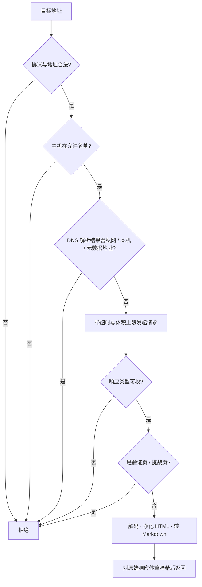

# Hearth OS · 数据源与联网设计说明

> 本文只依据项目源码整理（`apps/server/src` 下来源、抽取、抓取、搜索、GitHub 相关文件，以及 `packages/agent-runtime/src` 的抓取与文档实现），未参考 `docs/` 与 `README.md`；文中不列举任何具体代码，括号内的文件名仅用于定位核对。
> 整理日期：2026-11-13

**本文边界（避免与本套其它说明重复）**

| 已讲过的内容 | 在哪份文档 | 本文的处理 |
|---|---|---|
| 文档抽取的格式清单、各项上限、超限截断策略 | [Hearth-Agent运行时设计说明](./Hearth-Agent运行时设计说明.md) | 不重复，只讲来源层如何调用它 |
| 抓取工具恒被定义但按权限可用 | [Hearth-Agent运行时设计说明](./Hearth-Agent运行时设计说明.md) | 不重复，本文讲抓取本身的安全规则 |
| 意图关键词如何影响选路 | [意图识别路由与执行器自动选择](./意图识别路由与执行器自动选择.md) | 不展开 |
| 来源正文落盘与内容寻址 | [Hearth-存储设计说明](./Hearth-存储设计说明.md) | 不展开 |
| 工作区如何把 URL 输入落成文件 | [Hearth-工作区隔离与产物设计说明](./Hearth-工作区隔离与产物设计说明.md) | 不展开 |
| GitHub 副作用如何被审批 | [判定审批机制说明](./判定审批机制说明.md) | 只讲幂等与不确定处理 |

本文只讲：**外部资料怎么进系统、怎么去重、网页怎么安全地抓、搜索怎么接、GitHub 怎么准备与落地副作用**。

---

## 0. 一句话总览

一条「按来源类型分派 → 采集并抽取 → 哈希去重 → 就绪回写知识本体」的管线，外加两条独立的联网能力（网页快照与搜索）和一条基于命令行工具的代码托管集成。服务端有两个同名文件其实只是**转发门面**，真实实现在共享包里。

---

## 1. 先定性：三个容易误解的地方

| 误解 | 代码里的实际做法 |
|---|---|
| 以为来源抓取逻辑写在服务端 | `web-fetch.ts` 与 `extractors.ts` 分别只有几行，是纯转发；实现在 `agent-runtime` 包 |
| 以为邮件 / 日历来源可以直接点「读取」 | 这两类来源的直接读取恒被拒绝，只能由外部同步流程把内容喂进来 |
| 以为搜索后端失败会自动换另一家 | 没有跨供应商降级，一家失败就直接报错 |

---

## 2. 来源种类与生命周期

来源有五类：本地文件、本地知识库、网页、邮件、日历。来源状态五种：已连接、读取中、需要用户处理、出错、已断开；条目状态三种：就绪、失败、已清除。所有来源都被标为**只读**。

不同来源的创建条件差别很大：

| 来源 | 必备条件 | 默认提供者 |
|---|---|---|
| 本地文件 / 知识库 | 必须给根目录，解析真实路径并校验存在与类型 | 本地文件 / 本地知识 |
| 网页 | 必须给至少一个允许主机；主机串会被规范化、小写、拒绝通配符与特殊字符 | 公共网页 |
| 邮件 / 日历 | 无需凭据即可建，但状态直接置「需要用户处理」，原因是缺凭据 | 未配置 |

读取时先把状态置「读取中」并清空上次错误，成功后恢复「已连接」并刷新读取时间与条目数；失败时按错误类型决定是置「出错」还是「需要用户处理」——只有「需要人工过验证页」这类错误才会升级为需要用户处理。断开、重连、清除也是显式动作，清除会删掉该来源的正文目录并重置统计。

---

## 3. 采集、去重与就绪回写

本地采集是递归的，有三道闸门：最多 2000 个文件、最多 12 层、单文件 25 MB；跳过隐藏目录与依赖目录；遇到符号链接**不跟随**，而是单独产出一条失败条目。路径会解析真实路径并检查是否仍在根目录内，防目录逃逸。

去重的思路值得单说：

1. 哈希算的是**原始字节**（本地文件的原始内容、网页的原始响应体），而不是抽取后的 Markdown；
2. 若同哈希条目已存在且状态为就绪，本次直接跳过（增量采集）；
3. 若命中跨来源的同哈希条目，会**复用同一份正文文件**并标记「重复于谁」，不重复占空间；
4. 条目的业务键按类型不同：本地用相对路径，网页用最终地址，外部喂入由调用方给。

条目就绪时会发一条事件，并调用装配时注入的回调把内容回写知识本体。这个回调被明确标注为**尽力而为**：写本体失败不会影响采集本身成功。本体的结构见[Hearth-知识本体与指代消解设计说明](./Hearth-知识本体与指代消解设计说明.md)。

内容抽取（把各种格式转成 Markdown）由共享包完成，格式清单、上限与「超限记缺口」策略见[Hearth-Agent运行时设计说明](./Hearth-Agent运行时设计说明.md)，此处不重复。

---

## 4. 网页快照：一层很厚的防护

抓取不是简单的 HTTP GET，而是一串串行检查：

关键参数：最多手动跟随 5 次重定向、默认 20 秒超时、5 MB 体积上限（响应头预检 + 流式读取双保险）、固定 User-Agent。只接受 HTML、XHTML、纯文本三类响应；地址里带用户名密码直接拒；私网地址判定覆盖 IPv4 与 IPv6 的保留段、链路本地、回环、文档网段，并会解析 DNS 的全部结果逐个检查。

返回的是一份快照：请求地址与最终地址、时间、状态码、标题、Markdown 正文、字节数、以及**对原始响应体**算的哈希。HTML 净化会删脚本、样式、导航、页脚、表单等，把相对链接绝对化，优先从正文容器取内容，再转成 Markdown（与 Agent 运行时文档里讲的是同一套能力，这里补充它在来源层的调用规则）。

错误码分得极细：地址非法、协议不支持、地址带凭据、主机不允许、私网主机、私网地址、DNS 错误、重定向过多、响应类型不支持、内容为空、需要过挑战页、体积过大等。来源层据此区分「致命」与「可重试」，工作区层也据此决定是否写失败说明（见工作区文档）。

一个隐蔽的限制：虽然抓取函数支持通配主机与「允许私网」开关，但通过接口配置的网页来源**无法启用通配**，主机规范化又禁止通配字符，因此默认永远禁内网与本机。

---

## 5. 搜索：双后端，无降级

支持 Tavily 与自建 SearXNG 两种后端，配置存在应用设置里，默认关闭。密钥用加密箱保存，界面只返回「是否已有密钥」与掩码后的值；掩码规则是短密钥全掩、长密钥保留前 2 后 4。

| 项 | 规则 |
|---|---|
| 查询长度 | 1–500 字符 |
| 结果数 | 默认 5，最多 10 |
| 超时 | 20 秒，且禁止自动跟随重定向 |
| 结果规范化 | 按地址去重、只留 http/https、去 HTML 标签、标题截 200、摘要截 500 |

搜索被包装成一个 Agent 工具，但它有一道额外门槛：**权限里的网络主机必须包含通配符**才允许调用公共网络搜索。工具描述里会提示模型「搜到后可用抓取工具细读」。失败即抛错，不自动切到另一家供应商；唯一的「回退」是配置解析失败时回到「禁用」默认态。

---

## 6. GitHub：用命令行工具完成全部集成

所有操作都通过执行 `git` 与 `gh` 命令完成，不调用 REST SDK；凭据靠 Git 的凭据助手复用 gh 的登录态。默认命令超时 5 分钟，网络类命令有最多 3 次、间隔递增的重试。

**准备仓库**：优先用本地缓存做浅克隆，没有缓存则从远端浅克隆（深度 50，超时 10 分钟）；随后补齐提交身份、校验远端存在、读取默认分支。议题类任务会开一个以任务编号命名的分支（禁止用主分支名）；PR 类任务则抓取对应 ref 并以分离头指针检出，同时校验提交哈希一致性。仓库检查给出是否干净、当前分支、HEAD、提交数、差异统计。

**PR 预览校验**：标题与正文必填且有长度上限；有关联议题时正文必须引用它；分支与基准必须与仓库上下文严格一致；评论正文从评审稿中按成对标记提取。

**三类副作用的幂等设计**（审批流程本身见判定审批文档）：

| 动作 | 幂等手段 | 结果不确定时 |
|---|---|---|
| 推送分支 | 推送失败后比对远端分支提交与期望提交 | 抛「效果不确定」交对账 |
| 创建 PR | 先查是否已存在开放 PR；创建异常后再查一次 | 同上 |
| 发评论 | 先校验 PR 的 HEAD 与状态，再用带幂等键的 HTML 注释标记查重 | 同上 |

「效果不确定」不是失败重试，而是进入人工对账队列——因为外部动作可能已经发生了，盲目重试会造成重复。对账机制见[判定审批机制说明](./判定审批机制说明.md)。

---

## 7. 只读代码才会发现的事实

1. 服务端 `web-fetch.ts` / `extractors.ts` 是几行的转发文件，实现在共享包；共享包的入口也是纯导出。
2. 去重哈希基于原始字节，落盘的却是抽取后的 Markdown；跨来源同内容会共享正文文件并标记重复来源。
3. 邮件 / 日历来源不能直接读，只能由外部同步喂入；日历来源的实际喂入方在代码中未见闭环。
4. 搜索没有跨后端自动降级，且搜索工具额外要求通配网络权限。
5. 经接口配置的网页来源无法启用通配主机，默认永远禁止内网与本机。
6. GitHub 副作用失败一律转「效果不确定」对账，而不是自动重试。

---

## 8. 与其它模块的分界

| 方向 | 内容 |
|---|---|
| 输入 | 服务门面与存储、加密箱、共享契约枚举、任务网络权限、git/gh 可执行与登录态 |
| 输出 | 来源与条目记录、就绪回写本体、网页快照、两个联网工具、搜索结果、GitHub 工作区与副作用回执 |
| 不讲 | 格式解析上限（Agent 运行时）、URL 输入落地（工作区）、正文落盘（存储）、审批与对账（判定审批） |

---

## 附：源码定位索引

| 想看什么 | 去哪找 |
|---|---|
| 来源注册、状态机、采集与去重、外部喂入 | `apps/server/src/sources.ts` |
| 转发门面 | `apps/server/src/extractors.ts`、`web-fetch.ts` |
| 搜索服务与工具 | `apps/server/src/web-search.ts` |
| GitHub 准备、视图、PR 预览与副作用 | `apps/server/src/github.ts` |
| 意图关键词常量 | `apps/server/src/task-intent.ts` |
| 网页抓取净化、文档抽取的真实实现 | `packages/agent-runtime/src/web-fetch.ts`、`documents.ts` |
| 抓取工具的权限接入 | `packages/agent-runtime/src/tools.ts` |
