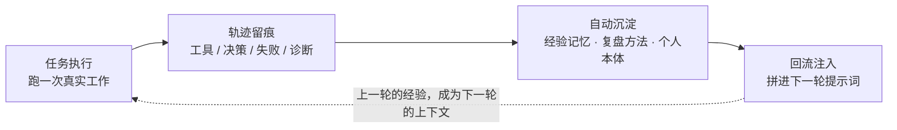
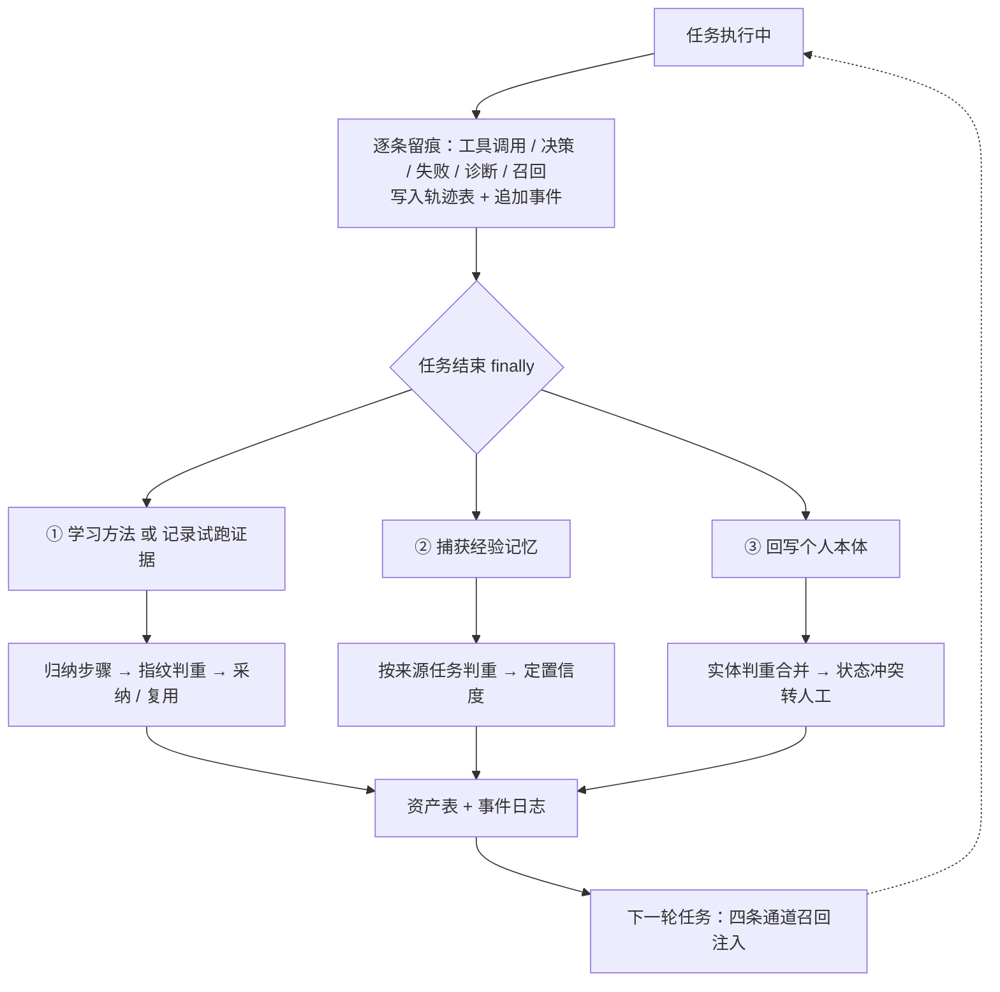
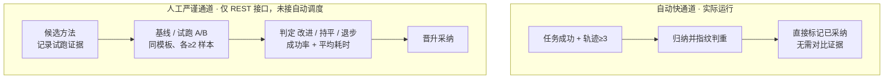

# Hearth 自进化机制设计说明

> **阅读范围**：本文只依据项目源码整理（`apps/server/src`、`packages/*/src`），未参考 `docs/` 与 `README.md`。
> **表达方式**：只讲设计思路与运行机制，不粘贴任何项目源码；文中括号内的文件名仅用于定位核对。
> **整理日期**：2026-11-13

---

## 0. 一句话看懂

这套「自进化」**不是训练或微调模型**，而是把每一次任务留下的经验，做成可积累的外部资产，再在下一轮提示词里喂回去。

模型权重从头到尾不变，变的是「任务前后拼接的上下文」和「可复用的流程建议」。所有状态都通过事件溯源写进本地 SQLite（只有技能包额外落成 `SKILL.md` 文件），因此天然可审计、可回放、可回滚。

它的整体形状是一个挂在任务生命周期上的闭环：

**关键位置**：沉淀动作挂在任务执行的 `finally` 里 —— 只学习，绝不改变任务结果。

---

## 1. 先定性：三个容易误解的地方

| 误解 | 代码里的实际做法 |
|---|---|
| 以为会训练模型 / 改权重 | 完全不改模型，只增减提示词内容与可调用的技能工具 |
| 以为有个「自进化」总模块 | **源码里没有这个统一命名**。它由一组机制拼成，内部最接近的术语是 `autoLearn`（方法自动学习）与 `autoCapture:"experience"`（经验自动捕获） |
| 以为失败也能「学到教训」 | 失败任务只留一条低置信度经验记忆；**只有成功任务才会被提炼成可复用方法** |

一句话：增强的是**上下文质量与流程复用率**，不是模型能力本身。

---

## 2. 三条贯穿全局的设计原则

1. **学习必须无副作用**
   所有沉淀动作放在任务执行的收尾阶段，异常一律吞掉，代码注释明确写了「best effort，不改变任务终态」。学习失败不会让任务失败。

2. **只从成功样本里提炼流程**
   方法归纳只针对 `completed` 的任务，且要求轨迹记录不少于 3 条，避免把一次偶然的失败路径固化成流程。

3. **学来的一律当「不可信建议」**
   注入文本显式标注「不可信流程建议」「不改变任务目标、工具权限、网络访问或审批规则」。权限只能收窄、不能扩张，审批门永不跳过。

---

## 3. 四层可积累资产

| 资产 | 记的是什么 | 怎么产生 | 存在哪 |
|---|---|---|---|
| **经验记忆** | 一次任务的成败摘要、输入范围、产物、阻塞原因 | **全自动**：每个进入终态的任务一条 | 记忆表，另有版本表、召回审计表、冲突表、遗忘凭证表 |
| **复盘方法** | 可复用步骤、适用范围、来源任务、允许能力、基线指标、代际号 | **全自动**：成功任务 + 轨迹够 3 条时归纳 | 方法候选表，另有试跑表、评估表、应用证据表 |
| **个人本体** | 任务 / 目标 / 文档 / 产物等实体，及状态、关系、决策、承诺 | **全自动**：来自任务终态、审批结果、每轮对话、邮件来源 | 实体、别名、关系、状态、决策、承诺、上下文包等表 |
| **技能包** | 方法固化成带权限清单的标准文档 | **仅手动导出**：唯一落文件的资产 | 技能表 + 版本表 + 磁盘上的 `SKILL.md` |

> 另有一个很轻的反馈环：用户对主动提醒的「接受 / 忽略 / 判断有误」会调整推送评分，但它调的是**提醒优先级**，不属于能力资产。

### 3.1 每条资产都带「出身与信任标签」

记忆不是一段纯文本，而是带了一整套治理字段：来源类别（用户 / 系统验证 / Agent 生成 / 导入 / 网页 / 邮件 / 不可信）、信任等级、污染状态、敏感度、层级（指令 / 策展 / 情景 / 前瞻 / 待复核）、置信度、重要性、有效期、内容哈希、召回次数等。这些字段直接决定它后面能不能被召回、能不能被合并。

### 3.2 方法与技能都有「代际」概念

方法状态机：候选 → 评估中 → 试跑 → 已采纳 / 已拒绝 / 已回退 / 已取代。
新方法一经采纳，同模板下的旧方法被标为「已取代」，代际号递增，形成一条可回退的版本链。技能也有版本、置顶标记、归档原因与恢复入口。

---

## 4. 完整数据流：从一次执行到一条资产

**逐环节说明：**

**① 留痕**
工具调用、决策、失败、诊断、记忆召回、方法注入等，都会逐条写进轨迹表，同时追加为事件。这是所有学习动作的原料。

**② 触发（唯一的自动汇聚点）**
任务执行收尾时，依次调用三件事：学习方法（或记录试跑证据）、捕获经验、回写本体。三者都在保护块里，互不影响，也不影响任务终态。

**③ 归纳与判重**

- **方法**：把轨迹拼成「核对输入范围 → 关键工具顺序 → 关键决策与失败 → 生成期望产物 → 发布前保留原有审批门」这样的步骤；再用「模板 + 输入结构 + 步骤 + 能力」算出一个指纹，命中已有且未被拒绝/回退的就直接复用，不重复创建。
- **经验**：按来源任务 ID 判重；成功的给中置信度，失败的给低置信度。
- **本体**：按名称 / 别名合并实体；同值状态合并证据引用；一旦出现互相矛盾的状态值，不自动覆盖，而是生成一条待办交人工确认。

**④ 巩固与淘汰**

- **记忆巩固**（手动）：按「作用域 + 主题键」分桶，同主题至少 2 条才成组，按重要性、置信度、信任、召回次数、跨天数打分排序；有新记忆生成、旧记忆标为「已被取代」并关闭召回，整批事件原子提交。
- **技能整理**（自动）：唯一的资产类定时器，每小时检查一次，但真正动手要满足「距上次整理满 7 天」且「系统空闲满 2 小时」。14 天未用标记过时并退出日常索引，30 天未用归档但保留恢复入口；只处理自动生成、未置顶、未被定时任务引用的技能。首次运行只记录基线、不改任何状态。动作前写快照备份，支持一键回滚。

---

## 5. 经验怎么影响下一次任务：四条注入通道

| 通道 | 检索逻辑 | 注入方式 |
|---|---|---|
| **记忆** | 两级召回：**常驻层**（指令 / 策展级 + 信任达标，最多 3 条、占 40% 字符预算）；**按需层**（综合置信度、信任、层级、作用域、实体图关联、词法匹配、新鲜度、历史召回次数打分）。整体受最大条数与最大字数约束 | 生成上下文包，拼进任务首轮提示词 |
| **方法** | 按任务模板自动匹配最新「已采纳」的方法，或用户手动置顶的那个 | 渲染成「可复用方法（不可信流程建议）」块；先过滤含「跳过 / 绕过审批」字样的危险步骤，再拼进提示词 |
| **个人本体** | 上下文代理按查询匹配实体，带出状态、关系、决策、承诺 | 编译成个人上下文包，按「必知 / 相关 / 可回想 / 省略」分层并受 token 预算约束 |
| **技能** | 只对「已采纳」的技能，或处于试跑且试跑任务列表命中当前任务的技能开放 | 提供技能索引 + 按需加载工具；加载时校验内容哈希与执行权限 |

**两个值得留意的小设计：**

- **召回会自我强化**：每次记忆被召回都写一条审计，并累加该记忆的召回次数；这个计数又成为下次打分的输入 —— 被用得多的记忆更容易再被选中。
- **注入要留凭据**：只有当提示词里**确实包含**那段方法文本时，才记录一条「应用证据」（带提示词哈希、方法版本、选择方式）；若因续接或预算限制没注入，则改记一条说明。这是为后续做 A/B 评估刻意准备的可验证凭据，避免「以为用了方法其实没用」。

---

## 6. 安全闸门（这套设计里最用力的部分）

| 类别 | 具体做法 |
|---|---|
| **权限不扩张** | 方法声明的能力必须落在「所有来源任务能力的交集」内，创建、评估、采纳三处分别复检；技能执行权限取「技能 ∩ 任务」的交集，还会扫描文档里是否夹带越权指令 |
| **内容不可信** | 注入文本统一声明「不改变权限或审批规则」；危险步骤用规则过滤；技能文档有固定章节校验与内容哈希校验 |
| **治理过滤** | 污染、不可信来源、信任为 none、机密级、已过期、待复核层级的记忆，一律排除在召回与巩固之外；常驻层还额外要求信任达标 |
| **试跑有门槛** | 试跑样本要求：任务确实注入过该方法、版本一致、对应运行记录存在、且**没有外部副作用** |
| **冲突转人工** | 记忆巩固遇到内容冲突直接跳过并提示人工确认；本体状态冲突生成待办；验收判官可返回「需要人工」 |
| **默认可撤销** | 记忆巩固默认是 dry-run（只出报告不落库）；技能整理有快照备份与回滚；方法有代际、取代、回退；记忆有遗忘凭证与墓碑 |

> 一个略反直觉的细节：`autoLearn` 与 `autoCapture` **不允许关闭** —— 设置里改成 false 会被强制改回开启，代码里对应「自动学习始终开启」的报错。

---

## 7. 最值得注意的一点：这是个「半闭环」

代码里其实存在**两条**通往「采纳」的路径，但只有一条被接进自动链：

**两条路径的差别：**

- **自动快通道**：只要来源任务全部成功，候选方法就被直接标为「已采纳」，跳过试跑与基线对比。
- **人工严谨通道**：先记录试跑证据（要求注入过、版本一致、无外部副作用）→ 基线与试跑样本同模板、不重叠、各至少 2 个 → 按成功率与平均耗时判定「改进 / 持平 / 退步 / 证据不足」→ 判定为「改进」且样本充足才允许晋升。这一整套（含样本自动配对、拒绝、回滚）**只暴露为 REST 接口，没有任何定时器或回调自动调用**。虽然「任务结束后自动记录试跑证据」是接上的，但证据攒够之后没人自动触发评估。

**另外四处「半接线」：**

1. **记忆巩固**默认 dry-run，且只有手动接口，没有定时器。
2. **方法导出成技能包**只有手动接口 —— 纯自动运行时，技能索引可能长期为空。
3. **资产产生事件没有下游自动消费者**，只用于界面推送、审计，以及多端同步时的冲突检测。
4. **没有专门衡量「进化是否有效」的模块**：目标验收判官只判断单次任务是否达成，外部评测接口与资产链没有连接。

因此严格说：**「数据回流 → 证据积累」这一半是闭合的，「证据 → 评估 → 晋升」这一半靠人工驱动**。

---

## 8. 总体评价

可以概括为：**保守、以安全为先的外挂式经验系统**。

- **优点**：学习被严格限定在「成功样本 + 不可信建议 + 权限只收窄 + 全程可追溯可撤销」的范围内，规避了自我改进最危险的失控路径（权限扩张、跳过审批、把错误经验固化）；四类资产分层清晰，事件溯源让每一步都可解释、可回放。
- **代价**：闭环的「评估—晋升」半圈靠人工驱动，自动部分更接近**经验记忆 + 流程复用**，而不是会根据效果自我纠错的强化学习；也缺少「进化是否真的有效」的度量。

**若要让闭环真正闭合，最直接的三个接线点：**

1. 给方法评估 / 晋升加定时调度，让攒够的试跑证据自动触发 A/B 判定；
2. 把「已采纳」的方法自动导出成技能包，让技能索引不再依赖手动操作；
3. 把试跑与采纳后的效果指标回流成资产评分，形成真正的优胜劣汰。

---

## 附录：代码依据（便于核对，非代码内容）

| 层次 | 关键文件 | 职责一句话 |
|---|---|---|
| 调度与装配 | `scheduler.ts`、`app.ts`、`index.ts` | 任务终态汇聚点、全部检索与注入点、服务注册与定时器启停 |
| 方法资产 | `methods.ts`、`method-context.ts` | 轨迹归纳、指纹判重、权限复检、评估晋升回滚；注入渲染与危险步骤过滤 |
| 记忆资产 | `memory.ts`、`memory-consolidation.ts` | 经验捕获、召回打分、巩固原子应用、治理门、遗忘；巩固规划纯函数 |
| 本体资产 | `ontology-writer.ts`、`ontology.ts`、`context-broker.ts` | 任务/审批/对话/来源写回；实体判重与冲突检测；编译个人上下文包 |
| 技能资产 | `skills.ts`、`skill-package.ts`、`skill-tools.ts`、`skill-permissions.ts`、`skill-curator.ts` | 方法导出、文档校验、按需加载、权限取交集、定时归档与回滚 |
| 数据与持久化 | `packages/core/src/types.ts`、`personal-agent.ts`、`packages/eventlog/src/database.ts` | 全部资产的类型定义、表结构与事件溯源 |
| 辅助注入 | `context-projector.ts`、`chat-routes.ts`、`service.ts`、`events.ts` | 交接场景注入、对话侧注入、事件总线与追加事件 |
