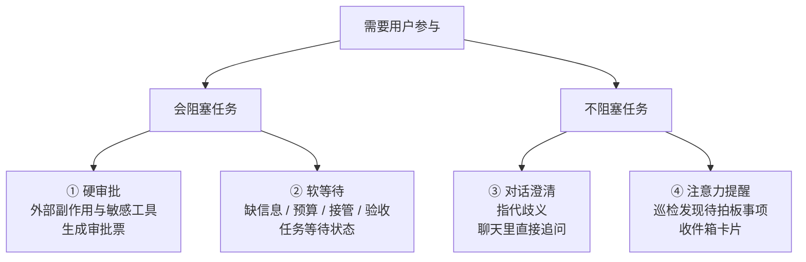
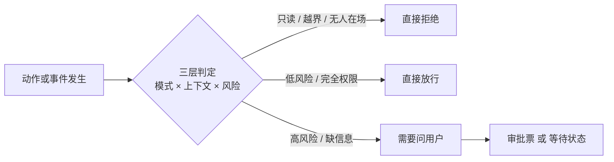
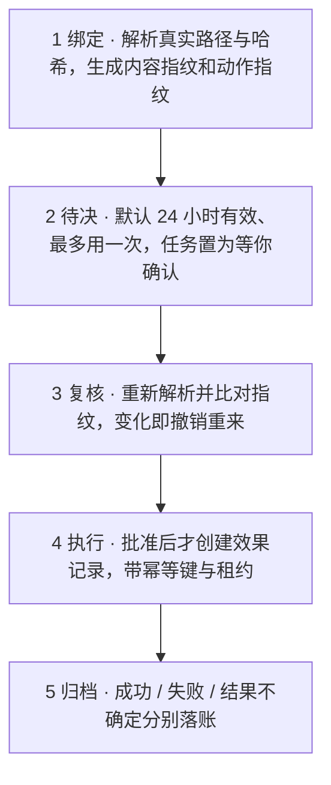

# Hearth OS「判定审批」机制说明

> 本文只依据源码整理，未参考项目文档与 README。整理日期：2026-11-13。
> 文中出现的模块名、状态名、字段名均为代码中的标识符，但不包含任何代码片段；图示使用 Mermaid 语法，即使不渲染也可通过正文表格读懂。

---

## 0. 一句话总览

这个项目**没有把「问用户」做成一个弹窗开关**，而是拆成两层：

- **第一层：多个"判定器"各自判断**「这件事要不要问用户」。没有中央审批大脑，每个环节自己给结论。
- **第二层：统一的"审批票 / 任务等待状态"接住结论**，并留下可审计的记录。

整体取向偏保守：**判不准、用户不在场、动作有外部副作用，就停下来问，或者直接拒绝**。唯一能整体关掉询问的总开关是「完全权限」模式。

---

## 1. 全景：四类「需要用户参与」

代码里其实有四条彼此独立的链路，强度差别很大：

| 类型 | 是否阻塞任务 | 是否有审批票 | 典型场景 | 落地方式 |
| --- | --- | --- | --- | --- |
| ① 硬审批 | 阻塞 | 有 | 发邮件、建 PR、发评论、写文件、跑命令、调用 MCP 工具 | 生成审批记录，任务进入「等你确认」 |
| ② 软等待 | 阻塞 | 没有 | 缺关键信息、预算触顶、换执行器、验收需人工判断 | 任务进入「等待补充 / 等待预算」等状态 |
| ③ 对话澄清 | 不阻塞 | 没有 | 「把这个发给 XX」里的 XX 指代了多个对象 | 聊天里直接回一句追问，根本不创建任务 |
| ④ 注意力提醒 | 不阻塞 | 没有 | 巡检发现需要你拍板、对账、续期的事 | 收件箱卡片，可折叠、可限流 |

紫色两类（①②）是**真阻塞**：任务状态机切换后，调度器不再推进该任务。橙色两类（③④）是**轻接触**：任务照常运行。

---

## 2. 第一层：谁判定「要不要问」

### 2.1 七个各管一摊的判定器

| 判定器（源码模块） | 看什么 | 判成「要问用户」的条件 |
| --- | --- | --- |
| 动作策略判定 `action-resolver.ts` | 权限模式、上下文、动作类型与风险、目标路径 | guarded 模式下遇到 shell、邮件、日历、桌面、网络，或 high / critical 风险；workspace 模式下遇到高风险或外部动作 |
| 敏感工具名单 `tool-policy.ts` | 工具名 | 写文件、写表格、写文档、改文件、打补丁、shell、抓网址、截屏，以及所有 `mcp__` 前缀工具 |
| 完成判定 `completion-judge.ts` | 验收标准、证据链、外部动作状态 | 有必需标准没跑、缺证据、目标要求人工复核 → `needs_human`；外部动作尚未结算 → `blocked` |
| 失败判定 `context-policy.ts` / `failure-policy.ts` | 错误原因分类 | 错误归类为权限、缺输入、预算、结果不确定、中断 → `ask_user`；不允许"盲重试"的失败类别也会改判成问用户 |
| 接管判定 `context-policy.ts` | 待审批、不确定效果、外部发布模板、越界写权限、网络策略 | 命中任一即标记高风险，换执行器前必须由用户确认 |
| 指代判定 `mentions.ts` + `chat-routes.ts` | 实体匹配分数 | 最佳匹配分数不足 0.75，或与第二名差距不足 0.15，且这句话要派任务 → 先追问、不派单 |
| 心跳与注意力治理 `standing-intents.ts` / `attention-governor.ts` | 是否在等你、是否紧急、免打扰、每日限额 | 生成「等你处理」卡片，但**要不要真的打扰你**由评分、折叠和限流再判一次 |

> 补充：入站文本路由 `intake-router.ts` 会把验证码、截止、冲突、凭证、付款、合同等内容判为「需注意」，但它只做分类落库，不直接向用户提问——它和上面第 ④ 类的注意力项是两套不同机制。

### 2.2 判定结果只有三种

| 结果 | 含义 | 典型原因 |
| --- | --- | --- |
| 直接拒绝 | 连审批票都不生成，任务落到「可继续」并给出指引 | 只读模式、路径越出会话根目录、非交互上下文且无预先授权 |
| 直接放行 | 记一笔审计即可 | 会话根目录内的低风险可逆写入、只读工具、完全权限模式 |
| 需要问用户 | 生成审批票，或把任务切到等待状态 | 高风险动作、敏感工具、缺信息、结果不确定、验收需人工 |

### 2.3 三个判定输入维度

1. **权限模式**
   - 用户看到的是「必要审批 / 完全权限」两档。
   - 生效优先级：**任务级 > 会话级 > 全局默认**；全局默认只影响之后新建的对话，已有对话保持自己的选择。
   - 内部再展开为四档：只读 / guarded / workspace / full。
2. **上下文**
   - 分为交互、定时、webhook、远程、委派五种。
   - **关键设计：用户不在场 ≠ 排队等用户，而是直接拒绝。** 非交互上下文 + 无明确预先授权，高风险动作会被策略直接否掉——避免定时任务在无人时攒一堆积压授权。
3. **动作的客观属性**
   - 系统不相信 Agent 的文字描述，而是把动作**解析成真实路径、可执行文件哈希、目标文件哈希、参数摘要**，再打上风险等级与副作用类别（本地可逆 / 外部不可逆等）。
   - 路径越出会话根目录，或真实路径（含符号链接）越界，一律硬拒绝。
   - 桌面动作还要求绑定画面帧哈希与「控制代次」，防止界面已经变了还按旧画面执行。

### 2.4 组合规则速查

| 权限档 | 行为 |
| --- | --- |
| 只读 | 一票否决所有写入与外部动作 |
| guarded | shell 与外部动作（邮件 / 日历 / 桌面 / 网络）一律要问；高风险一律要问；根目录内的可逆写入放行 |
| workspace | 只有高风险或外部动作才问，低风险放行 |
| full | 基本放行；但非交互场景下的高风险动作仍然拦截 |

---

## 3. 第二层：判定后怎么落地

### 3.1 任务状态机

任务状态里与「问用户」直接相关的只有三个，转换关系是硬约束：

| 状态 | 界面文案 | 由谁设置 | 用户怎么继续 |
| --- | --- | --- | --- |
| `waiting_approval` | 等你确认 | 审批创建时 | 批准 / 拒绝；过期后回到可继续或继续运行 |
| `waiting_input` | 需要补充信息 | 执行器提问、失败判定、完成判定、接管确认、目标边界触顶 | 补充信息后重试、确认接管、扩展预算 |
| `waiting_budget` | 预算已触顶 | 预算耗尽 | 扩展一倍预算并继续 |

`running` 可以进入这三个等待态；三个等待态退出后只能回到排队 / 运行 / 可继续 / 已取消。调度器会跳过所有等待态任务，并在服务重启时专门恢复审批租约、结算被中断的工具审批。

### 3.2 审批票：把「同意」绑死到具体内容

判定结果落到 `ApprovalManager`。它防的不是「用户误点同意」，而是**「用户同意的和实际执行的不一致」**。

**逐步说明：**

1. **绑定**：把抽象动作解析成可验证的实体，算出两个指纹——审批内容的参数指纹，以及绑定真实动作的动作指纹。审批票上写明「最多使用一次」和使用计数。
2. **待决**：创建前先校验运行存在、任务状态正确、该任务没有其他待处理审批；默认有效期 24 小时（真实发信缩短到 10 分钟）。前端会展示影响范围、能否撤销、截止时间。
3. **复核（精髓）**：用户点确认时，系统**按当前磁盘状态把动作重新解析一遍**，比对指纹、有效期和当前策略。文件被改过、可执行文件被换过、权限被收紧，票直接作废并记录撤销事件，任务回到「可继续」并提示重新生成审批。
4. **执行**：只有批准后才创建「效果记录」去真正执行，带幂等键、租约和重放策略（工具类进程内重放，其他一律禁止重放）。同一票在途时会拒绝重复提交。
5. **归档**：成功 / 失败 / **结果不确定**分别落账。结果不确定时明确提示「先到目标系统核对，避免重复执行」，并且会反过来阻塞完成判定、阻塞接管、禁止从检查点自动恢复。

**还有一层反向校验**：预备动作（邮件草稿、日程检查）提交时必须携带审批引用，并逐字段比对是不是同一个动作——**预备动作本身不构成授权，也不能拿别的审批来复用**。

**拒绝也有后续**：每次拒绝计数入账；30 分钟内连续 3 次拒绝会升级为「人工复核」，任务提示检查目标与方案，并明确写着「不要继续换写法绕过」。

### 3.3 两条审批分支的行为不一样

| 对比项 | 工具审批 | 外部动作审批 |
| --- | --- | --- |
| 典型场景 | 写文件、shell、抓网址、截屏、MCP 工具 | 发信、建 PR、发评论 |
| 等待方式 | 运行中的 Agent 线程被一个 Promise 原地挂起 | 任务整体停在「等你确认」 |
| 批准 | 放行**这一次调用**，任务恢复运行 | 创建效果记录并真正执行一次 |
| 拒绝 | 只跳过该工具，Agent 继续尝试完成任务 | 任务落到「可继续」，明确写着没有产生外部影响 |
| 过期 / 取消 / 重启 | 全部显式结算，不会把线程永久卡死 | 任务回到「可继续」，需重新执行生成新审批 |
| 重放策略 | 进程内可重放 | 禁止重放 |

---

## 4. 用户在哪儿回答

| 入口 | 呈现与操作 |
| --- | --- |
| Web 任务详情页 | **唯一挂审批卡片的地方**。两步确认（先「检查」再「确认」）；按类型展示影响范围、能否撤销、收件人、截止时间；工具审批写明「只允许本次调用，拒绝后 Agent 会跳过继续」；专业视图可查看参数指纹与原始 target / preview |
| 同页的等待类面板 | 补充信息输入框、扩展一倍预算、确认接管、任务提案「确认并执行」 |
| 通知中心 | SSE 事件 → toast（页面隐藏时可发桌面通知）：待审批、需补充信息、预算触顶、结果不确定 |
| 收件箱 | 注意力卡片显示「等你处理」「为什么现在提醒」「不处理的后果」「建议动作」，可确认 / 忽略 / 稍后 / 标记推错了；对账项需人工判定 |
| 飞书 | 斜杠命令批准 / 拒绝，并在任务进入等待审批时推送卡片文本 |
| 统一接口 | 所有「决定」最终收敛到一个审批决定接口；错误按「不存在 / 已过期 / 冲突」区分状态码 |

---

## 5. 什么时候不问：防打扰是单独一层设计

### 5.1 「完全权限」不是跳过弹窗，而是一串连锁动作

- 审批创建后立即按策略自动批准并记一笔审计事件；
- 切换时**批量批准**该会话所有待处理审批；
- 把「等待补充信息」的任务放回队列，并注入「请自行决策、不要再询问用户」的指令；
- 从工具列表里**移除提问工具**，执行器遇到提问会改为自行决策并继续（需在最终结果说明关键假设）；
- 给执行器的提示词追加「不要向用户提问或等待确认」；
- 状态文案同步改成「外部动作会自动批准并执行」；
- 放宽路径与工作目录校验，并允许低风险场景自动换执行器。

默认的「必要审批」则相反：策略拒绝时的指引明确是「调整动作范围或由用户在场确认」。

### 5.2 非阻塞提醒的治理

- **打分**：优先级、等待时长、影响面、是否「在等你」（加 8 分）、是否关键（加 30 分）、是否不可逆、历史反馈偏好。
- **折叠**：同一聚合键只保留最高分，其余标记为被遮蔽。
- **限流**：免打扰时段、每日总量、单目标每日上限、高优先级每日上限、冷却窗口；关键项可直接放行。
- **学习**：某类提醒被忽略或标记「推错了」占比过高，样本量够了会自动降分；反之加分。
- **影子模式**：只记录、不实际投递。

### 5.3 直接放行的部分

只读工具（读文件、列目录、搜文本）无需审批；会话根目录内的低风险可逆写入也无需审批。另外，实体匹配到多个候选时返回的是**给 Agent 的消歧错误**，不会打扰用户——系统清楚区分「问用户」和「问 Agent」。

---

## 6. 设计取舍与实现边界

### 6.1 六条原则

1. **默认拒绝优于默认放行**：越界、只读、无人在场，宁可硬拒绝也不排队等人。
2. **一次性授权**：一张票最多用一次，不因为「刚批准过」就放行下一次。
3. **审批票绑定内容而非意图**：指纹 + 二次校验，防止审批后动作被偷换。
4. **副作用账本是一等公民**：效果状态不确定会阻塞完成判定、阻塞接管、禁止检查点自动恢复。
5. **拒绝也是信号**：连续拒绝升级人工复核，明确劝阻换写法绕过。
6. **审计贯穿全程**：拒绝、策略拒绝、自动批准、复核失败、结果不确定都会写事件并广播。

### 6.2 读代码时容易踩坑的几处边界

- 前端**没有**专门处理澄清 / 提及事件，澄清文本是靠后续的助手消息带出来的；审批卡片**只**挂在任务详情页，聊天页与收件箱不渲染它。
- 执行器源码里那些「是否需要审批」字样，大多是产物字段的规范化与评测逻辑，**不是**系统在做判定。
- 不存在单独的「澄清接口」或「确认接口」；澄清是聊天流里的事件，「决定」统一收敛到审批决定接口。
- 设备配对、能力授权、技能授权、记忆冲突解决、同步冲突解决等也都需要人工确认，但它们属于各自业务域，**不走任务审批主链路**。

---

## 7. 源码索引（便于查阅）

| 主题 | 主要文件 |
| --- | --- |
| 审批票主体 | `apps/server/src/approvals.ts` |
| 动作解析与策略判定 | `apps/server/src/action-resolver.ts` |
| 敏感工具名单与摘要 | `apps/server/src/tool-policy.ts` |
| 调度与授权入口 | `apps/server/src/scheduler.ts`、`apps/server/src/app.ts` |
| 失败与接管判定 | `apps/server/src/context-policy.ts`、`apps/server/src/failure-policy.ts` |
| 完成判定 | `apps/server/src/completion-judge.ts` |
| 外部副作用 | `apps/server/src/outbox.ts`、`apps/server/src/prepared-actions.ts`、`apps/server/src/effects.ts`、`apps/server/src/reconcile.ts` |
| 指代澄清与对话路由 | `apps/server/src/mentions.ts`、`apps/server/src/chat-routes.ts`、`apps/server/src/intake-router.ts` |
| 提醒与治理 | `apps/server/src/standing-intents.ts`、`apps/server/src/attention-governor.ts` |
| 模式来源与状态机 | `apps/server/src/service.ts`、`packages/core/src/state.ts`、`packages/core/src/types.ts` |
| 执行器侧提问 | `packages/agent-runtime/src/runtime.ts`、`packages/agent-runtime/src/tools.ts`、`apps/server/src/executor-adapter.ts` |
| 前端呈现 | `apps/web/src/components/ApprovalCard.tsx`、`apps/web/src/pages/TaskDetailPage.tsx`、`apps/web/src/components/NotificationCenter.tsx`、`apps/web/src/pages/InboxPage.tsx` |
