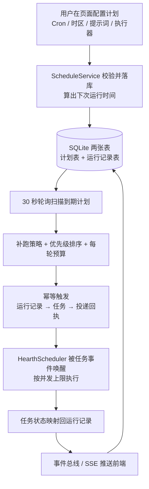
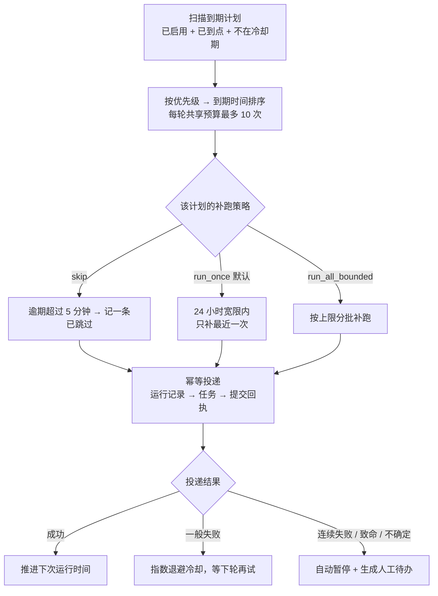

# Hearth OS 定时任务设计说明

> 本文根据项目源码整理，未参考 docs 目录下的设计文档，也不包含项目具体代码。
> 主要依据：服务端 schedules.ts、scheduler.ts、app.ts，数据层 eventlog/database.ts，类型定义 core/types.ts，前端 SchedulesPage.tsx 与 App.tsx，以及对应的单元测试。
> 整理日期：2026-11-13

---

## 速览（三句话）

1. 定时任务不是「给每条计划挂一个 Cron 定时器」，而是**把下次运行时间存进数据库，用一个 30 秒的轮询去扫描到期的计划**。
2. 到点后它只做一件事：**幂等地创建一条运行记录和一个普通任务，并留下投递回执**，真正的执行交给下游的任务执行调度器。
3. 一旦投递结果不确定或连续失败，它**宁可暂停计划并生成人工待办，也不盲目自动重试**，全程可追溯、可对账。

---

## 目录

- 一、先分清两个「Scheduler」
- 二、模块地图
- 三、数据模型：两张表
- 四、时钟是怎么走的
- 五、错过时间怎么办：三种补跑策略
- 六、触发瞬间的可靠性防线
- 七、失败治理：冷却与自动暂停
- 八、状态回流与用户界面
- 九、与其他后台周期任务的区别
- 十、设计取舍与需要注意的边界
- 十一、一句话总结
- 附录 A：关键默认值速查
- 附录 B：源码索引

---

## 一、先分清两个「Scheduler」

项目里有两个名字相近、职责完全不同的模块，这是理解整套设计的第一道门槛。

| | ScheduleService（schedules.ts） | HearthScheduler（scheduler.ts） |
|---|---|---|
| 回答的问题 | **什么时候该跑** | **怎么把已创建的任务跑起来** |
| 是不是定时任务 | 是，本文的主角 | 不是，是任务执行调度器 |
| 驱动方式 | 30 秒轮询数据库 | 事件驱动：任务创建或更新时唤醒循环 |
| 主要产出 | 运行记录、任务、投递回执 | 执行器进程、任务状态、产物 |
| 用户可配置 | 是，页面可增删改查 | 否，属于系统内部能力 |

两者的交界点只有一个：定时任务到点后**创建一个普通任务**，任务创建事件会唤醒执行调度器，后续排队、并发控制、执行、审批、产物回收都由后者负责。这种「触发与执行解耦」让定时模块可以专注于时间和投递可靠性。

### 1.1 整体链路一览

---

## 二、模块地图

| 位置 | 职责 |
|---|---|
| core/types.ts | 定义计划、运行记录、状态枚举、补跑策略等数据契约 |
| eventlog/database.ts | 两张 SQLite 表、唯一约束与索引、字段迁移、读写方法 |
| schedules.ts | 全部业务逻辑：参数校验、轮询、补跑、幂等投递、失败治理、事件发布 |
| app.ts | 服务装配、REST 接口、启动与关闭时的生命周期管理 |
| SchedulesPage.tsx / App.tsx | 配置表单、运行历史、事件驱动的实时刷新 |
| scheduler.ts | 下游执行层，消费定时任务创建出来的任务 |

服务启动时，定时服务是**无条件启动**的（不受那些可选的后台开关影响），并且启动时立刻执行一次扫描；关闭服务时会在 onClose 钩子中停止轮询、取消事件订阅。

---

## 三、数据模型：两张表

### 3.1 计划表（scheduled_jobs）

一条计划就是「在什么时间、用什么执行器、把什么提示词交给谁去办」，字段可以分成四组：

- **跑什么**：名称、固定提示词、绑定的专属对话、执行器、审批模式、任务类型。
- **何时跑**：Cron 表达式、时区（默认 Asia/Shanghai）、启用开关、下次运行时间。
- **跑过头了怎么办**：补跑策略、单次补跑上限（默认 3，可配 1–20）、优先级（默认 5，可配 0–100）。
- **自我保护与留痕**：上次运行时间 / 任务 / 状态、连续失败次数、冷却截止时间、暂停原因、跑完是否删除、创建与更新时间。

默认值：执行器为内置执行器、审批模式为「必要时审批」、任务类型为通用、补跑策略为 run_once、启用状态为开。

### 3.2 运行记录表（scheduled_job_runs）

每一个「计划时间点」对应一条记录，用于回答「这一轮到底发生了什么」：计划时间点、关联任务、关联投递效果、幂等键、尝试次数、回执、失败分类、状态、错误说明。

**最关键的设计**是表上的唯一约束：**计划 ID + 计划时间点** 只能有一条记录。这是防重复触发的数据库兜底，比任何内存标志都可靠。此外还有针对「启用状态 + 下次运行时间」的索引，服务于到期扫描。

### 3.3 状态

运行记录共 6 种状态：排队中、执行中、已完成、失败、已跳过、已取消。任务本身的状态会在执行过程中被映射回这 6 种状态（见第八节）。

---

## 四、时钟是怎么走的

### 4.1 核心思路：Cron 库只当计算器，不当闹钟

代码里没有为每条计划注册常驻定时器。Cron 库被以「暂停模式」创建，只用于两件纯计算的事：

- 创建或修改计划时，校验 Cron 表达式是否合法、时区是否有效（时区用国际化时间格式接口校验）；
- 从某个时间点算出「下一次该跑是什么时候」，算完立即释放实例。

真正推进时间的，是定时服务里**唯一一个 30 秒间隔的轮询**。服务启动时会立刻先跑一次，随后每 30 秒重复。

### 4.2 一次轮询的完整步骤

具体步骤展开：

1. **筛选到期**：已启用、有下次运行时间、时间已到、且不在冷却期内的计划。
2. **排序**：先按优先级（数值小的优先），再按到期时间先后。
3. **限量**：设一个共享的每轮预算（默认最多触发 10 次，可配置），用一个「正在轮询」标志防止重入。
4. **回溯漏掉的周期**：从上次的下次运行时间开始，用带时区的 Cron 逐个往后推算，最多扫描 2000 个时间点，并对结果去重。单元测试专门覆盖了夏令时跳变与回拨，保证同一个墙钟时间只跑一次。
5. **决定补跑方式**：按计划的补跑策略选择要真正触发哪些时间点（见第五节）。
6. **逐个触发**：对选中的时间点执行幂等投递（见第六节），并把下次运行时间推进到未来。

### 4.3 为什么这样设计

| 收益 | 原因 |
|---|---|
| 重启不丢计划 | 下次运行时间是数据库字段，不是内存里的定时器 |
| 暂停 / 恢复 / 改期很简单 | 只是改字段、重算时间，不需要增删定时器 |
| 停机期间可以补跑 | 漏掉的周期能从旧时间点推算出来 |
| 不重复触发 | 唯一约束 + 幂等键 + 防重入标志三重保障 |
| 不会挤爆执行器 | 每轮预算限制 + 优先级排序 |

代价是**触发精度为 30 秒级**，且这是一个面向单机本地服务的设计。对「每天九点生成一份简报」这类场景完全够用。

---

## 五、错过时间怎么办：三种补跑策略

服务停机、机器休眠、执行器忙碌都可能让计划错过原定时间。项目提供三种策略，由用户在创建计划时选择：

| 策略 | 行为 | 适用场景 |
|---|---|---|
| **skip** | 只要逾期超过约 5 分钟容差，就记一条「已跳过」，直接推进到下一次 | 过期就没有意义的任务，如整点快讯 |
| **run_once**（默认） | 错过不超过 24 小时宽限，只补最近那一次，折叠掉中间所有周期 | 日报、例行检查，补一次即可 |
| **run_all_bounded** | 在宽限期内按配置上限分批补跑（默认 3 次），且仍受每轮预算约束 | 不能漏的周期性采集 |

三条路径的共同行为：

- 被跳过的周期也会**写一条运行记录**，说明跳过原因，不会凭空消失；
- 在计划自己的专属对话里留一条说明消息；
- 把下次运行时间推进到**未来**，绝不会让计划卡在过去反复触发。

---

## 六、触发瞬间的可靠性防线

这是整套设计里最讲究的部分，可以概括为「先留痕、再投递、不确定就停手」。

**第一道：幂等**

幂等键由「计划 ID + 计划时间点」拼成；运行表上有对应的唯一约束；写入运行记录时如果发现同一时间点已有记录，就直接放弃本次触发。因此服务重启、轮询重叠、用户手动点「立即运行」都不会重复创建任务。

**第二道：固定投递顺序**

先写运行记录（排队态）→ 检查执行器是否可用（不可用时记「已跳过」并带原因）→ 创建任务 → 生成一条标准投递效果记录（类型为 schedule.trigger，只投一次、永不重放）→ 提交回执 → 回写运行记录与计划的上次结果。

**第三道：结果不确定时不重试**

如果回执写入出错，服务会先查是否已经存在「已提交」的回执：查得到就复用它完成本次运行；查不到就把效果标记为「不确定」，**立即暂停计划**，在对话里提示用户核对任务与效果记录的真实状态，并生成一条去重的人工待办。原则是：宁可等人确认，也不冒险重复投递。

**第四道：一次性计划的安全删除**

勾选「跑完删除」的计划，只有在拿到「已提交」回执后才会被删除；否则改为暂停等待确认。删除计划会连带删除它的运行记录，但**保留专属对话和已产生的任务**，不会把历史痕迹一起抹掉。

**第五道：全程可追溯**

每条计划创建时都会自动建立一个专属对话；触发成功、跳过、失败、暂停都会在这个对话里留下消息，用户可以直接从运行记录跳转到对应任务详情。

---

## 七、失败治理：冷却与自动暂停

| 情况 | 处理方式 |
|---|---|
| 执行器不可用 | 本次记为「已跳过」，不影响其他计划 |
| 一般失败（如临时错误） | 进入**指数退避冷却**：5 分钟起，上限 1 小时；冷却期内该计划不参与扫描 |
| 认证失败、权限被拒、投递结果不确定 | 视为**致命错误，立即暂停** |
| 连续失败达到上限（默认 3 次） | 自动禁用计划、清空下次运行时间、写下暂停原因、生成一条去重的人工待办 |
| 用户重新启用 | 清零失败次数、冷却时间与暂停原因，重新计算下次运行时间 |

待办带有去重键，同一个计划反复出问题不会刷出一堆重复提醒；凭据类问题会被标为更高优先级。

---

## 八、状态回流与用户界面

**状态回流**：定时服务订阅任务更新事件，通过任务反查运行记录，把任务状态映射成运行记录状态——排队、运行或等待输入 / 审批归为「执行中」，完成、取消、失败各归其位——再回写计划的上次结果。这样定时任务自己不必跟踪执行进度。

**实时刷新**：所有变更（计划创建 / 更新、运行记录创建 / 更新）都会追加进事件流，并经事件总线推送给前端的 SSE 连接；前端收到相关事件后刷新计划列表与运行历史。运行历史另有 10 秒轮询作为兜底。

**接口与界面**：服务端提供计划的增删改查、立即运行、运行历史五类接口。页面侧提供常用 Cron 预设（每小时、每天九点、工作日九点、每周一、每月一日、高级自定义）、时区填写、启用开关、暂停 / 恢复、立即运行按钮，以及最近 20 次运行记录（含状态徽标、时间、错误或任务链接）。

---

## 九、与其他后台周期任务的区别

系统里还有一批**内置后台循环**，它们是进程内固定间隔的定时器，不可由用户配置，和用户定时任务不是同一套机制：

| 后台服务 | 默认间隔 | 大致职责 |
|---|---|---|
| 维护服务 | 6 小时 | 例行维护 |
| 主动建议服务 | 5 分钟 | 生成主动提醒 / 建议 |
| 常驻意图服务 | 5 分钟 | 检查长期意图是否需要推进 |
| 看门狗 | 60 秒 | 健康与异常监控 |
| 技能整理服务 | 1 小时 | 技能包的整理与治理 |

这些服务由启动参数分别控制开关，而用户定时任务始终随服务启动。

---

## 十、设计取舍与需要注意的边界

- **触发与执行彻底解耦**：定时模块不关心任务怎么跑、用哪个执行器、要不要审批，只负责在正确的时间把任务可靠地交出去。
- **数据库是唯一真相**：计划、下次运行时间、运行记录、回执都落库，内存里只有轮询计数与防重入标志。
- **出错时保守**：不确定状态一律暂停并请人对账，不做自动重试，避免重复执行外部动作。
- **全局停止开关的边界**：开关停掉的是**任务执行调度器**，并没有停掉定时轮询时钟。停止期间到点的计划仍可能被投递成排队任务，等执行层恢复后再消费。这是从启动与开关代码能直接看出的取舍，值得留意。
- **单机假设**：轮询是单进程内的定时器；跨实例部署时的时间竞争并未在设计中专门处理（唯一约束能挡住重复运行记录，但不属于分布式调度方案）。
- **精度取舍**：30 秒级的触发延迟，换来了可持久化、可补跑、可暂停的实现。

---

## 十一、一句话总结

> 用「数据库里的下次运行时间 + 30 秒轮询」代替常驻定时器，用「幂等键 + 唯一约束 + 投递回执」保证不重不漏，用「冷却、自动暂停、人工待办」兜住所有不确定，再把触发和执行干净地拆开——这就是这套定时任务的设计。

---

## 附录 A：关键默认值速查

| 项目 | 默认值 | 说明 |
|---|---|---|
| 轮询间隔 | 30 秒 | 启动时立即先跑一次 |
| 每轮触发预算 | 10 次 | 所有到期计划共享，可配置 |
| 补跑策略 | run_once | 另有 skip、run_all_bounded |
| 补跑宽限 | 24 小时 | 超过则跳过并记录原因 |
| skip 容差 | 5 分钟 | 逾期超过即跳过 |
| 单次补跑次数上限 | 3 次 | 可配 1–20 |
| 到期时间点扫描上限 | 2000 个 | 防止长时间停机后的推算失控 |
| 优先级 | 5 | 可配 0–100，数值小者优先 |
| 失败冷却 | 5 分钟起 | 指数退避，上限 1 小时 |
| 连续失败暂停阈值 | 3 次 | 致命类错误立即暂停 |
| 默认时区 | Asia/Shanghai | 用国际化时间格式接口校验合法性 |
| 运行历史前端兜底刷新 | 10 秒 | 主通道为 SSE 事件推送 |

---

## 附录 B：源码索引

| 文件 | 可核对的设计点 |
|---|---|
| apps/server/src/schedules.ts | 参数校验、30 秒轮询、补跑策略、幂等触发、失败治理、事件发布 |
| apps/server/src/scheduler.ts | 执行层：事件唤醒循环、排队任务挑选、执行器并发上限（非定时模块） |
| apps/server/src/app.ts | 服务装配、五个 REST 接口、启动 / 关闭时的 start 与 stop、全局停止开关 |
| packages/eventlog/src/database.ts | 两张表结构、唯一约束与索引、字段迁移、读写方法 |
| packages/core/src/types.ts | 计划与运行记录的数据契约、状态与补跑策略枚举 |
| apps/web/src/pages/SchedulesPage.tsx | Cron 预设、启停、立即运行、运行历史展示 |
| apps/web/src/App.tsx | 订阅 schedule 相关事件并刷新查询 |
| apps/server/src/schedules.test.ts | 补跑、夏令时、幂等、冷却、自动暂停、一次性计划等用例 |
