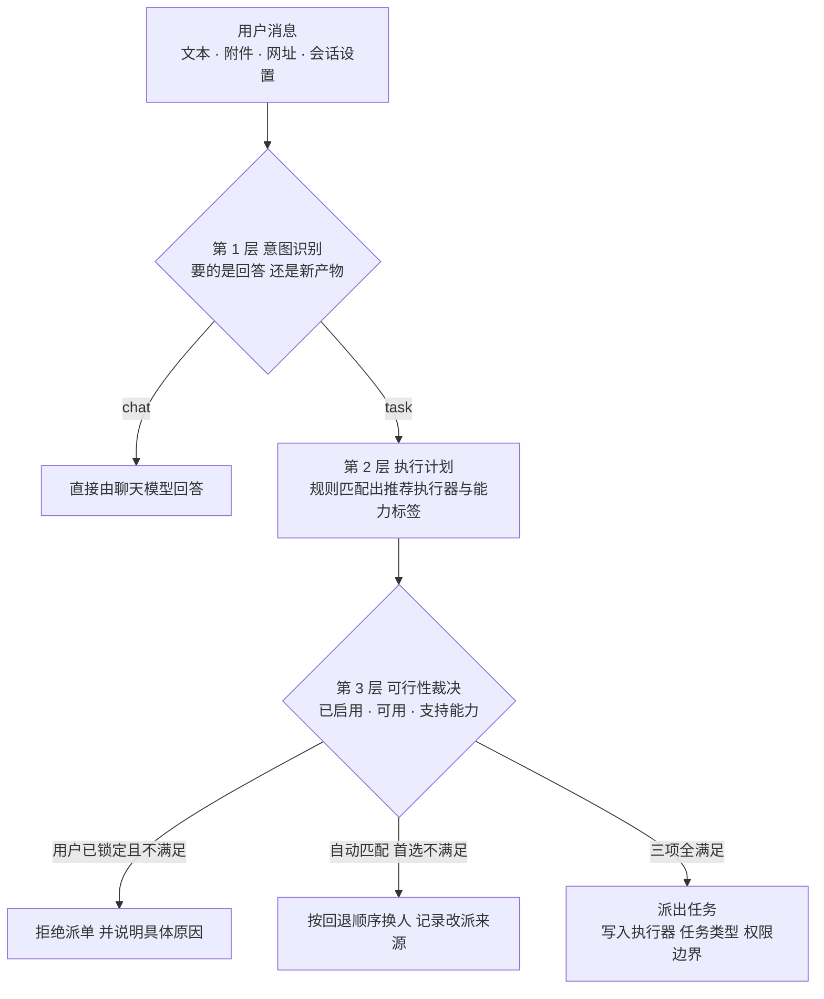

# Hearth OS｜意图识别路由：执行器是如何被自动选中的

> 基于实际源码梳理（未参考项目文档） · 整理于 2026-11-13
> 本文只讲设计思路，不贴源代码。

---

## 一、先分清两条「路由」

项目里有两个名字相近、但完全独立的模块，容易混淆：

| 模块 | 做什么 | 是否选择执行器 |
| --- | --- | --- |
| 外部消息入口分拣（`intake-router.ts`） | 用正则把来信分成「忽略 / 需关注 / 任务 / 闲聊」，只写一条决策记录 | ❌ 否 |
| 对话链路（`chat.ts` → `executors.ts` → `chat-routes.ts`） | 判断用户这句话要不要派单，并自动挑一个执行器去跑 | ✅ 是，本文主角 |

> 前者是「注意力分拣」，后者才是「执行器自动选择」。下面只讲后者。

---

## 二、一句话总览

核心设计是**把三个问题彻底拆开，逐层收窄**：

1. **要不要执行？** —— 语义判断，交给模型，但用规则双向纠错。
2. **该推荐谁？** —— 纯关键词规则，不经过模型。
3. **现在真能派给它吗？** —— 结合开关、健康状态、能力约束做最终裁决。

最值得注意的一点：**模型只负责「要不要干活」这一个问题，选哪个执行器完全由确定性规则决定**。这样结果可预测、可单测，也不会因为模型幻觉选到一个不存在或没安装的执行器。

---

## 三、第 1 层｜意图识别：要不要执行

**输出只有一个二分类：`chat`（用文字回答）或 `task`（派单执行）。**

### 硬规则先行

- **带附件 → 直接判 `task`**：聊天模型读不到附件内容，只能交给执行器处理。
- **没配置聊天模型 → 跳过模型**：直接退回关键词启发式。

### 模型路由器

用一段专门的提示词，要求模型**只输出一个 JSON**（动作 / 标题 / 原因），温度 0、限 160 tokens、20 秒超时。判据写得非常明确：

> 用户要的是「解释」，还是「一个新的产物」？网址和附件只是上下文，本身不等于任务。

提示词里还配了四组正反示例，例如「介绍一下这个 GitHub 项目」是问答，而「帮我总结这个网页并保存成文件」是任务。

### 双向校正（最用心的部分）

模型判完不算数，规则还会从两个方向纠偏：

| 方向 | 触发条件 | 纠正动作 |
| --- | --- | --- |
| 防「过度派单」 | 模型判 `task`，但带网址/附件且文本是「介绍、是什么、为什么、怎么样」这类解释性提问 | 拉回 `chat` |
| 防「漏派任务」 | 模型判 `chat`，但命中强制任务规则：要截图、要读取自己仓库的 PR、或用户已显式选了执行器且关键词像干活 | 拉回 `task` |

### 层层降级，永不硬失败

模型 JSON 解析失败、超时、抛异常 → 一律回落到关键词启发式。启发式同样有正反两组：

- 「怎么 / 为什么 / 什么是 / 请问」开头的解释性问句 → 优先判 `chat`；
- 「帮我 / 生成 / 修复 / 导出 / 运行 / 整理」等执行类动词 → 判 `task`。

> 小结：模型负责语义，规则负责兜底与纠错，两者互相拉扯，既不误派也不漏派。

---

## 四、第 2 层｜执行计划：推荐谁来做

**这一层完全不用模型，是按优先级短路匹配的确定性规则。**

| 优先级 | 命中特征 | 推荐执行器 | 任务类型 | 附带约束 |
| --- | --- | --- | --- | --- |
| 1 | 截图 / 截屏 / 桌面画面 | 原生执行器 | 通用 | 能力标签「桌面截图」，预期产出图片 |
| 2 | GitHub / PR / 拉取请求 | Codex | 工作区 | 能力标签「GitHub」+ 网络白名单（github.com 等） |
| 3 | 代码 / 仓库 / 测试 / 构建 / 重构 / 修复 等 | Codex | 工作区 | 预期产出结果文档 |
| 4 | 其余（文档、整理、分析、网页任务） | 原生执行器 | 通用 | 预期产出结果文档 |

产出的「执行计划」包含四件事：

- **推荐执行器**
- **任务类型**（通用 / 工作区）
- **预期产物**（结果文档或图片）
- **能力标签与网络白名单**

> 关键设计：能力标签不只是选人依据，它同时决定权限边界。意图识别在这里直接连到了安全策略，而不是先选人再补权限。

---

## 五、第 3 层｜可行性裁决：最终谁真的跑

推荐值不等于最终值。**首选 = 用户锁定值 ?? 计划推荐值**，然后经过三重过滤：

1. **是否启用**
   会话级开关。默认开启原生 / Codex / Hermes；DeepSeek 需要绑定模型档案，外部 CLI 需要检测到已安装或已配置命令。设置分三层：**全局偏好 → 会话设置 → 单条消息临时覆盖**（临时覆盖不落库）。

2. **是否可用**
   健康探测结果。本质是跑一个最小探针、要求执行器返回固定应答；原生执行器默认恒可用，其余都要真实探测通过。

3. **是否支持该能力**
   能力白名单。例如「桌面截图」只允许原生执行器；「GitHub」允许多数执行器，但不含部分外部 CLI。

### 两种模式，行为完全相反

| | 自动匹配（默认） | 用户锁定执行器 |
| --- | --- | --- |
| 首选不满足条件 | 按固定顺序回退到第一个三项全满足的执行器 | **绝不换人**，直接拒绝派单 |
| 回退顺序 | DeepSeek Harness → Codex → 原生 → Hermes → Qoder → WorkBuddy → Kimi | 无 |
| 用户看到什么 | 返回「改派自谁 + 中文原因」，助手消息里说明已自动改由谁接管 | 提示具体原因（已关闭 / 不可用 / 不支持此能力），并引导切回自动匹配 |
| 聊天是否仍可用 | 是 | 是，拒派只影响任务 |

一个巧妙的细节：**若用户偏好与计划推荐不一致，回退队列会把「计划推荐的执行器」插到队首**，保证语义上最合适的人选优先于机械顺序。

---

## 六、结果如何落地与复用

**落地**

- 裁决结果通过 SSE 的 `routing` 事件回传前端，包含动作、计划、偏好、锁定标记、改派来源 —— **决策过程对用户可观测**。
- 判为任务时创建任务，写入执行器、任务类型、预期产物、网络白名单；发生改派时，助手消息会明说「原执行器不可用，已自动改由 X 接管」。
- 判为问答时走普通聊天流，前面的执行器计算不影响回答。

**同一套裁决逻辑在另外三处复用**

| 场景 | 为什么要重新裁决 |
| --- | --- |
| 任务提案确认时 | 等待用户确认期间，执行器可能已被关闭或探测失败 |
| 调度器取执行器 | 直接用任务上已固化的值；缺省时按「有模板 → Codex，否则 → 原生」兜底 |
| 运行中故障接管 | 仅当确属执行器故障，才按同一回退顺序换人；**锁定状态、评测任务、超过接管次数一律禁止自动切换** |

---

## 七、走一个完整例子

用户说：「**请你审核我的 GitHub 仓库中目前开着的 PR，列出需要回复或 rebase 的**」

1. **意图识别**：无附件；模型可能因「列出」判成问答，但强制规则识别到「PR + 指向自己仓库」→ 纠正为 `task`。
2. **执行计划**：命中 GitHub 关键词 → 推荐 Codex，任务类型「工作区」，能力标签「GitHub」，网络白名单放行 github.com 与 api.github.com。
3. **可行性裁决**：
   - 若用户没锁定执行器，且 Codex 被关闭 → 按回退顺序找到原生执行器（它支持 GitHub 能力）→ 改派，并记录「改派自 Codex」。
   - 若用户显式锁定了原生执行器 → 直接用原生执行器，不换人；若它被关闭，则拒绝派单并提示原因。
4. **落地**：创建任务，带上执行器、任务类型、预期产物与网络白名单，前端同时收到 `routing` 事件展示决策依据。

---

## 八、这套设计的三个亮点

1. **职责分离**：模型只做语义二分类，选执行器交给确定性规则 —— 可预测、可测试、不受模型幻觉影响。
2. **层层降级，永不硬失败**：模型 → 关键词 → 默认问答；首选 → 有序回退 → 明确拒绝并给出可操作提示。任何一环出错都不阻塞聊天。
3. **用户显式意图优先级最高**：手动选择等于锁定，连自动改派都会被抑制；同时这个选择还会反向增强「这是任务」的判定，避免把明确的执行请求当成闲聊。

---

## 附：源码定位索引

| 职责 | 文件 |
| --- | --- |
| 意图识别（二分类 + 双向校正 + 启发式） | `apps/server/src/chat.ts` |
| 执行计划（规则匹配） | `apps/server/src/chat.ts` |
| 任务意图关键词（截图 / GitHub / 代码 / 联网） | `apps/server/src/task-intent.ts` |
| 执行器清单、能力白名单、回退顺序、两种裁决 | `apps/server/src/executors.ts` |
| 主链路编排（串起三层、SSE 回传、创建任务） | `apps/server/src/chat-routes.ts` |
| 执行器健康探测 | `apps/server/src/executor-runtime.ts` |
| 提案确认时重新裁决 | `apps/server/src/service.ts` |
| 调度取执行器、失败接管 | `apps/server/src/scheduler.ts` |
| 外部消息入口分拣（非执行器路由） | `apps/server/src/intake-router.ts` |
