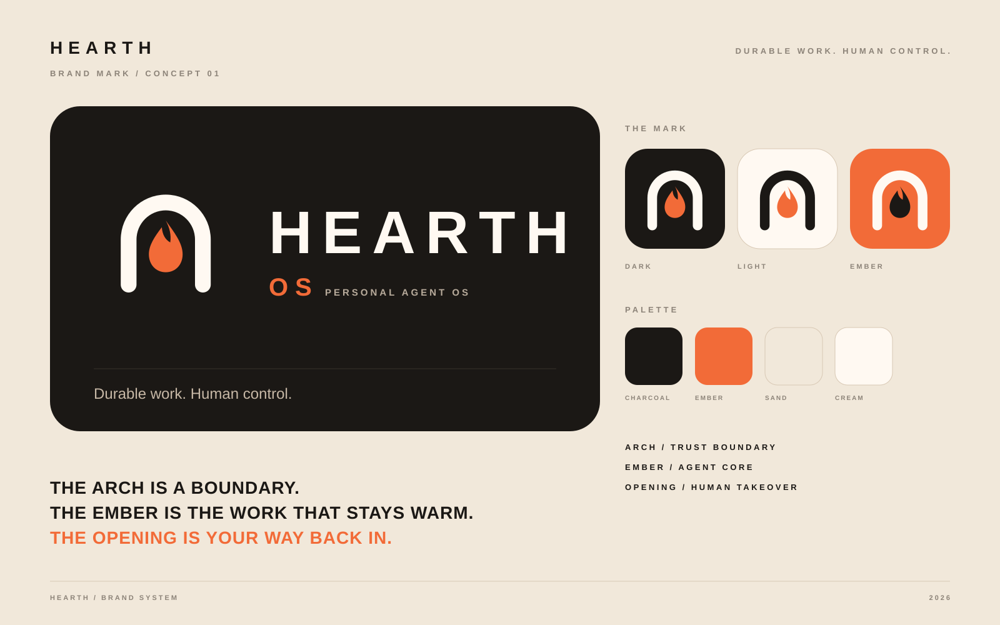

# Hearth Brand Mark

## Direction

**The Hearth Arch** is an open stone arch holding a warm ember.

- The arch is the trust boundary around the personal Agent OS.
- The ember is the durable work and the agent core that stays alive between runs.
- The opening is the human path back in: approval, takeover, and recovery.
- The continuous rounded stroke reads as an operating loop, while its open base avoids the feeling of a sealed black box.

The mark avoids the usual AI vocabulary of brains, sparkles, robots, and neural networks. It is intended to feel warm, private, self-hosted, and dependable rather than futuristic for its own sake.

## Assets

| File | Use |
|---|---|
| `hearth-mark.svg` | Primary symbol on light backgrounds |
| `hearth-mark-reverse.svg` | Symbol on charcoal backgrounds |
| `hearth-app-icon.svg` | App icon and avatar source |
| `hearth-logo.svg` | Organization lockup |
| `hearth-os-logo.svg` | Hearth OS product lockup |
| `hearth-brand-board.svg` | Concept overview and usage reference |

PNG exports are included for quick preview and for environments that do not support SVG.

## Palette

| Name | Hex | Role |
|---|---|---|
| Charcoal | `#1B1815` | Primary ink and dark surface |
| Ember | `#F26B38` | Agent core and active state |
| Sand | `#F1E8DA` | Warm background |
| Cream | `#FFF9F2` | Reverse mark and light surface |
| Stone | `#8C8378` | Secondary text and rules |

## Usage

- Keep clear space around the mark equal to at least half the width of the ember.
- Use the arch-only symbol without a wordmark below 40 px.
- Do not add glows, gradients, shadows, or photo textures to the mark.
- Do not stretch, skew, or rotate the mark.
- Keep the ember orange as the only accent color in the primary identity.
- The `HEARTH` wordmark is a working organization name until the organization has a final name; replace the text without changing the symbol.
