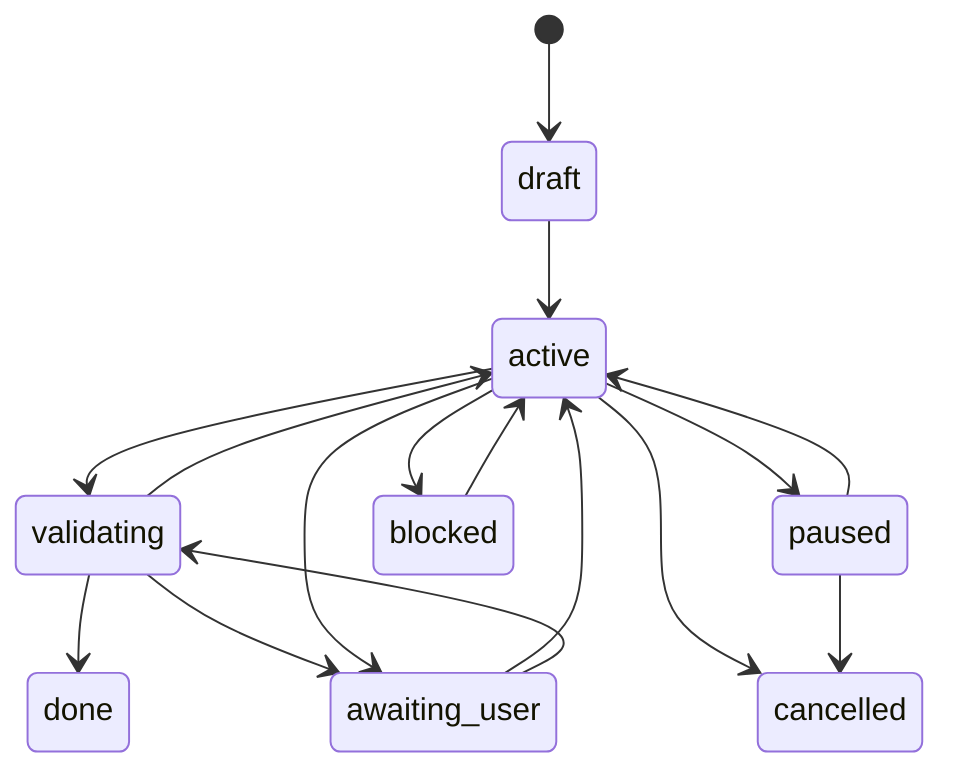

# 目标模式

<p class="lead">目标模式把“持续做到某件事”从一个任务里的循环，提升为 Hearth 的一等状态：目标跨多轮和重启继续存在，每一轮都有独立的意图、产物、预算和验收记录，只有通过验收或用户确认才算完成。</p>

## 为什么不是一次长任务

一次任务的预算是有限的，执行器上下文最终会满，宿主也可能重启。把目标塞进一次运行，会出现三个问题：模型自评就能宣布完成；重启后不知道上一轮做到哪里；同一目标重复创建任务，工作区、检查点和产物无法继承。

目标模式采用“一个目标、一个锚点任务、多个轮次运行”的模型。目标保存要达成的结果、约束、成功标准和证据要求；锚点任务保存工作区、检查点和产物；每一轮是锚点任务的一次运行。轮次之间复用同一个任务和真实执行根，避免每轮从零开始。

## 目标契约

目标由用户创建，模型只能读取和提交本轮意图，不能创建目标或直接关闭目标。契约在创建时冻结：

| 字段 | 作用 |
|---|---|
| `objective` | 要达成的最终状态，而不是一次动作 |
| `constraints` / `forbiddenActions` | 不允许违反的边界；禁止动作会与审批和副作用记录匹配 |
| `successCriteria` | 文件、git、命令、schema、人工或模型评审六类验收项 |
| `evidenceRequirements` | 必须出现的相对路径、产物或运行证据 |
| `budget` / `deadline` | 目标级 token、时长、轮次与截止时间 |
| `reviewPolicy` | `auto`、`human_on_risk` 或 `human_on_complete` |
| `maxRounds` | 默认 24，范围 1–200；达到上限必须由用户决定是否继续 |

## 状态机



`armed` 是独立的宿主开关，表示“是否允许自动开下一轮”。它不是目标状态：暂停、等待用户、宿主重启都会关闭它；用户确认继续后才重新打开。这样界面不会因为状态是 `active` 就误以为系统会自动推进。

## 轮次与准入

调度器用 30 秒一次的 tick 检查每个目标，但真正能否开轮由 `shouldRun` 决定，顺序固定：

1. 目标正在验收 → 等验收结束。
2. 目标在等待用户 → 不自动推进。
3. 目标不是 `active` → 不推进。
4. `armed` 为 false → 不推进。
5. 已有未结束的轮次 → 不重复开轮。
6. 锚点任务仍处于排队、运行、等待或可恢复状态 → 先处理任务。
7. 达到轮次上限 → 转 `awaiting_user`。
8. 超过截止时间或目标预算 → 停止并说明原因。
9. 未到 `nextWakeAt` → 退避等待。
10. 执行器不可用 → 保持目标，稍后再试。

只有全部通过，调度器才为同一锚点任务创建一个 `origin: "goal"` 的内部 follow-up，任务进入下一轮。内部 follow-up 不产生用户聊天消息，也不会被当成用户新指令。

## 每轮提示词

每轮开始前，Hearth 重新构造目标快照，而不是把上一轮的完整对话再灌一遍。提示词包含：目标、约束、禁止动作、成功标准、证据要求、当前轮次、最近两轮摘要、上一轮验收结论和本轮意图协议。模型被要求只推进一个有界片段、沿用已有工作区和产物、不要重复没有产生进展的动作。

## 意图协议

每轮结束前，执行器必须在本次运行输出目录写入 `goal-intent.json`：

```json
{
  "status": "progress | complete | blocked | needs_input",
  "note": "本轮结果摘要",
  "evidence": ["相对路径或产物 id"]
}
```

原生执行器通过宿主注入的 `update_goal` 工具写入；其他执行器按提示词直接写文件。解析失败或缺失时按“没有意图”处理，不会把自然语言里的“完成了”当成完成请求。`complete` 只是请求，最终由独立验收器判定。

## 独立验收

验收器不读取模型的自我评价，只检查目标契约与宿主观察到的事实：

- `file`：相对路径存在、可选 sha256；绝对路径和越界路径直接失败。
- `git`：分支、clean 状态、HEAD commit；通过 argv-only 的受限命令执行。
- `command`：创建目标时冻结 argv，必须显式确认 `commandsApprovedAt`，禁止 shell、解释器和删除类命令，默认 120 秒超时。
- `schema`：Ajv 校验 JSON 文件。
- `manual`：永不自动通过，只转人工。
- `llm_review`：单独模型调用，严格解析 `{"verdict":"pass|fail","reason":...}`；解析失败按未运行处理。

没有显式成功标准时，使用一条隐式的 `llm_review` 标准判断目标整体是否达成。所有必需标准通过、无缺失证据、无禁止动作命中，验收才是 `pass`。缺证据、缺评审或不确定一律 `needs_human`，不会“默认通过”。

## 完成策略

`reviewPolicy` 决定验收通过后的动作：

- `auto`：通过即 `done`。
- `human_on_risk`（默认）：通过但缺证据或命中禁止动作时转 `awaiting_user`；否则 `done`。
- `human_on_complete`：通过后也必须用户点“确认完成”。

验收失败时目标回到 `active` 继续修；连续两轮验收失败或验收器不可用，转 `awaiting_user`，避免无限自修复。

## 重启与恢复

宿主启动时对所有非终态目标执行 `recoverOnBoot()`：关闭 `armed`，把仍在运行的轮次标为 `interrupted`，写入 `stopReason: host_restart`。未决审批、未对账的外部副作用和未完成的交接不会自动开新轮；用户确认当前状态后才能继续。

所有目标写入都递增 `revision`，HTTP 动作可以携带 `expectedRevision`。版本不匹配返回冲突，避免旧界面把已经变化的暂停/继续状态覆盖掉。历史只追加补偿事件，不物理删除。

## API 与界面

```text
GET  /api/goals?conversationId=&projectId=&includeTerminal=
POST /api/goals
GET  /api/goals/:id
POST /api/goals/:id/actions   start|pause|resume|stop|replan|complete|approve
```

聊天入口增加 `goalMode` 与 `goalSettings`。界面在输入框提供 Target 开关和设置对话框，在聊天顶部显示目标栏：状态、轮次、下一步、暂停/继续、重规划、验收和停止。`/goal <目标>` 创建目标，`/goal pause|resume|stop|replan|complete|status` 控制当前目标。

## 边界

一个会话最多一个非终态目标，一个目标同时只有一轮在运行。子代理不注入目标工具。锚点任务仍然遵守任务预算、审批和检查点规则；目标级预算单独累计。旧的单次运行内 `.hearth/goal.json` 语义保留，但由宿主管理的目标会屏蔽内置目标工具，避免两层目标互相抢占。
