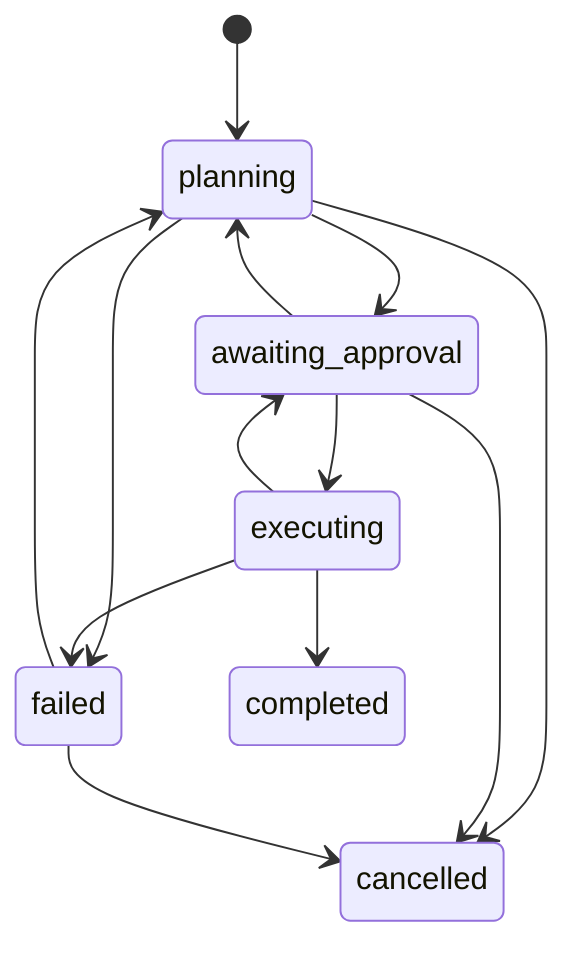

# 计划模式

<p class="lead">计划模式把“先想清楚再动手”做成会话的一等阶段：规划任务只能读、不能改；方案完整后才进入待批准；只有用户明确批准，Hearth 才会创建新的执行任务并放开写权限。</p>

## 为什么需要独立阶段

普通任务默认边想边做，遇到大范围重构、跨模块迁移或高风险操作时，模型容易在调查尚未完成时就改文件。计划模式参考 Codex 的三段式工作流，把环境取证、意图澄清和实现决策固定在执行之前；同时用 OpenCode 的独立 Plan Agent 形态承载规划任务，并用持久化状态保证重启后不会静默开跑。

## 状态机



一个会话同时最多一个非终态计划；计划与目标不能在同一轮执行。所有计划写入都递增 `revision`，动作可以携带 `expectedRevision`，旧界面不会覆盖新状态。

## 规划任务

创建计划时，Hearth 创建一个 `mode: "plan"` 的规划任务，绑定同一个项目和工作区。规划阶段：

1. **环境取证**：先用只读工具检查真实文件、配置、测试和依赖，不靠猜测设计。
2. **意图澄清**：只有会改变实现方向的关键歧义才调用 `ask_user`，一次只问最关键的问题。
3. **实现决策**：调查充分后提交完整方案。native 调用 `submit_plan`，Codex 返回最终回复，DSH 调用原生 `exit_plan_mode`；Hearth 校验正文后统一写入宿主数据目录的 `plans/<planId>.md`。

规划阶段只授予只读工具和提问、提交方案能力；shell 只允许 `git status/diff/log`、列目录、读取和查看版本等只读命令。执行器不能写工作区或决定规范计划路径，规划正文通过结果交回 Hearth。普通澄清问题会让计划保持 `planning`，不会因为缺少方案章节失败。提交计划后必须结束本轮，不问“是否继续”。

如果用户在规划中继续发消息，Hearth 复用同一个规划任务和工作区，把反馈作为 `origin: "plan"` 的内部 follow-up 继续调查，而不是新建任务。

## 批准与执行

调度器收到有效的计划正文后，把它置为 `awaiting_approval`，聊天顶部出现计划栏。用户可以查看、修改意见、重新规划、退出，或明确批准。

批准时 Hearth 以数据库中的计划正文为权威，重写稳定的计划文件并记录 SHA-256，再创建一个新的 `mode: "build"` 执行任务。build 任务沿用计划的执行器配置，并在启动前重新读取规范文件校验哈希；文件缺失或被修改时拒绝执行。任务收到原始目标、已批准计划正文、规范路径和执行协议，计划记录进入 `executing`，会话回到 build 模式。

执行成功计划完成；执行失败转为 `failed`，可以按同一份计划重试，或重新进入只读规划。退出计划会取消规划或执行任务。

## 重启与恢复

计划、规划任务、执行任务和计划正文都写入 Eventlog。宿主重启时：

- `executing` 回到 `awaiting_approval`，旧的执行任务被取消，用户确认后才重新执行；
- 已经有正文的 `planning` 直接转到待批准；
- 规划任务可以恢复，但保持只读工具边界。

不会因为重启自动执行一份未经批准的计划。

## API 与界面

```text
GET  /api/plans?conversationId=&projectId=&includeTerminal=
POST /api/plans
GET  /api/plans/:id
POST /api/plans/:id/actions   approve|replan|cancel|retry
```

聊天入口增加 `planMode` 和 `planId`，会话设置增加 `collaborationMode: "build" | "plan"`。输入框有计划按钮和 Shift+Tab 切换；聊天顶部显示阶段、版本和批准/重试/重规划/退出操作。`/plan <目标>` 创建计划，`/plan status|approve|cancel|replan|retry` 控制当前计划。

## 边界

- 规划阶段只读，批准前不产生工作区改动。
- 计划正文必须包含真实文件路径、按顺序的步骤、验证命令和明确不做的事项。
- 计划批准后直接执行，不再次询问“是否继续”。
- 最终输出只保留结果、证据和仍存在的限制，不复述执行过程。
