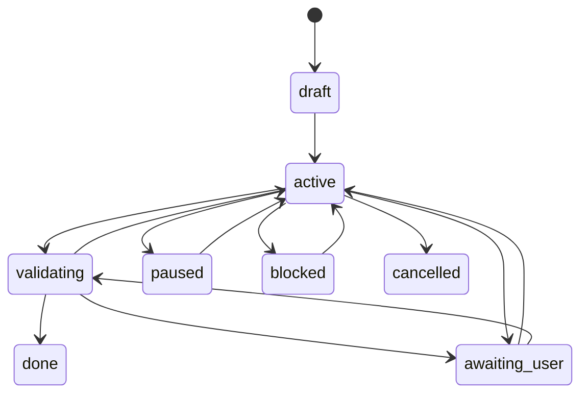

# Goal Mode

<p class="lead">Goal mode turns "keep working until this is done" into first-class Hearth state. A goal survives rounds and host restarts, and every round leaves its own intent, artifacts, and verification record. Only a passing verifier or an explicit user approval can close it.</p>

## One Goal, One Anchor Task, Many Runs

Executor context eventually fills and the host can restart. Putting a goal inside one run creates three failures: the model can declare success on its own, a restart loses where the last round stopped, and creating a new task per round loses the workspace, checkpoints, and artifacts.

Hearth keeps one goal contract, one anchor task, and one run per round. The goal stores the desired end state, constraints, success criteria, and evidence requirements. The anchor task stores the workspace, checkpoints, and artifacts. Rounds are runs of the same task and reuse the real execution root. This Hearth instance enforces no round, duration, token, tool-call, or artifact ceiling; a goal keeps advancing until its criteria pass, the user pauses it, or verification needs a human decision.

## Contract

Goals are created by the user. Models may read the contract and submit a round intent, but they cannot create a goal or close one directly. The contract is frozen at creation:

| Field | Purpose |
|---|---|
| `objective` | The end state, not a single action |
| `constraints` / `forbiddenActions` | Boundaries; forbidden actions are matched against approvals and effects |
| `successCriteria` | File, git, command, schema, manual, or model-review checks |
| `evidenceRequirements` | Required relative paths, artifacts, or run evidence |
| `reviewPolicy` | `auto`, `human_on_risk`, or `human_on_complete` |

`budget`, `deadline`, and `maxRounds` remain in the record types for backward compatibility, but this instance neither writes nor enforces them.

## State And Armed



`armed` is a separate host switch that allows automatic next rounds. Pausing or waiting for a human clears it; on host restart Hearth pauses an in-progress goal and clears the switch until the user explicitly resumes it.

## Round Admission

A scheduler tick checks goals every 30 seconds; `shouldRun` decides in a fixed order:

1. Verifying → wait.
2. Awaiting user → do not advance.
3. Not `active` → do not advance.
4. `armed` is false → do not advance.
5. An open round exists → do not open another.
6. Anchor task is queued, running, waiting, or recoverable → settle that first.
7. Before `nextWakeAt` → back off.
8. Executor unavailable → keep the goal and retry later.

There is no round, deadline, or budget gate. Only verification that needs a human decision, or an explicit pause, stops automatic progress.

Only then does the scheduler create an internal `origin: "goal"` follow-up on the same anchor task. It does not create a user chat message and is not treated as a new user instruction.

## Round Prompt And Intent

Each round gets a fresh goal snapshot instead of the previous full conversation: objective, constraints, forbidden actions, criteria, evidence, round number, the last two summaries, the previous verifier verdict, and the intent protocol. The model is told to keep advancing until the success criteria are met, reuse the existing workspace and artifacts, and avoid repeating actions that produced no progress. There is no bounded-slice quota.

Before finishing, the executor writes `goal-intent.json` into the run output directory:

```json
{
  "status": "progress | complete | blocked | needs_input",
  "note": "what changed this round",
  "evidence": ["relative/path/or/artifact-id"]
}
```

The native executor writes it through the host-provided `update_goal` tool; other executors write the file directly. A missing or malformed file counts as no intent. `complete` is only a request; the host verifier decides.

## Verification

The verifier never reads the model's self-assessment. It checks the contract against host-observed facts:

- `file`: relative path exists, optional sha256; absolute and escaping paths fail.
- `git`: branch, clean state, HEAD commit.
- `command`: argv frozen at creation and run by the host directly; no shell, no destructive binary, 120-second default timeout.
- `schema`: Ajv JSON-schema validation.
- `manual`: never auto-passes.
- `llm_review`: a separate model call returning strict `{"verdict":"pass|fail","reason":...}`.

Without explicit criteria, one implicit `llm_review` criterion judges the objective. All required criteria must pass, evidence must be present, and no forbidden action may be hit. Missing evidence, failed review calls, and uncertainty become `needs_human`, never an automatic pass.

## Completion Policy

- `auto`: pass means `done`.
- `human_on_risk` (default): pass with missing evidence or a forbidden action becomes `awaiting_user`; otherwise `done`.
- `human_on_complete`: pass still waits for explicit confirmation.

A failed verification returns to `active` for repair. Two consecutive verifier failures or an unavailable verifier becomes `awaiting_user`.

## Restart And Concurrency

On boot, Hearth marks open rounds `interrupted`, clears the backoff time, moves the goal to `paused`, records `stopReason=host_restart`, and sets `armed=false`; the user can resume after reviewing the contract, evidence, and external effects. A goal the user paused stays paused, and Hearth does not replay the old round. Pending approvals, unreconciled effects, and unfinished handoffs are not treated as completed just because the host restarted.

Every goal write increments `revision`; HTTP actions may carry `expectedRevision`. A mismatch returns a conflict instead of overwriting newer pause/resume state. History is append-only.

## API And Interface

```text
GET  /api/goals?conversationId=&projectId=&includeTerminal=
POST /api/goals
GET  /api/goals/:id
POST /api/goals/:id/actions   start|pause|resume|stop|replan|complete|approve
```

Chat accepts `goalMode` and `goalSettings`. The composer has a Target switch and a settings dialog; the chat header area shows a goal bar with state, round, next step, pause/resume, replan, verify, and stop. `/goal <objective>` creates a goal; `/goal pause|resume|stop|replan|complete|status` controls the current one.

## Boundaries

One non-terminal goal per conversation; one running round per goal; a goal and a plan cannot execute in the same turn. Subagents do not receive goal tools. The anchor task uses this instance's full-access permissions and checkpoint rules, with no goal-level or task-level budget ceiling. The older per-run `.hearth/goal.json` behavior remains, but host-managed goals hide built-in goal tools so the two layers cannot compete.
