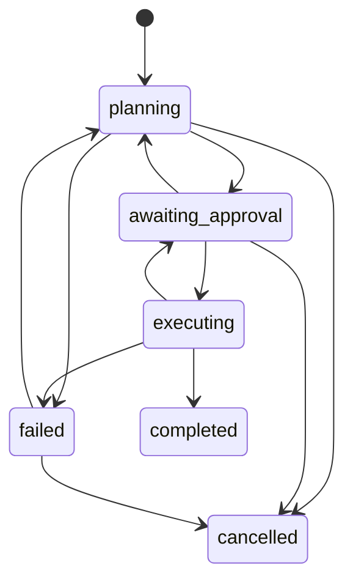

# Plan Mode

<p class="lead">Plan mode makes "think before acting" a first-class conversation stage: the planning task can read but never mutate, the plan becomes approvable only when complete, and Hearth creates a new execution task with write access only after the user approves.</p>

## Why A Separate Stage

Ordinary tasks act while thinking. For broad refactors, cross-module migrations, or risky operations, a model can start editing before investigation is complete. Plan mode follows Codex's three-stage workflow and fixes environment discovery, intent clarification, and implementation decision before execution. It uses OpenCode's independent Plan Agent shape for the planning task and persists every state so a restart cannot silently start executing.

## State Machine



One non-terminal plan per conversation; a plan and a goal cannot execute in the same turn. Every plan write increments `revision`; actions may carry `expectedRevision`, so a stale UI cannot overwrite newer state.

## Planning Task

Creating a plan creates a `mode: "plan"` task bound to the same project and workspace. The planning stage:

1. **Environment discovery**: inspect real files, configuration, tests, and dependencies with read-only tools instead of guessing.
2. **Intent clarification**: call `ask_user` only for an ambiguity that changes the implementation direction; ask one question at a time.
3. **Implementation decision**: when investigation is sufficient, call `submit_plan`, which writes the plan into `.hearth/plans/*.md`.

Planning receives read-only tools plus `submit_plan` and `ask_user`; shell is limited to read-only commands such as `git status/diff/log`, listing, reading, and version checks. `submit_plan` is the only write exception: it writes the plan file and nothing in the workspace. After submitting, the agent ends the turn and does not ask "shall I continue".

If the user keeps messaging during planning, Hearth reuses the same planning task and workspace and enqueues the feedback as an internal `origin: "plan"` follow-up.

## Approval And Execution

After `submit_plan` returns the plan body and real file path, the scheduler moves the plan to `awaiting_approval` and the UI shows a plan bar. The user can inspect it, request changes, replan, cancel, or approve explicitly.

Approval creates a new `mode: "build"` execution task with the plan's project, workspace, and executor profile. The task receives the original objective, the approved plan body, and an execution protocol. It runs with this instance's full access; the plan moves to `executing` and the conversation returns to build mode.

Successful execution completes the plan. Failure moves it to `failed`, where the user can retry the same approved plan or replan read-only. Cancelling closes the plan and its planning or execution task.

## Restart And Recovery

Plans, planning tasks, execution tasks, and plan bodies live in the event log. On boot:

- `executing` returns to `awaiting_approval`; the old execution task is cancelled and only explicit confirmation runs it again;
- `planning` with an existing body moves directly to approval;
- a planning task may resume but keeps its read-only tool boundary.

A restart never executes an unapproved plan.

## API And Interface

```text
GET  /api/plans?conversationId=&projectId=&includeTerminal=
POST /api/plans
GET  /api/plans/:id
POST /api/plans/:id/actions   approve|replan|cancel|retry
```

Chat accepts `planMode` and `planId`; conversation settings gain `collaborationMode: "build" | "plan"`. The composer has a plan button and Shift+Tab toggle; the chat header shows stage, revision, and approve/retry/replan/exit actions. `/plan <objective>` creates a plan; `/plan status|approve|cancel|replan|retry` controls the current plan.

## Boundaries

- Planning is read-only; no workspace change exists before approval.
- A plan must contain real file paths, ordered steps, verification commands, and explicit non-goals.
- Approval executes immediately without a second "continue?" prompt.
- The final response contains results, evidence, and remaining limitations, not a process narrative.
