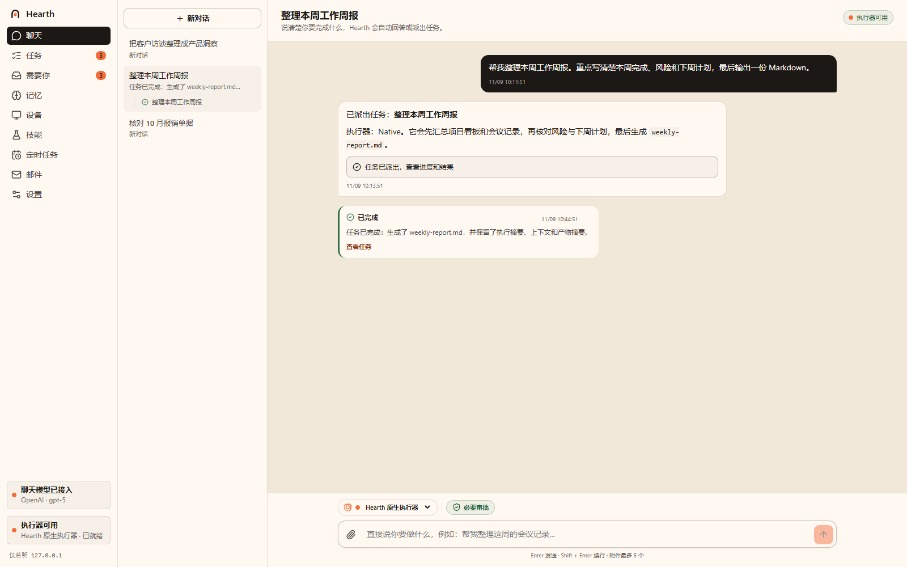
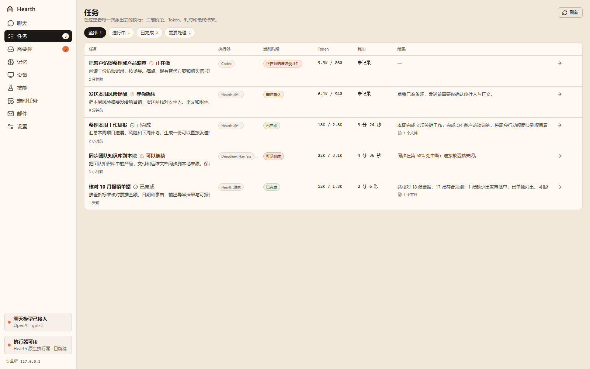
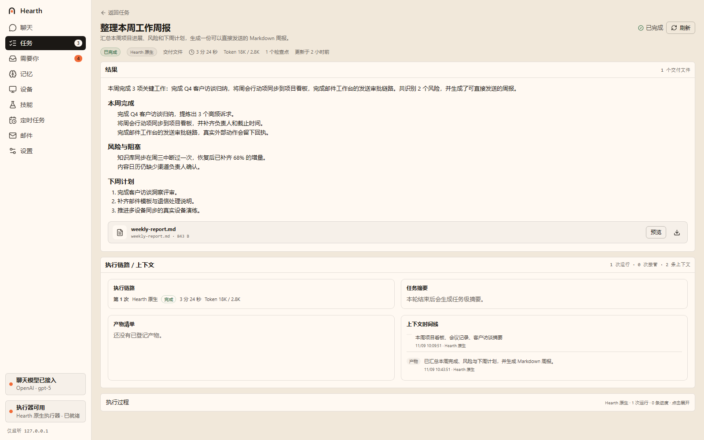
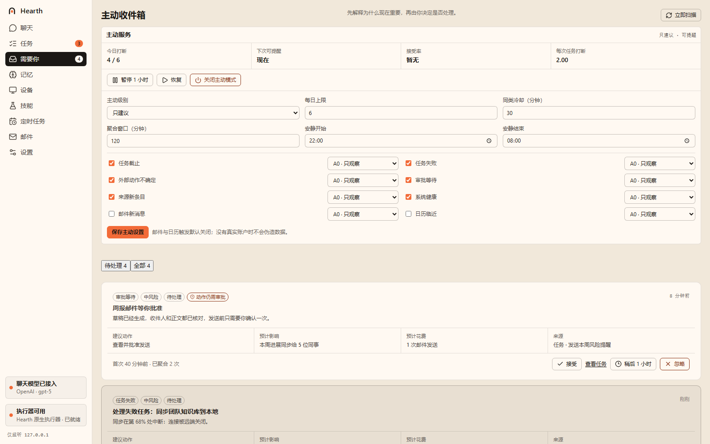
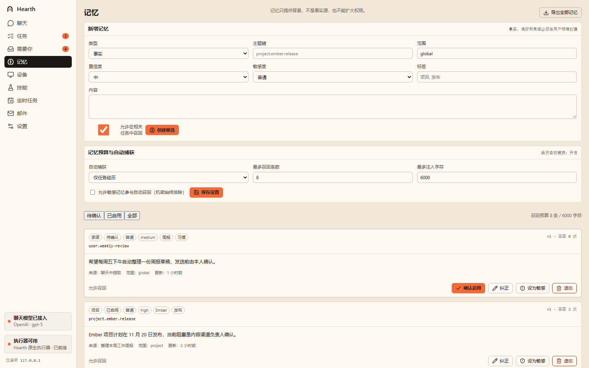
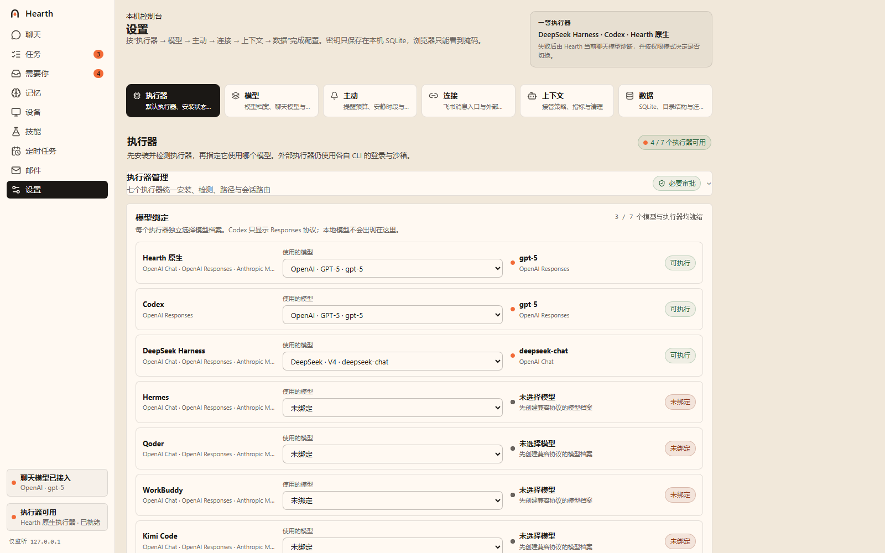

<nav class="home-quicklinks" aria-label="Documentation">
  <a href="#product">
    Product
    Chat, tasks, inbox, memory, and executors
  </a>
  <a href="/hearth-os/en/design/">
    Design
    Positioning, overall design, and nine modules
  </a>
  <a href="/hearth-os/en/delivery/">
    Delivery
    Phased plan from MVP to v1.0
  </a>
  <a href="/hearth-os/en/log/day-05.html">
    Dev Log
    Daily summary, commits, and concrete changes
  </a>
</nav>

## Product

  This is not a chat shell with a new skin. Each piece of real work becomes a traceable task: goal, executor, budget, approval, artifacts, and receipt all stay in one control surface.

<section class="home-showcase" aria-label="Hearth screenshots">
  <figure class="screenshot-spotlight">
    
    <figcaption>
      <strong>Chat workspace</strong>
      One intent becomes a task proposal; executor, stage, tokens, duration, and approval actions stay in context.
    </figcaption>
  </figure>

  

    <figure class="screenshot-card">
      
      <figcaption>
        <strong>Task list</strong>
        Running, waiting for approval, completed, and attention-needed work in one view.
      </figcaption>
    </figure>
    <figure class="screenshot-card">
      
      <figcaption>
        <strong>Task detail</strong>
        Goal, executor, budget, artifacts, and final result remain on record.
      </figcaption>
    </figure>
    <figure class="screenshot-card">
      
      <figcaption>
        <strong>Needs you</strong>
        Proactive suggestions can be accepted, ignored, snoozed, or converted into tasks.
      </figcaption>
    </figure>
    <figure class="screenshot-card">
      
      <figcaption>
        <strong>Memory</strong>
        Candidates, recall, correction, conflict, forgetting, and export all have explicit boundaries.
      </figcaption>
    </figure>
    <figure class="screenshot-card screenshot-card--wide">
      
      <figcaption>
        <strong>Settings and executors</strong>
        Model profiles, executor installation, health checks, protocol compatibility, and default routing in one place.
      </figcaption>
    </figure>
  

</section>

## Positioning

Hearth is not another chat shell, and it is not an agent that only serves code. It is a **task-centered personal control surface**: the user states intent; the system preserves the goal, assigns an executor, constrains authority, records evidence, and requires explicit approval before external actions.

<DocCardGrid :columns="3" :items="[
  {
    no: '01',
    title: 'Tasks first, not messages first',
    text: 'Every run has a goal, budget, checkpoints, and an artifact summary. Failures can be recovered; interruptions can be resumed.',
    link: '/en/design/tasks',
    meta: 'Durable execution'
  },
  {
    no: '02',
    title: 'Approve external effects, then keep receipts',
    text: 'Email, desktop actions, and external comments produce a preview first; one-time approvals bind to a parameter fingerprint.',
    link: '/en/design/effects',
    meta: 'Approval & effects'
  },
  {
    no: '03',
    title: 'Swap executors without losing the record',
    text: 'The native runtime, Codex, DeepSeek Harness, and external executors share a registry, routing, and run manifest.',
    link: '/en/design/executors',
    meta: 'Seven executors'
  }
]" />

## Start here

<DocCardGrid :columns="2" :items="[
  {
    title: 'Delivery and status',
    text: 'Phase 1 MVP is accepted; phases 2–6 have working code loops, while real-user and long-running acceptance is still in progress.',
    link: '/en/delivery/status',
    meta: 'Current status'
  },
  {
    title: 'Storage and backup boundaries',
    text: 'SQLite data domains, context lifecycle, encrypted backup, and why a recoverable database is not a portable artifact archive.',
    link: '/en/design/storage',
    meta: 'Data & backup'
  }
]" />
