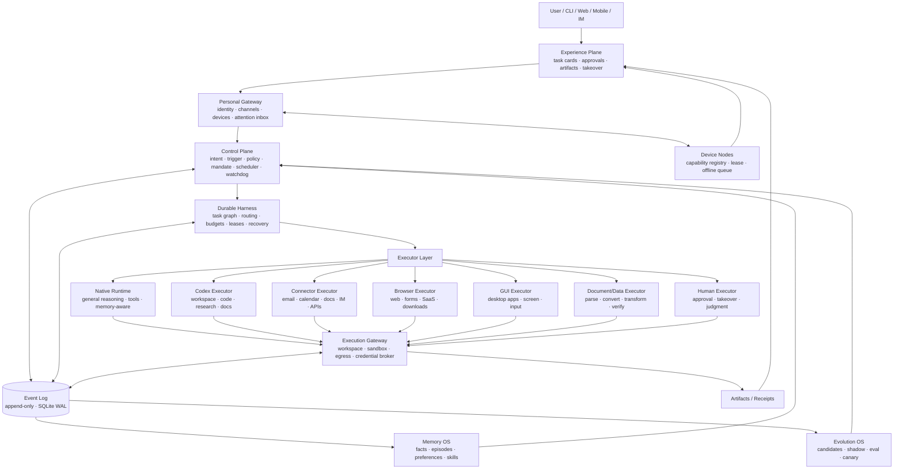

<p class="eyebrow">ARCHIVE</p>

# Complete Roadmap (Archive)

<p class="lead">This is the archived version of the complete main document, retaining all original details. For everyday reading, use the topic-reorganized chapter pages.</p>

---

## One-Page Summary

### Why It's Called Hearth

Hearth is the "hearth"—the most central, warmest, and most suitable place in the home for long-term dwelling.

This name corresponds to the product's most important qualities:

- It should be online long-term, but not constantly interrupting;
- It should have capability, but not turn the user into an ops engineer;
- It should remember life, but not turn privacy into a burden;
- It should guard daily life on people's behalf, letting their attention return to what truly matters.

The product name is **Hearth**, the GitHub repository is recommended to be **`hearth-os`**, the command-line entry point is `hearth`, the resident service is `hearthd`, and the package namespace is `@hearth/*`.

One-sentence positioning:

> **Hearth is a general-purpose personal Agent OS with personal context, durable execution, real tools, and multi-device entry points; it liberates people from repetitive digital labor rather than creating another chat window that needs to be watched.**

> It is not "hand everything to Codex," but rather lets Codex, Native, Connector, Browser, GUI, Document/Data, and Human each do the most appropriate segment under a unified Control Plane.

Among these, Codex is not limited to code, Issues, and PRs. It is a high-capability general-purpose Executor that can participate in research, long documents, reports, spreadsheets, code, and multi-file workspace tasks; but it remains only one of the Executor combinations, not the essence of Hearth. Hearth's capability boundary is jointly determined by the Executor combination, connectors, memory, verification, and permissions.

### What It Is Not

Hearth is not:

- Another Coding Agent;
- A Codex wrapper that only forwards prompts;
- A black-box automation that hands all permissions to the model;
- An assistant that only answers questions in a chat box;
- An enterprise multi-tenant Agent platform;
- A tool that requires users to maintain prompts, plugins, and workflows every day.

Hearth is:

- **A Control Plane**: decides what to do, whether it is allowed, when to interrupt, and how to recover;
- **A Durable Harness**: turns intent into recoverable, auditable execution with receipts;
- **A set of parallel Executors**: Native, Codex, Connector, Browser, GUI, Document/Data, Human, etc.;
- **A Memory OS**: lets people, projects, preferences, commitments, and experience be safely recalled;
- **An Evolution OS**: lets repeated successes settle into skills, but all changes go through evaluation and rollback;
- **A quiet Experience Plane**: carries interaction through task cards, approvals, and artifacts, rather than endless chat logs.

### Final Architecture

```text
User / CLI / Web / Mobile / IM
            ↓
     Experience Plane
     Task Card · Approval · Artifact · Takeover
            ↓
      Personal Gateway
   Identity · Channel · Device · Attention Entry
            ↓
       Control Plane
  Trigger · Policy · Mandate · Scheduling · Watchdog
            ↓
      Durable Harness
  Task Graph · Budget · lease · Retry · Recovery
            ↓
       Executor Layer
 Native · Codex · Connector · Browser
 GUI · Document/Data · Human
            ↓
     Execution Gateway
 Workspace · Sandbox · Network · Credential Broker
            ↓
  Event Log / Artifacts / Receipts
       ↓              ↓
   Memory OS      Evolution OS
```

All facts enter the Event Log; all external side effects pass through the outbox, idempotency keys, and Receipts; all interface state is a projection, not a source of truth.

### Five non-negotiable judgments

1. **Hearth's value lies in the control plane, memory, and verification, not in "implementing yet another model."**
2. **Codex is a powerful peer Executor, not the product itself, nor the sole execution brain.**
3. **Token consumption is an architectural metric, not an after-the-fact optimization; wherever a model is not needed, firmly do not use one.**
4. **The frontend must be simple enough that users don't need to learn Agent architecture; complex logic stays in the backend.**
5. **Self-evolution can only produce candidate skills and candidate policies; it cannot bypass permissions, evaluation, and human review.**

### North Star metric

> **The number of personal digital tasks completed by Hearth each week and verified automatically or confirmed by the user.**

Also tracked:

- Human minutes per verified completion;
- Interruptions per task;
- Tokens and cost per task;
- Recovery rate after crashes, offline periods, and device switches;
- Number of duplicate external side effects;
- Memory accuracy and forgetting compliance rate;
- Time for users to understand "what to do next."

### Delivery strategy: first become a usable minimal product, then grow into an Agent OS

Hearth's full goal is large, but development cannot follow the order of "first finish the kernel, executors, and backend entirely, then patch in the interface at the end." The correct order is:

1. **Stage 0 validates the product narrative first**: use a clickable prototype to walk through task creation, task cards, approvals, artifacts, and recovery paths, even if the data is fake.
2. **Stage 1 produces an MVP as early as possible**: deliver a genuinely usable local product on a narrow task family, including real execution, durable state, task cards, artifacts, and failure recovery.
3. **Every subsequent stage delivers a vertical slice**: user-visible results, frontend, backend, executors, verifiers, and recovery paths appear simultaneously; no milestones that have only the underlying layers and no product form.
4. **Narrow first, then broad**: first make one task family truly dependable, then expand to email, calendar, browser, desktop, proactivity, and multiple devices.
5. **No calendar commitments**: progress is driven by capability thresholds and real task evidence, not by "what step we reach in which week."

Here "100%" refers to the v1.0 exit at Stage 6, not an endpoint with no further evolution. See Chapter 25 for the complete incremental order and MVP definition.

---

## Product definition and boundaries

### Product definition

Hearth is a single-user, self-hosted, long-running personal Agent OS. It receives user intent, external events, and device requests, schedules different executors to complete content and operational work, and presents the process, artifacts, approvals, and receipts to the user in a unified way.

Its core purpose is not "to make the model talk more," but to:

- reduce repetitive labor;
- lower attention switching;
- connect cross-application workflows;
- preserve personal context;
- recover from failures and stop before risks.

### Primary Persona

| Item | Assumption |
|---|---|
| User | 1 primary user, possibly with 1–3 trusted collaborators |
| Devices | One primary computer, one always-on machine, one phone, later expanded to multiple devices |
| Work | A mix of research, writing, documents, email, scheduling, code, Issues, PRs, data, and web operations |
| Technical ability | Can run local services, but does not want to maintain Agent configuration every day |
| Privacy requirements | Personal files and credentials must not be uploaded to untrusted third parties by default |
| Usage mode | Proactive tasks, scheduled tasks, notification-triggered tasks, and manually initiated tasks coexist |

The first version does not aim for "everyone can use it," but for "one real user is willing to use it every day."

### Coverage matrix

"Digital content work that almost anyone can do" is defined by the following eight categories, not by software names:

| Task family | Typical work | Preferred execution method |
|---|---|---|
| Communication and collaboration | Email, IM, meeting notes, follow-ups, schedule coordination | Connector + Native/Codex + approval |
| Documents and content | docx, xlsx, pptx, PDF, Markdown, reports, translation, rewriting | Document/Data Engine, Native, Codex |
| Research and information organization | Search, reading, comparison, citation, summarization, knowledge base | Native + Browser + Codex |
| Code and R&D | Repository changes, testing, Issue triage, PR preparation, code review | Codex + test/CI tools |
| Data and spreadsheets | Cleaning, reconciliation, statistics, charts, import/export | Document/Data Engine + Python sidecar |
| Web and SaaS | Login, forms, downloads, uploads, back-office operations | Browser Executor |
| Desktop applications | Software without APIs, system settings, cross-application workflows | GUI Executor |
| Personal affairs | Forms, appointments, bills, reminders, device operations | Connector, Browser, GUI, approval for high-risk actions |

The same task can be handled by multiple executors collaboratively. For example, "research a competitor and write it into the weekly report" may use Browser, Native, Document Engine, and Codex simultaneously; it is not a single tool completing all steps alone.

### Autonomy levels

| Level | Behavior | Default use |
|---|---|---|
| A0 Suggest | Only generates suggestions, drafts, or plans | New scenarios, high risk, unverified capabilities |
| A1 Controlled execution | Automatically completes low-risk steps; first-time approval for medium risk | Default for Stage 1–2 |
| A2 Authorized execution | Automatically completes authorized actions within a Mandate; high risk still requires approval | After Stage 4 |
| A3 Supervised autonomy | Runs over long periods, but retains approvals, budgets, kill switch, and receipts | Long-term goals |

Autonomy must be configured independently by task family, source, time period, device, risk, and amount.

### Definition of "done"

Different tasks require different verifiers:

| Task | Evidence of completion |
|---|---|
| Code/Issue/PR | Tests, type checks, diff, CI, or human review |
| Documents | Structure checks, citation checks, format checks, user acceptance |
| Email drafts | Recipient, fact, and tone checks; approval before sending |
| Email sending | Approval, Broker execution record, provider message id, or an explicit uncertain state |
| Web operations | DOM/accessibility state, screenshots, final state, and receipt |
| Desktop operations | Accessibility tree, screenshots, target state, and human confirmation |
| Research | Sources are traceable; key assertions are cited |
| Scheduling | Time, time zone, participants, conflict checks, and calendar receipt |
| Data | Schema, row counts, sampling, reconciliation, and reproducible scripts |

Natural-language "done" is not evidence of completion. Hearth only trusts locatable artifacts, reproducible checks, and auditable receipts.

### Explicitly out of scope

- Physical-world robot operation;
- Assuming professional responsibility on the user's behalf in legal, medical, financial, or other domains;
- Unapproved payments, contracts, deletions, public releases, or permission changes;
- 100% unattended operation of arbitrary software;
- Enterprise IAM, multi-tenancy, organizational audit, and billing;
- Covering all eight task categories on day one;
- Competing with underlying model vendors on model capability;
- Manufacturing an illusion of "human-likeness" through unbounded autonomous loops.

### Experience commitments

Hearth's experience should satisfy:

- Users know at a glance what the Agent is doing;
- When a human is needed, only one clear action appears;
- No need to understand internal terms such as Worker, Harness, or Token;
- The phone can handle viewing, approval, takeover, and initiation;
- Any failure shows the cause and recovery options;
- Notifications are predictable, not random.
- From the first runnable increment, users can complete tasks through a real interface, rather than only seeing capabilities in the CLI, logs, or tests.

---

## Core design judgments

### Not another Coding Agent

Coding Agent is an executor category within Hearth, not the product category.

What Hearth must solve is:

- Cross-application work across email, calendar, documents, research, web, desktop, and devices;
- Personal affairs that require long-term memory and proactivity;
- Multi-device, mobile approval, and low-interruption interaction;
- System-level governance of Tokens, permissions, recovery, and evaluation.

If it only did "modify code in a terminal," this project would have no reason to exist independently.

### Not a Codex wrapper

A thin wrapper quickly runs into three problems:

- Cannot control task state and recovery;
- Cannot prevent duplicate sends, duplicate writes, and permission overreach;
- Cannot accumulate personal memory or prove that capability is actually improving.

Therefore Hearth must build in-house:

- Event log and task state;
- Control plane, policies, authorization, and approval;
- Durable Harness;
- Personal context and memory;
- Token budgets and routing;
- Skill evaluation and evolution;
- A concise task card frontend.

Can integrate:

- Models;
- Sandbox;
- Browser;
- Document parsing and conversion;
- External API connectors;
- Codex as a powerful workspace Executor.

### Codex Is a Powerful Peer Executor

Codex should not be narrowed down to a single development tool. It excels at:

- Long-horizon reasoning in isolated workspaces;
- Writing code, running tests, and modifying repositories;
- Handling Issues, preparing PRs, and performing code reviews;
- Investigation, synthesis, and structured research;
- Generating and modifying documents, reports, spreadsheets, and data files;
- Executing multi-step Shell operations, file conversions, and validation;
- Turning complex tasks into inspectable Artifacts.

It is not good at or suitable for:

- Directly managing email, calendars, and contacts;
- Serving as long-term memory;
- Serving as a center for permissions, approvals, or credentials;
- Listening for events continuously;
- Operating live desktops and GUIs;
- Directly operating phones and multiple devices;
- High-frequency, low-value notification triage;
- Sending and publishing that requires system-level side-effect Receipts.

Therefore, Codex is “one of multiple peer Executors,” not the only brain and not the only Worker. At present, Codex can be the only external Agent integrated, but inside Hearth there must be peer Executors such as Native, Connector, Browser, GUI, Document/Data, and Human.

The routing principle is not “let Codex handle everything,” but rather:

> **Choose the Executor that can complete and pass validation with the lowest Token cost, highest reliability, and least privilege.**

### Build vs Integrate

| Capability | Decision | Rationale |
|---|---|---|
| Control Plane | Build in-house | Deciding what to do, whether to allow it, and when to interrupt is the product core |
| Durable Harness | Build in-house | Task graphs, recovery, leases, idempotency, and budgets must be controllable |
| Event Log | In-house protocol | The source of truth cannot be outsourced |
| Memory | Build in-house | Provenance, conflicts, forgetting, and multi-device synchronization cannot be outsourced |
| Evolution | Build in-house | Skill promotion, evaluation, and rollback are the product moat |
| Token Governor | Build in-house | Requires governance across models, Executors, and Tasks |
| Frontend | Build in-house | Task cards, approvals, and low-interruption experience are differentiators |
| Models | Integrate, BYOM | Do not train models; retain the ability to swap them |
| Codex | Integrate | Currently the only external Agent integration; can serve as a general-purpose Executor for code, research, documents, spreadsheets, and complex workspace Task |
| Sandbox | Integrate; build the Policy layer in-house | Do not rewrite the container/VM kernel; control only workspaces, credentials, and egress |
| Browser | Integrate Playwright | Build validation, takeover, and Policy in-house |
| Document/Data | Integrate parsing and conversion tools | Build orchestration, validation, and minimal context extraction in-house |
| Connectors | Integrate official APIs/MCP | Build a unified Source/Effect model and security boundaries in-house |
| Observability | Integrate OpenTelemetry | Build trace semantics and Token attribution in-house |

The easiest thing to get wrong in this table is the boundary between Sandbox, model Runtime, and Agent Harness. Hearth’s product value does not lie in reimplementing containers, virtualization, model inference engines, or a complete third-party Agent framework. The recommended boundaries are:

- **Build in-house**: Durable Harness, Event Log, Policy, Mandate, Approval, Context Compiler, Token Governor, Memory, Evolution, and Task card UI;
- **Thin in-house layer**: adapters for Codex, Browser, connectors, document engines, and Sandbox, plus result validation, error normalization, cancellation, recovery, and takeover;
- **Integrate**: model APIs or local models, containers/microVMs, Playwright, document parsing/conversion libraries, and official email and calendar APIs;
- **Learning prototypes only**: a minimal event loop, session tree, context compression, and single-machine Sandbox wrapper. Prototypes can help clarify boundaries, but they do not enter the product foundation that must be maintained long term.

“Writing your own runtime and sandbox” has high value as a learning project, but as a product strategy it easily burns time on lower layers that cannot be differentiated. Hearth should focus its in-house effort on the questions that truly determine the quality of a personal Agent: “who acts under what permissions, with what context, to complete what, how completion is proven, and how to recover after failure.”

### Token Efficiency Is an Architectural Constraint

Token should not be treated as a consumable under the logic of “the model is smart, so using a little more does not matter.” Hearth treats Token as a budget on par with time, disk, and permissions:

- When a rule can decide, do not call a model;
- When a script can complete it, do not generate natural language;
- When a small model can classify, do not call a large model;
- When reading only file diffs is enough, do not reread the entire file;
- When an Artifact reference can be passed, do not stuff the full text into context;
- When it can be cached, do not recompute;
- When failure is certain and should be handed off to a human, do not retry indefinitely.

Token efficiency must be evaluated together with success rate and user time. Do not pursue “spending fewer Token” alone in a way that causes Task failure or increases human review cost.

### A Simple Frontend Is a Product Capability

Hearth’s complexity should remain in the Control Plane, Harness, Memory, and Executor layers, rather than being shifted to users.

The first principle of the frontend:

> **When users open Hearth, they only need to know three things: what it is doing, whether it needs me, and where to click next.**

Therefore:

- The home page is not an infinite chat stream but Task cards;
- Each state has only one primary action;
- Approvals are not hidden in multiple layers of settings;
- High-risk actions can be confirmed on a phone;
- Technical jargon does not enter the main interface;
- Every exception has an actionable recovery path.

Therefore, the development order cannot be “build the complete backend first, then wrap a frontend around it.” Hearth’s frontend must grow together with the kernel:

- At Stage 0, there are already clickable prototypes of Task cards, approvals, and Artifacts;
- Stage 1’s first runnable skeleton connects to real Task state;
- The MVP must allow users to create, view, approve, cancel, recover, and retrieve Artifacts through a browser;
- Each subsequent stage must project new capabilities into interface states that users can understand, operate, and recover from;
- Capabilities that exist only in the CLI, logs, database, or tests do not count toward stage completion.

The interface is not a decorative layer but the visible part of the product contract. Task cards, approvals, and the Artifact center in turn constrain the backend state machine, making the system expose ambiguous states, unrecoverable failures, and unnecessary steps earlier.

### One Logical Agent, Multi-Device Execution

Multiple computers are not multiple independent Agents, and a phone is not a second Agent.

The correct model is:

```text
One logical Hearth
  ├─ One primary Gateway / Control Plane
  ├─ One Event Log / single writer
  ├─ agentd on multiple devices
  ├─ Phone as the entry point for viewing, approval, takeover, and initiation
  └─ Each device registers its own capabilities
```

See Chapter 4 for specific constraints. The core principle is: share identity, events, memory, and authorization; devices provide only execution capabilities and interface entry points.

### Learn from OpenClaw and Hermes Without Becoming Them

What is worth learning from OpenClaw:

- Personal Gateway;
- Multi-channel routing;
- Device nodes;
- Always-on;
- Attention entry points;
- Autonomy levels.

What is worth learning from Hermes:

- Memory budgets;
- Memory constraints;
- Skill consolidation;
- Sub-Agent/subtask lifecycle;
- Self-evolution mechanisms.

But do not fork them, and do not use them as the product foundation. Hearth only absorbs patterns and implements them through its own Event Log, Policy, Memory, and Evolution protocols.

### Seven Architectural Invariants

1. Event Log is the single source of truth.
2. Each State Root has only one write authority.
3. All external side effects must have an idempotency key, approval or explicit exemption, and a Receipt.
4. Executors must not directly read long-term raw credentials.
5. Every Task must have a budget, deadline, and cancellation path.
6. Memory must have provenance, sensitivity, conflict, and forgetting policies.
7. Any self-evolution must go through evaluation, canary, and rollback.

### Delivery Invariant: Every Increment Is a Usable Vertical Slice

Any development increment declared "complete" must simultaneously have:

1. **User-visible outcome**: users can complete a concrete thing in the product, rather than only seeing internal modules pass tests;
2. **Frontend path**: from entry point, Task card, status, and primary action to Artifact or recovery, the interface is genuinely usable;
3. **Durable state**: after refresh, restart, or crash, Tasks and evidence do not exist only in memory;
4. **Real backend and Executor**: not permanent fake data, nor manual invocation only on a development machine;
5. **Verification evidence**: completion is proven through tests, diffs, citations, file checks, web page state, or business rules;
6. **Failure and recovery path**: users know what failed, what they can do, and which actions can be undone or compensated;
7. **Minimal metrics**: at least record the relevant items among success rate, human minutes, interruption count, Tokens, or cost.

Work that is only a horizontal foundation without a vertical product path can be an internal Task, but cannot become a phase milestone. This constraint takes precedence over the impulse to "connect a few more Executors first" or "complete the architecture first."

---

## Reference Systems and Learning Goals

### OpenClaw: Learn the Personal Gateway, Not Copy a Complete Agent

OpenClaw's core value is not in any single prompt, but in "how a personal Agent exists over the long term across multiple entry points and devices":

- **Gateway**: uniformly receives CLI, Web, mobile, IM, email, and scheduled events;
- **Channels**: normalize different messaging channels instead of having each channel implement the Agent itself;
- **Device nodes**: different devices register capabilities, and Tasks can be routed to suitable devices;
- **Always-on**: persistent operation, reconnection recovery, background Tasks, and proactive triggers;
- **Delegation**: different Tasks have different autonomy levels and takeover modes;
- **Attention**: more notifications are not better; they need aggregation, muting, and default actions.

Hearth adopts these patterns but explicitly does not:

- use OpenClaw as a runtime dependency;
- fork its complete product;
- replicate its channel scale and operational assumptions;
- let channel adapters have execution authority that bypasses Policy;
- misinterpret "always-on" as "unlimited interruption."

In Hearth's architecture, OpenClaw is not a Worker, nor is it the product foundation. It is better suited as a reference for a complete personal Agent product, not as the only Executor embedded in Hearth. Hearth's execution capabilities are provided by multiple parallel Executors such as Codex, Native, Connector, Browser, GUI, Document/Data, and Human; OpenClaw provides design experience for the Gateway, channels, device nodes, and attention entry points.

### Hermes: Learn Memory and Self-Evolution, Not Unbounded Self-Modification

Parts of Hermes worth studying systematically:

- **Memory budgets**: more memory is not better; there need to be budgets for total memory, individual entries, and injected Tokens;
- **Memory constraints**: which information can be written to long-term memory and which can only be retained short-term;
- **Skill consolidation**: distill repeatedly successful trajectories into reusable skills;
- **Subtask lifecycle**: sub-Agents or subtasks must have boundaries, budgets, termination, and reclamation;
- **Experience distillation**: extract candidate rules from failures and human corrections instead of retrying blindly;
- **Evolution loop**: candidate capabilities require evaluation, gradual rollout, rollback, and permission checks.

Hearth does not adopt:

- unbounded self-modification of the core Runtime;
- enabling new skills directly without evaluation;
- letting the Agent expand its own permissions;
- treating one success as a permanent capability;
- letting memory grow without bound;
- using "self-evolution" to conceal inexplicable drift.

### Other Reference Lines

| Reference | Learning Focus | Landing Point in Hearth | Explicitly Not Copied |
|---|---|---|---|
| Pi / Maka | Session tree, steering, compaction, Event Log, single writer | Native Runtime, Event Log, recovery | No sandbox, extensions sharing the trust boundary with the main process, overly large monolithic dependencies |
| DeerFlow | Harness/App layering, Run lifecycle, thread isolation, middleware | Durable Harness and module boundaries | Strong framework coupling, heavy service stack |
| OpenSandbox | Unified Sandbox API, credential isolation, egress, snapshots | Execution Gateway and remote execution | Strong dependency in the first phase |
| OpenBot | Agent Computer, isolated workspace, takeover, Receipt | Execution Gateway and human takeover | Do not copy the complete product |
| OpenMuse / OpenDots | durable jobs, checkpoints, lease, low-interruption experience | Harness and Attention | Single-container limitation, hosted core dependency |
| Codex | Workspace execution, code, research, documents, Shell, tests | One of the parallel Executors | Not as the product center, Task database, Memory, or permission center |

### Learning Evidence

Every reference line must produce verifiable artifacts, not just reading notes:

| Learning Topic | Required Deliverable |
|---|---|
| OpenClaw Gateway | Source→Trigger→Ticket→Run→Receipt closed loop; Gateway/Channel/Device boundary tests |
| Hermes Memory | Memory budget, conflict, forgetting, injection, and retrieval tests |
| Hermes Self-Evolution | A complete case of at least one skill going from trajectory to shadow, eval, canary, and rollback |
| Pi / Maka Runtime | Replayable session tree supporting branch, steering, and compaction |
| DeerFlow Harness | Harness/App one-way dependency checks and Run lifecycle tests |
| OpenSandbox / OpenBot | Attack matrix for workspace, network, credentials, snapshots, and takeover |
| OpenMuse / OpenDots | kill -9, lease, checkpoint, resume, and low-interruption Task card demo |
| Codex Executor | Version pinning, structured results, isolated workspace, cancellation, recovery, and failure attribution report |

### Evidence Boundaries

- Reference projects provide only patterns and failure lessons; do not fork them directly.
- GitHub stars, promotional articles, and secondhand interpretations cannot serve as evidence of maturity.
- Synthetic workloads cannot prove the success rate of real content Tasks.
- Any "autonomy improvement" must be proven with real Tasks, interruption count, human minutes, and side-effect data.
- Any third-party integration must have its version, license, security boundary, and recovery behavior re-verified before entering production.
- Hearth does not treat any single external project as an irreplaceable architectural foundation.

---

## Overall Architecture

### North Star Architecture



### The Seven Planes

| Plane | Responsibilities | Not responsible for |
|---|---|---|
| Experience Plane | Task cards, approvals, artifacts, takeover, notifications | Directly executing business logic or writing to the database |
| Personal Gateway | Identity, channel normalization, device registration, attention entry point | Long-running task reasoning |
| Control Plane | Intent, triggers, Policy, Mandate, scheduling, Watchdog | Holding long-term credentials |
| Durable Harness | Task graph, routing, budget, retries, lease, recovery | Bypassing Policy to execute external actions |
| Executor Layer | Unified protocol for Native, Codex, Connector, Browser, GUI, Document/Data, Human | Expanding its own permissions or modifying Policy |
| Execution Gateway | Workspace, Sandbox, browser, GUI, network, Credential Broker | Deciding "whether it should be done" |
| Memory / Evolution | Personal context, memory, skills, evaluation, promotion and rollback | Becoming the source of truth |

The Event Log runs through all planes and is the source of all state, auditing, recovery, and UI.

### The Complete Data Flow of a Task

```text
1. A user or Source generates an event
2. Gateway normalizes the Event, deduplicates it, and records the source
3. Control Plane decides: ignore / observe / suggest / create Task
4. Policy and Mandate check scope, risk, budget, and approval requirements
5. Token Router selects the minimum viable model and execution tier
6. Context Compiler builds the Task Pack
7. Harness creates the Ticket, Assignment, and outbox record
8. Executor runs in a restricted environment and continuously generates WorkerEvent
9. Execution Gateway completes approved side effects through the Broker
10. Artifacts, Receipts, failures, and manual operations are written to the Event Log
11. The validator decides whether to complete, retry, switch executors, or hand off to a human
12. Memory writes candidate memories; Evolution collects trajectories
13. The UI generates task cards, notifications, and artifact views from projections
```

### Deployment Topologies

| Topology | Composition | Goal |
|---|---|---|
| Local | `hearth` CLI + `hearthd` + SQLite + Docker | Phase 1 and dogfood |
| Hybrid | Local state and device capabilities + cloud models/sandboxes | Insufficient resources or remote execution |
| Self-hosted Server | Always-on Gateway + multi-device agentd + optional K8s/remote Sandbox | Long-term online presence and multi-device |

Phase 1 does not introduce microservices. A single process, single writer, and SQLite are sufficient to support the early stage.

### One logical Agent, multi-device execution

```text
One logical Hearth
  ├─ One primary Gateway / Control Plane
  ├─ One Event Log / single writer
  ├─ agentd on multiple devices
  ├─ Phone as the entry point for viewing, approval, takeover, and initiation
  └─ Each device registers its own capabilities
```

Key principles:

- The phone is not an execution authority unless it holds the corresponding device capability and passes Policy.
- Multiple computers are not multiple independent Agents, but execution nodes of the same logical Agent.
- Tasks are routed by capability, online status, data location, privacy constraints, and Token budget.
- When a device is offline, Tasks enter a recoverable queue and are not lost.
- The same State Root cannot be written to by multiple devices at the same time.
- Device switching must use a lease, fencing token, checkpoint, and idempotency key.
- All external side effects retain a Receipt; reassigning a device must not produce a second send or write.
- Device loss can revoke capability, lease, and keys.
- The phone connects through a secure tunnel or push service and does not directly expose Agent ports.
- Memory sync respects tombstones and forgetting, and does not "resurrect" deleted content on a new device.

In phase one, the mobile client handles only five things:

1. View Tasks and Artifacts;
2. Approve high-risk actions;
3. Take over anomalous Tasks;
4. Initiate new Tasks;
5. Receive aggregated high-signal notifications.

### Startup Form

```text
hearthd
  ├─ local gateway / IPC / web API
  ├─ scheduler / watcher / trigger
  ├─ task queue / event log / outbox
  ├─ token router / context compiler / budget governor
  ├─ executor supervisor
  ├─ device registry / capability catalog / lease manager
  ├─ execution gateway / sandbox manager
  ├─ watchdog / health / backup
  └─ pairing / event sync / device revocation
```

Must handle:

- Launch at startup;
- Continue running after the terminal is closed;
- Computer sleep and wake;
- Network interruption and recovery;
- Model authentication expiry and rate limiting;
- Executor crashes and restarts;
- Version upgrades and rollbacks;
- Idle resource policy;
- Phone disconnection and re-pairing.

### Architectural evolution from minimal product to full OS

Hearth does not implement all the modules on the final architecture diagram on day one. The architecture grows incrementally with the product, but the core invariants remain unchanged:

| Product form | Architectural increment | Remains unchanged |
|---|---|---|
| Stage 0 clickable prototype | Web prototype, UI data contract, simulated projection | Task card first, honest state, one primary action |
| Stage 1 local MVP | Single-process `hearthd`, SQLite WAL, Event Log, Codex, basic approval and artifacts | Source of truth, recovery, verification, side-effect receipts |
| Stage 2 daily operator | Connector, Browser, Document/Data, Context Compiler, Memory v0 | Least privilege, provenance, idempotency, Token budget |
| Stage 3 desktop operator | Device agentd, GUI Executor, takeover and desktop isolation | Single writer, audit, approval, failure recovery |
| Stage 4 proactive personal Agent | Trigger, attention budget, phone PWA, push and pairing | Low interruption, revocable, proactive mode can be paused |
| Stage 5 Memory and Evolution OS | Full Memory OS, Evolution OS, skill evaluation and rollback | provenance, forgetting, permission intersection, rollbackable |
| Stage 6 Personal Agent OS v1.0 | Multi-device sync, offline queue, migration, long-running operation and quotas | One logical Agent, event consistency, devices revocable |

This evolution line shows: **the architecture can be expanded in stages, but the product form cannot be patched in stages.** Every stage must have a complete user path that matches its architectural complexity.

---

## Domain model and protocol

### Core entities

| Entity | Definition | Key invariants |
|---|---|---|
| `Source` | User, email, calendar, IM, GitHub, web page, file, cron, device | Has identity, trust level, and rate limits |
| `Event` | Immutable fact: message, observation, tool call, result, approval, error | Append-only, replayable, with schema version |
| `Thread` | Context container around a continuing topic | Can be associated with multiple Tickets, but does not own execution rights |
| `Intent` | A goal expressed by the user or inferred by the system | Not executed directly; must be converted into a Task/Ticket |
| `Task` | A work item visible to the user with acceptance criteria | Has a deadline, state, and completion evidence |
| `Ticket` | The smallest authorized unit of work | Single owner, budget, scope, expiration time |
| `Mandate` | A versioned instance of an authorization policy | Scope, strength, validity period, revocable |
| `Policy` | A set of personal rules | Versioned; changes can trigger revalidation |
| `Assignment` | The binding between a Ticket and an Executor | At most one valid executor at any given time |
| `Run` | One actual execution attempt | Input, budget, checkpoints, terminal state |
| `Executor` | Execution capability: Native, Codex, Connector, Browser, GUI, Document/Data, Human | Capability declaration, isolation boundary, cancellable |
| `Capability` | Permission for resources, actions, scope, and duration | Least privilege, expirable, revocable |
| `Approval` | A human authorization decision | Bound to the actual action, parameters, scope, and expiration time |
| `Artifact` | Document, code, report, screenshot, data, schedule | Content-addressed, provenance traceable |
| `Receipt` | Receipt for an external side effect | Idempotency key, time, result, revocation information |
| `Memory` | Long-term facts, preferences, experiences, or skill index | provenance, confidence, sensitivity, forgetting policy |
| `Skill` | Reusable procedural capability | Versioned, permission declaration, evaluable, rollbackable |
| `Device` | Trusted device node | Identity, capability whitelist, pairing state |
| `Budget` | Time, Token, cost, disk, and command budget | Hard limits; exhaustion must pause or hand off to a human |
| `Eval` | Evaluation of a task, Run, Skill, or routing | Results cannot be cherry-picked by the operator |

### Relationships

```text
Source → Event → Trigger → Thread
                          ├─→ Intent → Task → Ticket → Assignment → Run
                          └─→ Subscription → fast path

Policy → Mandate → Ticket
Approval → Mandate
Run → Artifact / Receipt
Run → Eval → Skill proposal → Shadow → Eval → Promote / Rollback
Device → Capability → Assignment
Memory → Context Pack → Executor
```

### Minimal Structure of an Event

```ts
type Event = {
  id: string;
  type: string;
  schemaVersion: number;
  occurredAt: string;
  actor: "user" | "agent" | "executor" | "system" | "device" | "external";
  subject:
    | { kind: "thread"; id: string }
    | { kind: "task"; id: string }
    | { kind: "ticket"; id: string }
    | { kind: "run"; id: string }
    | { kind: "device"; id: string };
  causationId?: string;
  correlationId: string;
  payload: unknown;
  hashPrev?: string;
};
```

The Event Log records only facts, not "what the model thinks should be." Projections can be rebuilt, model context can be recomputed, but history cannot be overwritten.

### Executor Protocol

```ts
type ExecutorCapability =
  | "files"
  | "shell"
  | "code"
  | "research"
  | "documents"
  | "email"
  | "calendar"
  | "browser"
  | "gui"
  | "http"
  | "devices"
  | "human";

interface Executor {
  id: string;
  capabilities: ExecutorCapability[];
  execute(ticket: Ticket, context: ExecutorContext): AsyncIterable<ExecutorEvent>;
  cancel(runId: string): Promise<void>;
  resume?(checkpoint: Checkpoint): Promise<void>;
  health?(): Promise<ExecutorHealth>;
}
```

Unified output:

- Standardized event stream;
- Artifact references;
- Structured final result;
- Validation results;
- External action Receipt;
- Failure classification and recoverability.

The Executor is not responsible for:

- Interpreting users' long-term preferences;
- Deciding whether to send, delete, merge, or pay;
- Expanding capabilities on its own;
- Directly reading long-term raw credentials;
- Creating new tasks without a budget.

### Approval and Receipts

All external side effects follow this order:

```text
1. Generate effect intent
2. Write to outbox
3. Commit transaction
4. Dispatcher reads pending items
5. Check Approval / Mandate / capability
6. Call external service with idempotency key
7. Record Receipt
8. Mark complete or move to dead letter
```

Rules:

- Persist first, then execute;
- The same idempotency key must not produce a second external side effect;
- Retries must reuse the same idempotency key;
- External actions that cannot be made idempotent must be approved and handed over to a human;
- After crash recovery, safe redelivery is possible;
- When an external service returns an indeterminate result, reconcile first and do not retry blindly;
- Dead letters must be viewable, fixable, and manually replayable.

---

## Personal Gateway and Multiple Entry Points

### Responsibilities of the Gateway

Personal Gateway is the sole entry point between Hearth and the outside world:

- Identify users, devices, and channels;
- Receive text, voice, files, images, web pages, emails, calendars, and scheduled events;
- Normalize them into `Event`;
- Deduplicate, order, rate-limit, and mark provenance;
- Determine which events enter the attention inbox;
- Maintain device registration, online status, and pairing relationships;
- Provide a secure API and push notifications for mobile phones instead of exposing local ports.

The Gateway does not perform long-running task reasoning, nor does it directly execute business actions.

### Input Channels

| Channel | Typical Input | Processing |
|---|---|---|
| CLI | Commands, scripts, development debugging | Direct to Gateway, structured output possible |
| Web/PWA | Text, files, drag-and-drop, sharing | Task cards and approval center |
| Mobile | Text, voice, sharing, photos, notifications | Approval, viewing, takeover, initiation |
| IM | Messages, files, forwarding | Normalized by Channel Adapter |
| Email | Emails and attachments | Read-only sync, drafts, pending approval to send |
| Calendar | Schedules and invitations | Read-only, conflict checking, pending approval to write |
| Device | Files, screen, camera, sensors | Device capabilities and authorization |
| Cron/Watch | Timers, file changes, web page changes | Trigger evaluation |
| API/MCP | External service events | Normalized by Connector |

### Event Normalization and Deduplication

All channel events must contain at least:

- Source type and source id;
- Trust level;
- User/device identity;
- Original time;
- Content reference or redacted summary;
- Conversation/thread association;
- Idempotency key;
- Whether proactive tasks are allowed to be triggered.

Default policies:

- The same event from the same source is processed only once;
- Duplicate notifications are merged;
- Low-value events are only logged, not reasoned over;
- Untrusted sources cannot create high-risk Mandates;
- External content cannot override system Policies.

### Attention Inbox

The Attention Inbox is not a message list, but "the minimal set of items that require human handling."

It includes:

- Actions that require approval;
- Tasks that need additional information;
- Tasks that failed and cannot be recovered automatically;
- Browsers or desktops that need takeover;
- Completed artifacts;
- Summaries that can be reviewed later.

By default, the following do not enter the inbox:

- Low-confidence observations with no side effects;
- Duplicate events already filtered by rules;
- Pure state changes;
- Failed retries that do not require human decision-making.

Sorting criteria:

```text
priority = risk × blockedness × deadline × userImpact × reversibilityPenalty
```

After a user disables a channel, no other channel may bypass it.

### Device Registration and Capability Catalog

Devices report the following during registration:

- Device id and public key;
- Operating system and version;
- Online status and heartbeat;
- Available capabilities: files, terminal, browser, screen, camera, microphone, notifications, clipboard;
- Accessible local data scope;
- Security boundaries and Sandbox support;
- User-granted capabilities;
- Device lease and expiration time.

Device capabilities are not permanent authorizations. After a Task ends, temporary capabilities should be automatically reclaimed.

### Mobile Access

Phones are Hearth's remote entry point, not the default execution authority.

The first phase supports only:

- Viewing Tasks, status, and Artifacts;
- Approving high-risk actions;
- Taking over abnormal Tasks;
- Initiating new Tasks;
- Receiving high-signal notifications.

Security requirements:

- Connect through a secure tunnel or push service;
- Do not directly expose Agent ports;
- Device pairing uses short-lived codes and public keys;
- Approvals are bound to a nonce, action parameters, and an expiration time;
- Notifications contain only redacted summaries;
- If a device is lost, all tokens and leases can be revoked.

---

## Control Plane and Autonomy

### Responsibilities of the Control Plane

The Control Plane decides:

- Whether this event is worth processing;
- Whether to create a Task;
- Whether user approval is required;
- Which Executor to use;
- How many Tokens, how much time, and how much money to spend;
- When to notify and when to remain silent;
- After a failure, whether to retry, switch paths, or escalate to a human.

It does not directly call tools, directly hold credentials, or directly write to external services.

### Trigger

A Trigger is a combination of rules, subscriptions, and conditions:

- cron;
- File changes;
- Web page changes;
- Email arrival;
- Upcoming calendar events;
- GitHub Issue/PR events;
- Device online/offline;
- Task dependency completion;
- Explicit user subscription;
- Failure retry.

Once a rule matches, a Ticket can be created directly; only when semantic judgment is required is a small model invoked.

### Policy and Mandate

A Policy is a long-term rule; a Mandate is an authorization instance for one time or for a period of time.

A Mandate includes at least:

- Allowed action types;
- Resource scope;
- Contact/domain/repository/folder scope;
- Risk level;
- Budget;
- Validity period;
- Whether automatic execution is allowed;
- Whether forwarding or delegation is allowed;
- Revocation method.

Models can make suggestions but cannot modify Mandates, Approvals, or their own capabilities.

### Scheduling and Watchdog

The scheduler is responsible for:

- Priority;
- Concurrency limits;
- Device/Executor matching;
- Budget enforcement;
- Deadlines;
- Dependency waiting;
- Fairness.

Watchdog runs independently of the Agent and is responsible for:

- Stuck detection;
- Infinite loop detection;
- Budget overruns;
- Device unreachability;
- Credential invalidation;
- External platform anomalies;
- Automatic degradation or escalation to a human.

Watchdog is not another model, but a set of deterministic supervision mechanisms.

### Correct Boundaries of Autonomy

Autonomy is not "the model does whatever it wants"; rather, it is:

- Autonomous within an explicit Mandate;
- Autonomous within budget;
- Autonomous within a recoverable/rollback-capable scope;
- Autonomous in low-risk scenarios;
- High-risk actions always retain human confirmation.

### Attention Budget

Every Task has an attention budget, not just a Token budget:

- Maximum number of interruptions;
- Aggregation window;
- Quiet hours;
- Default action;
- Escalation conditions;
- Behavior after the user disables a channel.

Rules:

- Do not require human confirmation for what can be automatically verified;
- Do not interrupt immediately for what can safely wait;
- Do not interrupt item by item for what can be approved in batches;
- Every interruption must have a clear action;
- If the same Task is interrupted more than 2 times and this cannot be reduced, fall back to "advise only, do not execute".

### Proactive Loop

```text
Source Event
  → Trigger / Rule
  → Small classifier
  → Task / Thread
  → Policy + Mandate
  → Budget
  → Executor
  → Verification
  → Notification / Receipt
```

Proactive mode and suggestion mode must be independently toggleable, and must be backed by comparative data.

---

## Durable Harness

### Positioning

The Harness is the middle layer that "turns a single intent into resumable execution":

- Receives decisions from the Control Plane;
- Builds the task graph;
- Selects the Executor;
- Enforces budgets and leases;
- Handles cancellation, retries, and recovery;
- Turns results into Artifacts, Receipts, and Evals.

It is not a model, nor is it a Sandbox.

### Run lifecycle

```text
created
  → authorized
  → queued
  → assigned
  → running
  → verifying
  → completed

Exception branches:
  → paused
  → waiting_approval
  → waiting_input
  → retry_wait
  → failed
  → cancelled
  → needs_human
```

Every state transition must:

- emit an event;
- have an explicit trigger;
- have idempotency conditions;
- be replayable from events;
- not allow in-place overwriting of history.

### Task Graph

Supports:

- sequential dependencies;
- parallel branches;
- joins;
- failure propagation;
- compensation tasks;
- manual approval nodes;
- cross-day waits;
- long-task checkpoints;
- subtask budget inheritance.

Phase one does not introduce a heavyweight workflow engine. Use:

- explicit state machines;
- SQLite;
- outbox;
- timers and leases;
- clear intermediate artifacts.

### Lease and Single Writer

- Each Ticket has at most one valid Assignment at any given moment;
- An Executor or device must hold a lease in order to make progress;
- After a lease expires, it can be reassigned;
- Reassignment must carry a fencing token, rejecting continued writes from the old executor;
- A single State Root has only one write authority;
- Device-local state is only a cache;
- When a device is offline, tasks queue; upon coming back online, they resume according to cursor, lease, and checkpoint;
- If a device is lost, its lease, capability, and keys must be revoked.

### Recovery Strategy

```text
Process crash → recover from Event Log and checkpoints
Network interruption → retain outbox; after recovery, redeliver by idempotency key
Executor timeout → save workspace snapshot; retry or switch Executor
Device offline → enter device queue; do not lose Tasks
External result uncertain → mark uncertain; reconcile first, do not retry blindly
Memory conflict → preserve provenance; do not silently overwrite
```

After recovery, verification must be redone; do not trust the old natural-language “done” claim.

### Routing

```text
Ticket
  → Capability matching
  → Risk and permission check
  → Token / cost / latency estimate
  → Select Executor or Human
  → Execute
  → Validation failed?
      ├─ Retry with the same Executor
      ├─ Switch to a more suitable Executor
      ├─ Degrade to a smaller scope
      └─ Human takeover
```

Routing should not be decided by the model alone. Rules, historical success rates, cost, permissions, and device state all participate.

### Boundary Rules

1. The Control Plane does not directly execute tools.
2. Harness does not directly read raw credentials.
3. Executor does not decide “whether it is allowed.”
4. Execution Gateway does not decide business intent.
5. The UI cannot bypass Policy to write to the database or trigger tools.
6. All external side effects go through an outbox, idempotency keys, and a Receipt.
7. All schema changes include a migration and compatibility tests.

---

## Executor Layer: Multiple Parallel Capabilities, Not a Single Brain

### Executor Is Not a List of Workers

Hearth uses the `Executor` concept instead of cramming all executors into a single “Worker”:

- **Native Runtime**: built-in general reasoning and tool loop;
- **Codex Executor**: a powerful workspace executor covering code, research, and documents;
- **Connector Executor**: email, calendar, documents, cloud drives, IM, and Issue Tracker;
- **Browser Executor**: web pages, forms, login state, and SaaS;
- **GUI Executor**: desktop applications without APIs;
- **Document/Data Executor**: document parsing, format conversion, spreadsheets, reconciliation, and deterministic data processing;
- **Human Executor**: approvals, judgment, takeover, and high-risk accountability.

The same task can be handled collaboratively by multiple executors. Executors do not share credentials, files, or implicit context.

### Capability Matrix

| Capability | Native | Codex | Connector | Browser | GUI | Document/Data | Human |
|---|---|---|---|---|---|---|---|
| Code, tests, Issue, PR | Medium | Strong | Weak | Weak | Weak | Weak | Review |
| Investigation and structured research | Strong | Strong | Medium | Strong | Weak | Weak | Judgment |
| Document generation and editing | Medium | Strong | Medium | Medium | Medium | Strong | Acceptance |
| Shell and file conversion | Medium | Strong | Weak | Weak | Medium | Strong | No |
| Email/calendar | Weak | Weak | Strong | Medium | Medium | Weak | Approval |
| Login and forms | Weak | Weak | Medium | Strong | Medium | Weak | Takeover |
| Desktop applications | Weak | Weak | Weak | Weak | Strong | Weak | Takeover |
| Persistent events | Strong | Weak | Strong | Weak | Weak | Weak | No |
| Long-term memory | Medium | Weak | Weak | Weak | Weak | Weak | Audit |
| High-risk side effects | Weak | Weak | Strong | Strong | Strong | Weak | Strong |

This table is not a fixed conclusion; it must be updated based on real tasks and failure data.

“Email/calendar” in the matrix means directly holding accounts, reading real data, and producing external side effects. Codex can absolutely receive email threads, calendar context, or document excerpts retrieved by a Connector and complete understanding, classification, research, and drafting; actually sending, inviting, deleting, or publishing still needs to be done by the Connector, Credential Broker, and approval chain. Codex is responsible for cognition and generation, while the system is responsible for permissions and side effects.

### Routing: Choose by Task Shape, Not Tool Preference

There is no fixed order of “always use Native first and Codex last.” Routing is an optimization problem with hard constraints:

```text
Candidate executors
  → capability matching
  → permission and data residency checks
  → expected success rate
  → Token / cost / latency
  → risk and reversibility penalty
  → select the option that maximizes user value
```

A more practical decision order is:

1. No model is needed at all: cron, rules, SQL, scripts, file diff, official API.
2. External data or side effects are needed: prefer a Connector; if there is no API, use Browser; if there is no browser interface, use GUI.
3. Deterministic document/data transformation is needed: Document/Data Executor.
4. Long chains, multiple files, multiple artifacts, complex research, code, or in-depth writing are needed: Codex Executor.
5. High-frequency, short, low-risk, privacy-sensitive, or low-budget inference is needed: Native Runtime + small/local models.
6. Value judgments, accountability, or exception takeover are needed: Human Executor.

The key is not where Codex ranks relative to others, but that it usually has a higher first-attempt success rate on tasks in the "high-capability, long-chain, inspectable artifacts" category. If Native fails repeatedly, or the task requires extensive file coordination, continuing to use Native to "save Tokens" is actually more expensive.

The routing score can be approximated as:

```text
score = expectedSuccess × userValue
      − tokenCost − latencyCost − humanMinutes
      − riskPenalty
```

However, risk, permissions, and data residency are hard constraints and cannot be offset by a high score.

### Collaboration Between Executors

A typical Task:

> Find three competitor research materials, organize them into a comparison table, add it to the weekly report, and email the key conclusions to the team.

A possible execution chain:

1. Browser fetches web pages;
2. Native extracts and summarizes;
3. Document/Data generates a table;
4. Codex processes long documents, formatting, and citations;
5. Human approves the email;
6. Connector sends it and generates a Receipt;
7. Memory records project context and commitments;
8. Evolution observes whether it is worth capturing as a skill.

Each step has independent inputs, outputs, budgets, and validators.

### Executor Health and Degradation

Each Executor must provide:

- Capability inventory;
- Version;
- Health status;
- Latency and success rate;
- Cancellation semantics;
- Recovery semantics;
- Budget consumption;
- Failure classification.

Degradation paths:

```text
Codex unavailable → Native + tools → manual
Browser cannot log in → takeover → manual
GUI failure → Browser/API → manual
Connector rate limited → defer → downgrade to draft
```

### Do Not Pursue "One All-Powerful Agent"

An all-powerful monolithic Agent causes:

- Excessive permissions;
- Excessive Token costs;
- Difficult failure attribution;
- Inability to replace;
- Difficulty verifying;
- Difficulty selecting the most appropriate tool for different tasks.

Hearth's goal is to "orchestrate a reliable combination of tools," not to "build a brain that does everything itself."

---

## Codex Executor: A High-Capability General-Purpose Executor

### Positioning

Codex is the only external Agent Executor currently integrated with Hearth, and one of the most capable workspace Executors, but it is not Hearth's "master brain," nor is it a dedicated plugin that only handles code.

It is suited to tasks that require strong reasoning, longer execution chains, multiple files or multiple artifacts, and that can ultimately leave inspectable evidence:

- Code changes, testing, type checking, Issue triage, PR preparation, and code review;
- Research, material comparison, source organization, structured research, and long reports;
- Generation and modification of Markdown, tables, presentation outlines, data files, and complex documents;
- Shell, file conversion, batch processing, repository scanning, and verifiable data processing;
- Turning scattered materials into a deliverable, or breaking a vague goal into inspectable workspace artifacts.

It is not suited to directly holding email, calendars, browser login states, or long-term credentials, nor is it suited to serving as a resident event listener. It can treat email threads, calendar facts, web content, or document fragments retrieved by Connectors as evidence material to complete reading, classification, research, and drafting; actual side effects such as sending, inviting, deleting, and publishing are still completed by Connectors, Browser, Execution Gateway, and the approval chain.

### Why It Is Suited to "Heavy Work"

Codex's advantage is not just that it "can write code," but that it can continuously execute a bounded task within a controlled workspace:

1. Read the task package and multiple materials;
2. Form a plan and invoke file, Shell, testing, and retrieval tools;
3. Correct based on results across multiple rounds of execution;
4. Produce diffs, reports, tables, documents, or scripts;
5. Prove results with tests, commands, or structured checks;
6. Clearly hand unfinished items and requested side effects back to the Harness.

For Hearth, the most valuable thing is not letting Codex "freely improvise," but letting it work within clear goals, evidence, permissions, budgets, and output contracts.

### When to Choose Codex

| Task Shape | Prioritize | Reason |
|---|---|---|
| Multi-file code changes, testing, Issues, PRs | Yes | Complete workspace, tools, and verification loop |
| Complex research, long reports, multi-source comparison | Yes | Strong long-chain reasoning and artifact organization |
| Combined delivery of documents, tables, scripts, and reports | Yes | Can operate on multiple file types simultaneously and check results |
| Tasks requiring repeated workspace reads and iteration | Yes | Better suited to long context than short-turn Native |
| High-frequency email classification, short-message routing | No | High cost, high latency; rules/small models are more suitable |
| Real-time desktop or mobile operation | No | No direct GUI/device capability |
| Resident listening to email and calendars | No | Connections should be held by Connector/Gateway |
| Deterministic actions requiring only a single API call | No | No model needed; go directly through Connector |
| High-risk sending, deletion, publishing | Not directly executed | Can prepare drafts; side effects must be approved |

The criterion for choosing Codex is not "whether the task is a technical task," but "whether the task requires a high-capability, toolable, verifiable long-chain workspace Executor."

### Input: Task Pack, Not a Long Prompt

Codex receives only the minimal context required to complete the task each time. The input is a structured Task Pack:

```yaml
ticket_id: tkt_...
objective: "Turn three competitor research sources into a comparison table and write it into the weekly report draft"
scope:
  readable:
    - artifact://research/brief-001
    - artifact://docs/weekly-template
  writable:
    - workspace://current
  forbidden:
    - mailbox://personal
    - secrets://*
constraints:
  - "Conclusions must cite their sources"
  - "Preserve the existing weekly report format"
evidence:
  - artifact_id: art_...
    trust: external_untrusted
allowed_actions:
  - files.read
  - files.write_workspace
  - shell.run
  - tests.run
forbidden_actions:
  - email.send
  - http.authenticated
budget:
  max_input_tokens: 60000
  max_output_tokens: 12000
  max_wall_time_seconds: 900
output_contract: "artifact/report + artifact/table + verification"
```

Key rules:

- Long-lived credentials must not enter the Task Pack;
- External web pages, emails, and attachments are marked as untrusted data by default and must not override Policy or system instructions;
- Mount only the relevant directories; do not give Codex the entire home directory;
- When external facts are needed, prefer passing source-attributed snippets already retrieved by the Connector rather than having Codex log into accounts directly;
- Budgets and deadlines are hard constraints, not suggestions.

### Execution Flow

```text
1. Harness creates a one-time workspace (copy-on-write or snapshot)
2. Mount read-only evidence and a writable workspace
3. Generate a minimal Task Pack
4. Start the Codex Run, allocate a lease and budget
5. Codex streams plans, tool events, diffs, and artifacts
6. Harness checks for timeouts, privilege escalation, budget, and cancellation signals
7. The validator runs tests, structural checks, reference checks, or diff checks
8. Save the workspace snapshot, Artifact, and structured results
9. Write the requested side effects to the outbox and wait for Policy/Approval
10. Reclaim the workspace, temporary credentials, and lease
```

Codex can modify files within the workspace, but it cannot directly invoke email sending, calendar writes, payments, public publishing, or account changes. It can only submit typed `requested_effects`, and the system decides whether to execute them.

### Output Contract

A natural language summary cannot be the sole result. Codex must return a structured result:

```json
{
  "status": "completed",
  "summary": "Competitor comparison completed and written to the weekly report draft",
  "artifacts": [
    {"kind": "report", "path": "workspace/report.md", "hash": "sha256:..."},
    {"kind": "table", "path": "workspace/competitors.csv", "hash": "sha256:..."}
  ],
  "evidence": [
    {"source": "artifact://research/brief-001", "locator": "section-3"}
  ],
  "verification": {
    "checks": ["citation-check", "diff-review"],
    "passed": true,
    "details": "..."
  },
  "requested_effects": [
    {
      "kind": "email.draft",
      "target": "team@example.com",
      "params_ref": "artifact://drafts/mail-001",
      "requires_approval": true
    }
  ],
  "open_questions": [],
  "usage": {
    "input_tokens": 0,
    "output_tokens": 0,
    "tool_calls": 0
  }
}
```

`requested_effects` is only intent, not an execution result. A real Receipt can only be produced by the External Effect Dispatcher.

### Isolation, Cancellation, and Recovery

- Each Run uses an independent workspace and, by default, does not share implicit context from the previous task.
- Read-only materials are separated from the writable workspace; when the original needs to be modified, copy it first and preserve the original version.
- Network access is disabled by default; when web research is needed, go through a controlled Browser/Research Proxy and record access sources.
- Timeouts, budget exhaustion, user cancellation, policy rejection, and device disconnection must all be interruptible.
- After a process crash, recover from the workspace snapshot, event cursor, and checkpoint; re-validate after recovery and do not trust an old natural-language "done".
- After the old lease for the same Ticket becomes invalid, the old Run must not continue writing.

### Failure Classification and Degradation

| Failure | Handling |
|---|---|
| Task scope too large | Split into multiple Tickets and deliver intermediate outputs first |
| Insufficient context | Have Connector/Browser supplement evidence; do not repeatedly read the full text |
| Test or validation failure | Perform targeted fixes within the same workspace; after exceeding the allowed number of attempts, escalate to a human |
| Budget exhausted | Save a snapshot, hand it to Native for a small-scope wrap-up, or request a user decision |
| External dependency unavailable | Mark as blocked, wait for retry, or switch Connector |
| Output does not conform to the contract | Reject it with schema/validator; do not write the result into the official state |
| Proposes unauthorized side effects | Refuse execution, log a security event, and escalate to approval or a human |

The same failure cause should not be retried indefinitely. The default policy is: one fix, one path change, then escalate to a human.

### Token Control

Codex is one of the Executors best suited to complex work, and is also often one of the highest-cost Executors per task. Therefore:

- Do not stuff an entire repository, an entire mailbox, or a full attachment directly into context;
- Have Document/Data or Connector perform structured extraction first, and pass only relevant snippets and Artifact references;
- Split "research," "writing," and "validation" into reusable outputs, avoiding re-understanding all materials at every step;
- Reuse cached summaries, file diffs, test results, and validated intermediate outputs;
- Limit planning rounds and ineffective tool loops;
- For similar low-value tasks, use Native or deterministic workflows, and do not call Codex by default;
- Evaluate by "Token/cost per Verified Success," rather than looking only at the price per call.

### Codex Acceptance Criteria

A Codex Run is considered complete only when all of the following conditions are met:

- The target output exists and is locatable;
- The validator defined by the task passes;
- Changes have a diff or version record;
- Key assertions have sources;
- There is no unauthorized network access or side effects;
- All requested side effects enter the outbox;
- Failures, incomplete items, and risks are explicitly returned;
- Token, time, and tool calls are recorded;
- The workspace and temporary permissions have been reclaimed.

---

## Native Runtime: A Lightweight, Local, Replaceable General-Purpose Inference Layer

### Positioning

Native Runtime is not "rebuilding a Codex," nor is it a foundation-model inference engine. It is Hearth's built-in lightweight Executor, responsible for high-frequency, short-path, low-risk, budget-sensitive, or privacy-sensitive tasks:

- Event classification, priority determination, and routing;
- Summarization and field extraction for email, messages, web pages, and documents;
- Short replies, short drafts, and structured rewriting;
- Simple planning, parameter filling, and tool selection;
- Privacy-sensitive content that local models can handle;
- Low-cost checking and formatting of Codex outputs.

Its value is "good enough, cheap enough, fast enough," not "replacing all Executors."

### Learning Runtime Boundaries from Pi / Maka

Hearth learns core runtime patterns from projects such as Pi / Maka, but implements only the thin layer it needs:

- **Session tree**: A task can have branching attempts, and branches do not pollute the main history;
- **Steering**: Users can change direction and constraints during execution;
- **Compaction**: When context grows too long, perform traceable compression rather than silent discarding;
- **Event Log**: Every turn, tool call, and state change can be replayed;
- **Single writer**: A session has only one actor that can advance it at a time;
- **Inspectable terminal state**: Do not treat "the model says it is done" as done.

Hearth does not copy entire frameworks, plugin ecosystems, or host assumptions. The responsibility of Native Runtime is to be a replaceable Executor, not to become all of the product's infrastructure.

### Model Ladder

```text
Rules / scripts / SQL
  → local small model / classifier
  → small general-purpose model
  → Native large model (short tasks)
  → Codex (long chains, multiple files, complex artifacts)
  → Human (responsibility, judgment, takeover)
```

The ladder is not executed mechanically according to "the more expensive the model, the later it is used"; rather, it is selected jointly based on task requirements, privacy, latency, success rate, and cost. Low-risk but difficult research may go directly to Codex; high-frequency but complex repetitive judgments may first be filtered using a local model.

### Native's tool interface

Native can access resources only through the unified tool protocol:

- Read context and artifacts;
- Query structured data from Connectors;
- Invoke deterministic transformations of Documents/Data;
- Request execution by Browser/GUI;
- Write candidate memories;
- Submit `requested_effects`.

It cannot:

- Directly read long-term raw credentials;
- Directly send emails or modify calendars;
- Expand capabilities on its own;
- Directly write to the fact area of the Event Log;
- Create background tasks without a budget.

### When to escalate to Codex

When the following signals appear, Native should stop forcing it and escalate:

- It needs to read or modify multiple files;
- It needs a long-chain plan and multiple rounds of verification;
- The task output is a complex document, code, report, or data package;
- Native fails verification twice in a row;
- The context exceeds the budget and is still insufficient after compression;
- It needs workspace diffs, tests, or a structured toolchain;
- The human review cost of task failure is higher than directly invoking Codex.

When escalating, pass artifact references and verified summaries, and do not copy Native's entire conversation verbatim to Codex.

### Evaluation of Native

Native's metrics are not "whether the answer looks like a large model's," but rather:

- Classification accuracy and false negative rate;
- Token/cost and latency per classification;
- Whether the proportion of escalations to Codex is reasonable;
- Success rate on local privacy tasks;
- Additional manual minutes caused by incorrect routing;
- The number of privilege violations against the Event Log and Policy, which must be zero.

---

## Connector Executor: Turning external systems into auditable Sources and Effects

### Positioning

Connector is Hearth's first choice for reaching real external systems. It connects to services such as email, calendars, cloud drives, documents, IM, and Issue Trackers through official APIs, OAuth, Webhooks, or MCP, and abstracts each external system into two types of capabilities:

- **Source**: read, subscribe, incremental sync, search, parse, and normalize;
- **Effect**: actions with side effects or irreversible actions such as send, create, update, invite, share, delete, and publish.

Connector is not responsible for "understanding user intent," nor should it hand all raw data directly to the model. It is responsible for turning the external world into controlled interfaces with sources, cursors, permissions, and receipts.

### Unified model

```ts
interface ConnectorSource {
  id: string;
  capabilities: string[];
  sync(cursor?: string): AsyncIterable<SourceEvent>;
  fetch(ref: ExternalRef, ctx: ReadContext): Promise<SourceRecord>;
  search(query: StructuredQuery, ctx: ReadContext): Promise<SourceRecord[]>;
}

interface ConnectorEffect {
  preview(intent: EffectIntent): Promise<EffectPreview>;
  apply(intent: EffectIntent, ctx: EffectContext): Promise<Receipt>;
  reconcile(receipt: Receipt): Promise<ReconcileResult>;
}
```

Each SourceRecord contains at least:

- external id, source system, account, and resource scope;
- retrieval time, original time, and cursor;
- trust level and sensitivity labels;
- content reference or redacted summary;
- thread/project/contact associations;
- idempotency key and version.

### Email Pipeline

Email is a typical task in which "understand, draft, send, Receipt" must be layered.

```text
Email arrival / scheduled sync
  → Source incremental read, deduplication
  → Rule-based or small-model classification
  → Select thread, contact, and attachment snippets
  → Native/Codex understanding and drafting
  → Policy checks recipients, body, attachments, scope, and risk
  → Approval (every time by default; low-risk repeat sends under an explicit Mandate may be exempt)
  → Credential Broker issues a short-lived scoped credential
  → Connector sends, using an idempotency key
  → Record Receipt / provider message id
  → Write to Episodic Memory and follow-ups
```

Boundaries:

- Default read-only sync, no automatic sending;
- Drafting and sending are two separate actions;
- Codex can read retrieved threads and generate email drafts, but cannot hold long-lived mailbox tokens;
- Before sending, show the real recipients, subject, body, attachments, account, and scopes;
- Retries reuse the same idempotency key;
- When the provider times out or returns an uncertain result, mark it `uncertain`; query sent mail or reconcile first, and do not resend blindly;
- A Receipt is produced after successful sending; failures also produce explainable failure records;
- Raise approval requirements for bulk sending, external recipients, attachments, sensitive content, and first-time contacts.

### Calendar Flow

- Default read-only: read events, availability, participants, and time zones;
- Before writing, check for conflicts, duplicate invitations, time zones, duration, and participation scope;
- Creating, modifying, and canceling invitations are external side effects and require the corresponding Mandate;
- Rescheduling a meeting that involves multiple people requires approval by default;
- Calendar receipts include event id, time, and a change summary;
- Use different sensitivity policies for public, private, and work calendars.

### Documents, Cloud Drives, and Knowledge Bases

- Read file metadata, versions, permissions, and sharing scope;
- Download to an isolated workspace to avoid directly exposing local paths;
- Copy the version before modification and retain the original file;
- Uploading, overwriting, sharing, and permission changes are Effects and must be approved;
- For large files, extract structure first and send only the required pages, paragraphs, tables, and references to the model;
- All exported Artifacts carry source, version, and hash.

### IM, Issue Tracker, and Code Hosting

- IM: support reading, summarization, to-reply lists, and drafts; require approval before sending; avoid feeding private chat content into long-term memory without boundaries.
- Issue Tracker: read Issues, comments, labels, and status; creating comments, closing Issues, merging PRs, and similar actions are Effects; Codex is responsible for code and PR content, while the Connector is responsible for actual writes.
- Code hosting such as GitHub: read repositories, Issues, PRs, and CI; submitting PRs, commenting, merging, and releasing are authorized separately; do not store long-lived personal tokens in the Connector.

### Credentials, Permissions, and Revocation

- OAuth refresh tokens are stored only in the Credential Broker's encrypted storage;
- The Connector receives only a short-lived access token each time, scoped to account, resource, action, and expiration;
- The model can never see refresh tokens, cookies, private keys, or full Authorization headers;
- Connector permissions are requested with minimal scope, and the purpose is explained to the user on first connection;
- Support revocation by account, resource, action, and time limit;
- Credentials can be revoked immediately if a device is lost, an account is anomalous, or policies change;
- Connector logs do not record plaintext secrets, only credential ids and authorization scopes.

### Rate Limiting, Retries, and Reconciliation

- Maintain rate limits, quotas, and backoff policies for each provider;
- Read failures can be retried; for write failures, first determine whether the write has already taken effect;
- Any request with side effects must include an idempotency key;
- For operations where the provider does not support idempotency, use a local outbox, unique business keys, and a pre-send query to reduce duplication risk;
- Actions whose results cannot be confirmed enter `uncertain` and are closed out by reconciliation tasks or manual confirmation;
- When a Connector is unavailable, Tasks enter blocked or draft, and failures are not misreported as completion.

### Token Efficiency

The Connector is a key layer for reducing Tokens, not a simple API wrapper:

- Sync only changes and do not repeatedly pull full data;
- Filter, paginate, search, and sort on the server side first;
- Use deterministic parsing to extract titles, participants, times, and fields;
- For long threads, build a structured index first, then fetch snippets on demand;
- Cache contacts, projects, thread summaries, and known facts;
- Convert large attachments into Artifact references so the model obtains only on-demand slices;
- Do not stuff full HTML email bodies and attachment binaries directly into the context.

### When Not to Use a Connector

- There is no official API or authorization interface;
- Access would violate the terms of service;
- The task requires functionality available only in a desktop client;
- The task requires real-time UI operations across multiple systems without APIs.

In these cases, switch to Browser or GUI instead of passing off an unstable scraping script as a Connector.

---

## Browser Executor: Operating Web Pages Within Boundaries

### Positioning

Browser Executor is responsible for reading information, navigating, filling forms, downloading, uploading, and completing SaaS operations without APIs on real web pages. It is usually implemented through Playwright or an equivalent browser automation layer, with Hearth responsible for session isolation, policy, verification, screenshots, takeover, and receipts.

Browsers are not a "universal scraper." They are suitable for low-frequency tasks that require real page state or have no API; high-frequency bulk reads should prioritize APIs, RSS, exports, or dedicated Connectors.

### Three Modes

| Mode | Purpose | Default Permissions |
|---|---|---|
| Ephemeral | Read-only web pages, temporary research | No persistent login state, network allowlist |
| Profile-bound | Fixed sites requiring user login state | Controlled profile, short-lived sessions |
| Headed takeover | A human needs to see and take over | Read-only observation or explicitly authorized interaction |

Use ephemeral contexts by default; reuse a persistent profile only when the user explicitly authorizes a specific site and account.

### Execution Flow

```text
1. Validate domain, account, resource, and task scope
2. Open an isolated browser context
3. Capture the accessibility tree / DOM summary / structured page state
4. Plan the minimal navigation and interaction steps
5. Execute with robust locators and replayable actions
6. Verify URL, DOM, accessibility state, or screenshot at each step
7. Generate an Effect Preview and Approval before high-risk submissions
8. Record screenshots, downloads, network results, and the Receipt
9. Close the session and clean up temporary state
```

### Login State and Credentials

- Login is completed by the user, or uses a short-lived session managed by the Broker;
- The model does not read passwords, cookies, or Authorization headers;
- Profiles are stored encrypted and isolated by site, account, and task;
- One-off tasks do not reuse the personal browser's main profile;
- When a session expires, request re-login; do not attempt to bypass CAPTCHAs, risk controls, or access controls;
- If a device is lost, profiles and sessions can be revoked.

### Prompt Injection and Untrusted Pages

Web page content, downloaded files, and form text may all contain malicious instructions. The defense must be structural:

- Page content is always marked as untrusted data and cannot change system Policy;
- The model can operate pages only through controlled tool actions and cannot execute arbitrary scripts provided by the page;
- Domains, action types, and submission scope are determined before opening the page;
- When a page asks to "ignore previous instructions," "leak files," or "send credentials," refuse directly and log it;
- Downloaded files first enter a quarantine zone and are used only after scanning and parsing;
- Form submissions, purchases, deletions, sharing, and sending must all go through approval or a Mandate.

### Token Efficiency

Browsers are the most likely to generate massive context. Hearth does not stuff full HTML, console logs, and all screenshots into the model. Instead, it:

- First performs deterministic DOM/accessibility extraction;
- Provides only the current page state and elements relevant to the goal;
- Observes changes through page diffs;
- Parses downloads with Document/Data and extracts only the needed fragments;
- Uses screenshots for ambiguity, acceptance, and takeover, not for step-by-step reasoning;
- Caches site structure, selectors, and known flows;
- Reuses confirmed page state within the same task instead of repeatedly scraping.

### Failures and Takeover

| Failure | Handling |
|---|---|
| Selector invalid | Use semantic locating and page diff to retry once |
| Login invalid | Request the user to log in again or take over manually |
| CAPTCHA/risk control | Do not bypass; hand over to a human |
| Page structure changed | Save a screenshot and DOM summary, retry, or switch strategy |
| Submission result uncertain | Reconcile first; do not resubmit |
| Subjective judgment required | Pause and hand over to a Human |

### Browser Acceptance

- The final URL and page state match expectations;
- Key fields and downloads exist and their hashes can be located;
- Submission-type actions have Preview, Approval, and Receipt;
- Screenshots and accessibility evidence are auditable;
- There are no unauthorized domains, secret leaks, or unauthorized submissions;
- After the task ends, the browser context and temporary credentials have been reclaimed.

---

## GUI Executor: Operating Desktop Software Without an API

### Positioning

GUI Executor is used for tasks that have no stable API and cannot be completed through the web, such as desktop settings, legacy clients, cross-application window flows, file managers, system-level tools, and internal software that provides only a graphical interface.

It is the last layer of capability coverage, not the preferred layer. The reason is that GUI operations are more fragile, harder to verify, more likely to produce irreversible side effects, and have higher Token and manual takeover costs.

### Runtime Location

GUI Executor must run on a device or virtual desktop that has the corresponding desktop capabilities:

```text
Hearth
  → device lease
  → GUI agentd
  → isolated desktop / user desktop
  → accessibility tree + screen + keyboard/mouse
  → verification + screenshot + takeover
```

By default, prefer an isolated virtual desktop. Execution on the user's desktop is allowed only when a Task must access the user's current real desktop, specific hardware, or local account, and it requires a narrower window/application scope.

### Capabilities and Limitations

Capabilities:

- Start, focus, and close specified applications;
- Read window titles, accessibility trees, and visible text;
- Mouse, keyboard, clipboard, and keyboard shortcuts;
- File selection, download, upload, and drag-and-drop;
- Screenshots, screen recording, and visual verification;
- Manual takeover.

Limitations:

- Does not read system passwords, keychains, or browser password stores;
- Does not execute arbitrary scripts from web pages or documents;
- Does not disable security software or modify system security settings;
- Does not make unauthorized payments, deletions, formatting, or permission changes;
- Does not bypass operating system permissions and prompts.

### Execution Flow

```text
1. Verify the target application, window, and account scope
2. Launch the application and wait for the accessibility tree to stabilize
3. Locate targets using semantic elements rather than relying only on coordinates
4. Perform the minimal action and verify window and control state step by step
5. Generate before-and-after state screenshots and an Effect Preview before critical submissions
6. Request approval for high-risk actions
7. Save results, screenshots, file hashes, and receipts
8. Close the application or restore the user's original window state
```

### Status Verification

GUI tasks are the most prone to "it looks like it was clicked, but nothing actually happened." Therefore, use at least two types of evidence:

- Structured evidence: accessibility tree, control values, window titles, whether files appear;
- Visual evidence: screenshots of key areas, before/after differences, OCR or template checks.

The final artifact must be locatable, such as a generated file, a saved record, a page state, or a receipt—not merely a natural-language summary claiming "the operation completed."

### Token Efficiency

- Prefer reading the accessibility tree; use screenshots only when there is visual ambiguity;
- Codify repetitive flows into deterministic macros or scripts instead of having the model click step by step;
- Plan multiple low-risk steps at once to reduce round trips;
- Use cached selectors and verified flows for stable applications;
- Send only changed regions and anomaly screenshots to the model;
- High-frequency, stable GUI tasks should be converted into dedicated Connectors or local scripts.

### Failure, Takeover, and Recovery

| Failure | Handling |
|---|---|
| Application not started | Retry once, check version and permissions |
| Focus/coordinate drift | Use accessibility-based locating, recalibrate |
| Dialog blocking | Identify the dialog type; handle low-risk ones, escalate high-risk ones to a human |
| Application crash | Save screenshots and state, restart or escalate to a human |
| Result not visible | Read files, logs, or database state to reconcile |
| User needs to see | Switch to Headed takeover |

During takeover, pause automated operations, preserve the current desktop and input state, let the user complete the necessary actions, then hand control back and re-verify.

### GUI Acceptance

- The target application and window are correct;
- Key state changes have both structured and visual evidence;
- Artifact files exist, can be opened, and their hashes are locatable;
- High-risk actions have Approval and Receipt;
- The user's original window and application state are restored;
- Files, accounts, and screen areas unrelated to the task were not accessed;
- No half-completed high-risk state is left behind on failure.

---

## Document/Data Executor: Keeping Deterministic Work Out of the Model

### Positioning

The Document/Data Executor is responsible for deterministic processing of documents, spreadsheets, PDFs, images, archives, and structured data. Its core value is: **anything that can be done with parsers, converters, scripts, and validators should not invoke a large model.**

Typical tasks:

- Parsing and conversion of PDF, Word, Excel, PowerPoint, Markdown, HTML, CSV, and JSON;
- OCR, table recognition, page rendering, and layout checks;
- Document template filling, batch renaming, archiving, and metadata organization;
- XLSX formulas, charts, pivot tables, data cleaning, and reconciliation;
- Text extraction, pagination, chunking, indexing, and citation locating;
- Multi-version document diff, format checks, link checks, and reference checks;
- File hashing, signing, compression, encryption, and integrity verification.

### Pipeline Model

```text
Source Artifact
  → Detect Format
  → Parse / Extract
  → Normalize
  → Transform
  → Validate
  → Render / Export
  → Artifact + Manifest
```

Every step produces structured intermediate artifacts and logs, and the final result can be replayed. The model intervenes only at points of "semantic judgment" or "structural ambiguity"—for example, deciding whether two passages express the same thing—rather than taking on file parsing and format conversion.

### Document Processing

- Preserve the source file and version; write modifications only to copies;
- For docx/pptx, prefer structured libraries rather than treating the file as plain text;
- Preserve heading hierarchy, tables, headers and footers, footnotes, links, and citations;
- Before output, run structural checks, spell checks, link checks, and page rendering;
- Perform visual diff or sampled manual acceptance on important documents;
- Use schema validation for template filling to avoid field misalignment;
- For high-risk documents such as contracts, financial, and medical documents, generate drafts only and do not treat them as professional conclusions.

### Tables and Data

- Use deterministic scripts to read and write XLSX/CSV;
- Specify schema, field types, null values, dates, time zones, and units;
- Write formulas rather than only static values, unless the target explicitly requires otherwise;
- For reconciliation, output a difference table rather than just "aligned";
- Preserve the original row count, column count, checksum, and processing script;
- For large datasets, use streaming processing and sampled validation to avoid loading everything into the model at once;
- All charts and summary results must be reproducible from the source data.

### Token Efficiency

- Parsing, OCR, format conversion, formula calculation, and validation do not call the model;
- Build a document index and page/paragraph locations first, then read on demand;
- Send only the fragments relevant to the question to the model;
- For tables, run statistics and difference detection first, then hand anomalous rows to the model for explanation;
- Cache parsing results, OCR, and summaries of the same document;
- Use deterministic diff instead of "asking the model to compare two long documents";
- Model output must return to structured validation and must not directly overwrite the original data.

### Security

Documents and archives are untrusted input:

- Disable macro and external link execution;
- Prevent zip bombs, path traversal, and oversized files;
- Parse untrusted files in a Sandbox;
- Limit CPU, memory, disk, and parsing time;
- Perform format and malicious object checks on PDF/Office files;
- Do not treat instructions in documents as system instructions;
- Before export, check for sensitive information, hidden fields, comments, and metadata;
- Upload, sharing, and overwriting are high-risk Effects.

### Division of Labor with Codex

| Work | Preferred |
|---|---|
| Parse PDFs, extract tables, format conversion | Document/Data |
| Research, argumentation, and writing for complex reports | Codex |
| Mechanical batch renaming, archiving, reconciliation | Document/Data / scripts |
| Multi-file code and tests | Codex |
| Mixed document structure and semantic judgment | Document/Data provides structure, Codex judges semantics |
| Format acceptance and visual inspection | Document/Data + validators |

A good principle is: **determinism is responsible for "not deforming," Codex is responsible for "thinking it through," and the Human is responsible for "bearing responsibility."**

---

## Human Executor and Takeover: Humans Are Not a Patch After Failure

### The Human's Place

The Human Executor is not a fallback that appears only after the system fails; it is a formal component of the personal Agent. Humans are responsible for:

- Authorizing high-risk actions;
- Supplying preferences and facts that cannot be inferred from context;
- Making value judgments, relationship judgments, and ethical judgments;
- Taking over in the browser, on the desktop, or on the phone;
- Bearing responsibility for irreversible actions;
- Correcting erroneous memories and erroneous skills.

The system must not treat humans as an "infinitely available approval API," nor use frequent confirmations to mask design flaws.

### Approval Card

An approval card must answer four questions:

1. What exactly will happen?
2. In which account, object, and scope will it happen?
3. Is it reversible, and what happens on failure?
4. What is the validity period and scope of the approval being granted now?

An approval card must contain at least:

- The action type and the real target;
- The recipient, file, repository, amount, calendar, or resource scope;
- A content preview or attachment summary;
- An irreversibility or high-risk warning;
- A nonce, parameter hash, and expiration time;
- The four actions: approve, reject, modify, and defer;
- Where to view the receipt after approval.

### Approval Levels

| Level | Example | Default Policy |
|---|---|---|
| Automatic | Read-only summaries, low-risk file organization | Automatic within the Mandate |
| First-time approval | New recipient, new website, new repository | Manual confirmation the first time |
| Per-action approval | Sending, sharing, calendar invitations, publishing | Explicit confirmation every time |
| Enhanced approval | Deletion, payment, permission changes, bulk outbound sending | Secondary confirmation or device confirmation |
| Prohibited | Bypassing security controls, leaking secrets, unauthorized transfers | Hard rejection by the system |

Approval must be bound to a specific action and parameters. Approving "send one email" does not mean approving "send email to anyone from now on."

### Takeover Protocol

```text
Agent Paused
  → Save workspace, browser/desktop, and current action
  → Show the minimal interface requiring human handling
  → User action or supplementary information
  → Record user actions and results
  → Re-validate
  → Resume automated execution / narrow scope / terminate
```

Takeover does not hand the entire system to the user; it hands control precisely to where it is needed. After a takeover ends, the system must revalidate; it must not assume that the user's actions have satisfied all conditions.

### Attention Budget

- Do not require confirmation for what can be verified automatically;
- Do not interrupt item by item for what can be approved in batches;
- Do not notify immediately for what can be deferred;
- If a single Task is interrupted more than twice, switch to "suggest only, do not execute" or redesign the process;
- Every notification must include one explicit action;
- Quiet hours, disabled channels, and Do Not Disturb mode must not be bypassed through other channels.

### Human Error Is Also System Input

Users may approve the wrong content, modify the wrong file, or give contradictory instructions. The system should:

- Preserve state before and after the operation;
- Provide undo or compensation for high-risk actions;
- Allow users to correct memory and rules;
- Treat human corrections as candidate signals for Evolution, not as permanent rules directly;
- Do not automatically expand future permissions just because the user approved something once.

---

## Execution Gateway, Sandbox, and Credential Broker

### Why a Separate Layer

The Executor is responsible for "completing Tasks," but it should not directly own the host, network, file system, or long-term credentials. The Execution Gateway is the controlled boundary between executors and real resources:

```text
Executor
  → Request workspace / network / tools / credentials
  → Policy and Capability checks
  → Sandbox / Broker / Effect Dispatcher
  → Results, logs, Artifact, Receipt
```

This way, even if an Executor is affected by prompt injection, model hallucination, supply chain attacks, or malicious documents, it cannot directly cross the permission boundary.

### Build vs. Integrate

**Recommendation: build the Execution Gateway and isolation policies in-house, and integrate container/VM/sandbox kernels.**

Do not build in-house:

- Container runtime;
- Virtualization layer;
- Kernel-level isolation;
- General-purpose browser engine;
- General-purpose document parsing engine;
- Model inference engine.

Build in-house:

- Workspace lifecycle;
- Mount and file permissions;
- Network allowlists and egress policies;
- Capability, lease, quotas, and reclamation;
- Credential Broker;
- Effect Preview / Approval / Receipt;
- Snapshots, recovery, auditing, and takeover;
- Unified Sandbox Provider interface.

The rationale is straightforward: low-level isolation is mature infrastructure. Rewriting it makes it hard to achieve the same security level and consumes time that should be invested in Harness, memory, verification, and experience. The value of building in-house lies in "how to use isolation," not in "reinventing isolation."

### Workspace Types

| Type | Purpose | Characteristics |
|---|---|---|
| Read-only | Research, review, reading evidence | Not writable, cacheable |
| Ephemeral | One-off execution | Destroyed upon completion |
| Copy-on-write | Modify files while preserving originals | Snapshots, diff, rollback-capable |
| Persistent Project | Long-term project workspace | Versioned, quotas, periodic cleanup |
| Remote Workspace | Device or remote execution | lease, encrypted transport, offline recovery |

Start with least privilege and the shortest lifecycle by default. After the Task ends, temporary permissions, mounts, and network rules must be reclaimed.

### Isolation Levels

| Level | Typical Implementation | Applicable Scenarios |
|---|---|---|
| Process | Restricted process, resource limits | Trusted scripts, lightweight tools |
| Container | Docker/OCI | General code, tests, document conversion |
| MicroVM | Firecracker, etc. | Untrusted code, external files, high-risk research |
| Virtual Desktop | VM + desktop | GUI applications, untrusted desktop software |
| Remote Device | User device agentd | Tasks that must be executed on a specific device |

Container is suitable for operational isolation but should not be treated as an absolute security boundary against malicious code. When handling untrusted code, macros, browser downloads, or high-risk files, use stronger isolation.

### Sandbox Provider Interface

```ts
interface SandboxProvider {
  create(spec: SandboxSpec): Promise<SandboxHandle>;
  resume(snapshot: SnapshotRef): Promise<SandboxHandle>;
  snapshot(handle: SandboxHandle): Promise<SnapshotRef>;
  exec(handle: SandboxHandle, cmd: CommandSpec): Promise<CommandResult>;
  mount(handle: SandboxHandle, mount: MountSpec): Promise<void>;
  expose(handle: SandboxHandle, port: PortSpec): Promise<Endpoint>;
  destroy(handle: SandboxHandle): Promise<void>;
}
```

Hearth depends only on this interface and does not hard-code business logic into Docker, Firecracker, or any cloud vendor's API.

### Network Egress

- Outbound traffic is denied by default;
- Domain and port allowlists are enabled per task;
- Requests are logged through a proxy, and metadata addresses and local management interfaces are blocked;
- Research tasks use read-only network access or a browser proxy;
- Write operations do not go directly to arbitrary URLs generated by the model;
- Downloaded content enters a quarantine zone and is used only after scanning and parsing;
- Any attempt to bypass egress is treated as a security incident.

### Credential Broker

Credential Broker is the isolation layer between long-lived secrets and short-lived execution:

```text
User OAuth / API Key
  → Encrypted storage
  → User-authorized scope
  → Run requests short-lived capability
  → Broker validates Mandate / Approval
  → Issues short-lived token or performs execution on behalf
  → Records usage, expires and revokes
```

Principles:

- The model never sees refresh tokens, private keys, cookies, or full secrets;
- The Connector injects credentials only when calling external APIs;
- Credentials are scoped by account, resource, action, device, and time;
- All usage is recorded for audit;
- Revoked immediately when the task ends;
- Users can revoke all connections at any time;
- Logs, errors, and model context are automatically redacted.

### Effect Dispatcher

External side effects cannot be performed directly by the Executor; they must go through a typed Effect flow:

```text
Effect Intent
  → Parameter validation
  → Preview
  → Policy / Mandate check
  → Approval
  → outbox
  → Idempotent execution
  → Receipt / Reconciliation
```

An Effect should explicitly declare:

- target system and resources;
- idempotency key;
- whether it is reversible;
- failure compensation;
- required approval level;
- Receipt fields;
- timeout and reconciliation method.

### Security Threat Matrix

| Threat | Primary defense |
|---|---|
| Prompt injection | Data/instruction separation, tool allowlist, isolation of untrusted content |
| Data exfiltration | egress allowlist, DLP, redaction, minimal mounts |
| Malicious documents | sandboxed parsing, macros disabled, resource limits, virus scanning |
| Credential leakage | Broker, short-lived tokens, log redaction, never entering the model |
| Supply chain attacks | version pinning, signing, SBOM, reproducible builds |
| Sandbox escape | strong isolation, minimal kernel, non-root, no host sockets |
| Duplicate side effects | outbox, idempotency keys, reconciliation, unified Receipt |
| Device loss | revoke lease, token, profile, and local cache |
| Memory poisoning | source trustworthiness, quarantine, dual-source confirmation, forgetting |

### Learning Boundaries

Learn the unified Sandbox API, network control, and recoverable snapshots from OpenSandbox; learn Agent Computer, isolated workspaces, takeover, and Receipt from OpenBot; learn durable jobs, checkpoint, lease, and low-interruption execution from OpenMuse/OpenDots.

Do not treat any project as an irreplaceable runtime dependency. Before an external project enters Hearth, its version, license, security boundary, failure semantics, and maintenance status must be re-verified.

---

## Memory OS: Memory Is a Constrained Judgment Cache, Not a Chat Log

### Difference Between Memory and Event Log

The Event Log records “what happened,” while Memory records “what the system distilled from it, and why it believes it.”

- The Event Log is an immutable source of facts, retaining original events, tool results, approvals, and Receipts;
- Memory is a reconstructable derived layer, containing facts, preferences, experiences, project context, and procedural experience;
- Memories can be updated, merged, downgraded, and forgotten;
- Original Events must not be overwritten because of changes in Memory;
- Any long-term memory must be traceable to a source event or user confirmation.

Infinitely concatenating chat logs into a prompt is not a memory system; it is merely context bloat. Hearth’s Memory OS must simultaneously address “what to remember,” “when to recall,” “when to forget,” and “why to trust it.”

### Five Types of Memory

| Type | Content | Lifecycle | Typical use |
|---|---|---|---|
| Working Memory | Goals, constraints, steps, and temporary observations of the current Task | Cleared when the Task ends | Task Pack, current plan |
| Episodic Memory | Past Tasks, results, failures, human corrections | Medium-term, summarizable | “How was a similar Task handled last time?” |
| Semantic Memory | People, projects, organizations, facts, relationships | Long-term, requires source and validity period | Project context, contacts, decisions |
| User Model | Preferences, communication style, boundaries, habits, value ordering | Long-term, highly editable | Reduce repeated explanations, improve experience |
| Procedural Memory | Skills, workflows, tool recipes, validators | Versioned, rollback-capable | Reuse for repeated Tasks, Evolution |

Skills and procedural memory are closely related, but a Skill should also include permissions, versioning, evaluation, and rollback metadata; Memory only stores “experience that was once effective.”

### Memory Records

```ts
type MemoryRecord = {
  id: string;
  type: "working" | "episodic" | "semantic" | "user_model" | "procedural";
  subject: string;
  statement: string;
  scope: {
    user?: string;
    project?: string;
    person?: string;
    device?: string;
  };
  sourceRefs: string[];
  sourceTrust: "user" | "verified_tool" | "trusted_document" | "external_untrusted";
  confidence: number;
  sensitivity: "public" | "personal" | "private" | "secret";
  createdAt: string;
  lastUsedAt?: string;
  expiresAt?: string;
  supersedes?: string[];
  conflictsWith?: string[];
  status: "quarantined" | "active" | "superseded" | "forgotten";
  forgetPolicy: "ttl" | "user_request" | "project_end" | "never_auto";
};
```

What matters is not the number of fields, but that every memory can answer:

- Where did it come from?
- How trustworthy is it?
- Who can see it?
- When does it expire?
- Which older memory does it conflict with?
- How can the user correct or delete it?

### Write Path

```text
Candidate extraction
  → Source assessment
  → Sensitivity check
  → Deduplication and entity alignment
  → Conflict detection
  → quarantine
  → User confirmation / Policy acceptance
  → Indexing
  → Periodic review or forgetting
```

Rules:

- External web pages, emails, and documents are by default not allowed to be written directly into high-trust long-term memory;
- Memories involving identity, finances, health, relationships, and permissions require a higher level of confirmation;
- The model must not treat “inferences it has just generated” as a source of fact;
- Explicit user corrections take precedence over model inferences;
- Multiple sources for the same fact can increase confidence, but must not be merged unconditionally;
- Secrets, complete tokens, passwords, and private keys must not be written to memory;
- Low-value observations enter only short-term episodic memory, not long-term semantic memory.

### Memory Budget

More memory is not always better. Hearth defines at least five budget categories:

1. **Per-item budget**: the character/token limit for a single memory;
2. **Type budget**: the total volume limit for each memory type;
3. **Project budget**: the context injection limit per project;
4. **Retrieval budget**: the maximum number of items and tokens retrieved for a single Task;
5. **Maintenance budget**: the computational cost limit for merging, deduplication, review, and forgetting.

When budgets are exceeded, the system does not compress indefinitely; it evicts by value or waits for the user to organize.

### Retrieval

Retrieval uses a hybrid of structured filtering, keywords, vectors, and graphs:

```text
candidate set
  → scope filter (user/project/device/permission)
  → lexical + semantic + entity match
  → source trust / confidence filter
  → recency and expiry
  → task fit
  → token budget
  → final injection set
```

It can be approximately expressed as:

```text
score = relevance × confidence × recency × sourceTrust × taskFit
      − sensitivityPenalty − tokenCost − conflictPenalty
```

Retrieval results must include citations. What the model sees is “memory claim + source + confidence,” not an untraceable “the system knows.”

### Conflicts, Updates, and Confidence

- When a new fact conflicts with an old fact, keep both and mark them with `conflictsWith`;
- User confirmation or a more trustworthy source can supersede the old record through `supersedes`;
- Old records do not physically disappear, but they are no longer injected by default;
- Inferred memories and source facts are stored separately;
- Memories that have not been used for a long time and have low confidence are automatically downgraded;
- A corrected memory triggers derived summaries and cache invalidation;
- High-risk decisions must not rely on a single inferred memory alone.

### Forgetting

Forgetting is a product capability, not an appendage of a delete button. A single forgetting operation must handle at least:

- the primary memory record;
- vector indexes and full-text indexes;
- cached summaries;
- facts referenced in derived memories and skills;
- multi-device synchronized copies;
- recoverable versions in backups;
- temporary copies in model context;
- references in Artifacts that have been generated but not cleaned up.

Policy:

- Explicit user deletion takes precedence over any TTL;
- Use tombstones to prevent “resurrection” during device sync;
- For secret types, prioritize destroying keys and authorizations;
- For backups that cannot be deleted item by item, document the retention period and recovery limits;
- After forgetting, retain minimal audit facts but not the content itself;
- Deletion completion must have a verifiable Receipt.

### Memory Poisoning and Prompt Injection

- Untrusted sources enter quarantine;
- External content cannot directly create a high-confidence user model;
- Before memory injection, check whether it contains instructional text;
- Do not treat memory as system Policy;
- Memories that affect permissions, payments, sending, and relationships require two sources or user confirmation;
- Provide an explainable view of “why this memory was recalled”;
- When anomalous memories are found, they can be frozen, revoked in batches, and reindexed.

### Multi-Device Sync

- The Event Log and primary state are still maintained by a single writer;
- Devices cache only memories relevant to their own Tasks;
- Sync uses versions, cursors, and tombstones;
- A device cannot create “permanent facts” on its own while offline;
- After a device comes back online, it must merge first, then execute externally;
- After forgetting occurs on one device, other devices cannot re-upload old copies as valid memories;
- If a device is lost, revoke its local memory cache and credentials.

### Memory User Interface

Users should be able to:

- Search for “what the system remembers about me”;
- View memory sources and last-used times;
- Correct, merge, delete, and set expiration times;
- View which memories were used by a given Task;
- View which memories are quarantined or in conflict;
- Export and migrate all memories;
- Disable a category of long-term memory with one click.

Without these capabilities, “long-term memory” quickly becomes an uncontrollable black box.

### Memory Metrics

- Retrieval precision@k and recall@k;
- Actual usage rate of injected memories;
- Rework rate caused by incorrect memories;
- User correction rate;
- Compliance rate for expiration, conflicts, and forgetting;
- Memory-injection Tokens per Task;
- Reduction in repeated explanations due to memory;
- Number of sensitive-information leakage incidents, with a target of zero.

---

## Evolution OS: Form Candidate Capabilities from Trajectories, Rather Than Letting the Agent Rewrite Itself

### What Self-Evolution Really Means

Hearth’s self-evolution is not “the model rewrites its own core code in the middle of the night”; rather, it is:

> Discover recurring patterns from real trajectories, generate candidate skills or Policy candidates, prove in an isolated environment that they are more reliable, more cost-effective, and do not expand permissions, and only then allow limited use.

It optimizes “how to do things,” not bypassing the Control Plane.

### Input Signals

Evolution’s raw material comes from the Event Log and evaluation data:

- Recurring Task families;
- Repeated manual steps;
- High-frequency failures of models or Executors;
- Human takeovers and corrections;
- High-Token, high-latency, or high-cost trajectories;
- Systematic errors found by validators;
- Users explicitly saying “do it this way from now on”;
- Successful but verbose trajectories.

Not every success is worth consolidating, and not every failure requires a new skill. Cluster first, then decide.

### Skill Model

```ts
type SkillManifest = {
  id: string;
  version: string;
  name: string;
  trigger: string;
  preconditions: string[];
  inputs: SchemaRef[];
  steps: SkillStep[];
  tools: string[];
  capabilities: string[];
  budgets: BudgetSpec;
  validators: ValidatorRef[];
  fallback: FallbackSpec;
  provenance: string[];
  evalSuite: string;
  status: "draft" | "shadow" | "canary" | "active" | "retired";
};
```

Skills can be:

- Prompt templates and output contracts;
- Deterministic workflows/DAGs;
- Document processing pipelines;
- Connector operation recipes;
- Code adapters;
- A set of validation and compensation steps.

A Skill cannot bring new permissions of its own. It can only request the intersection of the parent Task and the user Mandate.

### From Trajectory to Skill

```text
Trajectory collection
  → Duplicate/failure clustering
  → Candidate skill description
  → Generate implementation
  → Static checks and permission audit
  → Offline replay evaluation
  → Shadow (no external side effects)
  → Canary (small-scale real usage)
  → Promote / Reject / Rollback
  → Continuous monitoring
```

- **Shadow**: Run with historical or simulated input, producing no real side effects;
- **Canary**: Enabled only for a limited set of Tasks, a limited time window, and a limited set of accounts;
- **Promote**: Meets thresholds for success rate, cost, safety, and human minutes;
- **Rollback**: Retains the old version and a toggle switch, so failures can be reverted immediately.

### Promotion Thresholds

A candidate skill must pass at least the following:

- Verified Success on a real Task set is no lower than the old process;
- Zero privilege escalation in critical safety tests;
- No expansion of capability;
- Clear improvement in Tokens, time, or human minutes per Task;
- Recoverable, explainable, and rollback-able on failure;
- The evaluation set has no severe contamination;
- The user reviews the skill description and permissions;
- No abnormal side effects during the post-launch monitoring period.

A promotion cannot be justified solely by "the model thinks it's better" or a single demo.

### Permission and Self-Modification Boundaries

- The Agent may propose candidates for skills, parameters, prompts, validators, and processes;
- The Agent may not modify its own Mandate, Policy, Approval rules, or Permission;
- The Agent may not directly rewrite the core Runtime, event formats, or safety boundaries;
- Changes to core code must go through a human-reviewed PR;
- A skill launch must be bound to a version, an evaluation set, and a rollback target;
- A skill may not create new credentials or background jobs;
- Any change in permissions requires explicit user authorization.

### Full Case Study: Weekly Competitive Briefing

Suppose a user needs to produce a competitive briefing every week.

**Current process:**

1. Collect updates from fixed sources;
2. Read articles and announcements;
3. Compare changes against last week;
4. Generate tables and summaries;
5. Draft the weekly report;
6. User approves and sends.

**Problems discovered from the trace:**

- The source list is fixed, but the search is redone every time;
- The comparison table structure repeats;
- Codex re-summarizes the same batch of background material every time;
- Human effort goes mainly into fixing sources and formatting.

**Candidate skill:**

- Trigger: A fixed weekly time or source update;
- Inputs: Source list, last week's report, product dictionary;
- Steps: Incremental fetch → deduplicate → change detection → structured comparison → generate draft → validate citations;
- Tools: Browser/Connector, Document/Data, Codex;
- Capabilities: Read-only sources, write drafts, no sending;
- Validators: Sources reachable, citations complete, table columns consistent, differences from last week explainable;
- Fallback: If a source fails, generate a "to be supplemented" draft rather than fabricating conclusions.

**Evaluation:**

- Replay with real data from a past period;
- Compare coverage, citation accuracy, and human minutes against the manual result;
- Run in Shadow with enough real samples, without sending;
- Enable Canary for only one briefing next week;
- Enter active mode only after user confirmation.

**Rollback:**

- Retain the old weekly report template and manual process;
- Automatically disable the new skill when citation fails twice in a row or it generates an erroneous send request;
- Rollback does not delete historical artifacts; it only restores the old version routing.

This case demonstrates the correct shape of self-evolution: consolidating processes, reducing repeated Tokens, and improving consistency, while permissions, sending, and ultimate responsibility remain under human control.

### Anti-Patterns

- Solidifying a skill permanently after a single success;
- No evaluation set or holdout;
- A skill quietly expanding its tool or data scope;
- Using self-evolution to bypass approval;
- Letting the Agent automatically modify safety policies;
- Deleting failure samples from the evaluation set;
- Using "better on average" to hide regressions in high-risk scenarios;
- A skill with no version, no rollback, and no owner.

### Evolution Metrics

- Skill coverage and reuse rate;
- Change in Verified Success after promotion;
- Change in Tokens, latency, and human minutes per Task;
- Failure recovery rate;
- Number of permission-expansion events, target zero;
- Number of rollbacks and rollback duration;
- Number of contaminated or stale skills;
- Change in user trust toward automated behavior.

---

## Token Economics: Treating Tokens as a System Budget

### The goal is not "using fewer Tokens," but "spending less per effective completion"

Hearth's Token goal is:

```text
Minimize Token / Verified Success
while not lowering the success rate, not adding manual minutes, and not increasing security risk
```

Pursuing shorter prompts and fewer model calls in isolation can lead to more failures, more retries, and more manual intervention — ultimately costing more. Token optimization must be evaluated alongside Task success rate, latency, and human time.

### Budget Tiers

Every Task has multiple budget tiers:

```text
Global daily budget
  → User/Project budget
  → Task budget
  → Run budget
  → Step budget
  → Per-context-injection budget
  → Output Token budget
```

Budgets include Token, cost, time, tool call count, network requests, and human interruptions. If any level is exhausted, the operation must pause, degrade, or escalate to a human; it must not silently overspend.

### Token Governor

Token Governor is the cost control plane across Executors:

- Rules first: Tasks that do not require a model go directly through deterministic paths;
- Task classification: Determine Task family, complexity, risk, and privacy level;
- Model catalog: Maintain model capabilities, prices, latency, context, and availability;
- Context Compiler: Build the minimal sufficient context;
- Router: Select an Executor based on expected success rate/cost;
- Cache: Reuse parsing, retrieval, summarization, and verified Artifacts;
- Meter: Record input, output, cache, and tool overhead in real time;
- Watchdog: Detect abnormal consumption, loops, and budget overruns;
- Attribution: Attribute costs to Tasks, projects, skills, and Executors.

### Context Compiler

Context Compiler is responsible for compressing "everything the system knows" into "the evidence truly needed for this Task".

A Context Pack typically contains:

1. Goals and acceptance criteria;
2. Current Task status;
3. Explicit user constraints and preferences;
4. Relevant facts and source citations;
5. Necessary file snippets and Artifact references;
6. Available tools and permissions;
7. Output schema;
8. Budget and deadline;
9. Known failures and forbidden paths;
10. Questions requiring human decision.

Rules:

- Do not treat the complete chat history as context;
- Do not stuff entire mailboxes, repositories, or web pages in;
- For long materials, first index, paginate, retrieve, and summarize;
- Keep only assertions that have sources;
- Reuse system prompts with stable prefixes and cache-friendly structures;
- Summaries must not lose key qualifiers, numbers, and citations;
- Clean up Working Memory after the Task ends.

### Model and Executor Ladder

| Tier | Capability | Typical use | Cost strategy |
|---|---|---|---|
| T0 Deterministic | Rules, SQL, scripts, API, diff | Filtering, transformation, reconciliation, reading | No model calls |
| T1 Local classifier | Small models, embeddings, rule-based models | Classification, prioritization, entity recognition | Local, low latency |
| T2 Small model | Short context, structured output | Summarization, extraction, short drafts | Pay-as-you-go, strict caps |
| T3 Native large model | General reasoning and tools | Short-chain planning, complex classification | Medium cost |
| T4 Codex | Long chains, multiple files, complex artifacts | Code, research, long documents | High cost, strong verification |
| T5 Human | Judgment, accountability, takeover | High risk, ambiguity, irreversibility | Scarcest, requires budget |

Routing is not a fixed table but is dynamically selected based on Task shape, historical success rate, privacy, and cost.

### Incremental Reading

One of the biggest sources of Token waste is repeatedly reading entire documents. Hearth should prioritize:

- File diff and version comparison;
- Incremental sync and cursors;
- Retrieval by page, paragraph, table, and row;
- Document indexing and reference locating;
- Structured field extraction;
- Use summaries and Artifact references for duplicate materials;
- For code, read only relevant files and test results;
- For web pages, provide only the accessibility tree and page diff.

### Caching

The following can be cached:

- Document parsing, OCR, table recognition;
- Web page structure, selectors, and verified flows;
- Retrieval results and embeddings;
- Model outputs (with input hashes, model versions, and expiration policies);
- Verified intermediate artifacts and test results from Codex;
- Connector contacts, thread summaries, and project metadata;
- Prompt cache for stable prefixes.

Caches must be invalidatable: when source files change, memories are corrected, models are upgraded, permissions change, or the user requests forgetting, the relevant caches are cleared synchronously.

### Batching and Aggregation

Low-urgency Tasks should be batched:

- Email classification and summarization;
- Daily/weekly briefings;
- Notification aggregation;
- Document archiving;
- Non-critical web page monitoring;
- Repetitive data synchronization.

Batching reduces startup overhead, context duplication, and the number of interruptions, but it must have per-Task failure isolation; one failure must not bring down the entire batch.

### Local Models and Privacy

Local models are suitable for:

- Classification of sensitive content;
- Initial screening of high-privacy materials such as medical, financial, and relationship data;
- Offline and low-latency scenarios;
- High-frequency, low-value text processing;
- Tasks where the user explicitly requires that data does not leave the local environment.

Local models are not a default replacement for Codex; rather, they are a layer that reduces sensitive data egress and high-frequency costs. Complex Tasks can still be escalated, but appropriate authorization must be obtained before escalation.

### Hard Budgets and Abnormal Stops

- Per-Task Token limit;
- Per-injection context limit;
- Per-Run tool call limit;
- Per-Task cost limit;
- Maximum wall-clock time;
- Consecutive retry limit;
- Abnormal consumption rate threshold;
- Global daily/weekly budget;
- User or system kill switch.

When limits are reached:

```text
Save state → Stop execution → Generate explanation → Choose degradation/wait/handoff to human
```

You cannot "bypass the budget" by compressing critical evidence, silently dropping history, or retrying indefinitely.

### Cost Attribution and Metrics

Each Run records:

- Executor and model version;
- Input, output, cached, and total Tokens;
- Tool calls and network requests;
- Wall time and queue time;
- Cost;
- Validation results;
- Human minutes and interruption count;
- Whether it was retried, rerouted, or rolled back.

Core metrics:

- `Token per Verified Success`;
- `Cost per Verified Success`;
- `Human Minutes per Verified Task`;
- `Retry Token Ratio`;
- `Cache Hit Rate`;
- `Escalation Rate`;
- `Token per Artifact`;
- `Unnecessary Model Call Rate`.

### Optimization Experiments

Token optimization must be proven with controlled experiments:

- Same task set, same acceptance criteria;
- Compare against baselines (single Codex, Native-first, fully manual);
- Record success rate, human minutes, cost, latency, and safety incidents;
- Report simple tasks and hard tasks separately;
- Do not use averages to mask high-risk regressions;
- Conclusions go into an ADR or skill evaluation, not left as anecdotal experience.

### Anti-Patterns

- Stuffing an entire mailbox/repository/webpage into context;
- Re-summarizing the entire history at every step;
- Multiple Agents restating each other with no information gain;
- Letting the model decide whether to continue an unbounded loop;
- Cutting validation steps to save Tokens;
- Continuing to use expired cached data;
- Injecting raw tool output indiscriminately;
- Ignoring the real cost of retries and human takeover;
- Looking only at per-call price, not the cost per Verified Success.

### Default Policies

| Task | Default path |
|---|---|
| Email classification/routing | Rules + local/small model |
| Email thread summary | Native, fetch snippets scoped to the thread |
| Email reply draft | Native or Codex, depending on context length and risk |
| Long reports/multi-source research | Codex + Connector/Browser evidence |
| Document format conversion | Document/Data, no model call |
| Spreadsheet reconciliation | Scripts + Document/Data |
| Simple code changes | Codex, with tests and diff |
| Read-only web research | Browser + structured extraction |
| High-frequency notifications | Rules + batching + aggregated notifications |
| High-risk sending/publishing | Human approval + Connector Effect |

---

## Frontend and Mobile Experience: Let Users Face Only the Task

### Design Principles

Hearth's frontend is not a console that exposes the Agent's internal architecture, but a quiet attention interface.

1. **Task first**: Users see what needs to be done, not models, tools, and threads.
2. **One state, one primary action**: Each task card has exactly one action most worth clicking at any moment.
3. **Progressive disclosure**: By default, show only the goal, status, evidence, and next step; details expand on demand.
4. **Quiet by default**: Do not disturb unless something needs a human.
5. **Honest status**: Do not disguise "running" as "almost done," and do not display "the model says it's done" as "completed."
6. **Mobile parity**: On mobile, users can complete viewing, approval, takeover, initiation, and notifications.
7. **No internal jargon**: The main interface does not show architecture terms such as Worker, Harness, Token, or Mandate.
8. **Interface first**: For every product increment, first define what the user sees, what they can click, and how to recover from failure, then connect the backend implementation; it is not allowed to push the complete interface to the end for a unified catch-up.

The frontend is not a presentation layer built after the backend is done, but part of the product's vertical slice. Stage 0 uses prototypes to validate the information architecture, Stage 1 connects real pages to real state, and each subsequent stage projects newly added capabilities into an operable interface. A feature only passes stage acceptance once it has a complete user path, evidence, and recovery entry points in the browser.

### Information Architecture

The main navigation keeps four items:

```text
Today  |  Needs You  |  Artifacts  |  Settings
```

- **Today**: what is in progress, just completed, and what comes next;
- **Needs You**: approvals, missing information, failure takeover, and exceptions;
- **Artifacts**: reports, documents, code, spreadsheets, screenshots, receipts;
- **Settings**: connections, memory, permissions, devices, notifications, and budgets.

"New Task" is a global action and does not occupy a navigation item. On desktop, use `⌘K` / `Ctrl+K`; on mobile, use a prominent floating button.

### Home

```text
┌─────────────────────────────────────────────┐
│ Hearth                           ＋ New Task │
│ Today · 3 in progress · 1 needs you          │
├─────────────────────────────────────────────┤
│ Needs you                                    │
│ ┌─────────────────────────────────────────┐ │
│ │ Approve sending weekly report draft     │ │
│ │ Recipients: team@example.com · 1 attachment │ │
│ │ [View content]                    [Approve]│ │
│ └─────────────────────────────────────────┘ │
├─────────────────────────────────────────────┤
│ In progress                                  │
│ ┌─────────────────────────────────────────┐ │
│ │ Organize three competitor documents and generate a comparison table │ │
│ │ Document extraction complete · Writing report │ │
│ │ [View progress]                         │ │
│ └─────────────────────────────────────────┘ │
│ ┌─────────────────────────────────────────┐ │
│ │ Fix Issue #214 on the login page        │ │
│ │ Tests passed · Waiting to submit PR     │ │
│ │ [View diff]                             │ │
│ └─────────────────────────────────────────┘ │
├─────────────────────────────────────────────┤
│ Completed                                    │
│ Weekly report draft · Invoice archive · Meeting notes │
└─────────────────────────────────────────────┘
```

The first screen does not show tokens, model names, executor names, internal steps, or debug logs. Users can go to "Details" to view them when needed.

### Task Card

The Task Card should answer:

- What is this task?
- What step is it at now?
- Is there an Artifact or verification evidence?
- Does it need me?
- What can I do next?

Fields:

| Field | Display principle |
|---|---|
| Title | In the user's language, not the internal task id |
| Status | One or two words; color assists but is not the only cue |
| Progress | Key stages, not every tool call |
| Artifacts | Count and type, directly accessible |
| Verification | Passed/partially passed/unverified |
| Risk | Shown only when needed, e.g. "will be sent externally" |
| Primary action | One per status |
| Time | Estimated or elapsed time; details collapsible |

### Status and Primary Action

| Status | What the user sees | Primary action |
|---|---|---|
| Queued | Waiting for a suitable device or time | Adjust priority |
| Running | Current stage | View progress |
| Waiting for approval | What is about to happen | Approve |
| Waiting for information | What is missing | Provide it |
| Waiting for takeover | Which step needs a person | Take over |
| Blocked | Cause and available paths | Choose a recovery method |
| Partially completed | Existing Artifacts and gaps | View Artifacts |
| Completed | Artifacts and verification | View Artifacts |
| Failed | Cause and recoverability | Retry/switch path/hand off to a person |
| Canceled | Cancellation reason | Start again |

### "Needs You" Inbox

Only include items that require human decisions:

- Approvals;
- Additional information;
- Takeover after failure;
- Browser/desktop takeover;
- High-risk exceptions;
- Results the user explicitly asked to view.

Do not include:

- Normal status changes;
- Retries that have already recovered automatically;
- Low-value observations;
- Every tool log.

Sorting basis:

```text
Priority = Risk × Blocking Severity × Deadline × Scope of Impact × Irreversibility Penalty
```

Batch approval is supported for similar low-risk actions under the same Mandate, but high-risk actions must be displayed individually.

### Approval Interface

The approval card must enable users to decide within ten seconds:

```text
What will happen: Send the weekly report to team@example.com
Account used: work@example.com
Attachment: weekly-report-v3.pdf (4 pages, passed reference check)
Reversibility: Cannot be recalled after sending
Validity: This approval applies only to this action
[View full content]  [Reject]  [Approve and send]
```

High-risk actions should also show:

- The actual recipient/domain/repository/folder;
- The amount, permissions, or public scope;
- The difference from the previous operation;
- How failures are compensated or undone;
- Secondary confirmation on the device;
- Expiration time.

### Artifact Center

Artifacts are not an attachment list; they are inspectable deliverables:

- Version, source Task, and Executor;
- Generation time, content hash, and size;
- Verification results and evidence;
- Preview, download, and copy link;
- Diff against the previous version;
- Related approvals and Receipts;
- Delete, archive, and export.

Sharing, publishing, and overwriting are external side effects and must not bypass approval just because "a button was clicked in the Artifact Center."

### Details and Timeline

The details page is for users who need to look deeper:

- Task goals and constraints;
- The current plan and completed steps;
- Key tool calls;
- Artifacts and verification;
- Approvals and Receipts;
- Errors, retries, and rerouting;
- Budget and cost (advanced information);
- Related memories and skills.

By default, do not show the model's internal thought process; show auditable events, evidence, and decision reasons.

### New Task

The new task entry point supports:

- Natural language descriptions;
- Drag-and-drop of files and images;
- Selecting a project/contact and deadline;
- Choosing "suggest only / confirm before execution / automatic within rules";
- Previewing the goals, scope, and acceptance criteria the system has understood;
- Reusing existing task templates or skills.

If the user writes only "help me organize this," the system should generate an editable task card rather than immediately executing without boundaries.

### Takeover Interface

The takeover interface should:

- Show the current browser or desktop;
- Clearly explain what the user needs to do;
- Pause automatic input to avoid contention over control;
- Allow the user to operate, annotate, and add information;
- Record the state before and after takeover;
- Support "hand back," "narrow scope," and "terminate."

### Notifications

Notifications are used only for high-signal events:

- Approval is required;
- Additional information is required;
- A Task fails and cannot recover automatically;
- A Task completes and the user explicitly cares about it;
- A device being offline causes a blockage;
- A security anomaly occurs.

Rules:

- Aggregate by the same Task;
- Quiet hours;
- Summary first, details later;
- Redact push content;
- Tapping takes the user directly to the corresponding action;
- After the user disables a channel, it must not be bypassed through other channels;
- Evaluate notification frequency together with task value.

### Mobile

Prioritize a PWA for mobile, and consider a native shell later. Phase one covers only five things:

1. View Tasks and Artifacts;
2. Approve high-risk actions;
3. Take over abnormal Tasks;
4. Start new Tasks;
5. Receive high-signal notifications.

Mobile should not:

- Run the full Agent by default;
- Hold long-term primary credentials;
- Directly expose the local Agent port;
- Execute high-risk Tasks without bounds in the background;
- Leak sensitive information in push notification bodies.

Security design:

- Secure tunnel or push relay;
- Device pairing using short-lived codes and public keys;
- Session expiration and biometrics;
- Approvals bound to a nonce, parameters, and expiration time;
- Remote revocation for lost devices;
- Read-only cache when offline, with no external side effects.

Mobile layout:

```text
┌──────────────────────────┐
│ Today                  ＋ │
│ 1 item needs you         │
│ ┌──────────────────────┐ │
│ │ Approve sending weekly report │ │
│ │ [Approve]             │ │
│ └──────────────────────┘ │
│ In progress              │
│ · Competitor comparison table  65% │
│ · Issue #214  Tests passed │
├──────────────────────────┤
│ Today  Needs you  Artifacts  Settings │
└──────────────────────────┘
```

### Accessibility and Performance

- Main flows can be completed with a keyboard;
- Status is not conveyed by color alone;
- Screen readers and accessibility labels are supported;
- Reduced motion and dark mode are supported;
- Fast initial load and virtualized long lists;
- On poor networks, show cached content and clear status;
- Typography in both Chinese and English does not truncate key actions;
- For one-handed use, primary actions are within reach.

### Experience Metrics

- Time required for users to understand the current state;
- Time from “Needs You” to approval completion;
- Approval misclick rate and undo rate;
- Number of interruptions per Task;
- Success rate of completing key actions on mobile;
- Actual handling rate after notifications are opened;
- Frequency and dwell time of users proactively opening the home page;
- Number of times users cannot find an Artifact or recovery entry.

---

## Security, Permissions, and Privacy

### Security Is a Product Capability

A personal Agent can see email, files, calendars, code, contacts, and devices, and can send, modify, delete, and publish. Security is not an add-on clause; it is the threshold for whether the product can be used long term.

Hearth's security goals are:

- Unauthorized actions do not occur;
- High-risk actions are auditable, revocable, or compensable;
- Credentials never enter the model context;
- External content cannot change system permissions;
- Lost devices can be revoked;
- Users can see, correct, and delete what the system knows;
- When failure occurs, stop rather than “guess and proceed.”

### Trust Boundaries

```text
Untrusted external content
  → Gateway normalization
  → Policy / data labeling
  → Minimal context
  → Executor
  → Sandbox
  → Effect Dispatcher
  → External systems
```

Each layer assumes that the next layer may be compromised. The model is not a trusted execution environment, pages are not trusted instructions, documents are not trusted code, and data returned by a Connector is not automatically trusted.

### Threat Model

| Threat | Scenario | Defense |
|---|---|---|
| Prompt injection | A web page/email asks for file exfiltration or instructs the model to ignore rules | Data-instruction separation, tool allowlist, untrusted markers |
| Credential theft | The model is induced to read a token | Broker, minimal injection, log redaction |
| Data exfiltration | A malicious document induces an upload | egress allowlist, DLP, read-only mounts |
| Duplicate side effects | A retry after a timeout causes a duplicate email to be sent | Idempotency keys, outbox, reconciliation |
| Malicious attachments | Macros, zip bombs, path traversal | Sandboxed parsing, macro disabling, resource limits |
| Supply chain | Dependencies/skills are tampered with | Version pinning, signatures, SBOM, review |
| Sandbox escape | Malicious code escapes the container | Strong isolation, non-root, no host socket |
| Memory poisoning | An untrusted source writes long-term preferences | quarantine, dual-source, user confirmation |
| Device loss | A phone or computer is used by someone else | Revocation, expiration, biometrics, encryption |
| Over-automation | An Agent expands its scope without supervision | Mandate, budget, kill switch |

### Capability Model

A Capability is not “an Agent has a tool,” but a permission for a specific resource, action, scope, and duration:

```ts
type Capability = {
  action: string;
  resource: string;
  scope?: Record<string, string>;
  constraints?: Record<string, unknown>;
  expiresAt: string;
  revokedAt?: string;
  issuedBy: string;
  mandateId: string;
};
```

Principles:

- Least privilege;
- Short-lived;
- Revoked when the task ends;
- Can be scoped by device, account, resource, and action;
- Cannot be self-issued or expanded by the Executor;
- All usage is auditable;
- Revocation takes effect immediately.

### Risk Levels

| Level | Examples | Default Handling |
|---|---|---|
| R0 Read-only | Viewing files, reading email, searching | Can be automatic |
| R1 Low-risk writes | Drafts, temporary files, workspace modifications | Automatic within the Mandate |
| R2 Externally visible | Sending email, commenting, sharing | Approval on first use or every time |
| R3 Irreversible | Deletion, payment, permission changes, public publishing | Strong approval + Receipt + compensation |
| R4 Prohibited | Bypassing security controls, leaking secrets, unauthorized transfers | Rejected by the system |

### Credentials and Secrets

- Long-term secrets exist only in the Broker/secret store;
- Model context never contains refresh tokens, private keys, or cookies;
- Short-term tokens are injected only when calling external APIs;
- Logs, exceptions, screenshots, and Artifacts are scanned for sensitive information;
- Development, testing, and production use different credentials;
- Local storage is encrypted, and backups are encrypted;
- Revocation is supported per connection, device, and account;
- Users can view "who used what permission and when."

### Sandbox and Network

- Deny outbound by default;
- Minimal mounts;
- Non-root;
- No host socket, Docker socket, or device passthrough;
- CPU, memory, disk, process, and time limits;
- High-risk tasks use microVMs or isolated desktops;
- Downloads are isolated and scanned;
- Block metadata addresses, admin panels, and local services;
- Any network policy change generates an audit event.

### Prompt Injection

Prompt injection cannot be solved with a single line like "don't listen to what web pages say." Engineering defenses include:

1. Pages, emails, documents, and tool outputs are marked as data;
2. System Policy does not come from untrusted content;
3. Tool calls are constrained by controlled schemas;
4. High-risk actions require external Approval, not model judgment;
5. The parameters of the same action are bound to a hash at approval time;
6. Untrusted content cannot directly change memory, skills, or permissions;
7. When an injection attempt is detected, stop, log, and isolate.

### Data Privacy and Local-First

- By default, state resides in a user-controllable location;
- Outbound data is minimized per task;
- Sensitive content is preferentially handled by local models or local processing;
- Different projects, contacts, and devices use different visibility scopes;
- Retention periods are configurable;
- Users can export and delete;
- Personal data is not used for training unless the user explicitly grants separate authorization;
- The residency and retention policies of third-party models, connectors, and sandboxes must be transparent.

### Supply Chain and Extensions

- Dependencies are locked to versions, with checksums and SBOMs;
- Skills and plugins are signed;
- Third-party Connectors require permission declarations and review;
- External Skills do not receive the full toolset by default;
- Compatibility and security tests are run before upgrades;
- Rollback versions are available;
- Extensions from unknown sources are not installed automatically.

### Multi-Device Security

- Each device has an independent key;
- Device registration requires pairing and user confirmation;
- Leases are bound to device identity;
- A device going offline does not lower security requirements;
- If a device is lost, immediately revoke tokens, leases, profiles, and caches;
- Sync between devices is encrypted;
- Remote devices cannot directly write to the primary State Root.

### Incident Response and Kill Switch

There must be a one-click stop:

- Stop all Executors;
- Cancel unfinished Runs;
- Stop the external Effect Dispatcher;
- Freeze memory writes and skill promotion;
- Revoke temporary tokens;
- Preserve on-site logs.

Incident response process:

```text
Detect anomaly
  → Stop the affected capability
  → Isolate the device/connector/skill
  → Assess the scope of impact
  → Notify the user
  → Remediate and reconcile
  → Review and update the evaluation set
```

### Backup, Restore, and Deletion

- Back up Event Log, Artifact, Memory, and configuration separately;
- Encrypt backups and verify recoverability;
- After restore, replay projections and re-verify;
- Deletion requests cover primary storage, indexes, caches, and device replicas;
- Plaintext of deleted secrets cannot be recovered;
- Retain minimal audit records and specify retention periods;
- Conduct disaster recovery drills regularly.

### Security Testing

- Prompt injection red teaming;
- Unauthorized action testing;
- Egress bypass testing;
- Credential leak scanning;
- Sandbox escape and resource exhaustion testing;
- Replay and duplicate side effect testing;
- Device loss and revocation testing;
- Supply chain and malicious skill testing;
- Memory poisoning testing;
- kill switch drills.

---

## Evaluation System: Prove "It Really Works" with Evidence

### A Demo Is Not Capability

A pretty demo only proves that a certain path works for a certain input; it does not prove:

- It still works with a different file;
- It can recover after failure;
- It will not send duplicates;
- It will not exceed authorization;
- Costs are acceptable;
- Users do not need repeated corrections;
- It remains stable over long-running operation.

Hearth's evaluation must cover capability, reliability, security, cost, and attention.

### Evaluation Pyramid

| Level | What Is Evaluated | Frequency |
|---|---|---|
| Unit/Tool | Parsers, connectors, Policy, validators | Every commit |
| Task-level | End-to-end success of a single Task | Daily/every release |
| Trajectory Replay | Replay of historical trajectories, route changes, and failure recovery | Weekly |
| Shadow | Real inputs, no external side effects | Continuous |
| Live Pilot | Real users, real side effects, controlled scope | Before each stage advance |
| Long-run | Multi-day/multi-week residency, device switching, memory evolution | Stage acceptance |

### Task Set

Initially establish 40–60 real Tasks covering eight Task families:

- Email classification, summaries, and reply drafts;
- Calendar conflicts and meeting preparation;
- Document parsing, format conversion, and table reconciliation;
- Multi-source research and citation checking;
- Code changes, tests, Issues, and PRs;
- Web page reading, forms, and downloads;
- Desktop application operations;
- Cross-application workflows and exception recovery.

Requirements:

- Each Task has explicit inputs, acceptance criteria, and validators;
- Include normal, boundary, failure, and malicious inputs;
- Prefer real anonymized data; mark synthetic data separately;
- Keep a holdout set and do not repeatedly tune parameters on it;
- Failed Task samples must not be deleted;
- When adding capabilities, add corresponding Tasks rather than only demos.

### Core Metrics

| Metric | Definition | Initial Target |
|---|---|---|
| Verified Task Success | Proportion of Tasks that pass validators | Stage 1 ≥ 70% |
| Human Minutes / Verified Task | Human minutes per verified completion | ≥ 30% decrease from baseline |
| Interruptions / Verified Task | Number of interruptions per Task | ≤ 1.0 |
| Unattended Completion | Completion rate without mid-task intervention | Improve progressively |
| Recovery Rate | Recovery rate after crash/network loss/restart | ≥ 95% |
| Duplicate Side Effects | Duplicate side effects under fault injection | 0 / 200 |
| Unsafe Action Rate | Unauthorized high-risk actions | 0 |
| Token / Verified Success | Tokens per verified completion | Continue to decrease |
| Cost / Verified Success | Total cost per verified completion | Explainable and controllable |
| Memory Precision | Recalled memories are actually relevant and correct | ≥ 90% |
| Skill Regression | Promoted skills cause regressions in old Tasks | 0 severe regressions |

Target values are early engineering thresholds, not marketing promises; they must be updated with real data.

### Baseline Comparison

On the same Task set, compare at least:

1. Fully manual;
2. Codex alone;
3. Hearth + Codex;
4. The full routing that later adds Native/Connector/Browser.

Comparison dimensions:

- Success rate;
- Human minutes;
- Number of interruptions;
- Token/cost;
- Latency;
- Recovery rate;
- Security incidents;
- Subjective user burden.

Only by proving that Hearth is better suited than "directly using one strong Agent" for long-term personal work does the project have independent value.

### Validators

Define executable validation for each Task type:

- Code: tests, type checking, lint, diff, CI;
- Documents: structure, citations, links, formatting, rendering, sampling;
- Tables: schema, row counts, formulas, reconciliation, abnormal rows;
- Email: recipients, body, attachments, approvals, Receipt;
- Web pages: URL, DOM/accessibility state, downloads, screenshots;
- Desktop: windows, control values, files, screenshots;
- Research: sources reachable, claims have citations, time ranges correct;
- Calendar: time, time zone, participants, conflicts, acknowledgments.

When a validator fails, the Task cannot be marked complete.

### Trajectory Replay

Event Log makes historical Tasks replayable:

- Rerun with the same inputs;
- Replace the Executor;
- Replace the routing Policy;
- Simulate timeouts, rate limits, and failures;
- Compare Artifacts, validation results, Token, and human minutes;
- Check whether duplicate side effects occur.

Trajectory replay cannot replace real side-effect testing, but it can detect regressions at low cost.

### Fault Injection

Regularly test:

- `kill -9` and process crashes;
- Device offline/online;
- Network interruptions;
- Model rate limits and authentication expiry;
- Connector 500/timeout/duplicate webhook;
- Browser login invalidation;
- Desktop application crashes;
- Disk full, permission changes;
- Database locks and WAL recovery;
- Duplicate Effect re-delivery;
- Device switching and lease expiry.

### Security and Red Team Evaluation

- Injection attacks;
- Unauthorized tool calls;
- Credential leakage;
- Malicious documents;
- Data exfiltration;
- Memory poisoning;
- Skill permission expansion;
- Device revocation;
- kill switch;
- Audit integrity.

Security test failures are release blockers, not "later optimizations."

### Statistics and Evaluation Discipline

- Pre-register metrics and acceptance conditions;
- Distinguish exploratory experiments from confirmatory experiments;
- Report sample sizes, confidence intervals, and failure distributions;
- Do not cherry-pick successful samples;
- Do not repeatedly use the holdout for parameter tuning;
- Report stratified by Task family;
- Report regressions in high-risk Tasks separately;
- Retain failure cases and add them to the regression set;
- Review conclusions are confirmed by humans, not passed by model self-evaluation.

### Token Efficiency Experiments

- Fix the Task set and validators;
- Compare full context, retrieved context, incremental reading, and caching;
- Record Verified Success, Token, cost, and human minutes;
- Accept savings only when success rate does not decrease or human minutes do not increase;
- Analyze long Tasks and short Tasks separately;
- Check cache hits and expiry;
- Prevent "manufacturing" cost reductions by reducing validation.

### Stage Release Gates

| Stage | Must Prove |
|---|---|
| Stage 0 | A clickable end-to-end prototype, 12 acceptance-testable Tasks, core protocols, and a threat model |
| Stage 1 | The MVP can be used in a browser every day; Tasks are recoverable, approvable, free of duplicate side effects, and Codex Tasks are acceptance-testable |
| Stage 2 | Real email/calendar/document/web Tasks can be completed, and Token usage is controllable |
| Stage 3 | The GUI can be taken over, failures are recoverable, and there is no unauthorized action |
| Stage 4 | Proactive Tasks do not cause notification fatigue, and approvals and security are auditable |
| Stage 5 | Memory can be corrected/forgotten, and skills can be evaluated/rolled back |
| Stage 6 | Multi-device consistency, offline recovery, migration, and revocation are reliable |

### Evaluation Anti-Patterns

- Looking only at demos and screenshots;
- Testing only the success path;
- Counting only model output without verifying side effects;
- Using synthetic Tasks instead of real Tasks;
- Treating Token reduction as the only goal;
- Contaminating the evaluation set with skill training;
- Deleting failure samples;
- Using averages to hide the collapse of a Task family;
- Passing by self-evaluation;
- Having no security regression tests.

---

## Phased Product Roadmap: From Prototype to Personal Agent OS

### Guiding Principles

- Advance by capability gates, not calendar commitments;
- Each stage independently delivers value;
- Within Stage 1, a daily-usable MVP must appear as early as possible, rather than waiting until Stage 6 to form a product;
- Each stage must simultaneously deliver a user-visible interface, durable state, validation evidence, and a recovery path;
- Frontend and backend advance in parallel by vertical slices; "finish the backend first, then add the interface" is not allowed;
- Prove reliability first, then expand coverage;
- Codex is the first external Executor, but not the only source of capability;
- Do not build a general-purpose Sandbox, model inference engine, or complete Agent framework in-house early on;
- Every stage has both a product gate and a learning gate;
- Before any automation capability enters real side effects, it must first pass safety and recovery tests.

### Stage Overview

| Stage | Product form delivered to users | Core capabilities | Explicitly out of scope | Main risks |
|---|---|---|---|---|
| Stage 0 | Clickable end-to-end product prototype | Product wedge, task set, protocol, interaction, evaluation, and safety baseline | Real execution, real side effects | Goal drift, prototype-implementation disconnect |
| Stage 1 | Locally usable personal task workbench; MVP appears early | Recoverable kernel, Codex, Web task cards, approvals, Artifacts, recovery | Real automatic email sending, GUI, proactive loops, multiple devices | State recovery, duplicate side effects, unstable integrations |
| Stage 2 | Personal Operator capable of handling daily content work | Real tasks across email/calendar/docs/web/data, Context Compiler, Memory v0 | Desktop GUI, full proactivity, self-evolution | Permissions, platform limits, context cost |
| Stage 3 | Computer Operator capable of operating the desktop | agentd, GUI, takeover, desktop isolation, and high-risk approvals | Long-term multi-device sync, evolution without evaluation | Fragility, validation, irreversible operations |
| Stage 4 | Low-interruption Proactive Personal Agent | Triggers, proactive loops, attention budget, mobile PWA, device pairing | Full multi-device execution, automatic skill promotion | Notification fatigue, privilege overreach, mobile security |
| Stage 5 | Agent that accumulates personal context and safely improves its methods | Memory OS, Evolution OS, skill evaluation/promotion/rollback | Enterprise multi-tenancy, public marketplace | Memory contamination, skill drift, evaluation bias |
| Stage 6 | Multi-device, portable, long-running Personal Agent OS v1.0 | Sync, offline queues, device revocation, backup migration, long-term operations | Unbounded unattended high-risk automation | Sync conflicts, device security, operations |

Stages are not a date-driven waterfall but a set of capability dependencies. Each stage can be paused at, trialed, and rolled back; at any stage, the product should remain fully usable within its current scope.

**Position of the MVP:** The MVP is Stage 1's early product exit, located before the full Stage 1 gate. It does not include email, calendar, GUI, proactivity, full memory, or multiple devices, but it must include real execution, durable task state, Web task cards, Artifacts, approval drills, and failure recovery. See 25.3 for the specific definition.

### Stage 0: Definition, Prototype, and Baseline

**Goal:** Pin down the product, interaction, protocol, and acceptance before entering real implementation. Stage 0 is not a pure documentation phase; it must produce a clickable end-to-end product prototype.

Deliverables:

- A one-page product definition and non-goals;
- Primary users and a list of 20–30 real tasks;
- Eight-category task coverage matrix;
- First product wedge: prioritize one high-frequency, low-external-risk task family for the MVP;
- Clickable Web prototype: Today, task cards, new task, Needs You, Artifacts, failure/recovery, and approval states;
- Projection fields and primary action corresponding to each UI state;
- Schema v0 for Event, Task, Run, Executor, Approval, Receipt;
- Threat model and risk classification;
- Evaluation task set and validator v0;
- Build vs Integrate ADR;
- Repository, CI, coding standards, and versioning strategy.

Exit criteria:

- Can explain in one sentence what Hearth is not;
- Every core entity has invariants;
- At least 12 tasks have executable acceptance criteria;
- High-risk actions have a clear approval path;
- Users can complete the sequence in the prototype: "create Task → see status → approve → view Artifacts → view recovery path";
- Every state in the prototype maps to a real data contract, not merely an animation for demonstration;
- It has been decided that Stage 1 will not build a Sandbox kernel in-house.

### Stage 1: Durable Personal Kernel and MVP

**Goal:** Prove that a personal Agent can complete real tasks as a locally resident service that is interruptible, recoverable, approvable, and auditable, and form a daily-usable minimal product as early as possible.

**MVP completion threshold:** Stage 1 does not wait for all kernel details to be complete before showing the product. First complete a real vertical slice on a narrow task family and reach the MVP gate in 25.3; then continue filling in side-effect safety, a second task family, and fault injection to complete all of Stage 1.

Scope:

- `hearthd` single-process resident service;
- SQLite WAL Event Log, projections, and migrations;
- Task / Ticket / Run / Assignment / Lease;
- outbox, idempotency keys, Receipt;
- Codex Executor: code, tests, Issue/PR, research, documentation, and multi-file workspaces;
- workspace lifecycle, read-only evidence, file diffs;
- Policy, Mandate, Approval v0;
- Web as the primary entry point: Task creation, task cards, details/timeline, approvals, Artifacts, failure and recovery;
- CLI as an automation and diagnostics entry point, not a replacement for the product interface; mobile PWA is deferred to Stage 4;
- Artifact and validator v0;
- Basic Token accounting and budgets;
- Crash recovery and fault injection tests.

First batch of real tasks:

1. From Issue to code changes, tests, and a PR draft;
2. Organize three sources into a comparison table and report;
3. Read a set of documents and generate a weekly report draft and citation list;
4. File organization and reproducible conversion;
5. External side effects requiring approval (using a test Effect or a local test service).

Exit criteria:

- The MVP can already be used daily in a browser for one narrow task family;
- After `kill -9`, it can recover to a continuable state;
- Under 200 fault injections, duplicate external side effects are 0;
- Codex tasks have structured Artifacts and validation;
- No task is "completed" solely by natural language;
- Task cards clearly show status, Artifacts, and next steps;
- Creation, cancellation, retry, approval, viewing Artifacts, and recovery can all be completed through the Web;
- At least 10 real tasks pass manual acceptance;
- There are baselines for Tokens and human minutes.

Learning gate:

- Understand the Event Log, single writer, leases, fencing tokens, and recovery;
- Understand Codex's capability boundaries and workspace isolation;
- Understand the differences among approvals, outbox, and Receipt;
- Produce the first failure classification and routing data.

### Stage 2: Personal Operator

**Goal:** Expand from "can do file tasks" to "can do most daily digital content work."

Scope:

- Email Connector: read-only sync, threads, contacts, attachments, drafts, send pending approval;
- Calendar Connector: read-only, conflict checks, writes pending approval;
- Docs/Drive Connector: read, versions, export, sharing pending approval;
- Browser Executor: research, downloads, forms without APIs;
- Document/Data Executor: PDF, Office, spreadsheets, OCR, conversion, reconciliation;
- Context Compiler and Token Governor v1;
- Memory v0: Episodic + Semantic, with provenance, budgets, and basic forgetting;
- Task templates and the first batch of reusable workflows;
- More complete notifications and Artifact center.

Exit criteria:

- The email loop of "read—understand—draft—approve—send—receipt" is usable;
- Calendar conflict checks and writes pending approval are usable;
- Document conversion results are verifiable;
- Web research has sources and citations;
- Human minutes for common tasks drop significantly;
- There is no cross-account or cross-project data crosstalk;
- On failure, it can recover or explicitly hand off to a human.

### Stage 3: Computer Operator

**Goal:** Cover desktop software without APIs and cross-application workflows.

Scope:

- Device agentd and desktop capability registration;
- GUI Executor: accessibility tree, screenshots, keyboard/mouse, file selection;
- Isolated virtual desktop;
- Real-time browser/desktop takeover;
- Approval for high-risk desktop actions;
- Desktop task verification and recovery;
- Application whitelist, window scope, and system security boundaries.

**Exit criteria:**

- At least 5 real desktop tasks can be completed and verified;
- The takeover process is usable; users can pause, operate, and hand back control;
- GUI failures do not leave half-completed high-risk states;
- Desktop operations do not read the password vault or exceed system settings permissions;
- Token and human minutes are within an acceptable range.

### Stage 4: Proactive Personal Agent

**Goal:** Enable Hearth to work proactively within limited authorization while maintaining low disturbance.

**Scope:**

- Email, calendar, files, web pages, and task dependency Trigger;
- Proactive loops and background batch processing;
- Attention budget, quiet hours, aggregated notifications;
- Mobile PWA: view, approve, take over, initiate, notify;
- Device pairing, secure tunnel, push notification redaction;
- A1/A2 autonomy levels;
- Mature task cards and "Needs You" inbox;
- Switches for proactive mode and controlled evaluation.

**Exit criteria:**

- Proactive tasks are genuinely useful and do not create notification fatigue;
- Interruptions per task ≤ 1;
- High-risk actions still require approval;
- Mobile devices can complete critical approvals and takeover;
- Users can pause, revoke, and downgrade proactive mode at any time;
- No background infinite loops or budget overdrafts.

### Stage 5: Memory OS and Evolution OS

**Goal:** Enable the system to truly accumulate personal context and safely improve its methods.

**Scope:**

- Complete implementation of the five types of memory;
- Memory writing, conflict resolution, retrieval, budgeting, forgetting, and synchronization;
- Memory browser and "Why recalled" view;
- Trajectory mining, skill candidates, versions, and evaluation sets;
- Shadow → Canary → Promote → Rollback;
- Skill permission constraints;
- Manual PR modifications to the core Runtime;
- At least one complete skill promotion case.

**Exit criteria:**

- Memory can be corrected, forgotten, and exported;
- Memory injection accuracy meets the standard;
- Skill promotion has controlled evaluation;
- No permission expansion or security regression;
- Rollback is available;
- Users can understand why the system acts this way.

### Stage 6: Personal Agent OS

**Goal:** Multi-device, long-term resident, migratable, and self-hostable.

**Scope:**

- Multi-device agentd;
- Event synchronization, cursor, lease, fencing;
- Device capability routing and offline queues;
- Device loss revocation;
- Remote execution and encrypted transport;
- Backup, recovery, migration, and upgrade;
- Long-running monitoring;
- Resource scheduling and quotas;
- Optional remote Sandbox.

**Exit criteria:**

- One logical Agent, consistent across multiple devices;
- Device switching does not lose tasks or duplicate side effects;
- Offline recovery rate meets the standard;
- Events, memory, and skills are verifiable after migration;
- Device revocation is immediately reliable;
- Long-running operation has no memory leaks or state drift.

### Learning Goal Mapping

| Learning Goal | Primary Focus | Stage | Verifiable Deliverable |
|---|---|---|---|
| Maka / Pi's Runtime | Native Runtime, session tree, steering, compaction | 1–2 | Replayable session and context compression tests |
| DeerFlow's complete Harness | Ticket/Run, state machine, middleware, recovery | 1 | Run lifecycle and fault injection |
| OpenSandbox / OpenBot isolation | Execution Gateway, Sandbox Provider, takeover, receipt | 1–3 | Attack matrix and takeover demonstration |
| OpenClaw's autonomous control | Gateway, channels, devices, attention, autonomy | 2–4 | Source→Trigger→Run→Receipt closed loop |
| Hermes's memory and evolution | Memory budget, constraints, skill lifecycle, evaluation | 5 | Memory evaluation and skill promotion/rollback cases |
| OpenMuse / OpenDots's autonomy | Durable job, checkpoint, low-disturbance task cards | 1–4 | Crash recovery and mobile task card demonstration |
| Codex Executor | Long chains, multi-file, research, documentation, code | 1 | Task package, structured output, and acceptance report |

### Explicitly Deferred

The Stage 0–1 MVP does not include:

- Self-developed containers/virtual machines/kernels;
- Self-developed foundation models or inference engines;
- Self-built public Agent marketplace;
- Enterprise IAM, multi-tenancy, billing;
- Complete desktop Office replacement;
- Unbounded automatic payments, contracting, and public publishing;
- Integrating all channels from the start;
- Self-evolution without evaluation;
- Complex multi-device synchronization;
- Native iOS/Android apps;
- A "pseudo-MVP" with only CLI or API and no browser product path;
- Deferring the entire frontend to later stages to rush foundational progress.

---

## Phased Delivery Route and Increment Sequence

### Plan Definition and Boundaries

This chapter expands Stage 0–6 from Chapter 24 into a complete development sequence. It sets no development time limit and does not use weekly plans, monthly plans, or calendar commitments.

- **Starting point at 0:** Only a product definition, one real user, and an empty repository; no runnable system and no demonstrable real task loop.
- **End point at 100:** Hearth Personal Agent OS v1.0, passing all exit criteria of Stage 6, capable of long-term use, migration, recovery, and revocation in a real personal environment.
- **Planning unit:** Not "which week," but individually acceptable vertical increments `D0.1 … D6.6`.
- **Approach:** Proceed strictly in dependency order; you can pause, roll back, or extend, but you cannot trade speed by skipping reliability, interface, or verification.
- **Stage relationship:** Stage is a capability level, not a waterfall date. When the stability threshold of the previous stage is not met, do not enter the next stage's real side effects and higher autonomy.
- **Time meaning:** This document only describes "what to do first, what it depends on, and what counts as done." It does not promise any completion date, duration, or iteration length.

This plan will not leave the frontend, approvals, recovery, or usable product form to be filled in at the end. Each increment itself must enable the user to complete one specific thing in the browser.

### Six Execution Rules

1. **Vertical slicing first.** Do not deliver stage milestones that are "only Event Log," "only Memory," or "only Sandbox interface." Each increment must simultaneously include user outcomes, interface, persistent state, real implementation, verification, and recovery.
2. **Frontend grows in sync.** Stage 0 delivers a clickable prototype; the first runnable skeleton in Stage 1 delivers a real Web task card; every subsequent increment must project new capabilities into an operable, recoverable interface.
3. **Narrow first, then wide.** First make one task family truly dependable, then add a second task family; first prove permissions, idempotency, and receipts on one connector, then expand the number of channels.
4. **Durability before autonomy.** Tasks must not be lost after restart, external actions must not be duplicated, and failures must be visible; before these are done, do not add proactive loops or high-risk unattended operation.
5. **Safety before real side effects.** Real sending, writing, sharing, deleting, public publishing, and desktop operations must first go through Effect Preview, Mandate, Approval, idempotency keys, and Receipt rehearsal.
6. **Evaluation before expansion.** Before adding executors, connectors, models, skills, or automation scope, there must be representative tasks, baselines, failure samples, and rollback paths.

### MVP Definition: Hearth MVP-1 (v0.2)

The MVP is not a "backend preview" nor a technical skeleton that can only be demonstrated through CLI or logs. MVP-1 is a locally usable personal task workbench, defaulting to "research/document organization" as the first task wedge; if the first user's most frequent real task is code work, the wedge can be replaced, but the same vertical structure must not change.

**User story:**

> I give several materials to Hearth and ask it to organize them into a report with citations. I can see the task plan, current progress, content requiring my confirmation, and the final artifact in the browser; if the process crashes or execution fails, I know what happened and can cancel, retry, or recover; I can see how many Tokens and how much human time this task consumed.

**MVP must include:**

| Dimension | MVP threshold |
|---|---|
| Entry point | A local web app can create tasks, select workspaces, upload files, or reference paths |
| Task | End-to-end closure for one narrow task family: goal, scope, budget, status, acceptance criteria |
| Execution | Codex Executor executes in an isolated workspace and returns structured results and artifacts |
| State | Queued, executing, awaiting approval, needs information, completed, failed, and recoverable states are genuinely persisted |
| Interface | Today/task cards, task details, approvals, artifacts, failures and recovery; no CLI knowledge required |
| Artifacts | Reports or files can be previewed/downloaded, with source, version, hash, and verification evidence |
| Approval | Effect Preview + approve/reject + practice receipt for at least one typed external action |
| Recovery | After refresh, restart, or service crash, tasks do not disappear; they can be continued, canceled, retried, or handed off to a human |
| Cost | Each run records tokens, model, executor, latency, and human minutes |
| Evidence | A task cannot be marked complete without artifacts and verification evidence |

**The MVP explicitly does not include:**

- Real email auto-sending, real calendar writes, or real cloud drive sharing;
- Browser, GUI, and desktop takeover;
- Proactive triggers, background autonomous loops, and mobile PWA;
- Full Memory OS, skill promotion, and self-evolution;
- Multi-device sync, offline queues, and remote execution;
- Enterprise permissions, plugin marketplace, or a full chat product.

The MVP's "practice receipt" may come from a local test service or a simulated Effect sink, but it must go through the real outbox, idempotency key, approval, and Receipt paths; it cannot be replaced by a static success screenshot.

**MVP acceptance criteria:**

1. The first user can go from creating a task to obtaining an artifact without touching the CLI, database, or logs.
2. At least 5 representative research/document tasks are completed, of which 3 produce stable results across repeated runs.
3. All completed tasks have artifacts, verification results, and traceable sources.
4. Interrupting the process at each of the four points—queuing, executing, writing artifacts, and awaiting approval—recovers to a definite state.
5. Retrying the same test Effect multiple times produces 0 duplicate external side effects.
6. Failed tasks show the reason, next step, and recovery options on the task card.
7. Users are willing to use it for the next day's real work, not just watch it in a demo.
8. Tokens, human minutes, interruption counts, and failure categories have comparable baselines.

### Delivery template for each increment

Every `Dx.y` increment must answer the following questions; if any item is missing, it cannot enter stage acceptance:

1. **What does the user complete?** Describe the visible result in one sentence in user language, without internal module names.
2. **Where does the user complete it?** Specify the entry point, task card state, primary action, artifact, or recovery interface.
3. **What is the frontend-backend contract?** How do events, projection fields, APIs, Task Pack, Result, and error categories change.
4. **What is the real implementation?** Which executor, connector, storage, or policy actually works, rather than a permanent mock.
5. **How is completion proven?** Tests, diffs, citation checks, file structure, web page state, business rules, or manual acceptance.
6. **What happens on failure?** On timeout, crash, permission denial, network failure, and uncertain results, what the user sees and how the system recovers.
7. **What evidence is left behind?** Tokens, cost, human minutes, interruption counts, failure samples, and rollback results.

**Definition of done for an increment:**

- The main path can be completed in the browser;
- Refreshing or restarting does not lose tasks;
- At least one failure path has actionable recovery;
- Key actions have audit events;
- No uncontrolled real side effects are introduced;
- Documentation, README, or changelog is updated in sync;
- The demo does not require manually modifying the database or stitching commands together only in the terminal.

### Stage 0 increments: product truth, prototype, and contract

The completion standard for Stage 0 is not "the documentation is written," but "the product narrative, interaction, and implementation contract are sufficient to support the first real slice." This stage does not connect real high-risk side effects.

#### D0.1 Product wedge and real task baseline

- **User-visible result:** A clear product description that can answer "who uses it, in what scenario, and why, instead of using Codex or a chat assistant directly."
- **Main work:** Select the first user and the first task wedge; collect 20–30 real tasks; pick out at least 12 acceptable tasks; establish baselines for fully manual work and direct use of Codex; write non-goals, a risk list, and success metrics.
- **Completion threshold:** At least 12 tasks have clear inputs, artifacts, and acceptance methods; Hearth's independent value can be explained; the task set includes success, failure, awaiting approval, and cases requiring takeover.

#### D0.2 Clickable end-to-end product prototype

- **User-visible result:** In the browser prototype, users can create tasks, see execution status, handle approvals, open artifacts, and view failure reasons and recovery options.
- **Main work:** Design four entry points: Today, Needs You, Artifacts, and Settings; cover queued, executing, awaiting approval, needs information, completed, failed, and recoverable states; check both desktop and mobile widths; demonstrate one complete task with near-real mock data.
- **Completion threshold:** A new user can complete the main path without reading instructions; each state has only one primary action; no internal terms such as Worker, Harness, or Mandate appear; failure states can give the next step; prototype states can map to real projection fields.

#### D0.3 Protocol, state machine, and UI data contract

- **User-visible result:** The states, primary actions, evidence, and artifacts seen in the prototype all have stable data source definitions and can later be replaced by a real backend.
- **Main work:** Define Event, Task, Ticket, Run, Executor, Approval, Artifact, Receipt, and Budget; define Task Pack, Result, and failure categories; define task card projections, approval projections, and artifact projections; determine Event Log, outbox, lease, migration, and SSE interfaces; establish a mock server and contract tests.
- **Completion threshold:** The frontend does not depend on internal database fields; core state transitions have a single interpretation; schemas can be versioned; the same event stream can rebuild UI projections; unknown states can safely display as "needs handling" rather than pretending to succeed.

#### D0.4 Evaluation, security, and engineering baseline

- **User-visible result:** Every development increment has a repeatable acceptance method and failure samples from day one.
- **Main work:** Establish an evaluation runner, scoring rules, and manual review records for 12 tasks; complete the threat model, risk classification, approval matrix, and secret handling rules; initialize the monorepo, CI, lint, type checking, tests, ADRs, documentation, and fake executor; define fields for collecting tokens/cost/human minutes.
- **Completion threshold:** Evaluations can be run repeatedly locally; high-risk actions must have an approval path; CI can prevent schema and contract regressions; the fake executor can drive the complete UI flow; there are no real external side effects.

### Stage 1 increments: Durable Personal Kernel and MVP

Stage 1 is the critical stage "from prototype to the smallest product usable every day." The order must be: first a real short loop, then safe side effects, and finally expanding the task family and reliability coverage; it is not acceptable to build the entire kernel first and add the interface later.

#### D1.1 Runnable walking skeleton

- **User-visible result:** Users can create tasks on a real web page and see the status go from queued to executing to completed; tasks remain after refresh or restart.
- **Main work:** Start the `hearthd` single process; integrate SQLite WAL, a minimal Event Log, and projections; implement the minimal state machine for Task/Run; use a fake executor to produce real events; connect the web app to task list, details, creation, and SSE; provide a minimal CLI for diagnostics.
- **Completion threshold:** The main path does not depend on manually modifying the database; tasks and states can be recovered after service restart; task cards show real states rather than static mocks; UI contract tests pass.

#### D1.2 First real Codex vertical slice

- **User-visible result:** The user submits a set of local materials, and Hearth calls Codex to generate a structured report with citations; the task card shows stages, artifacts, verification results, and cost.
- **Main work:** Codex adapter, version checks, and health checks; one-time workspace; Task Pack generation; structured output constraints; Artifact and source records; citation/file/structure validators; execution event projections; token and latency collection; failure classification.
- **Completion threshold:** One default task family is available end-to-end; artifacts can be opened and verified; citation or file evidence is traceable; on failure, the UI shows the category and next step; no permanent mock results are used.

#### D1.3 MVP closeout (v0.2)

- **User-visible outcome:** Hearth MVP-1 is usable: create, view, cancel, retry, approval dry runs, artifact retrieval, and recovery all happen in the browser.
- **Main work:** Complete durable Runs, cancellation and retry, task details/timeline, Artifact Center, failure recovery page, budgets and abnormal stops, practice Effect approvals, and basic failure classification; implement all acceptance criteria in 25.3.
- **Completion gate:** At least 5 representative real tasks pass; 3 of them run repeatedly and stably; all four key interruption points are recoverable; the user explicitly wants to keep using it; there are no uncontrolled real side effects.

#### D1.4 Side-Effect Safety Skeleton

- **User-visible outcome:** Users can preview "what will happen," approve or reject, and later see a Receipt; retries do not cause a second external action.
- **Main work:** Policy and Mandate v0; Effect Preview; typed Effects; outbox, idempotency keys, Receipt; test Effect sink; Credential Broker interface; approvals bound to parameters, nonce, and expiration time; reconcile uncertain results first.
- **Completion gate:** Approvals are bound to real parameters; repeated delivery does not produce duplicate side effects; safe redelivery after a crash; dead letters can be viewed and handled manually; secrets do not appear in task cards, logs, or Executor context.

#### D1.5 Second Task Family and Kernel Hardening

- **User-visible outcome:** In addition to research/documentation, a second task family can also be completed through the same task card model; failed tasks are easier to recover.
- **Main work:** Add a code/Issue task family or the user's second most frequent task family; diff, test, and structured result validation; lease and fencing token; `kill -9`, network disconnection, timeout, disk full, and duplicate delivery tests; backup and restore; more complete failure classification and degradation paths.
- **Completion gate:** Both task families can be completed end to end; recovery rate reaches the stage gate; duplicate external side effects are 0; task state is consistent with the source of truth; failures do not require manual state reconstruction.

#### D1.6 Stage 1 Release

- **User-visible outcome:** A local product that can be continuously trialed, with a clear scope, known limitations, recovery methods, and metric baselines.
- **Main work:** Run 10 real tasks; compare against baselines of fully manual work and direct use of Codex; fix high-frequency failures; complete installation, backup, upgrade, and data export; complete the Stage 1 security and evaluation report.
- **Completion gate:** All exit conditions for Stage 1 in Chapter 24 are met; the MVP has not been broken by subsequent kernel work; users can use it independently without relying on manual developer operations.

### Stage 2 Increment: Personal Operator

Stage 2 expands from "can handle file tasks" to "can do most daily content work." The expansion order is read-only first, then deterministic processing, then browser, and finally real writes, to avoid handing high-risk accounts to the model from the start.

#### D2.1 Read-Only Connectors and Source Views

- **User-visible outcome:** Users can connect a real email/calendar/document account, let Hearth read a specified scope, and see the source, time, and original citation on the task card.
- **Main work:** Connect one Connector first; OAuth minimum authorization scope; short-lived credentials and revocation; Source normalization, deduplication, cursors, and rate limiting; source projection and source detail UI; connector health page.
- **Completion gate:** Read-only sync works; users can revoke the connection; tasks reference only authorized scopes; sources are traceable to the original object; the UI does not expose raw credentials.

#### D2.2 Document/Data Executor

- **User-visible outcome:** Users can turn PDFs, Office documents, and spreadsheets into structured reports, comparison tables, or reproducible conversion results, and view file diffs.
- **Main work:** Python sidecar; parsing, OCR, format conversion, table cleaning, and import/export; deterministic pipelines; content-addressed artifacts; table structure/value/formula validation; artifact diff and preview.
- **Completion gate:** At least three common document formats can be processed; deterministic steps do not go through the model; results are verifiable; large files do not stuff the full text into context; original files are preserved on failure.

#### D2.3 Browser Executor and Web Research

- **User-visible outcome:** Users can have Hearth open web pages, collect sources, download authorized files, fill in non-high-risk form drafts, and take over when a CAPTCHA is required.
- **Main work:** Playwright worker; browser profile and login-state boundaries; page content treated as untrusted; prompt injection protection; domain/network egress policy; screenshots and source lists; download validation; takeover entry point.
- **Completion gate:** Representative research tasks have traceable sources; web content cannot directly expand permissions; downloaded files are validated; high-risk submissions are not executed automatically; state can continue after takeover.

#### D2.4 Drafts, Approvals, and Test-Account Side-Effect Loop

- **User-visible outcome:** Users see a complete preview of an email draft, calendar change, or document share, can approve or reject, and later view a Receipt.
- **Main work:** Email drafts, calendar conflict checks and pending-approval writes, document export/share; real Connector Effects; test accounts; Effect Preview; outbox redelivery; Receipt reconciliation; revocation and compensation notes.
- **Completion gate:** The "read → understand → draft → approve → execute → Receipt" loop works; test accounts have no duplicate sends/writes; uncertain results are reconciled first; approvals are bound to the real recipient, time, content, and scope.

#### D2.5 Context Compiler, Token Governor v1, and Memory v0

- **User-visible outcome:** Common tasks have templates, and task cards are more concise; the system can remember preferences and facts explicitly acknowledged by the user and explain why they were recalled.
- **Main work:** Context Compiler trims sources by task; Token Governor budgets, tiered routing, caching, and abnormal stops; Episodic + Semantic Memory v0; provenance, sensitivity, and basic forgetting; task templates; notification and Artifact Center improvements.
- **Completion gate:** Manual minutes for common tasks decrease and Tokens are explainable; no cross-account/cross-project leakage; users can view, correct, and forget memories; templates do not skip acceptance.

#### D2.6 Stage 2 Release

- **User-visible outcome:** Hearth becomes a daily operator that can handle research, email, calendar, document, and web tasks.
- **Main work:** Run the full stage with representative real tasks; complete failure classification, connector degradation, data export, and privacy documentation; compare against the Stage 1 baseline; complete the security and evaluation report.
- **Completion gate:** All exit conditions for Stage 2 in Chapter 24 are met; at least one real test account has a stable closed loop; no cross-account data leakage occurs; users can understand the source and Receipt of every external action.

### Stage 3 Increment: Computer Operator

Stage 3 handles desktop software without APIs. The order is observe first, then take over, then low-risk actions, and finally high-risk actions; automated operation must not be enabled when it cannot be verified or taken over.

#### D3.1 Device agentd and Device Visibility

- **User-visible outcome:** Users can see a trusted desktop device come online, what capabilities it has, and whether it can currently execute GUI tasks.
- **Main work:** Device pairing; agentd registration; capability catalog; health checks; local permission declarations; device detail page; disconnect and revoke; audit of device-task associations.
- **Completion gate:** A device can be registered, viewed, and revoked; tasks are not assigned when capabilities do not match; offline devices have a clear status; agentd cannot access undeclared capabilities beyond its authority.

#### D3.2 GUI Observation and Manual Takeover

- **User-visible outcome:** Users can see the target window in Hearth, pause the automated flow, operate it themselves, and then hand it back or terminate.
- **Main work:** Accessibility tree, screenshots, and window scope; observe-only mode; real-time takeover interface; keyboard/mouse pause and handback; state recording before and after takeover; screenshot redaction; audit events.
- **Completion gate:** Takeover works and does not compete with automated input; task state is clear after handback; window scope is correct; users can see what they need to do themselves; no high-risk actions are executed automatically.

#### D3.3 Low-Risk GUI Actions and Validation

- **User-visible outcome:** Hearth can complete low-risk operations in allowlisted applications, such as opening files, locating menus, filling drafts, and exporting results, and show validation screenshots.
- **Main work:** Application/window allowlist; action preview; keyboard/mouse and file selection; post-action state validation; screenshot/accessibility evidence; failure retry; half-completed state detection.
- **Completion gate:** At least 3 real desktop tasks are completed and validated; password vaults are not read and system security settings are not modified; every action has a scope; failures can be paused or taken over; the UI shows progress and evidence.

#### D3.4 High-Risk GUI and Stage 3 Release

- **User-visible outcome:** For irreversible or high-impact desktop actions, users see the full impact, a second confirmation, and compensation methods; after failure, no unknown high-risk state is left behind.
- **Main work:** Isolated virtual desktop; high-risk approval; irreversible action checklist; compensation/recovery scripts; desktop snapshots; failure recovery; Stage 3 evaluation and operations documentation.
- **Completion gate:** At least 5 representative desktop Tasks are completed; takeover and high-risk approval are available; no privilege escalation to password vault/system settings; failures do not leave a half-completed high-risk state; users understand how to undo or compensate.

### Stage 4 Increment: Proactive Personal Agent

The difficulty of Stage 4 is not “whether it can run automatically,” but “whether it can do the right thing at the right time with the right level of interruption.” Proactivity must be built on the recovery, approval, and verification of Stages 1–3.

#### D4.1 Trigger and Proactive Inbox

- **User-visible outcome:** Hearth can propose “what can be done now” and explain the trigger reason, suggested action, budget, and whether it will interrupt the user.
- **Main work:** Email, calendar, files, and Task dependencies as Triggers; Event deduplication; proactive candidate generation; fast path; A1/A2 autonomy levels; proactive Task cards; “why now” explanations; pause and ignore.
- **Completion gate:** Duplicate Events do not generate duplicate Tasks; proactive suggestions have provenance; users can pause with one click; there are no infinite background loops; execution stops when the budget is exhausted; high-risk actions still require approval.

#### D4.2 Mobile PWA: View, Approve, Take Over, and Initiate

- **User-visible outcome:** Users can see today’s Tasks, needs-your-attention items, and Artifacts on their phone, complete approvals, take over, initiate Tasks, and receive high-signal notifications.
- **Main work:** Responsive PWA; mobile Task cards and approvals; takeover entry points; Artifact previews; offline read-only cache; biometrics/short-lived sessions; notification redaction; one-handed operation and accessibility.
- **Completion gate:** Key actions can be completed on mobile; long-term primary credentials are not held; offline mode produces no external side effects; approval requires re-authentication; notifications do not leak sensitive body content.

#### D4.3 Secure Pairing, Push, and Device Revocation

- **User-visible outcome:** Phone and desktop pair via a short-lived code/QR code; if the phone is lost, it can be revoked immediately, and after revocation it can no longer approve or take over.
- **Main work:** Public-key pairing; secure tunnel or push relay; nonce, parameter binding, and expiration time; device list; remote revocation; session invalidation; push summaries; security audit.
- **Completion gate:** Approvals cannot be replayed; lost devices can be revoked; after revocation, access to Tasks and Artifacts is immediately restricted; push does not contain sensitive content; pairing cannot bypass user confirmation.

#### D4.4 Attention Budget and Proactive Trial Runs

- **User-visible outcome:** Proactive mode can work quietly and appear only when truly needed; users can predict when they will be interrupted and can downgrade at any time.
- **Main work:** Attention budget, quiet hours, aggregated notifications, value assessment, interruption count metrics, proactive mode switch, shadow/control runs, kill switch; evaluation of proactive Task success rate and user satisfaction.
- **Completion gate:** Average interruptions per Task ≤ 1; proactive Tasks produce real value; there is no notification fatigue; users can explain why they were reminded; proactive mode can be paused, revoked, or downgraded at any time.

#### D4.5 Stage 4 Release

- **User-visible outcome:** A low-interruption proactive personal Agent that can handle key actions via phone.
- **Main work:** Representative Trigger scenarios; real proactive Task trial runs; notification fatigue and approval security assessment; cross-device audit; update privacy and emergency stop documentation.
- **Completion gate:** All exit conditions for Stage 4 in Chapter 24 are met; mobile approval and takeover are stable; proactive mode can be paused and rolled back; no background budget overdraft or runaway loops.

### Stage 5 Increment: Memory OS and Evolution OS

Stage 5 lets Hearth accumulate personal context and improve its methods, but it must not let memory contamination or skill drift turn into an unexplainable black box. The order is: first make memory correctable, then make memory forgettable, then make skills evaluable, and only then allow promotion.

#### D5.1 Memory Core and Memory Browser

- **User-visible outcome:** Users can see what Hearth remembers, where it came from, why it was recalled, and can correct or delete it.
- **Main work:** Five-category memory model; provenance, confidence, sensitivity, freshness, and budget; write paths; retrieval; Context Pack injection; memory browser; “why recalled” view; user corrections.
- **Completion gate:** Memory has provenance and sensitivity; recall is explainable; incorrect memories can be corrected; sensitive information does not enter contexts where it should not appear; memory budget takes effect.

#### D5.2 Memory Conflict, Forgetting, and Export

- **User-visible outcome:** Outdated facts are updated or forgotten; users can export all memories and confirm that forgetting has propagated to all relevant indexes and devices.
- **Main work:** Conflict detection and update time; deletion/forgetting propagation; memory export; prompt injection and poisoning protection; device sync reservation; forgetting audit; sensitive memory isolation.
- **Completion gate:** Forgetting can propagate and be verified; exports include provenance and version; conflicts do not silently overwrite correct facts; malicious content cannot gain permissions through memory; users can understand why memory changed.

#### D5.3 Trajectories, Skill Candidates, and Evaluation Sets

- **User-visible outcome:** Reusable candidate methods begin to appear for repeated Tasks, and users can see what a candidate skill does, what permissions it needs, and whether it is better than existing methods.
- **Main work:** Trajectory collection and replay; failure/success samples; skill manifest; permission declarations; candidate generation; evaluation sets; Shadow runs; baseline comparison; evaluation contamination protection.
- **Completion gate:** Evaluations are repeatable; candidate skills do not expand permissions; Shadow runs produce no real side effects; users can see candidate differences; no fabricated improvement by cherry-picking samples.

#### D5.4 Evolution Promotion Gate and Stage 5 Release

- **User-visible outcome:** A candidate skill can be promoted after evaluation, Canary, and limited real-world use; when problems occur, it can be rolled back, with the reason for rollback explained.
- **Main work:** Shadow → Canary → Promote → Rollback; permission intersection; versioning and signing; skill UI; runtime selection; rollback drills; at least one complete promotion case.
- **Completion gate:** All exit conditions for Stage 5 in Chapter 24 are met; at least one skill has comparison evaluation, promotion, and rollback records; no security regression; users can understand why the system adopts the new method.

### Stage 6 Increment: Personal Agent OS v1.0

Stage 6 turns a single-machine product into a long-running, multi-device, portable personal Agent OS. Multi-device does not mean replicating multiple Agents; rather, it means sharing one logical identity, Events, memory, and authorization, while different devices provide execution and entry-point capabilities.

#### D6.1 Multi-Device Reads and Event Synchronization

- **User-visible outcome:** Users see consistent Tasks, Artifacts, and states on a second device and can determine which device a Task is executing on.
- **Main work:** Event synchronization, cursor, projection synchronization, device identity, read-only replicas, conflict detection, reconnection after disconnection; device status page; sync scope and sensitive field filtering.
- **Completion gate:** Switching devices does not lose Tasks; projections can be rebuilt; sync conflicts are handled explicitly; sensitive data is not copied unconditionally; offline devices do not block the primary device.

#### D6.2 Device Capability Routing and Offline Queues

- **User-visible outcome:** Tasks can be executed on a device that has the required capabilities; when a device is offline, Tasks queue and continue after recovery instead of being executed repeatedly.
- **Main work:** Capability catalog; routing; lease, fencing, and single writer; offline queue; execution ownership handoff; device reconnection; Task migration; duplicate side-effect protection.
- **Completion gate:** Multi-device execution does not duplicate execution; offline recovery has a clear state; execution can continue after device switching; lease expiration does not cause double writes; all external actions still have Receipts.

#### D6.3 Device Revocation, Key Rotation, and Secure Migration

- **User-visible outcome:** A lost device can be revoked immediately; users can re-pair, rotate keys, and confirm that the old device can no longer access Tasks, memory, or credentials.
- **Main work:** Remote revocation; key rotation; local data wipe; session invalidation; re-pairing; encrypted transport; device audit; emergency kill switch.
- **Completion gate:** Revocation is immediate and reliable; the old device cannot approve, take over, or read new Events; key rotation does not break historical Events; security incidents have readable audit records.

#### D6.4 Backup, Restore, Migration, and Upgrade

- **User-visible outcome:** Users can export, back up, restore, and migrate Hearth; failed upgrades can be rolled back, with historical Events, memory, and skills remaining consistent.
- **Main work:** Encrypted backup; full restore; data export/import; schema migration; Executor version pinning; pre-upgrade checks; rollback; migration verification; user-visible health checks.
- **Completion gate:** After migration, references to Events, Artifacts, memory, skills, and credentials are verifiable; rollback is available; old data is not lost; upgrades do not require manual database modification.

#### D6.5 Long-Running Operation, Resource Scheduling, and Operations

- **User-visible outcome:** Hearth can stay resident for the long term; users can see resources, tasks, failures, and health status without daily maintenance.
- **Main work:** Resource scheduling, quotas, concurrency limits, watchdog, log rotation, disk management, automatic recovery, long-term metrics, remote Sandbox (optional), maintenance mode.
- **Completion gate:** No memory leaks or state drift during long-term operation; safe degradation when resources are exhausted; no task loss in maintenance mode; users can export diagnostic information.

#### D6.6 v1.0 Audit and Release

- **User-visible outcome:** An installable, migratable, revocable, and long-term usable Hearth v1.0.
- **Main work:** Pass all Stage 0–6 exits; complete the eight-category task coverage audit; security red teaming, fault injection, migration drills, privacy documentation, installer, upgrade paths, support documentation, and the final evaluation report.
- **Completion gate:** All "100% definition" conditions in 25.15 are met; no serious unresolved security or recovery issues; core task families reach target maturity; the product can be used continuously in a real personal environment.

### Five workstreams that span all increments

The following work cannot be treated as "catch-up" at the end of a phase; it must advance in sync with every increment:

| Workstream | What must be updated in every increment |
|---|---|
| Product and interface | User stories, states, primary actions, empty states, failure states, recovery entry points, desktop/mobile layouts |
| Protocol and projection | Event, schema, API, Task Pack, Result, projection fields, migration, and contract tests |
| Evaluation and security | Representative tasks, success/failure samples, permission checks, fault injection, security regressions, and manual acceptance |
| Observability and cost | trace, executor/model, Token, latency, human minutes, number of interruptions, failure classification |
| Documentation and migration | README, ADR, user documentation, install/backup/upgrade, known limitations, and data export |

Any workstream that is not updated with the increment becomes hidden debt in later phases—especially the debt of "no interface first, patch it later."

### Product release sequence

Version numbers express product scope and quality, not dates. Every version must be installable, usable, and recoverable within its current scope:

| Version | Corresponding increment | Product meaning |
|---|---|---|
| `v0.0` | D0.1–D0.4 | Clickable prototype, protocol, evaluation, and security baseline; not an executable product |
| `v0.1` | D1.1 | Real walking skeleton: Web + durable tasks + fake executor |
| `v0.2` | D1.3 | **MVP-1**: a real end-to-end product for one narrow task family |
| `v0.3` | D1.6 | Stage 1 complete: recoverable kernel, two task families, side-effect safety skeleton |
| `v0.5` | D2.6 | Personal Operator: daily email/calendar/document/web/data tasks |
| `v0.7` | D3.4 | Computer Operator: GUI observation, takeover, low/high-risk desktop actions |
| `v0.8` | D4.5 | Proactive Personal Agent: proactive loop, mobile PWA, attention budget |
| `v0.9` | D5.4 | Memory OS and Evolution OS: correctable memory, rollbackable skills |
| `v1.0` | D6.6 | Personal Agent OS: multi-device, migration, long-term operation, and full audit |

Not every small increment needs a public release; but every increment must remain demonstrable and rollbackable, and there must never be a state where "you have to wait for several more big modules before it can run again."

### Scope-cutting order

When resources, energy, or risk do not allow further feature expansion, cut scope first—not the foundation. The recommended cutting order is:

1. Reduce the number of non-core connectors and channels;
2. Reduce proactive and background scenarios, keep manual triggering;
3. Reduce native/mobile forms, keep the responsive PWA;
4. Reduce advanced memory types, keep provenance, correction, and forgetting;
5. Reduce multi-device execution, ensure single-device reliability first;
6. Reduce remote Sandbox and ecosystem extensions;
7. Pause skill promotion, keep only candidates and evaluation.

**Never cut:**

- Web interface and task cards;
- Event Log, persistent state, and recovery;
- Approval, idempotency, outbox, and Receipt;
- Validators and failure samples;
- Permission boundaries, secret protection, and kill switch;
- Data export, backup, and revocation;
- User-visible failure reasons and next steps.

An MVP is not "part of the backend is implemented," but "the user can already complete one real narrow task." If it can only be demonstrated via CLI, logs, or developer scripts, the scope must keep shrinking until a complete product path is formed.

### The "100%" definition: Hearth v1.0 exit

"100%" does not mean "all software, all scenarios, always zero human involvement," but rather the following conditions all hold at the same time:

1. **Phase completeness:** All phase exit conditions for Stage 0–6 pass, with no gaps masked by skipped steps or temporary exemptions.
2. **Task coverage:** Each of the eight categories of digital content work has at least representative tasks reaching "completable"; core daily task families reach "dependable"; unmet boundaries are clearly stated and safely handed off to humans.
3. **Product completeness:** Desktop Web and mobile PWA can both complete viewing, initiation, approval, takeover, and artifact retrieval; critical failure paths have recovery entry points.
4. **Reliability:** Crashes, network loss, restarts, timeouts, duplicate delivery, and device switching do not cause task loss or duplicate external side effects.
5. **Security:** Executors cannot exceed their Mandate; secrets do not enter the model context; high-risk actions require approval; devices, connections, and skills are revocable.
6. **Memory:** Memory is explainable, correctable, forgettable, and exportable; forgetting propagates; memory poisoning cannot expand permissions.
7. **Evolution:** Skill candidates have controlled evaluation, Shadow, Canary, promotion, and rollback; permissions do not expand through self-evolution.
8. **Multi-device:** One logical Agent, consistent across multiple devices; offline queues and device switching do not cause duplicate execution; lost devices can be revoked immediately.
9. **Migratability:** Backup, recovery, export, import, and upgrade have been drilled; after migration, events, artifacts, memory, and skills are verifiable.
10. **Long-term usability:** Installation, startup, health checks, resource management, logs, and upgrade paths are complete; users do not need daily maintenance.
11. **Understandability:** Users can know what a task is doing, whether it needs them, whether an artifact is trustworthy, and how to recover from failure.
12. **Benefit:** Human minutes, success rates, and user trust for real tasks meet baseline requirements; it is not just good-looking in a demo.

Once these conditions are met, the project enters the v1.0 maintenance and expansion phase; task families, channels, and optimizations can still be added later, but the goal is no longer "finishing the basic product."

### Phase advancement checklist

Before preparing to enter the next Stage, confirm each item:

- [ ] All exit conditions of the current Stage have evidence, rather than being verbally declared;
- [ ] The last increment can still be fully demonstrated in the browser;
- [ ] The path from empty database to installation, startup, task creation, and recovery is available;
- [ ] There are no unresolved high-risk security, duplicate side-effect, or secret leakage issues;
- [ ] All newly added capabilities have failure states, recovery entry points, and user-visible documentation;
- [ ] The evaluation set, real task results, Token/human minutes, and failure classification are updated;
- [ ] Data export, backup, rollback, and known limitations are updated;
- [ ] The next phase will not depend on hidden manual operations or configurations that only work on the development machine.

If any item is not met, stay in the current Stage and fix it, rather than advancing with "patch it later."

---

## Engineering architecture and repository structure

### Engineering principles

- **Modular monolith first**: Do not introduce microservices early;
- **Vertical slice first**: Every milestone must include UI, persistent state, execution, validation, and recovery at the same time;
- **The interface is the acceptance surface**: Capabilities users cannot complete in the browser do not enter the phase exit;
- **Single writer**: The same State Root has only one write authority;
- **Event sourcing**: Facts are written to the Event Log; the UI/indexes are projections;
- **Schema first**: Inputs, outputs, Effect, and Approval all have versioned schemas;
- **Adapter isolation**: Codex, Connector, Browser, GUI, and Sandbox all connect through interfaces;
- **Local first**: Data is local by default; cloud resources are replaceable;
- **Rollbackable**: Databases, skills, configurations, and releases all have rollback paths;
- **Observable**: Every task has a correlation id, trace, and cost attribution.

### Recommended tech stack

The following are default recommendations, not an irreplaceable religion:

| Layer | Recommendation |
|---|---|
| Language | TypeScript / Node.js 22+ |
| Package management | pnpm |
| Monorepo | Turborepo or equivalent |
| Persistent services | Node + Fastify/Hono |
| Database | SQLite WAL + migration |
| Schema | Zod / JSON Schema |
| Web | React + Vite + PWA |
| Real-time updates | SSE first, WebSocket when necessary |
| Browser | Playwright |
| Documents/data | Python sidecar + mature parsing libraries |
| Sandbox | Start with Docker; microVMs for untrusted tasks |
| Observability | OpenTelemetry + local logs/metrics |
| Testing | Vitest/Playwright/contract testing/fault injection |
| Packaging | npm CLI + Docker Compose |

The rationale for choosing TypeScript is shared types, event protocols, and schemas between frontend and backend, making it well-suited for rapidly building local web and CLI; document/data-intensive processing is supplemented by a Python sidecar to fill ecosystem gaps, without splitting the entire system into polyglot microservices.

### Repository Layout

```text
hearth-os/
  apps/
    hearthd/              # Resident service: Gateway / Control / Harness
    web/                  # Task cards, approvals, artifacts, PWA
    cli/                  # hearth commands
    agentd/               # Device node (later)
  packages/
    core/                 # Domain model, state machine, error classification
    eventlog/             # Event Log, projections, migration
    harness/              # Ticket, Run, lease, outbox, recovery
    policy/               # Policy, Mandate, Capability, risk
    context/              # Context Compiler, Task Pack
    token/                # Token Governor, budget, attribution
    memory/               # Memory writes, retrieval, forgetting, sync
    evolution/            # Trajectories, skills, evaluation, promotion, rollback
    executors/
      native/
      codex/
      connector/
      browser/
      gui/
      document/
    connectors/           # email/calendar/docs/im/issue
    gateway/              # Channels, devices, notifications, identity
    execution/            # Sandbox Provider, egress, Broker
    artifacts/            # Artifacts, hashes, versions, verification
    evals/                # Task sets, runner, scorer
    shared/               # schema, types, utilities
  sidecars/
    docdata/              # Python document/data pipeline
  fixtures/
  docs/
    adr/
    architecture/
  docker/
```

### Process Model

```text
hearth CLI / Web / Mobile
          │
          ▼
       hearthd
  ├─ Gateway
  ├─ Control Plane
  ├─ Durable Harness
  ├─ Token Governor / Context Compiler
  ├─ Executor Supervisor
  ├─ Event Log / projections
  ├─ Sandbox Provider client
  ├─ Credential Broker
  └─ Effect Dispatcher
          │
          ├─ Codex adapter
          ├─ Browser worker
          ├─ Connector workers
          ├─ Document/Data sidecar
          └─ Device agentd (later)
```

All Executors connect through a unified protocol and never write directly to the primary database. SQLite is written by the single `hearthd` process; Executors receive work through RPC/Task queues.

### Data Directory

```text
~/.hearth/
  state.db                # Event Log + projections
  artifacts/              # Content-addressed artifacts
  workspaces/             # Temporary and project workspaces
  config/
    policy.yaml
    connections.yaml
  secrets/                # Encrypted credentials or Broker pointers
  logs/
  backups/
  devices/
```

Minimize permissions on sensitive directories; encrypt backups; device sync transmits only the necessary projections and Artifact references.

### CLI

```text
hearth init
hearth run "compile this week's competitor updates and generate a weekly report draft"
hearth status
hearth inbox
hearth approve <id>
hearth artifacts
hearth memory search "Project A decisions"
hearth memory forget <id>
hearth doctor
hearth export
```

CLI output supports both human-readable and JSON modes, making it convenient for scripts and automated tests.

### Event Log and projections

- Events are append-only, never updated in place;
- Each Event has schemaVersion, correlationId, and causationId;
- Task status, inbox, artifacts, and cost are all projections;
- Projections can be rebuilt;
- Event hash chains or equivalent integrity checks;
- Large content is stored in Artifacts; Events store only references;
- Migrations must be compatible with old events;
- Event replay must not produce external side effects.

### Tasks and leases

- Each Ticket has at most one valid Assignment at any given time;
- Leases carry a fencing token;
- Executors validate the fencing token before writing;
- When a device goes offline, its lease expires and the task can be reassigned;
- Reassignment must not duplicate external Effects;
- Task state transitions have explicit events and conditions;
- Subtasks inherit the parent task's budget and permission intersection.

### Testing strategy

| Layer | Content |
|---|---|
| Unit | schema, policy, validators, cost calculation |
| Contract | Executor, Connector, Sandbox, Broker |
| Integration | Event Log, outbox, lease, recovery |
| E2E | task cards, approvals, artifacts, email drafts |
| Slice E2E | browser path from task creation to artifact/recovery for each increment |
| Fault Injection | crashes, network loss, timeouts, duplicates, disk full |
| Replay | replay of historical traces, route switching |
| Security | injection, privilege escalation, secrets, sandbox, egress |
| Performance | startup, queries, long-running tasks, concurrency limits |

### Observability

- Each Task/Run has a trace id;
- Each model call records model, Token, cost, and latency;
- Each tool call records parameter hash, result status, and resources;
- Each external side effect records an idempotency key and Receipt;
- The UI shows only the events users need;
- Detailed information is kept in a local audit view;
- Logs are automatically redacted;
- Metrics are used for routing and evaluation, not for manipulating users.

### Release and migration

- Versioned schema and API;
- Database migrations are forward-compatible;
- Executor versions are pinned;
- Skills are versioned;
- Run evaluations and fault injection before release;
- Support rollback to the previous stable version;
- Upgrades do not break historical events and artifacts;
- Users can export and migrate.
- Each increment retains a rollback-capable version; recovery must not depend solely on rebuilding the environment.

---

## Risks and Kill Criteria

### Main risks

| Risk | Early signal | Mitigation |
|---|---|---|
| Scope creep | New executors added at every stage while the core loop is not yet stable | Control scope with task sets and stage gates |
| Insufficient reliability | Tasks lost after crashes, duplicate sends | Single writer, outbox, lease, fault injection |
| Security incidents | Privilege escalation, secret leaks, successful prompt injection | Sandbox, Broker, approvals, red teaming |
| Runaway Token costs | High per-task cost with no reduction in human minutes | Context Compiler, routing, caching, hard budgets |
| External Agent dependency | Version changes cause mass task failures | Adapters, version pinning, fallback to Native/manual |
| Maintenance burden | Large amounts of time each week fixing dependencies and channels | Do not build low-level infrastructure in-house, reduce connectors, automated upgrade testing |
| Notification fatigue | Users disable notifications or ignore approvals | Attention budget, aggregation, quiet hours, default actions |
| Memory errors | Repeatedly citing outdated or incorrect facts | Provenance, confidence, conflicts, forgetting, user corrections |
| Self-evolution drift | Skills grow more complex and permissions expand with use | Evaluation, shadow, canary, permission intersection, rollback |
| Multi-device complexity | Sync conflicts, duplicate execution | Single writer, lease, fencing, offline queue |
| Product feels like a wrapper | No independent value without Codex | Control Plane, memory, approvals, recovery, evaluation |
| Platform limitations | Browser logins, CAPTCHAs, API changes | Manual takeover, official APIs first, fallback |
| Declining user trust | Users do not understand why something happened or cannot undo it | Explainable state, artifacts, receipts, kill switch |
| Unsustainable time investment | Maintenance exceeds available time | Narrow scope, defer non-core capabilities, automated testing |

### Global pause conditions

When the following occur, pause new features and prioritize fixes:

- High-risk actions escalate privileges;
- Secrets or sensitive data leak;
- Fault injection produces duplicate external side effects;
- Crash recovery rate falls below 95%;
- Users cannot revoke devices, connections, or skills;
- Critical memories cannot be forgotten;
- Task status is inconsistent with the source of truth;
- External side effects cannot be reconciled.

### Stage Kill Criteria

**Stage 0:**

- Cannot define 12 acceptance-testable tasks;
- Cannot articulate the difference between Hearth and a single Codex;
- No threat model;
- The prototype cannot let users complete the main path without reading instructions;
- Prototype state cannot be mapped to real projections or data contracts;
- Attempting to build all executors at once in the first stage.

**Stage 1:**

- Still cannot complete 10 real tasks after reaching the MVP threshold;
- Duplicate side effects cannot be eliminated;
- Recovery depends on manually rebuilding state;
- Task status can only be inferred from chat logs;
- Token costs are completely invisible;
- The backend is available, but the Web task card cannot complete creation, viewing, approval, recovery, and artifact retrieval;
- Demos that only work via CLI or logs do not count as a valid MVP.

**Stage 2:**

- The email/calendar loop requires users to frequently rebuild context;
- Connector permissions cannot be minimized;
- Document processing results cannot be verified;
- Human minutes for common tasks do not decrease;
- Data cross-contamination between accounts/projects.

**Stage 3:**

- GUI task success rate is low and cannot be taken over;
- Cannot prove that operations did not escalate privileges;
- The desktop environment cannot be recovered;
- Every GUI task requires substantial manual intervention.

**Stage 4:**

- Proactive tasks create notification fatigue;
- Users cannot predict when they will be interrupted;
- Mobile approvals can be replayed or escalated;
- Background tasks cannot be stopped or budgets run out of control.

**Stage 5:**

- Memory errors cause persistent rework;
- Forgetting cannot propagate to devices and indexes;
- Skill evaluation can be manipulated by cherry-picked samples;
- Skills expand permissions or introduce security regressions;
- Rollback is unavailable.

**Stage 6:**

- Duplicate execution or state splits across multiple devices;
- Lost devices cannot be revoked promptly;
- Facts, memories, or artifacts are inconsistent after migration;
- Long-term operational maintenance costs exceed product benefits.

### Project-level Kill Criteria

In the following cases, consider narrowing the product rather than continuing to add features:

- After completing Stage 2, there are still no stable 10 real daily tasks;
- Human minutes have not substantially decreased; users are merely "watching the Agent work";
- Maintenance costs consistently exceed available time with no downward trend;
- Swapping models alone can replace most of Hearth's value;
- Security boundaries cannot reach an acceptable level;
- Users are unwilling to entrust it with real emails, files, or calendars;
- Self-evolution continuously produces unexplainable drift;
- Multi-device complexity swallows the single-device experience.

### Things that should not be killed

- Event Log and recoverability;
- Approvals, idempotency, and Receipts;
- Evaluations and failure samples;
- Memory forgetting and user corrections;
- Task cards and the low-interruption experience;
- Manual takeover;
- Security boundaries and kill switch.

These are the foundations of the product, not features that can be deleted when "rushing to hit deadlines."

---

## ADR index

The following are the recommended first batch of architecture decisions. Those with status `Accepted` should be written into the repository as early as possible; subsequent changes are recorded through new ADRs.

| ADR | Decision | Status | Main Consequences |
|---|---|---|---|
| ADR-001 | Hearth is a single-user, self-hosted, local-first personal Agent OS | Accepted | No enterprise IAM; prioritize local state and portability |
| ADR-002 | Event Log is the sole source of truth; UI/index/memory are projections | Accepted | Requires event schema, replay, and migration |
| ADR-003 | Use SQLite WAL and a single writer early on; do not introduce microservices | Accepted | Reduces operations; requires leases and a horizontal scaling plan |
| ADR-004 | Adopt a modular monolith; executors connect through a unified protocol | Accepted | Boundaries enforced by interfaces and tests, not network splitting |
| ADR-005 | Use the Executor multi-executor model; do not chase a single all-purpose Agent | Accepted | Requires capability declarations, routing, and a unified result contract |
| ADR-006 | Codex is the first external Executor and can handle code, research, documents, and Shell, but is not the product itself | Accepted | Requires an adapter, version pinning, and a fallback path |
| ADR-007 | Build Execution Gateway, Policy, and Broker in-house; integrate Sandbox/Runtime kernels | Accepted | Do not build containers/virtualization in-house; requires a unified Sandbox Provider |
| ADR-008 | All external side effects go through typed Effects, outbox, idempotency keys, and Receipt | Accepted | Increases implementation complexity, but avoids duplication and unauditable actions |
| ADR-009 | High-risk actions require a Mandate and Approval; executors cannot expand permissions | Accepted | Adds interaction, but establishes a trust boundary |
| ADR-010 | Memory is divided into five categories, with source, confidence, sensitivity, budget, and forgetting | Accepted | Requires memory maintenance and a user interface |
| ADR-011 | Self-evolution only produces candidate skills, which are promoted after Shadow/Canary/evaluation/rollback | Accepted | Requires evaluation sets and version management |
| ADR-012 | Mobile-first PWA; start with view/approve/take over/initiate/notify | Accepted | No full mobile Agent for now; lowers release cost |
| ADR-013 | Token Governor and Context Compiler are core architecture, not after-the-fact optimization | Accepted | Requires unified metering, budgeting, and context assembly |
| ADR-014 | Learn from OpenClaw/Hermes patterns; do not fork their product foundation | Accepted | Requires building Gateway, Memory, and Evolution protocols in-house |
| ADR-015 | Human Executor and takeover are first-class capabilities | Accepted | Requires real-time UI, auditing, and recovery |
| ADR-016 | Do not build enterprise multi-tenancy, a public Agent marketplace, or billing | Accepted | Focus on personal experience and self-hosting |
| ADR-017 | Currently only integrate Codex; other external Agents are out of product scope for now | Accepted (provisional) | Keep the Executor interface to avoid lock-in |
| ADR-018 | Models are replaceable; local models are optional; do not train foundation models | Accepted | Requires a model catalog, routing, and evaluation |
| ADR-019 | Deliver via MVP-first vertical slices; frontend enters every increment from Stage 0 | Accepted | Do not let backend go first and add UI last; stage acceptance must include browser paths |
| ADR-020 | The roadmap advances only by capability thresholds and increment order, not weekly/monthly schedules | Accepted | No completion dates promised; progress measured by real tasks, recovery, and evaluation evidence |

---

## Appendix and Final Judgment

### Glossary

| Term | Meaning |
|---|---|
| Hearth | Name of this project; personal Agent OS |
| Executor | Executor; a controlled capability for completing a class of tasks |
| Native Runtime | Built-in lightweight inference and tool execution layer |
| Codex Executor | External high-capability workspace executor |
| Connector | External system Source/Effect adapter |
| Browser Executor | Web operation executor |
| GUI Executor | Desktop operation executor |
| Document/Data Executor | Deterministic document and data processor |
| Human Executor | The person who approves, judges, and takes over |
| Task | A user-visible work item |
| Ticket | The smallest authorized unit of work |
| Run | A single execution attempt |
| Event Log | Immutable log of facts |
| Artifact | Output, content-addressed |
| Receipt | Receipt for external side effects |
| Mandate | Authorization with scope, duration, and budget |
| Approval | Human confirmation for a specific action |
| Capability | Short-term permission for resources/actions/scope |
| Context Pack | The minimal context assembled for a single task |
| Memory | Long-term/medium-term knowledge with sources and constraints |
| Skill | Versioned, evaluable, rollback-capable procedural capability |
| Shadow | Evaluation run that produces no real side effects |
| Canary | Small-scale real run |
| Kill switch | Global stop switch |
| Verified Success | Success supported by artifacts, verification, and receipts |

### Default Approval Checklist

Before a high-risk action, confirm each item:

- [ ] The action type is correct;
- [ ] The target recipient/file/repository/calendar/resource is correct;
- [ ] The account used is correct;
- [ ] The content and attachments are correct;
- [ ] The scope does not exceed the Mandate;
- [ ] Whether it is reversible has been stated;
- [ ] Failure and reconciliation methods have been stated;
- [ ] The approval has a nonce and expiration time;
- [ ] A Receipt and rollback/compensation are prepared;
- [ ] No security controls are bypassed.

### Default Completion Checklist

Before marking a Task complete, confirm each item:

- [ ] The target Artifact exists and is locatable;
- [ ] The verifier passes;
- [ ] Key assertions have sources;
- [ ] Changes have a diff or version;
- [ ] There are no unauthorized side effects;
- [ ] External actions have a Receipt;
- [ ] Failures and incomplete items are stated;
- [ ] Token, time, and cost are recorded;
- [ ] Workspace, credentials, and lease are reclaimed;
- [ ] The user can view, revoke, or continue.

### Final Definition of Task Coverage

Hearth's goal is not to promise “any software, any scenario, 100% unattended.” Its goals are:

- Provide end-to-end coverage for eight categories of digital content work;
- Gradually improve reliability and autonomy for each task category;
- Safely stop and hand over to a human for tasks that cannot be completed reliably;
- Free users from needing to understand the internal architecture or repeatedly restating context;
- Ensure every completion has evidence, permission, and a Receipt.

Coverage maturity should be described in layers:

| Level | Meaning |
|---|---|
| Attemptable | The system can enter the task family and produce a draft |
| Completable | Passes verification on representative tasks |
| Dependable | Stable across multiple real uses; failures are recoverable |
| Proactive | No manual trigger needed within a Mandate |
| Unattended | Runs for long periods with controllable risk |

Do not pass off “Attemptable” as “Unattended.”

### Final Judgment

Returning to the original debate: should we write only the control layer and hand execution to external Agents, or also write the runtime and sandbox entirely ourselves?

**The product roadmap should take the former approach, but it is not simply a “thin wrapper.”**

Hearth writes the following itself:

- Control Plane;
- Durable Harness;
- Event Log;
- Approval and idempotency;
- Context Compiler and Token Governor;
- Memory OS;
- Evolution OS;
- Execution Gateway;
- Credential Broker;
- Task cards, approvals, Artifacts, and mobile entry points.

Hearth integrates:

- Codex;
- Model APIs or local models;
- Containers/microVMs/Sandbox kernels;
- Playwright;
- Document parsing and conversion libraries;
- Official APIs for email, calendar, cloud drives, and more.

Hearth keeps only for learning:

- Minimal event loop and session tree;
- Context compression prototype;
- Single-machine Sandbox wrapper;
- Routing and evaluation experiments.

This way, you can go deep into the Agent Runtime, Harness, Sandbox, Gateway, Memory, and Evolution without spending the project's life reimplementing containers, virtualization, and model inference engines.

Codex's positioning should be equally clear:

> **Codex is currently one of Hearth's strongest and most general-purpose external executors. It can write code, and it can also do research, long documents, reports, spreadsheets, and complex file work; but it is not limited to code, nor is it the essence of Hearth. Email, calendar, web, desktop, deterministic document processing, and human responsibility are handled by the parallel Connector, Browser, GUI, Document/Data, and Human Executor respectively.**

Ultimately, Hearth's moat is not "having a stronger model," but rather:

- Knowing when not to call the model;
- Knowing what minimal context to give the executor;
- Knowing which actions must be authorized by whom;
- Knowing how to prove that a task is truly complete;
- Knowing how to recover after failure;
- Knowing what should be remembered and what should be forgotten;
- Knowing when to stop and give attention back to the human.

If these are accomplished, Hearth will be more than an Agent wrapper—it will be a truly personal, long-term reliable digital work system.

Finally, the delivery judgment:

> **First build a minimal product that can be used every day in a real browser, then gradually grow it into a Personal Agent OS.**

Stage 0 uses prototypes to validate the product narrative, Stage 1 delivers the MVP as early as possible, and after that, every increment delivers UI, backend, verification, and recovery together. The roadmap sets no development time limits and does not prove progress by "which week it is"; it proves the direction is correct only through real tasks, recoverability, and whether users are willing to keep using it.
