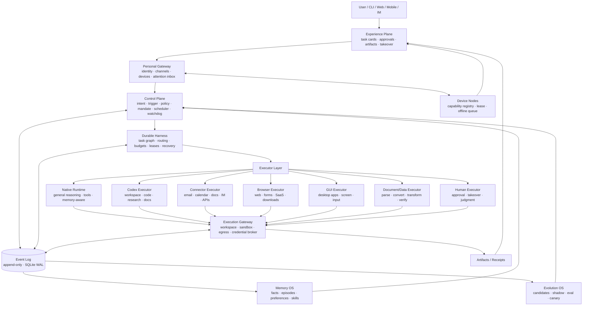

<p class="eyebrow">ARCHIVE</p>

# 完整路线图（归档）

<p class="lead">这是完整主文档的归档版本，保留全部原始细节。日常阅读建议使用按主题重组后的章节页面。</p>

---

## 一页摘要

### 为什么叫 Hearth

Hearth 是“炉台”，也是家里最中心、最温暖、最适合长期停留的地方。

这个名字对应产品最重要的气质：

- 它应该长期在线，但不是一直打扰；
- 它应该有能力，但不是把用户变成运维；
- 它应该记住生活，但不把隐私变成负担；
- 它应该替人守住日常，让人的注意力回到真正重要的事情。

产品名使用 **Hearth**，GitHub 仓库建议使用 **`hearth-os`**，命令行入口为 `hearth`，常驻服务为 `hearthd`，包命名空间为 `@hearth/*`。

一句话定位：

> **Hearth 是一个拥有个人上下文、持久执行、真实工具和多设备入口的通用个人 Agent OS；它把人从重复的数字劳动中解放出来，而不是制造另一个需要看管的聊天窗口。**

> 它不是“把一切交给 Codex”，而是让 Codex、Native、Connector、Browser、GUI、Document/Data 和 Human 在统一的控制面下各做最合适的一段。

其中，Codex 不局限于代码、Issue 和 PR。它是一个高能力通用执行器，可以参与调研、长文档、报告、表格、代码和多文件工作区任务；但它仍然只是执行器组合中的一个，不是 Hearth 的本体。Hearth 的能力边界由执行器组合、连接器、记忆、验证和权限共同决定。

### 它不是什么

Hearth 不是：

- 另一个 Coding Agent；
- 一个只会转发提示词的 Codex 套壳；
- 一个把所有权限交给模型的黑盒自动化；
- 一个只会在聊天框里回答问题的助手；
- 一个企业多租户 Agent 平台；
- 一个需要用户每天维护提示词、插件和工作流的工具。

Hearth 是：

- **一个 Control Plane**：决定做什么、是否允许、何时打扰、如何恢复；
- **一个 Durable Harness**：把意图变成可恢复、可审计、可回执的执行；
- **一组并列 Executor**：Native、Codex、Connector、Browser、GUI、Document/Data、Human 等；
- **一个 Memory OS**：让人物、项目、偏好、承诺和经验可被安全召回；
- **一个 Evolution OS**：让重复成功沉淀成技能，但所有变化都经过评估和回滚；
- **一个安静的 Experience Plane**：用任务卡、审批和产物，而不是无穷聊天记录，承载交互。

### 最终架构

```text
用户 / CLI / Web / Mobile / IM
            ↓
     Experience Plane
     任务卡 · 审批 · 产物 · 接管
            ↓
      Personal Gateway
   身份 · 渠道 · 设备 · 注意力入口
            ↓
       Control Plane
  触发 · 策略 · Mandate · 调度 · Watchdog
            ↓
      Durable Harness
  任务图 · 预算 · lease · 重试 · 恢复
            ↓
       Executor Layer
 Native · Codex · Connector · Browser
 GUI · Document/Data · Human
            ↓
     Execution Gateway
 工作区 · Sandbox · 网络 · Credential Broker
            ↓
  Event Log / Artifacts / Receipts
       ↓              ↓
   Memory OS      Evolution OS
```

所有事实进入 Event Log；所有外部副作用经过 outbox、幂等键和 Receipt；所有界面状态都是投影，不是事实源。

### 五个不可妥协的判断

1. **Hearth 的价值在控制面、记忆和验证，不在“再实现一个模型”。**
2. **Codex 是强大的并列 Executor，不是产品本体，也不是唯一执行大脑。**
3. **Token 消耗是架构指标，不是事后优化；能不用模型的地方，坚决不用模型。**
4. **前端必须简单到用户不需要学习 Agent 架构；复杂逻辑留在后端。**
5. **自进化只能产生候选技能和候选策略，不能绕过权限、评估和人类审查。**

### 北极星指标

> **每周由 Hearth 完成、并经过自动验证或用户确认的个人数字任务数。**

同时跟踪：

- 每次已验证完成的人工分钟；
- 每任务打断次数；
- 每任务 Token 与成本；
- 崩溃、离线和设备切换后的恢复率；
- 重复外部副作用次数；
- 记忆准确率和遗忘合规率；
- 用户对“下一步该做什么”的理解时间。

### 交付策略：先成为可用的最小产品，再长成 Agent OS

Hearth 的完整目标很大，但开发不能采用“先把内核、执行器和后端全部做完，最后再补界面”的顺序。正确顺序是：

1. **Stage 0 先验证产品叙事**：用可点击原型把任务创建、任务卡、审批、产物和恢复路径走通，哪怕数据是假的。
2. **Stage 1 尽早出现 MVP**：在一个窄任务族上交付真实可用的本地产品，包含真实执行、持久状态、任务卡、产物和失败恢复。
3. **之后每个阶段都交付纵向切片**：用户可见结果、前端、后端、执行器、验证器和恢复路径同时出现，不做只有底层、没有产品形态的里程碑。
4. **先窄后宽**：先让一个任务族真正可依赖，再扩展到邮件、日历、浏览器、桌面、主动性和多设备。
5. **不做日历承诺**：推进依据是能力门槛和真实任务证据，不是“第几周做到哪一步”。

这里的“100%”指 Stage 6 的 v1.0 出口，而不是再无演进的终点。完整增量顺序与 MVP 定义见第 25 章。

---

## 产品定义与边界

### 产品定义

Hearth 是一个单用户、自托管、长期驻留的个人 Agent OS。它接收用户意图、外部事件和设备请求，调度不同执行器完成内容性与操作性工作，并把过程、产物、审批和回执统一呈现给用户。

它的核心目的不是“让模型多说话”，而是：

- 减少重复劳动；
- 降低注意力切换；
- 把跨应用流程串起来；
- 保留个人上下文；
- 在失败时能恢复，在风险前能停下。

### 首选 Persona

| 项目 | 假设 |
|---|---|
| 用户 | 1 个主要用户，可能有 1–3 个可信协作者 |
| 设备 | 一台主力电脑、一台常驻机器、一部手机，后续扩展到多台设备 |
| 工作 | 研究、写作、文档、邮件、日程、代码、Issue、PR、数据和网页操作混合 |
| 技术能力 | 能运行本地服务，但不希望每天维护 Agent 配置 |
| 隐私要求 | 个人文件和凭据不能默认上传到不可信第三方 |
| 使用方式 | 主动任务、定时任务、通知触发和手动发起并存 |

第一版不追求“所有人都能用”，而是追求“一个真实用户愿意每天用”。

### 覆盖矩阵

“几乎所有人可以做的数字内容工作”按以下八类定义，而不是按软件名称定义：

| 任务族 | 典型工作 | 首选执行方式 |
|---|---|---|
| 沟通与协作 | 邮件、IM、会议纪要、跟进、日程协调 | Connector + Native/Codex + 审批 |
| 文档与内容 | docx、xlsx、pptx、PDF、Markdown、报告、翻译、改写 | Document/Data Engine、Native、Codex |
| 研究与信息整理 | 搜索、阅读、对比、引用、摘要、资料库 | Native + Browser + Codex |
| 代码与研发 | 仓库修改、测试、Issue 分流、PR 准备、代码审查 | Codex + 测试/CI 工具 |
| 数据与表格 | 清洗、对账、统计、图表、导入导出 | Document/Data Engine + Python sidecar |
| 网页与 SaaS | 登录、表单、下载、上传、后台操作 | Browser Executor |
| 桌面应用 | 没有 API 的软件、系统设置、跨应用流程 | GUI Executor |
| 个人事务 | 表单、预约、账单、提醒、设备操作 | Connector、Browser、GUI，高风险动作审批 |

同一个任务可以由多个执行器协作。例如“调研一个竞品并写进周报”可能同时使用 Browser、Native、Document Engine 和 Codex；不是由一个工具独自完成所有步骤。

### 自主级别

| 级别 | 行为 | 默认使用 |
|---|---|---|
| A0 建议 | 只生成建议、草稿或计划 | 新场景、高风险、未验证能力 |
| A1 受控执行 | 自动完成低风险步骤，中风险首次审批 | Stage 1–2 默认 |
| A2 授权执行 | 在 Mandate 内自动完成已授权动作，高风险仍需审批 | Stage 4 以后 |
| A3 受监督自主 | 长周期运行，但保留审批、预算、kill switch 和回执 | 长期目标 |

自主性必须按任务族、来源、时间段、设备、风险和金额独立配置。

### “完成”的定义

不同的任务需要不同的验证器：

| 任务 | 完成证据 |
|---|---|
| 代码/Issue/PR | 测试、类型检查、diff、CI 或人工审查 |
| 文档 | 结构检查、引用检查、格式检查、用户验收 |
| 邮件草稿 | 收件人、事实、语气检查；发送前审批 |
| 邮件发送 | Approval、Broker 执行记录、provider message id 或明确的不确定状态 |
| 网页操作 | DOM/可访问性状态、截图、最终状态和回执 |
| 桌面操作 | 可访问性树、截图、目标状态和人工确认 |
| 研究 | 来源可追溯，关键断言有引用 |
| 日程 | 时间、时区、参与者、冲突检查和日历回执 |
| 数据 | schema、行数、抽样、对账和可复现脚本 |

自然语言“已完成”不是完成证据。Hearth 只相信可定位的产物、可复现的检查和可审计的回执。

### 明确不承诺的范围

- 物理世界机器人操作；
- 代替用户承担法律、医疗、金融等专业责任；
- 未审批的付款、签约、删除、公开发布或权限变更；
- 对任意软件 100% 无人值守；
- 企业 IAM、多租户、组织审计和计费；
- 第一天覆盖全部八类任务；
- 与底层模型厂商比模型能力；
- 通过无限自主循环制造“像人”的假象。

### 体验承诺

Hearth 的体验应该满足：

- 用户一眼知道 Agent 正在做什么；
- 需要人时只出现一个明确动作；
- 不需要理解 Worker、Harness、Token 等内部术语；
- 手机可以完成查看、审批、接管和发起；
- 任何失败都能看到原因和恢复选项；
- 通知是可预期的，不是随机的。
- 从第一个可运行增量开始，用户就能通过真实界面完成任务，而不是只能在 CLI、日志或测试里看到能力。

---

## 核心设计判断

### 不是另一个 Coding Agent

Coding Agent 是 Hearth 的一个执行器类别，不是产品类别。

Hearth 要解决的是：

- 邮件、日历、文档、研究、网页、桌面和设备的跨应用工作；
- 需要长期记忆和主动性的个人事务；
- 多设备、手机审批和低打扰交互；
- Token、权限、恢复和评估的系统级治理。

如果只做“在终端里改代码”，这个项目没有独立存在的必要。

### 不是 Codex 套壳

薄包装会很快遇到三个问题：

- 无法控制任务状态和恢复；
- 无法阻止重复发送、重复写入和权限越界；
- 无法积累个人记忆或证明能力真的变好。

因此 Hearth 必须自研：

- 事件日志与任务状态；
- 控制面、策略、授权和审批；
- Durable Harness；
- 个人上下文与记忆；
- Token 预算与路由；
- 技能评估和进化；
- 简洁的任务卡前端。

可以集成：

- 模型；
- Sandbox；
- 浏览器；
- 文档解析和转换；
- 外部 API 连接器；
- Codex 作为强大的工作区执行器。

### Codex 是强大的并列 Executor

Codex 不应被窄化为单一开发工具。它擅长：

- 在隔离 workspace 中进行长链路推理；
- 写代码、跑测试、改仓库；
- 处理 Issue、准备 PR、做代码审查；
- 调研、归纳和结构化研究；
- 生成和修改文档、报告、表格、数据文件；
- 执行多步骤 Shell、文件转换和验证；
- 把复杂任务落成可检查的产物。

它不擅长或不适合：

- 直接管理邮箱、日历和通讯录；
- 作为长期记忆；
- 作为权限、审批或凭据中心；
- 常驻监听事件；
- 操作实时桌面和 GUI；
- 直接操作手机和多设备；
- 高频繁、低价值的通知分类；
- 需要系统级副作用回执的发送和发布。

因此，Codex 是“多个并列执行器中的一个”，不是唯一大脑，也不是唯一 Worker。当前可以只接入 Codex 这一家外部 Agent，但 Hearth 内部必须有 Native、Connector、Browser、GUI、Document/Data 和 Human 等并列执行器。

路由原则不是“让 Codex 承担一切”，而是：

> **哪个执行器能以最低 Token、最高可靠性、最小权限完成并通过验证，就选哪个。**

### Build vs Integrate

| 能力 | 决策 | 理由 |
|---|---|---|
| 控制面 | 自研 | 决定做什么、是否允许、何时打扰，是产品核心 |
| Durable Harness | 自研 | 任务图、恢复、lease、幂等和预算必须可控 |
| Event Log | 自研协议 | 事实源不能外包 |
| 记忆 | 自研 | provenance、冲突、遗忘和多设备同步不能外包 |
| Evolution | 自研 | 技能晋升、评估和回滚是产品护城河 |
| Token Governor | 自研 | 需要跨模型、跨执行器、跨任务治理 |
| 前端 | 自研 | 任务卡、审批和低打扰体验是差异化 |
| 模型 | 集成，BYOM | 不训练模型，保留替换能力 |
| Codex | 集成 | 目前唯一外部 Agent 集成；可承担代码、研究、文档、表格和复杂工作区任务的通用执行器 |
| Sandbox | 集成，策略层自研 | 不重写容器/VM 内核，只控制工作区、凭据和出口 |
| 浏览器 | 集成 Playwright | 自研验证、takeover 和策略 |
| 文档/数据 | 集成解析与转换工具 | 自研调度、验证和最小上下文提取 |
| 连接器 | 集成官方 API/MCP | 自研统一 Source/Effect 模型和安全边界 |
| 可观测性 | 集成 OpenTelemetry | 自研轨迹语义与 Token 归因 |

这张表里最容易做错的是 Sandbox、模型 Runtime 和 Agent Harness 的边界。Hearth 的产品价值不在重新实现容器、虚拟化、模型推理引擎或完整的第三方 Agent 框架。推荐边界是：

- **自研**：Durable Harness、Event Log、Policy、Mandate、Approval、Context Compiler、Token Governor、Memory、Evolution、任务卡 UI；
- **薄层自研**：Codex、浏览器、连接器、文档引擎和 Sandbox 的适配器，以及结果验证、错误归一、取消、恢复和接管；
- **集成**：模型 API 或本地模型、容器/微虚拟机、Playwright、文档解析/转换库、官方邮件和日历 API；
- **只作为学习原型**：最小事件循环、session tree、上下文压缩、单机 Sandbox 包装。原型可以帮助理解边界，但不进入必须长期维护的产品地基。

“自己写 runtime 和 sandbox”作为学习项目有很高价值，作为产品路线则很容易把时间耗在无法差异化的底层。Hearth 要把自研精力集中在“谁在什么权限下、用什么上下文、完成什么、如何证明完成、失败后如何恢复”这些真正决定个人 Agent 质量的问题上。

### Token 效率是架构约束

Token 不应该被当作“模型很聪明，所以多用一点没关系”的消耗品。Hearth 把 Token 当作与时间、磁盘、权限同级的预算：

- 能由规则决定的，不调用模型；
- 能由脚本完成的，不生成自然语言；
- 能用小模型分类的，不调用大模型；
- 能只读文件差异的，不重读全文件；
- 能传 artifact 引用的，不把全文塞进上下文；
- 能缓存的，不重复计算；
- 能确定失败并转人工的，不做无界重试。

Token 效率必须与成功率和用户时间一起评估，不能只追求“少花 Token”导致任务失败或人类复核成本上升。

### 前端简单是产品能力

Hearth 的复杂度应该留在控制面、Harness、Memory 和 Executor 层，而不是转移给用户。

前端的第一原则：

> **用户打开 Hearth 时，只需要知道三件事：它在做什么、是否需要我、下一步点哪里。**

因此：

- 首页不是无限聊天流，而是任务卡；
- 每个状态只有一个主动作；
- 审批不藏在多层设置里；
- 手机可以完成高风险动作的确认；
- 技术术语不进入主界面；
- 任何异常都有可执行的恢复路径。

因此，开发顺序不能是“先做完整后端，最后套前端”。Hearth 的前端必须与内核同时生长：

- Stage 0 就有可点击的任务卡、审批和产物原型；
- Stage 1 的第一个可运行骨架就连接真实任务状态；
- MVP 必须能通过浏览器完成创建、查看、审批、取消、恢复和取回产物；
- 后续每个阶段都必须把新能力投影成用户可理解、可操作、可恢复的界面状态；
- 只存在于 CLI、日志、数据库或测试中的能力，不计入阶段完成。

界面不是装饰层，而是产品契约的可见部分。任务卡、审批和产物中心会反过来约束后端状态机，使系统更早暴露含糊状态、无法恢复的失败和多余步骤。

### 一个逻辑 Agent，多设备执行

多台电脑不是多个独立 Agent，手机也不是第二个 Agent。

正确模型：

```text
一个逻辑 Hearth
  ├─ 一个主 Gateway / Control Plane
  ├─ 一个 Event Log / 单写者
  ├─ 多台设备上的 agentd
  ├─ 手机作为查看、审批、接管、发起入口
  └─ 每个设备注册自己的能力
```

具体约束见第 4 章。核心原则是：共享身份、事件、记忆和授权；设备只提供执行能力和界面入口。

### 学 OpenClaw 和 Hermes，不变成它们

OpenClaw 值得学习的是：

- Personal Gateway；
- 多渠道路由；
- 设备节点；
- 长期在线；
- 注意力入口；
- 自主分级。

Hermes 值得学习的是：

- 记忆预算；
- 记忆约束；
- 技能沉淀；
- 子 Agent/子任务生命周期；
- 自进化机制。

但不 fork 它们，不把它们作为产品底座。Hearth 只吸收模式，并通过自己的 Event Log、Policy、Memory 和 Evolution 协议实现。

### 七条架构不变量

1. Event Log 是唯一事实源。
2. 每个 State Root 只有一个写权威。
3. 所有外部副作用必须有幂等键、审批或明确豁免、以及 Receipt。
4. 执行器不能直接读取长期原始凭据。
5. 每个任务必须有预算、截止时间和取消路径。
6. 记忆必须有 provenance、敏感度、冲突和遗忘策略。
7. 任何自进化都必须经过评估、canary 和回滚。

### 交付不变量：每个增量都是可用的纵向切片

任何一个被宣布“完成”的开发增量，都必须同时具备：

1. **用户可见结果**：用户能在产品中完成一件具体的事，而不是只看到内部模块通过测试；
2. **前端路径**：从入口、任务卡、状态、主动作到产物或恢复，界面真实可用；
3. **持久状态**：刷新、重启或崩溃后，任务和证据不会只存在于内存；
4. **真实后端与执行器**：不是永久假数据，也不是只在开发机上手工调用；
5. **验证证据**：通过测试、diff、引用、文件检查、网页状态或业务规则证明完成；
6. **失败与恢复路径**：用户知道失败了什么、能做什么、哪些动作可撤销或补偿；
7. **最小度量**：至少记录成功率、人工分钟、打断次数、Token 或成本中的相关项。

只有横向底层、没有纵向产品路径的工作可以作为内部任务，但不能成为阶段里程碑。这个约束优先于“先多接几个执行器”或“先把架构做完整”的冲动。

---

## 参考系统与学习目标

### OpenClaw：学习个人 Gateway，而不是复制完整 Agent

OpenClaw 的核心价值不在某一个提示词，而在“个人 Agent 如何长期存在于多个入口和设备之间”：

- **Gateway**：统一接收 CLI、Web、手机、IM、邮件和定时事件；
- **Channels**：把不同消息渠道归一化，而不是让每个渠道自己实现 Agent；
- **Device nodes**：不同设备注册能力，任务可以路由到合适的设备；
- **Always-on**：常驻运行、断线恢复、后台任务和主动触发；
- **Delegation**：不同任务有不同的自主级别和接管方式；
- **Attention**：通知不是越多越好，需要聚合、静默和默认动作。

Hearth 采用这些模式，但明确不做：

- 不把 OpenClaw 作为运行时依赖；
- 不 fork 它的完整产品；
- 不复制它的渠道规模和运维假设；
- 不让渠道适配器拥有绕过 Policy 的执行权；
- 不把“常驻”误解为“无限打扰”。

在 Hearth 的架构中，OpenClaw 不是 Worker，也不是产品底座。它更适合作为一个完整个人 Agent 产品的参考，而不是嵌入 Hearth 的唯一执行器。Hearth 的执行能力由 Codex、Native、Connector、Browser、GUI、Document/Data 和 Human 等多个并列执行器承担；OpenClaw 提供的是 Gateway、渠道、设备节点和注意力入口的设计经验。

### Hermes：学习记忆与自进化，而不是无界自改

Hermes 值得系统学习的部分：

- **记忆预算**：记忆不是越多越好，需要总量、单条和注入 Token 预算；
- **记忆约束**：哪些信息可以写入长期记忆，哪些只能短期保存；
- **技能沉淀**：把重复成功的轨迹提炼成可复用技能；
- **子任务生命周期**：子 Agent 或子任务必须有边界、预算、终止和回收；
- **经验蒸馏**：从失败和人工纠偏中提取候选规则，而不是盲目重试；
- **进化闭环**：候选能力需要评估、灰度、回滚和权限检查。

Hearth 不采用：

- 无界自修改核心 Runtime；
- 无评估直接启用新技能；
- 让 Agent 自己扩大权限；
- 把一次成功当成永久能力；
- 让记忆无限增长；
- 用“自进化”掩盖不可解释的漂移。

### 其他参考线

| 参考 | 学习重点 | 在 Hearth 中的落点 | 明确不照搬 |
|---|---|---|---|
| Pi / Maka | Session tree、steering、compaction、事件日志、单写者 | Native Runtime、Event Log、恢复 | 无沙箱、扩展与主进程同信任边界、体量过大的整体依赖 |
| DeerFlow | Harness/App 分层、Run lifecycle、thread 隔离、middleware | Durable Harness 与模块边界 | 强框架耦合、重型服务栈 |
| OpenSandbox | 统一 Sandbox API、凭据隔离、egress、快照 | Execution Gateway 与远程执行 | 第一阶段强依赖 |
| OpenBot | Agent Computer、隔离工作区、takeover、receipt | Execution Gateway 与人工接管 | 不复制完整产品 |
| OpenMuse / OpenDots | durable jobs、checkpoints、lease、低打扰体验 | Harness 与 Attention | 单容器限制、hosted 核心依赖 |
| Codex | 工作区执行、代码、研究、文档、Shell、测试 | 并列 Executor 之一 | 不作为产品中心、任务数据库、记忆或权限中心 |

### 学习证据

每一条参考线都必须产出可验证产物，而不是只写读书笔记：

| 学习主题 | 必须交付 |
|---|---|
| OpenClaw Gateway | Source→Trigger→Ticket→Run→Receipt 闭环；Gateway/Channel/Device 边界测试 |
| Hermes 记忆 | 记忆预算、冲突、遗忘、注入和检索测试 |
| Hermes 自进化 | 至少一个技能从轨迹到 shadow、eval、canary、回滚的完整案例 |
| Pi / Maka Runtime | 可重放 session tree，支持 branch、steering、compaction |
| DeerFlow Harness | Harness/App 单向依赖检查和 Run 生命周期测试 |
| OpenSandbox / OpenBot | 工作区、网络、凭据、快照和 takeover 的攻击矩阵 |
| OpenMuse / OpenDots | kill -9、lease、checkpoint、resume 和低打扰任务卡演示 |
| Codex Executor | 版本锁定、结构化结果、隔离 workspace、取消、恢复和失败归因报告 |

### 证据边界

- 参考项目只提供模式和失败教训，不直接 fork。
- GitHub star、宣传文章和二手解读不能作为成熟度证据。
- 合成负载不能证明真实内容任务成功率。
- 任何“自主性提升”都必须用真实任务、打断次数、人工分钟和副作用数据证明。
- 任何第三方集成在进入生产前，必须重新核验版本、许可证、安全边界和恢复行为。
- Hearth 不把任何单一外部项目当作不可替代的架构基础。

---

## 总体架构

### 北极星架构



### 七个平面

| 平面 | 责任 | 不承担 |
|---|---|---|
| Experience Plane | 任务卡、审批、产物、接管、通知 | 直接执行业务逻辑或写数据库 |
| Personal Gateway | 身份、渠道归一化、设备注册、注意力入口 | 长任务推理 |
| Control Plane | 意图、触发、策略、Mandate、调度、Watchdog | 持有长期凭据 |
| Durable Harness | 任务图、路由、预算、重试、lease、恢复 | 绕过策略执行外部动作 |
| Executor Layer | Native、Codex、Connector、Browser、GUI、Document/Data、Human 的统一协议 | 自行扩大权限或修改 Policy |
| Execution Gateway | 工作区、Sandbox、浏览器、GUI、网络、Credential Broker | 决定“该不该做” |
| Memory / Evolution | 个人上下文、记忆、技能、评估、晋升和回滚 | 成为事实源 |

Event Log 贯穿所有平面，是所有状态、审计、恢复和 UI 的源头。

### 一次任务的完整数据流

```text
1. 用户或 Source 产生事件
2. Gateway 归一化 Event，去重并记录来源
3. Control Plane 判断：忽略 / 观察 / 建议 / 创建 Task
4. Policy 与 Mandate 检查范围、风险、预算和审批要求
5. Token Router 选择最小可行模型和执行层级
6. Context Compiler 构建 Task Pack
7. Harness 创建 Ticket、Assignment 和 outbox 记录
8. Executor 在受限环境执行，持续产生 WorkerEvent
9. Execution Gateway 通过 Broker 完成获批副作用
10. 产物、Receipt、失败和人工操作写入 Event Log
11. 验证器决定完成、重试、换执行器或转人工
12. Memory 写入候选记忆；Evolution 收集轨迹
13. UI 从投影生成任务卡、通知和产物视图
```

### 部署形态

| 形态 | 组成 | 目标 |
|---|---|---|
| Local | `hearth` CLI + `hearthd` + SQLite + Docker | 第一阶段和 dogfood |
| Hybrid | 本地状态与设备能力 + 云端模型/沙箱 | 资源不足或远程执行 |
| Self-hosted Server | 常驻 Gateway + 多设备 agentd + 可选 K8s/远程 Sandbox | 长期在线和多设备 |

第一阶段不引入微服务。单进程、单写者、SQLite 足以支撑早期。

### 一个逻辑 Agent，多设备执行

```text
一个逻辑 Hearth
  ├─ 一个主 Gateway / Control Plane
  ├─ 一个 Event Log / 单写者
  ├─ 多台设备上的 agentd
  ├─ 手机作为查看、审批、接管、发起入口
  └─ 每个设备注册自己的能力
```

关键原则：

- 手机不是执行权威，除非它持有对应设备能力并通过 Policy。
- 多台电脑不是多个独立 Agent，而是同一个逻辑 Agent 的执行节点。
- 任务按能力、在线状态、数据位置、隐私约束和 Token 预算路由。
- 设备离线时任务进入可恢复队列，不丢。
- 同一 State Root 不能同时由多个设备写入。
- 设备切换必须使用 lease、fencing token、检查点和幂等键。
- 所有外部副作用保留 Receipt；重分配设备不能产生第二次发送或写入。
- 设备丢失可以撤销 capability、lease 和密钥。
- 手机通过安全隧道或推送服务接入，不直接暴露 Agent 端口。
- 记忆同步遵守 tombstone 与遗忘，不在新设备“复活”已删除内容。

手机端第一阶段只承担五件事：

1. 查看任务与产物；
2. 审批高风险动作；
3. 接管异常任务；
4. 发起新任务；
5. 接收聚合后的高信号通知。

### 启动形态

```text
hearthd
  ├─ local gateway / IPC / web API
  ├─ scheduler / watcher / trigger
  ├─ task queue / event log / outbox
  ├─ token router / context compiler / budget governor
  ├─ executor supervisor
  ├─ device registry / capability catalog / lease manager
  ├─ execution gateway / sandbox manager
  ├─ watchdog / health / backup
  └─ pairing / event sync / device revocation
```

必须处理：

- 开机自启；
- 终端关闭后继续运行；
- 电脑休眠与唤醒；
- 网络中断与恢复；
- 模型认证过期和限流；
- 执行器崩溃与重启；
- 版本升级和回滚；
- 空闲资源策略；
- 手机断开和重新配对。

### 从最小产品到完整 OS 的架构演进

Hearth 不在第一天实现最终架构图上的全部模块。架构随产品增量逐步长出来，但核心不变量保持不变：

| 产品形态 | 架构增量 | 继续保持不变 |
|---|---|---|
| Stage 0 可点击原型 | Web 原型、UI 数据契约、模拟投影 | 任务卡优先、状态诚实、一个主动作 |
| Stage 1 本地 MVP | 单进程 `hearthd`、SQLite WAL、Event Log、Codex、基础审批与产物 | 事实源、恢复、验证、副作用回执 |
| Stage 2 日常操作员 | Connector、Browser、Document/Data、Context Compiler、Memory v0 | 最小权限、来源、幂等、Token 预算 |
| Stage 3 桌面操作员 | 设备 agentd、GUI Executor、接管与桌面隔离 | 单写者、审计、审批、失败恢复 |
| Stage 4 主动个人 Agent | Trigger、注意力预算、手机 PWA、推送与配对 | 低打扰、可撤销、主动模式可暂停 |
| Stage 5 记忆与进化 OS | 完整 Memory OS、Evolution OS、技能评估与回滚 | provenance、遗忘、权限交集、可回滚 |
| Stage 6 Personal Agent OS v1.0 | 多设备同步、离线队列、迁移、长期运行与配额 | 一个逻辑 Agent、事件一致、设备可撤销 |

这条演进线说明：**架构可以分阶段扩展，但产品形态不能分阶段补课。** 每个阶段都必须有与其架构复杂度匹配的完整用户路径。

---

## 领域模型与协议

### 核心实体

| 实体 | 定义 | 关键不变量 |
|---|---|---|
| `Source` | 用户、邮件、日历、IM、GitHub、网页、文件、cron、设备 | 有身份、可信级别和速率限制 |
| `Event` | 不可变事实：消息、观察、工具调用、结果、审批、错误 | 只追加、可重放、带 schema version |
| `Thread` | 围绕一个持续主题的上下文容器 | 可关联多个 Ticket，但不拥有执行权 |
| `Intent` | 用户表达或系统推断的目标 | 不直接执行，必须转成 Task/Ticket |
| `Task` | 对用户可见、有验收标准的工作项 | 有截止时间、状态和完成证据 |
| `Ticket` | 被授权的最小工作单元 | 单 owner、预算、范围、过期时间 |
| `Mandate` | 授权策略的版本化实例 | 范围、强度、有效期、可撤销 |
| `Policy` | 个人规则集合 | 版本化；变化可触发 revalidation |
| `Assignment` | Ticket 与 Executor 的绑定 | 同一时刻最多一个有效执行者 |
| `Run` | 一次实际执行尝试 | 输入、预算、检查点、终态 |
| `Executor` | 执行能力：Native、Codex、Connector、Browser、GUI、Document/Data、Human | 能力声明、隔离边界、可取消 |
| `Capability` | 对资源、动作、范围和期限的许可 | 最小权限、可过期、可撤销 |
| `Approval` | 人的授权决定 | 绑定真实动作、参数、范围和过期时间 |
| `Artifact` | 文档、代码、报告、截图、数据、日程 | 内容寻址、来源可追溯 |
| `Receipt` | 外部副作用的回执 | 幂等键、时间、结果、撤销信息 |
| `Memory` | 长期事实、偏好、经历或技能索引 | provenance、置信度、敏感度、遗忘策略 |
| `Skill` | 可复用的程序性能力 | 版本化、权限声明、可评估、可回滚 |
| `Device` | 可信设备节点 | 身份、能力白名单、配对状态 |
| `Budget` | 时间、Token、成本、磁盘和命令预算 | 硬上限；耗尽必须暂停或转人工 |
| `Eval` | 对任务、Run、Skill 或路由的评估 | 结果不可由操作者挑选 |

### 关系

```text
Source → Event → Trigger → Thread
                          ├─→ Intent → Task → Ticket → Assignment → Run
                          └─→ Subscription → fast path

Policy → Mandate → Ticket
Approval → Mandate
Run → Artifact / Receipt
Run → Eval → Skill proposal → Shadow → Eval → Promote / Rollback
Device → Capability → Assignment
Memory → Context Pack → Executor
```

### Event 的最小结构

```ts
type Event = {
  id: string;
  type: string;
  schemaVersion: number;
  occurredAt: string;
  actor: "user" | "agent" | "executor" | "system" | "device" | "external";
  subject:
    | { kind: "thread"; id: string }
    | { kind: "task"; id: string }
    | { kind: "ticket"; id: string }
    | { kind: "run"; id: string }
    | { kind: "device"; id: string };
  causationId?: string;
  correlationId: string;
  payload: unknown;
  hashPrev?: string;
};
```

事件日志只记录事实，不记录“模型觉得应该怎样”。投影可以重建，模型上下文可以重算，但历史不能覆盖。

### Executor 协议

```ts
type ExecutorCapability =
  | "files"
  | "shell"
  | "code"
  | "research"
  | "documents"
  | "email"
  | "calendar"
  | "browser"
  | "gui"
  | "http"
  | "devices"
  | "human";

interface Executor {
  id: string;
  capabilities: ExecutorCapability[];
  execute(ticket: Ticket, context: ExecutorContext): AsyncIterable<ExecutorEvent>;
  cancel(runId: string): Promise<void>;
  resume?(checkpoint: Checkpoint): Promise<void>;
  health?(): Promise<ExecutorHealth>;
}
```

统一输出：

- 标准化事件流；
- 产物引用；
- 结构化最终结果；
- 验证结果；
- 外部动作 Receipt；
- 失败分类与可恢复性。

Executor 不负责：

- 解读用户长期偏好；
- 决定是否发送、删除、合并或付款；
- 自行扩大 capability；
- 直接读取长期原始凭据；
- 创建无预算的新任务。

### 审批与回执

所有外部副作用都按以下顺序：

```text
1. 生成 effect intent
2. 写入 outbox
3. 提交事务
4. Dispatcher 读取待执行项
5. 检查 Approval / Mandate / capability
6. 使用幂等键调用外部服务
7. 记录 Receipt
8. 标记完成或进入死信
```

规则：

- 先落盘，再执行；
- 同一幂等键不能产生第二次外部副作用；
- 重试必须复用同一幂等键；
- 无法幂等的外部动作必须审批并转人工；
- 崩溃恢复后可以安全重投；
- 外部服务返回不确定结果时，先对账，不盲目重试；
- 死信必须可查看、可修复、可人工重放。

---

## Personal Gateway 与多入口

### Gateway 的职责

Personal Gateway 是 Hearth 与外部世界之间的唯一入口：

- 识别用户、设备和渠道；
- 接收文字、语音、文件、图片、网页、邮件、日历和定时事件；
- 统一转换为 `Event`；
- 去重、排序、限流和来源标记；
- 判断哪些事件进入注意力收件箱；
- 维护设备注册、在线状态和配对关系；
- 为手机提供安全 API 和推送，而不是暴露本地端口。

Gateway 不做长任务推理，也不直接执行业务动作。

### 输入渠道

| 渠道 | 典型输入 | 处理方式 |
|---|---|---|
| CLI | 命令、脚本、开发调试 | 直达 Gateway，可结构化输出 |
| Web/PWA | 文本、文件、拖拽、分享 | 任务卡和审批中心 |
| 手机 | 文本、语音、分享、拍照、通知 | 审批、查看、接管、发起 |
| IM | 消息、文件、转发 | Channel Adapter 归一化 |
| Email | 邮件与附件 | 只读同步、草稿、待审批发送 |
| Calendar | 日程与邀请 | 只读、冲突检查、待审批写入 |
| Device | 文件、屏幕、摄像头、传感器 | 设备能力与授权 |
| Cron/Watch | 定时器、文件变化、网页变化 | Trigger 评估 |
| API/MCP | 外部服务事件 | Connector 归一化 |

### 事件归一化与去重

所有渠道事件至少包含：

- 来源类型与来源 id；
- 可信级别；
- 用户/设备身份；
- 原始时间；
- 内容引用或脱敏摘要；
- 会话/线程关联；
- 幂等键；
- 是否允许触发主动任务。

默认策略：

- 同一来源同一事件只处理一次；
- 重复通知合并；
- 低价值事件只记录，不推理；
- 不可信来源不能创建高风险 Mandate；
- 外部内容不能覆盖系统 Policy。

### 注意力收件箱

Attention Inbox 不是消息列表，而是“需要人处理的最小集合”。

包含：

- 需要审批的动作；
- 需要补充信息的任务；
- 失败且无法自动恢复的任务；
- 需要接管的浏览器或桌面；
- 已完成的产物；
- 可延后查看的摘要。

默认不进入收件箱：

- 低置信度但无副作用的观察；
- 已被规则过滤的重复事件；
- 纯状态变化；
- 不需要人决策的失败重试。

排序依据：

```text
priority = risk × blockedness × deadline × userImpact × reversibilityPenalty
```

用户关闭某渠道后，任何其他渠道都不能绕过。

### 设备注册与能力目录

设备注册时上报：

- 设备 id 与公钥；
- 操作系统和版本；
- 在线状态与心跳；
- 可用能力：文件、终端、浏览器、屏幕、摄像头、麦克风、通知、剪贴板；
- 可访问的本地数据范围；
- 安全边界和 Sandbox 支持；
- 用户授予的 capability；
- 设备 lease 与过期时间。

设备能力不是永久授权。任务结束后，临时能力应自动回收。

### 手机接入

手机是 Hearth 的远程入口，不是默认执行权威。

第一阶段只支持：

- 查看任务、状态和产物；
- 审批高风险动作；
- 接管异常任务；
- 发起新任务；
- 接收高信号通知。

安全要求：

- 通过安全隧道或推送服务接入；
- 不直接暴露 Agent 端口；
- 设备配对使用短期码和公钥；
- 审批绑定 nonce、动作参数和过期时间；
- 通知只包含脱敏摘要；
- 设备丢失可撤销全部 token 和 lease。

---

## Control Plane 与自主性

### Control Plane 的职责

Control Plane 决定：

- 这个事件是否值得处理；
- 是否创建 Task；
- 是否需要用户审批；
- 应该用哪个 Executor；
- 应该花多少 Token、时间和金钱；
- 何时通知、何时静默；
- 失败后重试、换路还是转人工。

它不直接调用工具，不直接持有凭据，也不直接写外部服务。

### Trigger

Trigger 是规则、订阅和条件的组合：

- cron；
- 文件变化；
- 网页变化；
- 邮件到达；
- 日历临近；
- GitHub Issue/PR 事件；
- 设备上线/离线；
- 任务依赖完成；
- 用户显式订阅；
- 失败重试。

规则命中后可以直接创建 Ticket；只有需要语义判断时才调用小模型。

### Policy 与 Mandate

Policy 是长期规则，Mandate 是一次或一段时间的授权实例。

Mandate 至少包含：

- 允许的动作类型；
- 资源范围；
- 联系人/域名/仓库/文件夹范围；
- 风险等级；
- 预算；
- 有效期；
- 是否允许自动执行；
- 是否允许转发或委托；
- 撤销方式。

模型可以提出建议，但不能修改 Mandate、Approval 或自身 capability。

### 调度与 Watchdog

调度器负责：

- 优先级；
- 并发上限；
- 设备/Executor 匹配；
- 预算执行；
- 截止时间；
- 依赖等待；
- 公平性。

Watchdog 独立于 Agent 运行，负责：

- 卡死检测；
- 死循环检测；
- 预算超支；
- 设备失联；
- 凭据失效；
- 外部平台异常；
- 自动降级或转人工。

Watchdog 不是另一个模型，而是一组确定性的监督机制。

### 自主性的正确边界

自主性不是“模型想做什么就做什么”，而是：

- 在明确 Mandate 内自主；
- 在预算内自主；
- 在可恢复/可回滚范围内自主；
- 在低风险场景中自主；
- 高风险动作始终保留人类确认。

### 注意力预算

每个任务都有注意力预算，而不只是 Token 预算：

- 最多打断次数；
- 聚合窗口；
- 静默时段；
- 默认动作；
- 升级条件；
- 用户关闭渠道后的行为。

规则：

- 能自动验证的不要求人确认；
- 能安全等待的不即时打扰；
- 能批量审批的不逐条打断；
- 每次打断必须有一个明确动作；
- 同一任务打断超过 2 次且无法下降，退回“只建议不执行”。

### 主动循环

```text
Source Event
  → Trigger / Rule
  → Small classifier
  → Task / Thread
  → Policy + Mandate
  → Budget
  → Executor
  → Verification
  → Notification / Receipt
```

主动模式与建议模式必须可独立开关，并且有对照数据。

---

## Durable Harness

### 定位

Harness 是“把一次意图变成可恢复执行”的中间层：

- 承接 Control Plane 的决策；
- 构建任务图；
- 选择执行器；
- 执行预算和 lease；
- 处理取消、重试、恢复；
- 把结果转成 Artifact、Receipt 和 Eval。

它不是模型，也不是 Sandbox。

### Run 生命周期

```text
created
  → authorized
  → queued
  → assigned
  → running
  → verifying
  → completed

异常分支：
  → paused
  → waiting_approval
  → waiting_input
  → retry_wait
  → failed
  → cancelled
  → needs_human
```

每个状态迁移都必须：

- 产生事件；
- 有明确触发者；
- 有幂等条件；
- 可以从事件重放；
- 不允许原地覆盖历史。

### 任务图

支持：

- 顺序依赖；
- 并行分支；
- 汇合；
- 失败传播；
- 补偿任务；
- 人工审批节点；
- 跨天等待；
- 长任务检查点；
- 子任务预算继承。

第一阶段不引入重型工作流引擎。使用：

- 显式状态机；
- SQLite；
- outbox；
- 定时器和 lease；
- 清晰的中间产物。

### Lease 与单写者

- 每个 Ticket 同一时刻最多一个有效 Assignment；
- Executor 或设备必须持有 lease 才能推进；
- lease 过期后可重新分配；
- 重新分配必须带 fencing token，拒绝旧执行者继续写入；
- 同一 State Root 只有一个写权威；
- 设备本地状态只是缓存；
- 设备离线时任务排队，重新上线按 cursor、lease 和检查点继续；
- 设备丢失必须撤销 lease、capability 和密钥。

### 恢复策略

```text
进程崩溃 → 从 Event Log 和检查点恢复
网络中断 → 保留 outbox；恢复后按幂等键重投
Executor 超时 → 保存 workspace 快照；重试或换 Executor
设备离线 → 进入设备队列；不丢任务
外部结果不确定 → 标记 uncertain；先对账，不盲目重试
记忆冲突 → 保留来源；不静默覆盖
```

恢复后必须重新验证，不信任旧的自然语言“完成”。

### 路由

```text
Ticket
  → 能力匹配
  → 风险与权限检查
  → Token / 成本 / 延迟估计
  → 选择 Executor 或 Human
  → 执行
  → 验证失败？
      ├─ 同 Executor 重试
      ├─ 换更合适的 Executor
      ├─ 降级为更小范围
      └─ 人工接管
```

路由不应只由模型决定。规则、历史成功率、成本、权限和设备状态都参与。

### 边界规则

1. Control Plane 不直接执行工具。
2. Harness 不直接读取原始凭据。
3. Executor 不决定“是否允许”。
4. Execution Gateway 不决定业务意图。
5. UI 不能绕过 Policy 写数据库或触发工具。
6. 所有外部副作用经过 outbox、幂等键和 Receipt。
7. 所有 schema 变更带 migration 和兼容测试。

---

## Executor Layer：多个并列能力，不是单一大脑

### Executor 不是 Worker 列表

Hearth 使用 `Executor` 概念，而不是把所有执行器都塞进一个“Worker”里：

- **Native Runtime**：内置通用推理与工具循环；
- **Codex Executor**：强大的工作区执行器，覆盖代码、研究和文档；
- **Connector Executor**：邮件、日历、文档、云盘、IM、Issue Tracker；
- **Browser Executor**：网页、表单、登录态和 SaaS；
- **GUI Executor**：没有 API 的桌面应用；
- **Document/Data Executor**：文档解析、格式转换、表格、对账和确定性数据处理；
- **Human Executor**：审批、判断、接管和高风险责任。

同一任务可以由多个执行器协作。执行器之间不共享凭据、文件和隐式上下文。

### 能力矩阵

| 能力 | Native | Codex | Connector | Browser | GUI | Document/Data | Human |
|---|---|---|---|---|---|---|---|
| 代码、测试、Issue、PR | 中 | 强 | 弱 | 弱 | 弱 | 弱 | 审查 |
| 调研与结构化研究 | 强 | 强 | 中 | 强 | 弱 | 弱 | 判断 |
| 文档生成与修改 | 中 | 强 | 中 | 中 | 中 | 强 | 验收 |
| Shell 与文件转换 | 中 | 强 | 弱 | 弱 | 中 | 强 | 否 |
| 邮件/日历 | 弱 | 弱 | 强 | 中 | 中 | 弱 | 审批 |
| 登录与表单 | 弱 | 弱 | 中 | 强 | 中 | 弱 | 接管 |
| 桌面应用 | 弱 | 弱 | 弱 | 弱 | 强 | 弱 | 接管 |
| 常驻事件 | 强 | 弱 | 强 | 弱 | 弱 | 弱 | 否 |
| 长期记忆 | 中 | 弱 | 弱 | 弱 | 弱 | 弱 | 审核 |
| 高风险副作用 | 弱 | 弱 | 强 | 强 | 强 | 弱 | 强 |

这张表不是固定结论，必须通过真实任务和失败数据更新。

矩阵中的“邮件/日历”指直接持有账户、读取真实数据和产生外部副作用。Codex 完全可以接收 Connector 取回的邮件线程、日历上下文或文档片段，完成理解、分类、研究和草稿；真正发送、邀请、删除或发布仍需由 Connector、Credential Broker 和审批链路完成。Codex 负责认知与生成，系统负责权限与副作用。

### 路由：按任务形态选择，而不是按工具偏好

不存在“永远先用 Native，最后才用 Codex”的固定顺序。路由是一个带硬约束的优化问题：

```text
候选执行器
  → capability 匹配
  → 权限与数据驻留检查
  → 预期成功率
  → Token / 成本 / 延迟
  → 风险与可逆性惩罚
  → 选择最大化用户价值的方案
```

更实用的判断顺序是：

1. 根本不需要模型：cron、规则、SQL、脚本、文件 diff、官方 API。
2. 需要外部数据或副作用：优先 Connector；没有 API 再用 Browser；没有浏览器接口再用 GUI。
3. 需要确定性的文档/数据转换：Document/Data Executor。
4. 需要长链路、多文件、多产物、复杂研究、代码或深度写作：Codex Executor。
5. 需要高频、短、低风险、隐私敏感或低预算的推理：Native Runtime + 小模型/本地模型。
6. 需要价值判断、责任承担或异常接管：Human Executor。

关键不是 Codex 排在谁后面，而是它在“高能力、长链路、可检查产物”这一类任务上通常有更高的首次成功率。若 Native 反复失败，或任务需要大量文件协同，继续用 Native“省 Token”反而更贵。

路由评分可以近似写成：

```text
score = expectedSuccess × userValue
      − tokenCost − latencyCost − humanMinutes
      − riskPenalty
```

但风险、权限和数据驻留是硬约束，不能用高分抵消。

### Executor 之间的协作

一个典型任务：

> 查找三份竞品资料，整理成对比表，写进周报，并把关键结论发邮件给团队。

可能的执行链：

1. Browser 获取网页；
2. Native 提取和归纳；
3. Document/Data 生成表格；
4. Codex 处理长文档、格式和引用；
5. Human 审批邮件；
6. Connector 发送并产生 Receipt；
7. Memory 记录项目背景和承诺；
8. Evolution 观察是否值得沉淀技能。

每一步都有独立的输入、输出、预算和验证器。

### Executor 健康与降级

每个执行器必须提供：

- 能力清单；
- 版本；
- 健康状态；
- 延迟和成功率；
- 取消语义；
- 恢复语义；
- 预算消耗；
- 失败分类。

降级路径：

```text
Codex 不可用 → Native + 工具 → 人工
Browser 无法登录 → 接管 → 人工
GUI 失败 → Browser/API → 人工
Connector 限流 → 延后 → 降级为草稿
```

### 不追求“一个万能 Agent”

一个万能单体 Agent 会造成：

- 权限过大；
- Token 成本过高；
- 失败归因困难；
- 无法替换；
- 难以验证；
- 难以为不同任务选择最合适工具。

Hearth 的目标是“编排一个可靠的工具组合”，而不是“造一个什么都自己做的大脑”。

---

## Codex Executor：高能力通用执行器

### 定位

Codex 是 Hearth 当前唯一接入的外部 Agent 执行器，也是能力最强的工作区执行器之一，但它不是 Hearth 的“总大脑”，也不是只处理代码的专用插件。

它适合承接那些需要较强推理、较长执行链、多个文件或多个产物，并且最终可以留下可检查证据的任务：

- 代码修改、测试、类型检查、Issue 分流、PR 准备和代码审查；
- 调研、资料对比、来源整理、结构化研究和长报告；
- Markdown、表格、演示提纲、数据文件和复杂文档的生成与修改；
- Shell、文件转换、批处理、仓库扫描和可验证的数据处理；
- 把零散材料整理成一份可交付成果，或把一个模糊目标拆成可检查的工作区产物。

它不适合直接持有邮箱、日历、浏览器登录态或长期凭据，也不适合作为常驻事件监听器。它可以把 Connector 取回的邮件线程、日历事实、网页内容或文档片段当作证据材料，完成阅读、分类、研究和起草；真正的发送、邀请、删除、发布等副作用仍由 Connector、Browser、Execution Gateway 和审批链路完成。

### 为什么它适合做“重活”

Codex 的优势不只是“会写代码”，而是它能在受控工作区里持续执行一个有边界的任务：

1. 读取任务包和多份材料；
2. 形成计划并调用文件、Shell、测试和检索工具；
3. 在多轮执行中根据结果修正；
4. 产出 diff、报告、表格、文档或脚本；
5. 用测试、命令或结构化检查证明结果；
6. 把未完成项和请求的副作用清晰交回 Harness。

对 Hearth 来说，最有价值的不是让 Codex“自由发挥”，而是让它在明确的目标、证据、权限、预算和输出契约内工作。

### 什么时候选 Codex

| 任务形态 | 是否优先 | 原因 |
|---|---|---|
| 多文件代码修改、测试、Issue、PR | 是 | 工作区、工具和验证闭环完整 |
| 复杂调研、长报告、多来源对比 | 是 | 长链路推理和产物组织能力强 |
| 文档、表格、脚本和报告的组合交付 | 是 | 可以同时操作多种文件并检查结果 |
| 需要反复读取工作区并迭代的任务 | 是 | 比短回合 Native 更适合长上下文 |
| 高频邮件分类、短消息路由 | 否 | 成本高、延迟大，规则/小模型更合适 |
| 实时桌面或手机操作 | 否 | 没有直接 GUI/设备能力 |
| 常驻监听邮箱和日历 | 否 | 应由 Connector/Gateway 持有连接 |
| 只需一次 API 调用的确定性动作 | 否 | 不需要模型，直接走 Connector |
| 高风险发送、删除、发布 | 不直接执行 | 可以准备草稿，副作用必须审批 |

选择 Codex 的判断不是“任务是不是技术任务”，而是“任务是否需要一个高能力、可工具化、可验证的长链路工作区执行器”。

### 输入：Task Pack，而不是一段长提示词

Codex 每次只接收完成任务所需的最小上下文。输入是一个结构化 Task Pack：

```yaml
ticket_id: tkt_...
objective: "把三份竞品资料整理成对比表，并写入周报草稿"
scope:
  readable:
    - artifact://research/brief-001
    - artifact://docs/weekly-template
  writable:
    - workspace://current
  forbidden:
    - mailbox://personal
    - secrets://*
constraints:
  - "结论必须引用来源"
  - "保留原有周报格式"
evidence:
  - artifact_id: art_...
    trust: external_untrusted
allowed_actions:
  - files.read
  - files.write_workspace
  - shell.run
  - tests.run
forbidden_actions:
  - email.send
  - http.authenticated
budget:
  max_input_tokens: 60000
  max_output_tokens: 12000
  max_wall_time_seconds: 900
output_contract: "artifact/report + artifact/table + verification"
```

关键规则：

- 长期凭据不进入 Task Pack；
- 外部网页、邮件和附件默认标记为不可信数据，不得覆盖 Policy 或系统指令；
- 只挂载相关目录，不把整个主目录交给 Codex；
- 需要外部事实时，优先传 Connector 已获取、带来源的片段，而不是让 Codex 直接登录账户；
- 预算和截止时间是硬约束，不是建议。

### 执行流程

```text
1. Harness 创建一次性 workspace（copy-on-write 或快照）
2. 挂载只读证据和可写工作区
3. 生成最小 Task Pack
4. 启动 Codex Run，分配 lease 和预算
5. Codex 流式产生计划、工具事件、diff 和产物
6. Harness 检查超时、越权、预算和取消信号
7. 验证器执行测试、结构检查、引用检查或差异检查
8. 保存 workspace 快照、Artifact 和结构化结果
9. 将请求的副作用写入 outbox，等待 Policy/Approval
10. 回收工作区、临时凭据和 lease
```

Codex 可以在工作区内修改文件，但不能直接调用邮件发送、日历写入、支付、公开发布或账户变更。它只能提交类型化的 `requested_effects`，由系统决定是否执行。

### 输出契约

自然语言总结不能作为唯一结果。Codex 必须返回结构化结果：

```json
{
  "status": "completed",
  "summary": "已完成竞品对比并写入周报草稿",
  "artifacts": [
    {"kind": "report", "path": "workspace/report.md", "hash": "sha256:..."},
    {"kind": "table", "path": "workspace/competitors.csv", "hash": "sha256:..."}
  ],
  "evidence": [
    {"source": "artifact://research/brief-001", "locator": "section-3"}
  ],
  "verification": {
    "checks": ["citation-check", "diff-review"],
    "passed": true,
    "details": "..."
  },
  "requested_effects": [
    {
      "kind": "email.draft",
      "target": "team@example.com",
      "params_ref": "artifact://drafts/mail-001",
      "requires_approval": true
    }
  ],
  "open_questions": [],
  "usage": {
    "input_tokens": 0,
    "output_tokens": 0,
    "tool_calls": 0
  }
}
```

`requested_effects` 只是意图，不是执行结果。真正的 Receipt 只能由 External Effect Dispatcher 产生。

### 隔离、取消和恢复

- 每个 Run 使用独立 workspace，默认不共享上一个任务的隐式上下文。
- 只读材料与可写工作区分离；需要修改原件时先复制，保留原始版本。
- 网络默认关闭；需要网页研究时通过受控 Browser/Research Proxy，并记录访问来源。
- 超时、预算耗尽、用户取消、策略拒绝和设备失联都必须可中断。
- 进程崩溃后从 workspace 快照、事件游标和检查点恢复；恢复后重新验证，不信任旧的自然语言“完成”。
- 同一个 Ticket 的旧 lease 失效后，旧 Run 不得继续写入。

### 失败分类与降级

| 失败 | 处理 |
|---|---|
| 任务范围过大 | 拆成多个 Ticket，先交付中间产物 |
| 上下文不足 | 由 Connector/Browser 补充证据，不重复读取全文 |
| 测试或验证失败 | 在同一 workspace 内定向修复，超过次数转人工 |
| 预算耗尽 | 保存快照，交给 Native 做小范围收尾或请求用户决策 |
| 外部依赖不可用 | 标记 blocked，等待重试或换 Connector |
| 输出不符合契约 | 用 schema/validator 拒绝，不把结果写入正式状态 |
| 提出越权副作用 | 拒绝执行，记录安全事件并转审批或人工 |

同一失败原因不应无界重试。默认策略是：一次修复、一次换路、然后转人工。

### Token 控制

Codex 是最适合做复杂工作的执行器之一，也往往是单位任务成本最高的执行器之一。因此：

- 不把整个仓库、整个邮箱或整份附件直接塞进上下文；
- 先由 Document/Data 或 Connector 做结构化提取，只传相关片段和 artifact 引用；
- 把“研究”“写作”“验证”拆成可复用产物，避免每一步重新理解全部材料；
- 复用缓存摘要、文件 diff、测试结果和已验证的中间产物；
- 限制计划轮数和无效工具循环；
- 对同类低价值任务使用 Native 或确定性流程，不默认调用 Codex；
- 以“每次 Verified Success 的 Token/成本”评估，而不是只看单次调用价格。

### Codex 的验收标准

一次 Codex Run 只有同时满足以下条件才算完成：

- 目标产物存在且可定位；
- 任务定义的验证器通过；
- 修改有 diff 或版本记录；
- 关键断言有来源；
- 没有未授权的网络访问或副作用；
- 所有请求的副作用都进入 outbox；
- 失败、未完成项和风险被明确返回；
- Token、时间和工具调用被记录；
- 工作区和临时权限已回收。

---

## Native Runtime：轻量、本地、可替换的通用推理层

### 定位

Native Runtime 不是“再造一个 Codex”，也不是基础模型推理引擎。它是 Hearth 内置的轻量执行器，负责高频、短链路、低风险、预算敏感或隐私敏感的任务：

- 事件分类、优先级判断和路由；
- 邮件、消息、网页和文档的摘要与字段提取；
- 短回复、短草稿和结构化改写；
- 简单计划、参数填充和工具选择；
- 本地模型可处理的隐私内容；
- 对 Codex 产出做低成本检查和格式整理。

它的价值是“足够好、足够便宜、足够快”，不是“替代所有执行器”。

### 学习 Pi / Maka 的 Runtime 边界

Hearth 从 Pi / Maka 一类项目中学习 runtime 的核心模式，但只实现自己需要的薄层：

- **Session tree**：一个任务可以有分支尝试，分支不污染主历史；
- **Steering**：用户可以在执行中改变方向和约束；
- **Compaction**：上下文过长时做可追溯压缩，而不是静默丢弃；
- **事件日志**：每个 turn、tool call 和状态变化都可重放；
- **单写者**：一个 session 同时只有一个推进者；
- **可检查的终态**：不把“模型说完成”当完成。

Hearth 不复制完整框架、插件生态和宿主假设。Native Runtime 的职责是成为一个可替换的执行器，而不是成为产品的基础设施全部。

### 模型阶梯

```text
规则 / 脚本 / SQL
  → 本地小模型 / 分类器
  → 小型通用模型
  → Native 大模型（短任务）
  → Codex（长链路、多文件、复杂产物）
  → Human（责任、判断、接管）
```

阶梯不是按“模型越贵越靠后”机械执行，而是按任务需求、隐私、延迟、成功率和成本共同选择。低风险但困难的调研可能直接进入 Codex；高频但复杂的重复判断则可能先用本地模型筛选。

### Native 的工具接口

Native 只能通过统一工具协议访问资源：

- 读取上下文和 artifact；
- 查询 Connector 的结构化数据；
- 调用 Document/Data 的确定性转换；
- 请求 Browser/GUI 执行；
- 写入候选记忆；
- 提交 `requested_effects`。

它不能：

- 直接读取长期原始凭据；
- 直接发送邮件或修改日历；
- 自行扩大 capability；
- 直接写入 Event Log 的事实区；
- 创建无预算的后台任务。

### 何时升级到 Codex

当出现以下信号时，Native 应停止硬撑并升级：

- 需要读取或修改多个文件；
- 需要长链路计划和多次验证；
- 任务产物是复杂文档、代码、报告或数据包；
- Native 连续两次无法通过验证；
- 上下文超过预算且压缩后仍不足；
- 需要工作区 diff、测试或结构化工具链；
- 任务失败的人类复核成本高于直接调用 Codex。

升级时传递 artifact 引用和已验证摘要，不把 Native 的整段对话原样复制给 Codex。

### Native 的评估

Native 的指标不是“回答得像不像大模型”，而是：

- 分类准确率与漏报率；
- 每次分类的 Token/成本和延迟；
- 升级到 Codex 的比例是否合理；
- 在本地隐私任务上的成功率；
- 错误路由造成的额外人工分钟；
- 对 Event Log 和 Policy 的越权次数，必须为零。

---

## Connector Executor：把外部系统变成可审计的 Source 与 Effect

### 定位

Connector 是 Hearth 接触真实外部系统的第一选择。它通过官方 API、OAuth、Webhook 或 MCP 连接邮件、日历、云盘、文档、IM、Issue Tracker 等服务，并把每个外部系统抽象成两类能力：

- **Source**：读取、订阅、增量同步、搜索、解析和归一化；
- **Effect**：发送、创建、更新、邀请、分享、删除、发布等有副作用或不可逆的动作。

Connector 不负责“理解用户意图”，也不应该把所有原始数据直接交给模型。它负责把外部世界变成有来源、有游标、有权限、有回执的受控接口。

### 统一模型

```ts
interface ConnectorSource {
  id: string;
  capabilities: string[];
  sync(cursor?: string): AsyncIterable<SourceEvent>;
  fetch(ref: ExternalRef, ctx: ReadContext): Promise<SourceRecord>;
  search(query: StructuredQuery, ctx: ReadContext): Promise<SourceRecord[]>;
}

interface ConnectorEffect {
  preview(intent: EffectIntent): Promise<EffectPreview>;
  apply(intent: EffectIntent, ctx: EffectContext): Promise<Receipt>;
  reconcile(receipt: Receipt): Promise<ReconcileResult>;
}
```

每个 SourceRecord 至少包含：

- 外部 id、来源系统、账户和资源范围；
- 获取时间、原始时间和游标；
- 可信级别、敏感度标签；
- 内容引用或脱敏摘要；
- 线程/项目/联系人关联；
- 幂等键和版本。

### 邮件链路

邮件是“理解、草稿、发送、回执”必须分层的典型任务。

```text
邮件到达 / 定时同步
  → Source 增量读取，去重
  → 规则或小模型分类
  → 选取线程、联系人和附件片段
  → Native/Codex 理解与起草
  → Policy 检查收件人、正文、附件、范围和风险
  → Approval（默认每次；明确 Mandate 下的低风险重复发送可例外）
  → Credential Broker 发放短期作用域凭据
  → Connector 发送，使用幂等键
  → 记录 Receipt / provider message id
  → 写入 Episodic Memory 和后续跟进
```

边界：

- 默认只读同步，不自动发送；
- 草稿与发送是两个动作；
- Codex 可以阅读已取回的线程并生成邮件草稿，但不能持有邮箱长期 token；
- 发送前展示真实收件人、主题、正文、附件、账号和作用域；
- 重试复用同一个幂等键；
- provider 超时或返回不确定时标记 `uncertain`，先查询已发送邮件或对账，不盲目重发；
- 发送成功后产生 Receipt，失败也产生可解释的失败记录；
- 对群发、外部收件人、附件、敏感内容和首次联系人提高审批等级。

### 日历链路

- 默认只读：读取日程、空闲时间、参与者和时区；
- 写入前检查冲突、重复邀请、时区、持续时间和参与范围；
- 新建、修改、取消邀请都是外部副作用，需要对应 Mandate；
- 会议改期涉及多人时默认需要审批；
- 日历回执包含事件 id、时间和变更摘要；
- 对公开日历、私人日历和工作日历使用不同敏感度策略。

### 文档、云盘与知识库

- 读取文件元数据、版本、权限和共享范围；
- 下载到隔离工作区，避免直接暴露本地路径；
- 修改前复制版本，保留原文件；
- 上传、覆盖、分享和权限变更属于 Effect，必须审批；
- 大文件先结构化提取，只将需要的页、段、表和引用送入模型；
- 所有导出产物带来源、版本和哈希。

### IM、Issue Tracker 与代码托管

- IM：支持读取、摘要、待回复清单和草稿；发送前审批；避免把私聊内容无边界地送入长期记忆。
- Issue Tracker：读取 Issue、评论、标签和状态；创建评论、关闭 Issue、合并 PR 等是 Effect；Codex 负责代码和 PR 内容，Connector 负责实际写入。
- GitHub 等代码托管：读取仓库、Issue、PR 和 CI；提交 PR、评论、合并和发布分别授权；不在 Connector 中存放长期个人 token。

### 凭据、权限和撤销

- OAuth refresh token 只存在 Credential Broker 的加密存储中；
- Connector 每次只获得短期 access token，且限定账户、资源、动作和过期时间；
- 模型永远看不到 refresh token、cookie、私钥和完整 Authorization header；
- 连接器权限按最小 scope 申请，首次连接时向用户解释用途；
- 支持按账户、资源、动作和期限撤销；
- 设备丢失、账户异常或策略变更时可以立即吊销；
- 连接器日志不记录明文 secret，只记录凭据 id 和授权范围。

### 限流、重试与对账

- 对每个 provider 维护速率、配额和退避策略；
- 读取失败可重试；写入失败先判断是否已经生效；
- 任何有副作用的请求必须带幂等键；
- 对 provider 不支持的幂等操作，使用本地 outbox、唯一业务键和发送前查询降低重复风险；
- 无法确认结果的动作进入 `uncertain`，由对账任务或人工确认收尾；
- 连接器不可用时，任务进入 blocked 或 draft，不把失败误报为完成。

### Token 效率

Connector 是降低 Token 的关键层，而不是简单的 API 包装：

- 只同步变化，不重复拉取全量；
- 先在服务端过滤、分页、搜索和排序；
- 用确定性解析提取标题、参与者、时间和字段；
- 对长线程先做结构化索引，再按需取片段；
- 缓存联系人、项目、线程摘要和已知事实；
- 把大附件转成 artifact 引用，模型只获取按需切片；
- 不把 HTML 邮件全文和附件二进制直接塞进上下文。

### 何时不用 Connector

- 没有官方 API 或授权接口；
- 访问会违反服务条款；
- 需要操作只有桌面客户端才提供的功能；
- 需要跨多个无 API 系统进行实时界面操作。

这些情况应转向 Browser 或 GUI，而不是用不稳定的抓取脚本冒充连接器。

---

## Browser Executor：有边界地操作网页

### 定位

Browser Executor 负责在真实网页上读取信息、导航、填表、下载、上传和完成无 API 的 SaaS 操作。它通常通过 Playwright 或等价浏览器自动化层实现，并由 Hearth 负责会话隔离、策略、验证、截图、接管和回执。

浏览器不是“万能爬虫”。它适合低频、需要真实页面状态或没有 API 的任务；高频批量读取应优先 API、RSS、导出或专用 Connector。

### 三种模式

| 模式 | 用途 | 默认权限 |
|---|---|---|
| Ephemeral | 只读网页、临时研究 | 无持久登录态，网络白名单 |
| Profile-bound | 需要用户登录态的固定站点 | 受控 profile，短期会话 |
| Headed takeover | 人需要看见并接管 | 只读观察或明确授权的交互 |

默认使用临时上下文；只有用户明确授权某个站点和账号时，才复用持久 profile。

### 执行流程

```text
1. 校验域名、账号、资源和任务范围
2. 打开隔离浏览器上下文
3. 获取可访问性树 / DOM 摘要 / 结构化页面状态
4. 规划最少的导航和交互步骤
5. 使用稳健定位器和可重放动作执行
6. 每步验证 URL、DOM、可访问性状态或截图
7. 高风险提交前生成 Effect Preview 和 Approval
8. 记录截图、下载物、网络结果和 Receipt
9. 关闭会话并清理临时状态
```

### 登录态与凭据

- 登录由用户完成，或使用 Broker 管理的短期会话；
- 模型不读取密码、cookie 和 Authorization header；
- profile 加密存储，按站点、账号和任务隔离；
- 一次性任务不复用个人浏览器主 profile；
- 会话过期时请求重新登录，不尝试绕过验证码、风控或访问控制；
- 设备丢失可以撤销 profile 和会话。

### 提示词注入与不可信页面

网页内容、下载文件和表单文本都可能包含恶意指令。防线必须是结构性的：

- 页面内容永远标记为不可信数据，不能改变系统 Policy；
- 模型只能通过受控工具动作操作页面，不能执行页面提供的任意脚本；
- 域名、动作类型和提交范围在打开页面前确定；
- 页面要求“忽略之前指令”“泄露文件”“发送凭据”时直接拒绝并记录；
- 下载文件先进入隔离区，扫描和解析后再使用；
- 表单提交、购买、删除、分享和发送都必须经过审批或 Mandate。

### Token 效率

浏览器最容易产生巨量上下文。Hearth 不把完整 HTML、控制台日志和所有截图塞给模型，而是：

- 先做确定性 DOM/可访问性提取；
- 只给当前页面状态和与目标相关的元素；
- 通过页面 diff 观察变化；
- 下载物用 Document/Data 解析，只取需要的片段；
- 截图用于歧义、验收和接管，不用于每一步推理；
- 缓存站点结构、选择器和已知流程；
- 同一任务内复用已确认的页面状态，不重复抓取。

### 失败与接管

| 失败 | 处理 |
|---|---|
| 选择器失效 | 使用语义定位和页面 diff 重试一次 |
| 登录失效 | 请求用户重新登录或人工接管 |
| 验证码/风控 | 不绕过；转人工 |
| 页面结构变化 | 保存截图和 DOM 摘要，重试或切换策略 |
| 提交结果不确定 | 先对账，不重复提交 |
| 需要主观判断 | 暂停并交给 Human |

### Browser 的验收

- 最终 URL 和页面状态符合预期；
- 关键字段和下载物存在且哈希可定位；
- 提交类动作有 Preview、Approval 和 Receipt；
- 截图和可访问性证据可审计；
- 没有越权域名、秘密泄露或未授权提交；
- 任务结束后浏览器上下文和临时凭据已回收。

---

## GUI Executor：操作没有 API 的桌面软件

### 定位

GUI Executor 用于没有稳定 API、也无法通过网页完成的任务，例如桌面设置、传统客户端、跨应用窗口流程、文件管理器、系统级工具以及只提供图形界面的内部软件。

它是能力覆盖的最后一层，不是首选层。原因是 GUI 操作更脆弱、更难验证、更容易产生不可逆副作用，而且 Token 和人工接管成本都更高。

### 运行位置

GUI Executor 必须运行在拥有对应桌面能力的设备或虚拟桌面上：

```text
Hearth
  → 设备 lease
  → GUI agentd
  → 隔离桌面 / 用户桌面
  → 可访问性树 + 屏幕 + 键鼠
  → 验证 + 截图 + 接管
```

默认优先使用隔离虚拟桌面。只有任务必须访问用户当前真实桌面、特定硬件或本地账户时，才允许在用户桌面执行，并且需要更窄的窗口/应用范围。

### 能力与限制

能力：

- 启动、聚焦和关闭指定应用；
- 读取窗口标题、可访问性树和可见文本；
- 鼠标、键盘、剪贴板和快捷键；
- 文件选择、下载、上传和拖拽；
- 截图、录屏和视觉验证；
- 人工接管。

限制：

- 不读取系统密码、钥匙串和浏览器密码库；
- 不执行来自网页或文档的任意脚本；
- 不关闭安全软件、不修改系统安全设置；
- 不进行未授权的付款、删除、格式化或权限变更；
- 不绕过操作系统的权限和提示。

### 执行流程

```text
1. 验证目标应用、窗口和账户范围
2. 启动应用并等待可访问性树稳定
3. 用语义元素定位目标，而不是只依赖坐标
4. 执行最小动作，逐步验证窗口和控件状态
5. 关键提交前生成前后状态截图和 Effect Preview
6. 高风险动作请求审批
7. 保存结果、截图、文件哈希和回执
8. 关闭应用或恢复用户原来的窗口状态
```

### 状态验证

GUI 任务最容易“看起来点了，实际上没生效”。因此至少使用两类证据：

- 结构化证据：可访问性树、控件值、窗口标题、文件是否出现；
- 视觉证据：关键区域截图、前后差异、OCR 或模板检查。

最终产物必须能被定位，例如生成的文件、保存的记录、页面状态或回执，而不是只凭“操作完成”的自然语言总结。

### Token 效率

- 优先读取可访问性树，截图只在视觉歧义时使用；
- 将重复流程沉淀为确定性宏或脚本，不让模型逐步点击；
- 一次规划多个低风险步骤，减少往返；
- 对稳定应用使用缓存的选择器和已验证流程；
- 只把变化区域和异常截图送入模型；
- 高频、稳定的 GUI 任务应转为专用 Connector 或本地脚本。

### 失败、接管与恢复

| 失败 | 处理 |
|---|---|
| 应用未启动 | 重试一次，检查版本和权限 |
| 焦点/坐标漂移 | 使用可访问性定位，重新校准 |
| 弹窗阻塞 | 识别弹窗类型，低风险可处理，高风险转人工 |
| 应用崩溃 | 保存截图和状态，重启或转人工 |
| 结果不可见 | 读取文件、日志或数据库状态对账 |
| 用户需要看见 | 切换为 Headed takeover |

接管时暂停自动操作，保留当前桌面和输入状态，让用户完成必要动作，再把控制权交回并重新验证。

### GUI 的验收

- 目标应用和窗口正确；
- 关键状态变化有结构化与视觉证据；
- 产物文件存在、可打开、哈希可定位；
- 高风险动作有 Approval 和 Receipt；
- 用户原有窗口和应用状态被恢复；
- 未访问与任务无关的文件、账户和屏幕区域；
- 失败时没有留下半完成的高风险状态。

---

## Document/Data Executor：让确定性工作不经过模型

### 定位

Document/Data Executor 负责文档、表格、PDF、图片、压缩包和结构化数据的确定性处理。它的核心价值是：**能用解析器、转换器、脚本和验证器完成的事情，不调用大模型。**

典型任务：

- PDF、Word、Excel、PowerPoint、Markdown、HTML、CSV、JSON 的解析与转换；
- OCR、表格识别、页面渲染和版式检查；
- 文档模板填充、批量命名、归档和元数据整理；
- XLSX 公式、图表、透视表、数据清洗和对账；
- 文本抽取、分页、切片、索引和引用定位；
- 多版本文档 diff、格式检查、链接检查和引用检查；
- 文件哈希、签名、压缩、加密和完整性校验。

### 管道模型

```text
Source Artifact
  → Detect Format
  → Parse / Extract
  → Normalize
  → Transform
  → Validate
  → Render / Export
  → Artifact + Manifest
```

每一步产生结构化中间产物和日志，最终结果可以重放。模型只在“语义判断”或“结构歧义”处介入，例如判断两段话是否表达同一件事，而不是承担文件解析和格式转换。

### 文档处理

- 保留源文件和版本，修改只写入副本；
- 对 docx/pptx 优先使用结构化库，而不是把文件当纯文本；
- 保留标题层级、表格、页眉页脚、脚注、链接和引用；
- 输出前做结构检查、拼写检查、链接检查和页面渲染；
- 重要文档进行视觉 diff 或抽样人工验收；
- 模板填充使用 schema 校验，避免字段错位；
- 对合同、财务、医疗等高风险文档只生成草稿，不作为专业结论。

### 表格与数据

- 使用确定性脚本读取和写入 XLSX/CSV；
- 明确 schema、字段类型、空值、日期、时区和单位；
- 写入公式而不是只写静态值，除非目标明确要求；
- 对账输出差异表，而不是只给“已对齐”；
- 保留原始行数、列数、校验和与处理脚本；
- 大数据集使用流式处理和抽样验证，避免一次性载入模型；
- 所有图表和汇总结果都能从源数据复现。

### Token 效率

- 解析、OCR、格式转换、公式计算和校验不调用模型；
- 先建立文档索引和页码/段落定位，再按需读取；
- 只把与问题相关的片段送入模型；
- 表格先做统计和差异检测，再把异常行交给模型解释；
- 相同文档的解析结果、OCR 和摘要可以缓存；
- 用确定性 diff 代替“让模型比较两个长文档”；
- 模型输出必须回到结构化验证，不直接覆盖原始数据。

### 安全

文档和压缩包是不可信输入：

- 禁用宏和外部链接执行；
- 防止 zip bomb、路径穿越和超大文件；
- 在 Sandbox 中解析不受信任文件；
- 限制 CPU、内存、磁盘和解析时间；
- 对 PDF/Office 文件做格式和恶意对象检查；
- 不把文档中的指令当成系统指令；
- 导出前检查敏感信息、隐藏字段、批注和元数据；
- 上传、分享和覆盖属于高风险 Effect。

### 与 Codex 的分工

| 工作 | 首选 |
|---|---|
| 解析 PDF、提取表格、格式转换 | Document/Data |
| 复杂报告的研究、论证和写作 | Codex |
| 机械地批量改名、归档、对账 | Document/Data / 脚本 |
| 多文件代码和测试 | Codex |
| 文档结构与语义判断混合 | Document/Data 提供结构，Codex 判断语义 |
| 格式验收和视觉检查 | Document/Data + 验证器 |

一个好的原则是：**确定性负责“不变形”，Codex 负责“想清楚”，Human 负责“担责任”。**

---

## Human Executor 与接管：人不是失败后的补丁

### 人的位置

Human Executor 不是系统失败后才出现的兜底，而是个人 Agent 的正式组成部分。人负责：

- 授权高风险动作；
- 补充无法从上下文推断的偏好和事实；
- 做价值判断、关系判断和伦理判断；
- 在浏览器、桌面或手机上进行接管；
- 对不可逆动作承担责任；
- 纠正错误记忆和错误技能。

系统不能把人当作“无限可用的审批 API”，也不能用频繁确认掩盖设计缺陷。

### 审批卡

审批卡必须回答四个问题：

1. 到底会发生什么？
2. 发生在哪个账户、对象和范围？
3. 是否可逆，失败会怎样？
4. 现在批准的有效期和作用域是什么？

审批卡至少包含：

- 动作类型和真实目标；
- 收件人、文件、仓库、金额、日历或资源范围；
- 内容预览或附件摘要；
- 不可逆或高风险提示；
- nonce、参数哈希和过期时间；
- 批准、拒绝、修改和延后四个动作；
- 审批后的回执在哪里查看。

### 审批级别

| 级别 | 示例 | 默认策略 |
|---|---|---|
| 自动 | 只读摘要、低风险文件整理 | Mandate 内自动 |
| 首次审批 | 新收件人、新网站、新仓库 | 第一次人工确认 |
| 每次审批 | 发送、分享、日历邀请、发布 | 每次明确确认 |
| 强化审批 | 删除、付款、权限变更、批量外发 | 二次确认或设备确认 |
| 禁止 | 绕过安全控制、泄露秘密、未授权转账 | 系统硬拒绝 |

审批必须绑定具体动作和参数。批准“发一封邮件”不等于批准“以后给任何人发邮件”。

### 接管协议

```text
Agent 暂停
  → 保存 workspace、浏览器/桌面和当前动作
  → 显示需要人处理的最小界面
  → 用户操作或补充信息
  → 记录用户动作和结果
  → 重新验证
  → 恢复自动执行 / 缩小范围 / 终止
```

接管不是把整个系统交给用户，而是把控制权精确地交到需要的地方。接管结束后必须重新验证，不能默认用户操作已经满足所有条件。

### 注意力预算

- 能自动验证的不要求确认；
- 能批量审批的不逐条打断；
- 能延后的不立即通知；
- 同一任务打断超过两次，应转为“只建议不执行”或重新设计流程；
- 每次通知必须带一个明确动作；
- 静默时段、渠道关闭和勿扰模式不可被其他渠道绕过。

### 人类错误也是系统输入

用户可能批准错误内容、修改错文件或给出矛盾指令。系统应：

- 保留操作前后状态；
- 对高风险动作提供撤销或补偿；
- 允许用户纠正记忆和规则；
- 将人工纠偏作为 Evolution 的候选信号，而不是直接当成永久规则；
- 不因为用户曾经批准一次，就自动扩大以后的权限。

---

## Execution Gateway、Sandbox 与 Credential Broker

### 为什么单独一层

Executor 负责“完成任务”，但不应直接拥有主机、网络、文件系统和长期凭据。Execution Gateway 是执行器与真实资源之间的受控边界：

```text
Executor
  → 申请 workspace / 网络 / 工具 / 凭据
  → Policy 与 Capability 检查
  → Sandbox / Broker / Effect Dispatcher
  → 结果、日志、Artifact、Receipt
```

这样即使一个执行器被提示词注入、模型幻觉、供应链攻击或恶意文档影响，也不能直接越过权限边界。

### 自研还是集成

**建议：自研执行网关和隔离策略，集成容器/虚拟机/沙箱内核。**

不自己写：

- 容器运行时；
- 虚拟化层；
- 内核级隔离；
- 通用浏览器内核；
- 通用文档解析引擎；
- 模型推理引擎。

自己写：

- Workspace 生命周期；
- 挂载与文件权限；
- 网络白名单和 egress 策略；
- Capability、lease、配额和回收；
- Credential Broker；
- Effect Preview / Approval / Receipt；
- 快照、恢复、审计和接管；
- 统一 Sandbox Provider 接口。

理由很直接：底层隔离是成熟基础设施，重写它既难以达到同等安全水平，也会消耗掉本应投入 Harness、记忆、验证和体验的时间。自研的价值在“如何使用隔离”，不在“重新发明隔离”。

### Workspace 类型

| 类型 | 用途 | 特性 |
|---|---|---|
| Read-only | 研究、审查、读取证据 | 不可写，可缓存 |
| Ephemeral | 一次性执行 | 结束即销毁 |
| Copy-on-write | 修改文件但保留原件 | 快照、diff、可回滚 |
| Persistent Project | 长期项目工作区 | 版本化、配额、定期清理 |
| Remote Workspace | 设备或远程执行 | lease、加密传输、离线恢复 |

默认从最小权限和最短生命周期开始。任务结束后，临时权限、挂载和网络规则必须回收。

### 隔离级别

| 级别 | 典型实现 | 适用场景 |
|---|---|---|
| Process | 受限进程、资源限制 | 可信脚本、轻量工具 |
| Container | Docker/OCI | 一般代码、测试、文档转换 |
| MicroVM | Firecracker 等 | 不受信任代码、外部文件、高风险研究 |
| Virtual Desktop | VM + 桌面 | GUI 应用、不可信桌面软件 |
| Remote Device | 用户设备 agentd | 必须在特定设备执行的任务 |

Container 适合运营隔离，但不应被当成对恶意代码的绝对安全边界。处理不受信任代码、宏、浏览器下载物或高风险文件时，应使用更强隔离。

### Sandbox Provider 接口

```ts
interface SandboxProvider {
  create(spec: SandboxSpec): Promise<SandboxHandle>;
  resume(snapshot: SnapshotRef): Promise<SandboxHandle>;
  snapshot(handle: SandboxHandle): Promise<SnapshotRef>;
  exec(handle: SandboxHandle, cmd: CommandSpec): Promise<CommandResult>;
  mount(handle: SandboxHandle, mount: MountSpec): Promise<void>;
  expose(handle: SandboxHandle, port: PortSpec): Promise<Endpoint>;
  destroy(handle: SandboxHandle): Promise<void>;
}
```

Hearth 只依赖这个接口，不把业务逻辑写死在 Docker、Firecracker 或某个云厂商 API 上。

### 网络出口

- 默认拒绝出站；
- 按任务开启域名和端口白名单；
- 通过代理记录请求、阻断元数据地址和本地管理接口；
- 研究任务使用只读网络或浏览器代理；
- 写操作不直接走模型生成的任意 URL；
- 下载内容进入隔离区，扫描、解析后再使用；
- 任何绕过 egress 的尝试都视为安全事件。

### Credential Broker

Credential Broker 是长期秘密和短期执行之间的隔离层：

```text
用户 OAuth / API Key
  → 加密存储
  → 用户授权 scope
  → Run 申请短期能力
  → Broker 校验 Mandate / Approval
  → 发放短期 token 或代执行
  → 记录使用、过期并撤销
```

原则：

- 模型永远看不到 refresh token、私钥、cookie 和完整 secret；
- Connector 在调用外部 API 时才注入凭据；
- 凭据按账户、资源、动作、设备和时间限定；
- 所有使用都有审计记录；
- 任务结束立即回收；
- 用户可随时撤销全部连接；
- 日志、错误和模型上下文中自动脱敏。

### Effect Dispatcher

外部副作用不能由执行器直接完成，而应通过类型化 Effect 流程：

```text
Effect Intent
  → 参数验证
  → Preview
  → Policy / Mandate 检查
  → Approval
  → outbox
  → 幂等执行
  → Receipt / 对账
```

Effect 应显式声明：

- 目标系统和资源；
- 幂等键；
- 是否可逆；
- 失败补偿；
- 需要的审批级别；
- 回执字段；
- 超时和对账方式。

### 安全威胁矩阵

| 威胁 | 主要防线 |
|---|---|
| 提示词注入 | 数据/指令分离、工具白名单、不可信内容隔离 |
| 数据外泄 | egress 白名单、DLP、脱敏、最小挂载 |
| 恶意文档 | 沙箱解析、宏禁用、资源限制、病毒扫描 |
| 凭据泄露 | Broker、短期 token、日志脱敏、不进入模型 |
| 供应链攻击 | 版本锁定、签名、SBOM、可复现构建 |
| 沙箱逃逸 | 强隔离、最小内核、非 root、无宿主 socket |
| 重复副作用 | outbox、幂等键、对账、统一 Receipt |
| 设备丢失 | 撤销 lease、token、profile 和本地缓存 |
| 记忆投毒 | 来源可信度、隔离区、双来源确认、遗忘 |

### 学习边界

从 OpenSandbox 学习统一 Sandbox API、网络控制和可恢复快照；从 OpenBot 学习 Agent Computer、隔离工作区、takeover 和 receipt；从 OpenMuse/OpenDots 学习 durable job、checkpoint、lease 和低打扰执行。

不把任何一个项目作为不可替换的运行时依赖。外部项目进入 Hearth 前必须重新核验版本、许可证、安全边界、故障语义和维护状态。

---

## Memory OS：记忆是受约束的判断缓存，不是聊天记录

### 记忆与事件日志的区别

Event Log 记录“发生了什么”，Memory 记录“系统从中提炼出了什么，以及为什么相信它”。

- Event Log 是不可变事实源，保留原始事件、工具结果、审批和回执；
- Memory 是可重建的派生层，包含事实、偏好、经历、项目背景和程序性经验；
- 记忆可以更新、合并、降级、遗忘；
- 原始 Event 不应因为记忆变化而被覆盖；
- 任何长期记忆都必须能追溯到来源事件或用户确认。

把聊天记录无限拼接成提示词，不是记忆系统，只是上下文膨胀。Hearth 的 Memory OS 必须同时解决“记住什么”“何时召回”“何时遗忘”“凭什么相信”。

### 五类记忆

| 类型 | 内容 | 生命周期 | 典型用途 |
|---|---|---|---|
| Working Memory | 当前任务的目标、约束、步骤和临时观察 | 任务结束即清理 | Task Pack、当前计划 |
| Episodic Memory | 过去的任务、结果、失败、人工纠偏 | 中期，可摘要 | “上次类似任务怎么做” |
| Semantic Memory | 人物、项目、组织、事实、关系 | 长期，需来源和有效期 | 项目背景、联系人、决策 |
| User Model | 偏好、沟通风格、边界、习惯、价值排序 | 长期，高度可编辑 | 减少重复说明、改善体验 |
| Procedural Memory | 技能、工作流、工具配方、验证器 | 版本化，可回滚 | 重复任务复用、Evolution |

技能和程序性记忆关系密切，但 Skill 还应包含权限、版本、评估和回滚元数据；Memory 只保存“曾经有效的经验”。

### 记忆记录

```ts
type MemoryRecord = {
  id: string;
  type: "working" | "episodic" | "semantic" | "user_model" | "procedural";
  subject: string;
  statement: string;
  scope: {
    user?: string;
    project?: string;
    person?: string;
    device?: string;
  };
  sourceRefs: string[];
  sourceTrust: "user" | "verified_tool" | "trusted_document" | "external_untrusted";
  confidence: number;
  sensitivity: "public" | "personal" | "private" | "secret";
  createdAt: string;
  lastUsedAt?: string;
  expiresAt?: string;
  supersedes?: string[];
  conflictsWith?: string[];
  status: "quarantined" | "active" | "superseded" | "forgotten";
  forgetPolicy: "ttl" | "user_request" | "project_end" | "never_auto";
};
```

关键不是字段多，而是每条记忆都能回答：

- 从哪里来？
- 有多可信？
- 谁能看到？
- 什么时候过期？
- 与哪条旧记忆冲突？
- 用户如何纠正或删除？

### 写入路径

```text
候选提取
  → 来源评估
  → 敏感度检查
  → 去重与实体对齐
  → 冲突检测
  → quarantine
  → 用户确认 / 策略接纳
  → 索引
  → 定期复核或遗忘
```

规则：

- 外部网页、邮件和文档默认不可直接写入高可信长期记忆；
- 涉及身份、财务、健康、关系和权限的记忆需要更高确认级别；
- 模型不能把“自己刚刚生成的推断”当成事实来源；
- 用户的明确纠正优先于模型推断；
- 同一事实的多来源可以提升置信度，但不能无条件合并；
- 不能把 secret、完整 token、密码和私钥写入记忆；
- 低价值观察只进入短期 episodic，不进入长期 semantic。

### 记忆预算

记忆不是越多越好。Hearth 至少设置五类预算：

1. **单条预算**：一条记忆的字符/Token 上限；
2. **类型预算**：每类记忆的总量上限；
3. **项目预算**：每个项目可注入的上下文上限；
4. **检索预算**：一次任务最多召回多少条、多少 Token；
5. **维护预算**：合并、去重、复核和遗忘的计算成本上限。

超预算时不是无限压缩，而是按价值淘汰或等待用户整理。

### 检索

检索采用结构化过滤、关键词、向量和图的混合方式：

```text
candidate set
  → scope filter（用户/项目/设备/权限）
  → lexical + semantic + entity match
  → source trust / confidence filter
  → recency and expiry
  → task fit
  → token budget
  → final injection set
```

可以近似表示为：

```text
score = relevance × confidence × recency × sourceTrust × taskFit
      − sensitivityPenalty − tokenCost − conflictPenalty
```

检索结果必须带引用。模型看到的是“记忆主张 + 来源 + 置信度”，不是一段无法追溯的“系统知道”。

### 冲突、更新与置信度

- 新事实与旧事实冲突时保留双方，标记 `conflictsWith`；
- 用户确认或更高可信来源可以 `supersedes` 旧记录；
- 旧记录不物理消失，但不再默认注入；
- 推断记忆和来源事实分开存储；
- 长期未使用且低置信的记忆自动降级；
- 被纠正的记忆触发派生摘要和缓存失效；
- 高风险决策不能只依赖单条推断记忆。

### 遗忘

遗忘是产品能力，不是删除按钮的附属功能。一次遗忘至少要处理：

- 主记忆记录；
- 向量索引和全文索引；
- 缓存摘要；
- 派生记忆和技能中引用的事实；
- 多设备同步副本；
- 备份中的可恢复版本；
- 模型上下文中的临时副本；
- 已生成但未清理的 Artifact 引用。

策略：

- 用户显式删除优先于任何 TTL；
- 用 tombstone 防止设备同步时“复活”；
- 对 secret 类型优先销毁密钥和授权；
- 对无法逐条删除的备份，说明保留周期和恢复限制；
- 遗忘后保留最小审计事实，但不保留内容本身；
- 删除完成要有可验证的回执。

### 记忆投毒与提示词注入

- 不可信来源进入 quarantine；
- 外部内容不能直接创建高可信用户模型；
- 记忆注入前检查是否包含指令性文本；
- 不把记忆当作系统 Policy；
- 对影响权限、付款、发送和关系的记忆要求双来源或用户确认；
- 提供“为什么召回这条记忆”的可解释视图；
- 发现异常记忆时可以冻结、批量撤销和重新索引。

### 多设备同步

- Event Log 和主状态仍由单写者维护；
- 设备只缓存与自身任务相关的记忆；
- 同步使用版本、cursor 和 tombstone；
- 设备离线时不能自行创造“永久事实”；
- 设备重新上线后先合并，再对外执行；
- 遗忘在一台设备发生后，其他设备不能把旧副本重新上传为有效记忆；
- 设备丢失时撤销本地记忆缓存和凭据。

### 记忆的用户界面

用户应该能：

- 搜索“系统记得我什么”；
- 查看记忆来源和最后使用时间；
- 纠正、合并、删除、设置过期时间；
- 查看某次任务使用了哪些记忆；
- 查看哪些记忆被隔离或发生冲突；
- 导出和迁移全部记忆；
- 一键关闭某类长期记忆。

没有这些能力，“长期记忆”很快就会变成不可控的黑盒。

### 记忆指标

- 检索 precision@k 与 recall@k；
- 注入记忆的实际使用率；
- 错误记忆导致的返工率；
- 用户纠正率；
- 过期、冲突和遗忘合规率；
- 每任务记忆注入 Token；
- 记忆带来的重复说明减少量；
- 敏感信息泄露事件数，目标为零。

---

## Evolution OS：从轨迹中形成候选能力，而不是让 Agent 自己改自己

### 自进化的正确含义

Hearth 的自进化不是“模型在半夜重写自己的核心代码”，而是：

> 从真实轨迹中发现重复模式，生成候选技能或候选策略，在隔离环境中证明它更可靠、更省成本、没有扩大权限，然后才允许小范围使用。

它优化的是“做事的方法”，不是绕过控制面。

### 输入信号

Evolution 的原料来自 Event Log 和评估数据：

- 重复出现的任务族；
- 反复执行的手工步骤；
- 模型或执行器的高频失败；
- 人工接管和纠偏；
- 高 Token、高延迟或高成本轨迹；
- 验证器发现的系统性错误；
- 用户明确说“以后都这样做”；
- 成功但步骤冗长的轨迹。

不是每一次成功都值得沉淀，也不是每一次失败都需要新技能。先聚类，再判断。

### 技能模型

```ts
type SkillManifest = {
  id: string;
  version: string;
  name: string;
  trigger: string;
  preconditions: string[];
  inputs: SchemaRef[];
  steps: SkillStep[];
  tools: string[];
  capabilities: string[];
  budgets: BudgetSpec;
  validators: ValidatorRef[];
  fallback: FallbackSpec;
  provenance: string[];
  evalSuite: string;
  status: "draft" | "shadow" | "canary" | "active" | "retired";
};
```

技能可以是：

- 提示模板和输出契约；
- 确定性的工作流/DAG；
- 文档处理管道；
- Connector 操作配方；
- 代码适配器；
- 一套验证和补偿步骤。

技能不能自带新权限。它只能申请父任务和用户 Mandate 的交集。

### 从轨迹到技能的流程

```text
轨迹采集
  → 重复/失败聚类
  → 候选技能描述
  → 生成实现
  → 静态检查与权限审计
  → 离线回放评估
  → Shadow（无外部副作用）
  → Canary（小范围真实使用）
  → Promote / Reject / Rollback
  → 持续监控
```

- **Shadow**：使用历史或模拟输入运行，不产生真实副作用；
- **Canary**：只对有限任务、有限时间、有限账号启用；
- **Promote**：满足成功率、成本、安全、人工分钟门槛；
- **Rollback**：保留旧版本和切换开关，失败可立即回退。

### 晋升门槛

一个候选技能至少要通过：

- 真实任务集的 Verified Success 不低于旧流程；
- 在关键安全测试中零越权；
- 没有扩大 capability；
- 每任务 Token、时间或人工分钟有明确改善；
- 失败时可恢复、可解释、可回滚；
- 评估集没有严重污染；
- 用户审阅技能说明和权限；
- 上线后监控周期内无异常副作用。

不能只用“模型觉得更好”或一次演示作为晋升证据。

### 权限与自修改边界

- Agent 可以提出技能、参数、提示、验证器和流程候选；
- Agent 不能修改自己的 Mandate、Policy、Approval 规则和 Permission；
- Agent 不能直接改写核心 Runtime、事件格式和安全边界；
- 核心代码变更必须走人工审阅的 PR；
- 技能上线必须绑定版本、评估集和回滚目标；
- 技能不能创建新的凭据或后台任务；
- 任何权限变化都需要用户明确授权。

### 完整案例：每周竞品简报

假设用户每周都要做一份竞品简报。

**当前流程：**

1. 从固定来源收集更新；
2. 阅读文章和公告；
3. 对比上周变化；
4. 生成表格和摘要；
5. 起草周报；
6. 用户审批和发送。

**轨迹发现问题：**

- 来源列表固定但每次都重新搜索；
- 对比表结构重复；
- Codex 每次都重新总结同一批背景资料；
- 人工主要在修正来源和格式。

**候选技能：**

- Trigger：每周固定时间或来源更新；
- Inputs：来源列表、上周报告、产品字典；
- Steps：增量抓取 → 去重 → 变更检测 → 结构化对比 → 生成草稿 → 验证引用；
- Tools：Browser/Connector、Document/Data、Codex；
- Capabilities：只读来源、写草稿、不发送；
- Validators：来源可达、引用完整、表格列一致、与上周差异可解释；
- Fallback：来源失败则生成“待补充”草稿，不伪造结论。

**评估：**

- 用过去一段时间的真实数据回放；
- 与人工结果比较覆盖率、引用准确率和人工分钟；
- 在 Shadow 中用足够多的真实样本运行，不发送；
- Canary 只对下周一份简报启用；
- 用户确认后才进入主动模式。

**回滚：**

- 保留旧版周报模板和手工流程；
- 新技能连续两次引用失败或产生错误发送请求时自动停用；
- 回滚不删除历史产物，只恢复旧版本路由。

这个案例展示了自进化的正确形态：沉淀流程、降低重复 Token、提高一致性，但权限、发送和最终责任仍由人控制。

### 反模式

- 一次成功就固化成永久技能；
- 没有评估集和 holdout；
- 技能偷偷扩大工具或数据范围；
- 用自进化绕过审批；
- 让 Agent 自动修改安全策略；
- 把失败样本从评估集中删除；
- 用“平均变好”掩盖高风险场景退化；
- 技能没有版本、没有回滚、没有所有者。

### 进化指标

- 技能覆盖率与复用率；
- 晋升后的 Verified Success 变化；
- 每任务 Token、延迟和人工分钟变化；
- 失败恢复率；
- 权限扩大事件数，目标为零；
- 回滚次数与回滚耗时；
- 被污染或过期的技能数量；
- 用户对自动化行为的信任变化。

---

## Token Economics：把 Token 当成系统预算

### 目标不是“少用 Token”，而是“每次有效完成更省”

Hearth 的 Token 目标是：

```text
最小化 Token / Verified Success
同时不降低成功率、不增加人工分钟、不增加安全风险
```

单独追求短提示词、少调用模型，可能造成更多失败、更多重试和更多人工接管，最终更贵。Token 优化必须和任务成功率、延迟、人工时间一起评估。

### 预算层级

每个任务都有多级预算：

```text
全局日预算
  → 用户/项目预算
  → Task 预算
  → Run 预算
  → Step 预算
  → 单次上下文注入预算
  → 输出 Token 预算
```

预算包括 Token、成本、时间、工具调用次数、网络请求和人工打断。任何一级耗尽都必须暂停、降级或转人工，不能静默透支。

### Token Governor

Token Governor 是跨执行器的成本控制面：

- 规则优先：不需要模型的任务直接走确定性路径；
- 任务分类：判断任务族、复杂度、风险和隐私级别；
- 模型目录：维护模型能力、价格、延迟、上下文和可用性；
- Context Compiler：构建最小充分上下文；
- Router：按预期成功率/成本选择执行器；
- Cache：复用解析、检索、摘要和已验证产物；
- Meter：实时记录输入、输出、缓存和工具开销；
- Watchdog：发现异常消耗、循环和预算超支；
- Attribution：把成本归因到任务、项目、技能和执行器。

### Context Compiler

Context Compiler 负责把“系统知道的一切”压缩成“这次任务真正需要的证据”。

一个 Context Pack 通常包含：

1. 目标和验收标准；
2. 当前任务状态；
3. 用户明确约束和偏好；
4. 相关事实与来源引用；
5. 必要的文件片段和 artifact 引用；
6. 可用工具和权限；
7. 输出 schema；
8. 预算和截止时间；
9. 已知失败和禁止路径；
10. 需要人决策的问题。

规则：

- 不把完整聊天历史当上下文；
- 不把完整邮箱、仓库或网页塞入；
- 对长材料先索引、分页、检索和摘要；
- 只保留有来源的断言；
- 用稳定前缀和缓存友好的结构复用系统提示；
- 摘要不能丢掉关键限定条件、数字和引用；
- 任务结束后清理 Working Memory。

### 模型与执行器阶梯

| 层级 | 能力 | 典型用途 | 成本策略 |
|---|---|---|---|
| T0 确定性 | 规则、SQL、脚本、API、diff | 过滤、转换、对账、读取 | 不调用模型 |
| T1 本地分类器 | 小模型、embedding、规则模型 | 分类、优先级、实体识别 | 本地、低延迟 |
| T2 小模型 | 短上下文、结构化输出 | 摘要、提取、短草稿 | 按量、严格上限 |
| T3 Native 大模型 | 通用推理与工具 | 短链路规划、复杂分类 | 中等成本 |
| T4 Codex | 长链路、多文件、复杂产物 | 代码、研究、长文档 | 高成本、强验证 |
| T5 Human | 判断、责任、接管 | 高风险、歧义、不可逆 | 最稀缺，需预算 |

路由不是固定表，而是根据任务形态、历史成功率、隐私和成本动态选择。

### 增量读取

Token 浪费的最大来源之一是重复读取全文。Hearth 应优先：

- 文件 diff 和版本比较；
- 增量同步和游标；
- 按页、段、表、行检索；
- 文档索引和引用定位；
- 结构化字段提取；
- 对重复材料使用摘要和 artifact 引用；
- 对代码只读相关文件和测试结果；
- 对网页只给可访问性树和页面 diff。

### 缓存

可以缓存：

- 文档解析、OCR、表格识别；
- 网页结构、选择器和已验证流程；
- 检索结果和 embedding；
- 模型输出（带输入哈希、模型版本和过期策略）；
- Codex 已验证的中间产物和测试结果；
- Connector 的联系人、线程摘要和项目元数据；
- 稳定前缀的 prompt cache。

缓存必须可失效：源文件变化、记忆纠正、模型升级、权限变化或用户要求遗忘时，相关缓存同步清理。

### 批处理与聚合

低紧急任务应批处理：

- 邮件分类和摘要；
- 每日/每周简报；
- 通知聚合；
- 文档归档；
- 非关键网页监控；
- 重复性数据同步。

批处理减少启动开销、上下文重复和打断次数，但要有单任务失败隔离，不能因为一条失败拖垮整批。

### 本地模型与隐私

本地模型适合：

- 敏感内容分类；
- 医疗、财务、关系等高隐私材料的初筛；
- 断网和低延迟场景；
- 高频、低价值的文本处理；
- 用户明确要求不出本地的任务。

本地模型不是默认替代 Codex，而是降低敏感数据外发和高频成本的一层。复杂任务仍可升级，但升级前必须获得相应授权。

### 硬预算与异常停止

- 单任务 Token 上限；
- 单次上下文注入上限；
- 单 Run 工具调用上限；
- 单任务成本上限；
- 最大墙钟时间；
- 连续重试上限；
- 异常消耗速率阈值；
- 全局日/周预算；
- 用户或系统 kill switch。

达到上限时：

```text
保存状态 → 停止执行 → 生成解释 → 选择降级/等待/转人工
```

不能通过压缩关键证据、静默丢历史或无限重试来“绕过预算”。

### 成本归因与指标

每次 Run 记录：

- 执行器和模型版本；
- 输入、输出、缓存和总 Token；
- 工具调用和网络请求；
- wall time 和排队时间；
- 成本；
- 验证结果；
- 人工分钟和打断次数；
- 是否重试、换路或回滚。

核心指标：

- `Token per Verified Success`；
- `Cost per Verified Success`；
- `Human Minutes per Verified Task`；
- `Retry Token Ratio`；
- `Cache Hit Rate`；
- `Escalation Rate`；
- `Token per Artifact`；
- `Unnecessary Model Call Rate`。

### 优化实验

Token 优化必须用对照实验证明：

- 同一任务集、同一验收标准；
- 比较基线（单 Codex、Native 优先、全人工）；
- 记录成功率、人工分钟、成本、延迟和安全事件；
- 分开报告简单任务和困难任务；
- 不用平均值掩盖高风险退化；
- 结论进入 ADR 或技能评估，而不是停留在经验。

### 反模式

- 把整个邮箱/仓库/网页塞进上下文；
- 每一步都重新总结全部历史；
- 多个 Agent 互相复述，没有信息增益；
- 让模型决定是否继续无界循环；
- 为了省 Token 砍掉验证步骤；
- 缓存过期数据继续使用；
- 把工具原始输出无差别注入；
- 忽略重试和人工接管的真实成本；
- 只看单次调用价格，不看 Verified Success 成本。

### 默认策略

| 任务 | 默认路径 |
|---|---|
| 邮件分类/路由 | 规则 + 本地/小模型 |
| 邮件线程摘要 | Native，按线程范围取片段 |
| 邮件回复草稿 | Native 或 Codex，取决于上下文长度和风险 |
| 长报告/多来源调研 | Codex + Connector/Browser 证据 |
| 文档格式转换 | Document/Data，不调用模型 |
| 表格对账 | 脚本 + Document/Data |
| 简单代码修改 | Codex，带测试和 diff |
| 网页只读研究 | Browser + 结构化提取 |
| 高频通知 | 规则 + 批处理 + 聚合通知 |
| 高风险发送/发布 | Human 审批 + Connector Effect |

---

## 前端与移动端体验：让用户只面对任务

### 设计原则

Hearth 的前端不是一个展示 Agent 内部架构的控制台，而是一个安静的注意力界面。

1. **任务优先**：用户看到的是要完成的事，不是模型、工具和线程。
2. **一个状态一个主动作**：每个任务卡在任何时刻只有一个最值得点击的动作。
3. **渐进披露**：默认只显示目标、状态、证据和下一步；细节可按需展开。
4. **安静默认**：没有需要人的事情就不打扰。
5. **状态诚实**：不把“运行中”伪装成“即将完成”，不把“模型说完成”显示成“已完成”。
6. **手机对等**：手机上能完成查看、审批、接管、发起和通知。
7. **无内部术语**：主界面不出现 Worker、Harness、Token、Mandate 等架构词汇。
8. **界面先出现**：每个产品增量都先明确用户看到什么、能点什么、失败后怎么恢复，再接后端实现；不允许把完整界面推到最后统一补。

前端不是后端完成后的展示层，而是产品纵向切片的一部分。Stage 0 用原型验证信息架构，Stage 1 用真实页面连接真实状态，之后每个阶段都把新增能力投影为可操作界面。功能只有在浏览器中有完整的用户路径、证据和恢复入口，才算进入阶段验收。

### 信息架构

主导航保持四项：

```text
今日  |  需要你  |  产物  |  设置
```

- **今日**：正在做、刚完成、接下来要做什么；
- **需要你**：审批、补充信息、失败接管和异常；
- **产物**：报告、文档、代码、表格、截图、回执；
- **设置**：连接、记忆、权限、设备、通知和预算。

“新任务”是全局动作，不占一个导航项。桌面端使用 `⌘K` / `Ctrl+K`，移动端使用明显的悬浮按钮。

### 首页

```text
┌─────────────────────────────────────────────┐
│ Hearth                           ＋ 新任务  │
│ 今天 · 3 项进行中 · 1 项需要你               │
├─────────────────────────────────────────────┤
│ 需要你                                      │
│ ┌─────────────────────────────────────────┐ │
│ │ 批准发送周报草稿                        │ │
│ │ 收件人：team@example.com · 1 个附件     │ │
│ │ [查看内容]                         [审批]│ │
│ └─────────────────────────────────────────┘ │
├─────────────────────────────────────────────┤
│ 正在做                                      │
│ ┌─────────────────────────────────────────┐ │
│ │ 整理三份竞品资料，生成对比表            │ │
│ │ 已完成资料提取 · 正在写报告             │ │
│ │ [查看进度]                              │ │
│ └─────────────────────────────────────────┘ │
│ ┌─────────────────────────────────────────┐ │
│ │ 修复登录页的 Issue #214                 │ │
│ │ 测试通过 · 等待提交 PR                  │ │
│ │ [查看差异]                              │ │
│ └─────────────────────────────────────────┘ │
├─────────────────────────────────────────────┤
│ 已完成                                      │
│ 周报初稿 · 发票归档 · 会议纪要               │
└─────────────────────────────────────────────┘
```

首屏不展示 Token、模型名、执行器名、内部步骤和调试日志。用户需要时可以进入“详情”查看。

### 任务卡

任务卡应回答：

- 这是什么任务？
- 现在进行到哪一步？
- 有没有产物或验证证据？
- 是否需要我？
- 我下一步能做什么？

字段：

| 字段 | 展示原则 |
|---|---|
| 标题 | 用户语言，不是内部任务 id |
| 状态 | 一两个词，颜色辅助但不只靠颜色 |
| 进度 | 关键阶段，不是每个工具调用 |
| 产物 | 数量与类型，可直达 |
| 验证 | 通过/部分通过/未验证 |
| 风险 | 仅在需要时显示，例如“将向外部发送” |
| 主动作 | 每个状态一个 |
| 时间 | 预计或已用时间，细分可折叠 |

### 状态与主动作

| 状态 | 用户看到 | 主动作 |
|---|---|---|
| 排队中 | 等待合适设备或时间 | 调整优先级 |
| 执行中 | 当前阶段 | 查看进度 |
| 等待审批 | 将要发生什么 | 审批 |
| 等待信息 | 缺少什么 | 补充 |
| 等待接管 | 哪一步需要人 | 接管 |
| 遇到阻塞 | 原因和可选路径 | 选择恢复方式 |
| 部分完成 | 已有产物和缺口 | 查看产物 |
| 已完成 | 产物与验证 | 查看产物 |
| 已失败 | 原因与可恢复性 | 重试/换路/转人工 |
| 已取消 | 取消原因 | 重新发起 |

### “需要你”收件箱

只放需要人决策的事项：

- 审批；
- 补充信息；
- 失败接管；
- 浏览器/桌面接管；
- 高风险异常；
- 用户明确要求查看的结果。

不放：

- 正常状态变化；
- 已自动恢复的重试；
- 低价值观察；
- 每条工具日志。

排序依据：

```text
优先级 = 风险 × 阻塞程度 × 截止时间 × 影响范围 × 不可逆惩罚
```

支持批量审批同一 Mandate 下的相似低风险动作，但高风险动作必须逐项展示。

### 审批界面

审批卡必须让用户在十秒内判断：

```text
将要做什么：向 team@example.com 发送周报
使用账户：work@example.com
附件：weekly-report-v3.pdf（4 页，已通过引用检查）
可逆性：发送后不可撤回
有效期：此审批仅对本次动作有效
[查看完整内容]  [拒绝]  [批准发送]
```

高风险动作还应显示：

- 真实收件人/域名/仓库/文件夹；
- 金额、权限或公开范围；
- 与上次操作的差异；
- 失败补偿或撤销方式；
- 设备二次确认；
- 过期时间。

### 产物中心

产物不是附件列表，而是可检查的交付物：

- 版本、来源任务和执行器；
- 生成时间、内容哈希和大小；
- 验证结果与证据；
- 预览、下载、复制链接；
- 与上一版的 diff；
- 相关审批和回执；
- 删除、归档和导出。

分享、发布和覆盖是外部副作用，不能因为“在产物中心点了一个按钮”就绕过审批。

### 详情与时间线

详情页面向需要深入查看的用户：

- 任务目标与约束；
- 当前计划和已完成步骤；
- 关键工具调用；
- 产物与验证；
- 审批和回执；
- 错误、重试和换路；
- 预算与成本（高级信息）；
- 关联记忆和技能。

默认不展示模型内部思维过程；展示可审计的事件、证据和决策原因。

### 新任务

新任务入口支持：

- 自然语言描述；
- 文件和图片拖拽；
- 选择项目/联系人和截止时间；
- 选择“只建议 / 执行前确认 / 在规则内自动”；
- 预览系统理解出的目标、范围和验收标准；
- 复用已有任务模板或技能。

如果用户只写一句“帮我整理一下”，系统应生成可编辑的任务卡，而不是立刻无边界执行。

### 接管界面

接管界面应：

- 显示当前浏览器或桌面；
- 明确说明需要用户做什么；
- 暂停自动输入，避免争抢控制；
- 允许用户操作、批注和补充信息；
- 记录接管前后状态；
- 支持“交还”“缩小范围”“终止”。

### 通知

通知只用于高信号事件：

- 需要审批；
- 需要补充信息；
- 任务失败且无法自动恢复；
- 任务完成且用户明确关心；
- 设备离线导致阻塞；
- 安全异常。

规则：

- 同一任务聚合；
- 静默时段；
- 先摘要后详情；
- 推送内容脱敏；
- 点击后直达对应动作；
- 用户关闭渠道后不得从其他渠道绕过；
- 通知频率与任务价值一起评估。

### 手机端

手机优先做 PWA，后续再考虑原生壳。第一阶段只承担五件事：

1. 查看任务与产物；
2. 审批高风险动作；
3. 接管异常任务；
4. 发起新任务；
5. 接收高信号通知。

手机端不应：

- 默认运行完整 Agent；
- 持有长期主凭据；
- 直接暴露本地 Agent 端口；
- 在后台无界执行高风险任务；
- 用推送正文泄露敏感信息。

安全设计：

- 安全隧道或推送中继；
- 设备配对使用短期码和公钥；
- 会话过期与生物识别；
- 审批绑定 nonce、参数和过期时间；
- 丢失设备可远程撤销；
- 离线时只读缓存，不产生外部副作用。

移动端布局：

```text
┌──────────────────────────┐
│ 今日                   ＋ │
│ 1 项需要你               │
│ ┌──────────────────────┐ │
│ │ 批准发送周报          │ │
│ │ [审批]                │ │
│ └──────────────────────┘ │
│ 正在做                   │
│ · 竞品对比表  65%        │
│ · Issue #214  测试通过   │
├──────────────────────────┤
│ 今日  需要你  产物  设置  │
└──────────────────────────┘
```

### 可访问性与性能

- 键盘可完成主要流程；
- 不只依赖颜色表达状态；
- 支持屏幕阅读器和可访问性标签；
- 支持减少动画和深色模式；
- 首屏快速加载，长列表虚拟化；
- 网络差时显示缓存和明确状态；
- 中文和英文排版都不截断关键动作；
- 单手操作时主动作在可达区域。

### 体验指标

- 用户理解当前状态所需时间；
- 从“需要你”到完成审批的时间；
- 审批误点率和撤销率；
- 每任务打断次数；
- 手机端完成关键动作的成功率；
- 通知打开后实际处理率；
- 用户主动打开首页的频率与停留时间；
- 找不到产物或恢复入口的次数。

---

## 安全、权限与隐私

### 安全是产品能力

个人 Agent 能看到邮件、文件、日历、代码、联系人和设备，能发送、修改、删除和发布。安全不是附加条款，而是能否长期使用的门槛。

Hearth 的安全目标是：

- 未授权动作不发生；
- 高风险动作可审计、可撤回或可补偿；
- 凭据不进入模型上下文；
- 外部内容不能改变系统权限；
- 设备丢失可撤销；
- 用户能看见、纠正和删除系统知道的东西；
- 失败时宁可停下，也不“猜着做”。

### 信任边界

```text
不可信外部内容
  → Gateway 归一化
  → Policy / 数据标记
  → 最小上下文
  → Executor
  → Sandbox
  → Effect Dispatcher
  → 外部系统
```

每一层都假设下一层可能被污染。模型不是可信执行环境，页面不是可信指令，文档不是可信代码，Connector 返回的数据也不是自动可信。

### 威胁模型

| 威胁 | 场景 | 防线 |
|---|---|---|
| 提示词注入 | 网页/邮件要求泄露文件或忽略规则 | 数据指令分离、工具白名单、不可信标记 |
| 凭据窃取 | 模型被诱导读取 token | Broker、最小注入、日志脱敏 |
| 数据外泄 | 恶意文档诱导上传 | egress 白名单、DLP、只读挂载 |
| 重复副作用 | 超时后重试导致重复发信 | 幂等键、outbox、对账 |
| 恶意附件 | 宏、zip bomb、路径穿越 | 沙箱解析、宏禁用、资源限制 |
| 供应链 | 依赖/技能被篡改 | 锁版本、签名、SBOM、审阅 |
| 沙箱逃逸 | 恶意代码跳出容器 | 强隔离、非 root、无宿主 socket |
| 记忆投毒 | 不可信来源写入长期偏好 | quarantine、双来源、用户确认 |
| 设备丢失 | 手机或电脑被他人使用 | 撤销、过期、生物识别、加密 |
| 过度自动化 | Agent 在无监督下扩大范围 | Mandate、预算、kill switch |

### Capability 模型

Capability 不是“某个 Agent 有某个工具”，而是对具体资源、动作、范围和期限的许可：

```ts
type Capability = {
  action: string;
  resource: string;
  scope?: Record<string, string>;
  constraints?: Record<string, unknown>;
  expiresAt: string;
  revokedAt?: string;
  issuedBy: string;
  mandateId: string;
};
```

原则：

- 最小权限；
- 短期有效；
- 任务结束回收；
- 可按设备、账户、资源和动作限定；
- 不能由执行器自行签发或扩大；
- 所有使用可审计；
- 撤销立即生效。

### 风险分级

| 等级 | 示例 | 默认处理 |
|---|---|---|
| R0 只读 | 查看文件、读邮件、搜索 | 可自动 |
| R1 低风险写入 | 草稿、临时文件、工作区修改 | 在 Mandate 内自动 |
| R2 外部可见 | 发送邮件、评论、分享 | 首次或每次审批 |
| R3 不可逆 | 删除、付款、权限变更、公开发布 | 强审批 + 回执 + 补偿 |
| R4 禁止 | 绕过安全控制、泄露秘密、未经授权转账 | 系统拒绝 |

### 凭据与秘密

- 长期秘密只存在 Broker/密钥库；
- 模型上下文永远不包含 refresh token、私钥、cookie；
- 短期 token 只在调用外部 API 时注入；
- 日志、异常、截图和 Artifact 做敏感信息扫描；
- 开发、测试和生产使用不同凭据；
- 本地存储加密，备份加密；
- 支持按连接、设备和账户撤销；
- 用户可查看“谁在什么时候用了什么权限”。

### Sandbox 与网络

- 默认拒绝出站；
- 最小挂载；
- 非 root；
- 无宿主 socket、Docker socket 和设备直通；
- CPU、内存、磁盘、进程和时间限制；
- 高风险任务使用微虚拟机或隔离桌面；
- 下载物隔离扫描；
- 阻断元数据地址、管理面板和本地服务；
- 任何网络策略变更产生审计事件。

### 提示词注入

提示词注入不能靠一句“不要听网页的话”解决。工程防线包括：

1. 页面、邮件、文档和工具输出标记为数据；
2. 系统 Policy 不来自不可信内容；
3. 工具调用由受控 schema 约束；
4. 高风险动作需要外部 Approval，而不是模型判断；
5. 同一动作的参数在审批时绑定哈希；
6. 不可信内容不能直接改变记忆、技能或权限；
7. 发现注入尝试时停止、记录和隔离。

### 数据隐私与本地优先

- 默认状态存在用户可控位置；
- 出站数据按任务最小化；
- 敏感内容优先本地模型或本地处理；
- 不同项目、联系人和设备使用不同可见范围；
- 保留期限可配置；
- 用户可导出和删除；
- 不把个人数据用于训练，除非用户明确单独授权；
- 第三方模型、连接器和沙箱的驻留与保留策略必须透明。

### 供应链与扩展

- 依赖锁版本、校验和与 SBOM；
- 技能和插件签名；
- 第三方 Connector 需要权限声明和审阅；
- 外部 Skill 不能默认获得完整工具集；
- 升级前运行兼容性和安全测试；
- 回滚版本可用；
- 不自动安装来源不明的扩展。

### 多设备安全

- 每台设备独立密钥；
- 设备注册需要配对和用户确认；
- lease 与设备身份绑定；
- 设备离线不降低安全要求；
- 设备丢失立即撤销 token、lease、profile 和缓存；
- 设备间同步加密；
- 远端设备不能直接写主 State Root。

### 事故响应与 kill switch

必须有一键停止：

- 停止所有执行器；
- 取消未完成 Run；
- 停止外部 Effect Dispatcher；
- 冻结记忆写入和技能晋升；
- 撤销临时 token；
- 保留现场日志。

事故响应流程：

```text
发现异常
  → 停止相关能力
  → 隔离设备/连接器/技能
  → 评估影响范围
  → 通知用户
  → 修复与对账
  → 复盘并更新评估集
```

### 备份、恢复与删除

- Event Log、Artifact、Memory 和配置分别备份；
- 备份加密并验证可恢复；
- 恢复后重放投影，重新验证；
- 删除请求覆盖主存储、索引、缓存和设备副本；
- 不能恢复已删除 secret 的明文；
- 保留最小审计记录并说明保留期限；
- 定期演练灾难恢复。

### 安全测试

- 提示词注入红队；
- 越权动作测试；
- egress 绕过测试；
- 凭据泄露扫描；
- 沙箱逃逸和资源耗尽测试；
- 重放与重复副作用测试；
- 设备丢失和撤销测试；
- 供应链和恶意技能测试；
- 记忆投毒测试；
- kill switch 演练。

---

## 评估体系：用证据证明“真的能做”

### Demo 不是能力

一个漂亮 demo 只能证明某条路径在某次输入下可行，不能证明：

- 换一种文件还能做；
- 失败后能恢复；
- 不会重复发送；
- 不会越权；
- 成本可接受；
- 用户不需要反复纠正；
- 长时间运行仍然稳定。

Hearth 的评估必须覆盖能力、可靠性、安全性、成本和注意力。

### 评估金字塔

| 层级 | 评什么 | 频率 |
|---|---|---|
| Unit/Tool | 解析器、连接器、策略、验证器 | 每次提交 |
| Task-level | 单任务端到端成功 | 每日/每次发布 |
| Trajectory Replay | 历史轨迹重放、换路由和失败恢复 | 每周 |
| Shadow | 真实输入、无外部副作用 | 持续 |
| Live Pilot | 真实用户、真实副作用、受控范围 | 阶段推进前 |
| Long-run | 多天/多周驻留、设备切换、记忆演化 | 阶段验收 |

### 任务集

初始建立 40–60 个真实任务，覆盖八类任务族：

- 邮件分类、摘要、回复草稿；
- 日历冲突和会议准备；
- 文档解析、格式转换、表格对账；
- 多来源调研和引用检查；
- 代码修改、测试、Issue、PR；
- 网页读取、表单和下载；
- 桌面应用操作；
- 跨应用流程和异常恢复。

要求：

- 每条任务有明确输入、验收标准和验证器；
- 包含正常、边界、失败和恶意输入；
- 真实脱敏数据优先，合成数据单独标记；
- 保留 holdout 集，不能反复调参；
- 任务失败样本不能被删除；
- 新增能力时增加对应任务，而不是只增加 demo。

### 核心指标

| 指标 | 定义 | 初始目标 |
|---|---|---|
| Verified Task Success | 通过验证器的任务比例 | Stage 1 ≥ 70% |
| Human Minutes / Verified Task | 每有效完成的人工分钟 | 相对基线下降 ≥ 30% |
| Interruptions / Verified Task | 每任务打断次数 | ≤ 1.0 |
| Unattended Completion | 无需中途介入的完成率 | 逐步提升 |
| Recovery Rate | 崩溃/断网/重启后恢复比例 | ≥ 95% |
| Duplicate Side Effects | 故障注入下重复副作用 | 0 / 200 |
| Unsafe Action Rate | 未授权高风险动作 | 0 |
| Token / Verified Success | 每有效完成 Token | 持续下降 |
| Cost / Verified Success | 每有效完成综合成本 | 可解释且可控 |
| Memory Precision | 召回记忆确实相关且正确 | ≥ 90% |
| Skill Regression | 晋升技能导致旧任务退化 | 0 严重回归 |

目标值是早期工程门槛，不是营销承诺；必须用真实数据更新。

### 基线比较

同一任务集至少比较：

1. 全人工；
2. 单 Codex；
3. Hearth + Codex；
4. 后续加入 Native/Connector/Browser 的完整路由。

比较维度：

- 成功率；
- 人工分钟；
- 打断次数；
- Token/成本；
- 延迟；
- 恢复率；
- 安全事件；
- 用户主观负担。

只有证明 Hearth 比“直接用一个强 Agent”更适合长期个人工作，项目才有独立价值。

### 验证器

每类任务定义可执行验证：

- 代码：测试、类型检查、lint、diff、CI；
- 文档：结构、引用、链接、格式、渲染、抽样；
- 表格：schema、行数、公式、对账、异常行；
- 邮件：收件人、正文、附件、审批、Receipt；
- 网页：URL、DOM/可访问性状态、下载物、截图；
- 桌面：窗口、控件值、文件、截图；
- 研究：来源可达、断言有引用、时间范围正确；
- 日程：时间、时区、参与者、冲突、回执。

验证器失败时，任务不能标记完成。

### 轨迹重放

Event Log 让历史任务可重放：

- 用相同输入重跑；
- 替换执行器；
- 替换路由策略；
- 模拟超时、限流和失败；
- 比较产物、验证结果、Token 和人工分钟；
- 检查是否出现重复副作用。

轨迹重放不能替代真实副作用测试，但能低成本发现回归。

### 故障注入

必须定期测试：

- `kill -9` 和进程崩溃；
- 设备离线/上线；
- 网络中断；
- 模型限流和认证过期；
- Connector 500/超时/重复 webhook；
- 浏览器登录失效；
- 桌面应用崩溃；
- 磁盘满、权限变化；
- 数据库锁和 WAL 恢复；
- 重复 Effect 重投；
- 设备切换和 lease 过期。

### 安全与红队评估

- 注入攻击；
- 越权工具调用；
- 凭据外泄；
- 恶意文档；
- 数据外泄；
- 记忆投毒；
- 技能权限扩大；
- 设备撤销；
- kill switch；
- 审计完整性。

安全测试失败是发布阻断项，不是“后续优化”。

### 统计与评估纪律

- 预先注册指标和验收条件；
- 区分探索性实验和确认性实验；
- 报告样本量、置信区间和失败分布；
- 不挑选成功样本；
- 不重复使用 holdout 调参；
- 按任务族分层报告；
- 单独报告高风险任务的退化；
- 失败案例保留并进入回归集；
- 评审结论由人确认，不由模型自评通过。

### Token 效率实验

- 固定任务集和验证器；
- 比较全上下文、检索上下文、增量读取和缓存；
- 记录 Verified Success、Token、成本和人工分钟；
- 只有在成功率不下降或人工分钟不增加时，才接受节省；
- 对长任务和短任务分别分析；
- 检查缓存命中和过期；
- 防止通过减少验证“制造”成本下降。

### 阶段发布门槛

| 阶段 | 必须证明 |
|---|---|
| Stage 0 | 有可点击的端到端原型、12 个可验收任务、核心协议和威胁模型 |
| Stage 1 | MVP 可在浏览器每天使用；任务可恢复、可审批、无重复副作用、Codex 任务可验收 |
| Stage 2 | 邮件/日历/文档/网页真实任务可完成，Token 可控 |
| Stage 3 | GUI 可接管，失败可恢复，无越权 |
| Stage 4 | 主动任务不造成通知疲劳，审批和安全可审计 |
| Stage 5 | 记忆可纠正/遗忘，技能可评估/回滚 |
| Stage 6 | 多设备一致、离线恢复、迁移和撤销可靠 |

### 评估反模式

- 只看 demo 和截图；
- 只测成功路径；
- 只统计模型输出，不验证副作用；
- 用合成任务代替真实任务；
- 把 Token 降低当成唯一目标；
- 评估集被技能训练污染；
- 失败样本被删除；
- 用平均值掩盖某个任务族崩溃；
- 自评通过；
- 没有安全回归测试。

---

## 分阶段产品路线图：从原型到 Personal Agent OS

### 推进原则

- 以能力门槛推进，不以日历承诺推进；
- 每个阶段都能独立交付价值；
- Stage 1 内部必须尽早出现可每天使用的 MVP，而不是等 Stage 6 才形成产品；
- 每个阶段都必须同时交付用户可见界面、持久状态、验证证据和恢复路径；
- 前端与后端按纵向切片同步推进，不允许“先做完后端再补界面”；
- 先证明可靠，再扩大覆盖；
- Codex 是第一个外部执行器，但不是唯一能力来源；
- 不在早期自研通用 Sandbox、模型推理引擎或完整 Agent 框架；
- 每个阶段都同时有产品门槛和学习门槛；
- 任何自动化能力进入真实副作用前，必须先通过安全与恢复测试。

### 阶段总览

| 阶段 | 用户拿到的产品形态 | 核心能力 | 仍明确不做 | 主要风险 |
|---|---|---|---|---|
| Stage 0 | 可点击的端到端产品原型 | 产品楔子、任务集、协议、交互、评测和安全基线 | 真实执行、真实副作用 | 目标漂移、原型与实现脱节 |
| Stage 1 | 本地可用的个人任务工作台；早期出现 MVP | 可恢复内核、Codex、Web 任务卡、审批、产物、恢复 | 真实邮箱自动发送、GUI、主动循环、多设备 | 状态恢复、重复副作用、集成不稳 |
| Stage 2 | 能处理日常内容工作的 Personal Operator | 邮件/日历/文档/网页/数据真实任务，Context Compiler，Memory v0 | 桌面 GUI、完整主动性、自进化 | 权限、平台限制、上下文成本 |
| Stage 3 | 能操作桌面的 Computer Operator | agentd、GUI、接管、桌面隔离与高风险审批 | 多设备长期同步、无评估进化 | 脆弱性、验证、不可逆操作 |
| Stage 4 | 低打扰的 Proactive Personal Agent | Trigger、主动循环、注意力预算、手机 PWA、设备配对 | 完整多设备执行、技能自动晋升 | 通知疲劳、越权、移动安全 |
| Stage 5 | 会积累个人上下文并安全改进方法的 Agent | Memory OS、Evolution OS、技能评估/晋升/回滚 | 企业多租户、公开市场 | 记忆污染、技能漂移、评估偏差 |
| Stage 6 | 多设备、可迁移、可长期运行的 Personal Agent OS v1.0 | 同步、离线队列、设备撤销、备份迁移、长期运维 | 无边界的无人值守高风险自动化 | 同步冲突、设备安全、运维 |

阶段之间不是按日期切换的瀑布，而是能力依赖关系。每个阶段都可以停留、试用和回退；产品在任一阶段都应保持当前范围内的完整可用性。

**MVP 的位置：** MVP 是 Stage 1 的早期产品出口，位于完整 Stage 1 门槛之前。它不包含邮件、日历、GUI、主动性、完整记忆和多设备，但必须包含真实执行、持久任务状态、Web 任务卡、产物、审批演练和失败恢复。具体定义见 25.3。

### Stage 0：定义、原型与基线

**目标：** 在进入真实实现前，把产品、交互、协议和验收钉住。Stage 0 不是纯文档阶段，必须产出一个可点击的端到端产品原型。

交付：

- 一页产品定义与非目标；
- 首选用户和 20–30 个真实任务清单；
- 八类任务覆盖矩阵；
- 第一个产品楔子：优先选择一个高频、低外部风险的任务族做 MVP；
- 可点击的 Web 原型：今日、任务卡、新任务、需要你、产物、失败/恢复和审批状态；
- 每个 UI 状态对应的投影字段和主动作；
- Event、Task、Run、Executor、Approval、Receipt 的 schema v0；
- 威胁模型和风险分级；
- 评测任务集与验证器 v0；
- Build vs Integrate ADR；
- 仓库、CI、编码规范和版本策略。

退出条件：

- 能用一句话说明 Hearth 不是什么；
- 每个核心实体有不变量；
- 至少 12 个任务有可执行验收；
- 高风险动作有明确审批路径；
- 用户可以在原型中连续完成“创建任务 → 看到状态 → 审批 → 查看产物 → 查看恢复路径”；
- 原型中的每个状态都能映射到真实数据契约，而不是只能演示的动画；
- 已决定 Stage 1 不自研 Sandbox 内核。

### Stage 1：Durable Personal Kernel 与 MVP

**目标：** 证明一个个人 Agent 可以本地常驻、可中断、可恢复、可审批、可审计地完成真实任务，并尽早形成一个每天可用的最小产品。

**MVP 完成线：** Stage 1 不等待所有内核细节完成后才展示产品。先在一个窄任务族上完成真实纵向切片，达到 25.3 的 MVP 门槛；随后继续补齐副作用安全、第二任务族和故障注入，完成整个 Stage 1。

范围：

- `hearthd` 单进程常驻服务；
- SQLite WAL Event Log、投影和 migration；
- Task / Ticket / Run / Assignment / Lease；
- outbox、幂等键、Receipt；
- Codex Executor：代码、测试、Issue/PR、调研、文档和多文件工作区；
- workspace 生命周期、只读证据、文件 diff；
- Policy、Mandate、Approval v0；
- Web 作为主入口：任务创建、任务卡、详情/时间线、审批、产物、失败与恢复；
- CLI 作为自动化和诊断入口，不替代产品界面；手机 PWA 留到 Stage 4；
- Artifact 和验证器 v0；
- 基础 Token 记录与预算；
- 崩溃恢复和故障注入测试。

首批真实任务：

1. 从 Issue 到代码修改、测试和 PR 草稿；
2. 三份资料来源整理成对比表和报告；
3. 读取一组文档，生成周报草稿和引用清单；
4. 文件整理与可复现转换；
5. 需要审批的外部副作用（使用测试 Effect 或本地测试服务）。

退出条件：

- MVP 已能在浏览器中每天使用一个窄任务族；
- `kill -9` 后能恢复到可继续状态；
- 200 次故障注入下重复外部副作用为 0；
- Codex 任务有结构化产物和验证；
- 没有任务仅凭自然语言“完成”；
- 任务卡能清楚显示状态、产物和下一步；
- 创建、取消、重试、审批、查看产物和恢复都能通过 Web 完成；
- 至少 10 个真实任务通过人工验收；
- Token 和人工分钟有基线。

学习门槛：

- 理解事件日志、单写者、lease、fencing token 和恢复；
- 理解 Codex 的能力边界和工作区隔离；
- 理解审批、outbox 和 Receipt 的区别；
- 形成第一份失败分类和路由数据。

### Stage 2：Personal Operator

**目标：** 从“会做文件任务”扩展到“能做大多数日常数字内容工作”。

范围：

- Email Connector：只读同步、线程、联系人、附件、草稿、待审批发送；
- Calendar Connector：只读、冲突检查、待审批写入；
- Docs/Drive Connector：读取、版本、导出、待审批分享；
- Browser Executor：研究、下载、无 API 表单；
- Document/Data Executor：PDF、Office、表格、OCR、转换、对账；
- Context Compiler 和 Token Governor v1；
- Memory v0：Episodic + Semantic，带来源、预算和基本遗忘；
- 任务模板和第一批可复用流程；
- 更完整的通知与产物中心。

退出条件：

- 邮件“读—理解—起草—审批—发送—回执”闭环可用；
- 日历冲突检查与待审批写入可用；
- 文档转换结果可验证；
- 网页研究有来源和引用；
- 常见任务的人工分钟显著下降；
- 没有跨账户、跨项目数据串扰；
- 失败时能恢复或明确转人工。

### Stage 3：Computer Operator

**目标：** 覆盖没有 API 的桌面软件和跨应用流程。

范围：

- 设备 agentd 与桌面能力注册；
- GUI Executor：可访问性树、截图、键鼠、文件选择；
- 隔离虚拟桌面；
- 浏览器/桌面实时接管；
- 高风险桌面动作审批；
- 桌面任务验证与恢复；
- 应用白名单、窗口范围和系统安全边界。

退出条件：

- 至少 5 个真实桌面任务可以完成并验证；
- 接管流程可用，用户能暂停、操作和交还；
- GUI 失败不会留下半完成的高风险状态；
- 桌面操作没有读取密码库或越权系统设置；
- Token 和人工分钟在可接受范围。

### Stage 4：Proactive Personal Agent

**目标：** 让 Hearth 在有限授权内主动工作，同时保持低打扰。

范围：

- 邮件、日历、文件、网页和任务依赖 Trigger；
- 主动循环和后台批处理；
- 注意力预算、静默时段、聚合通知；
- 手机 PWA：查看、审批、接管、发起、通知；
- 设备配对、安全隧道、推送脱敏；
- A1/A2 自主级别；
- 任务卡和“需要你”收件箱成熟；
- 主动模式的开关和对照评估。

退出条件：

- 主动任务真实有用，不制造通知疲劳；
- 每任务打断次数 ≤ 1；
- 高风险动作仍需审批；
- 手机可完成关键审批和接管；
- 用户能随时暂停、撤销和降级主动模式；
- 无后台无限循环和预算透支。

### Stage 5：Memory OS 与 Evolution OS

**目标：** 让系统真正积累个人上下文，并能安全地改进方法。

范围：

- 五类记忆完整落地；
- 记忆写入、冲突、检索、预算、遗忘、同步；
- 记忆浏览器和“为什么召回”视图；
- 轨迹挖掘、技能候选、版本和评估集；
- Shadow → Canary → Promote → Rollback；
- 技能权限约束；
- 核心 Runtime 人工 PR 修改；
- 至少一个完整技能晋升案例。

退出条件：

- 记忆可纠正、可遗忘、可导出；
- 记忆注入准确率达标；
- 技能晋升有对照评估；
- 没有权限扩大或安全回归；
- 回滚可用；
- 用户能理解系统为什么这样做。

### Stage 6：Personal Agent OS

**目标：** 多设备、长期驻留、可迁移、可自托管。

范围：

- 多设备 agentd；
- 事件同步、cursor、lease、fencing；
- 设备能力路由和离线队列；
- 设备丢失撤销；
- 远程执行和加密传输；
- 备份、恢复、迁移和升级；
- 长期运行监控；
- 资源调度和配额；
- 可选远程 Sandbox。

退出条件：

- 一个逻辑 Agent、多个设备一致；
- 设备切换不丢任务、不重复副作用；
- 离线恢复率达标；
- 迁移后事件、记忆和技能可验证；
- 设备撤销立即可靠；
- 长期运行无内存泄漏和状态漂移。

### 学习目标映射

| 学习目标 | 主要落点 | 阶段 | 可验证交付 |
|---|---|---|---|
| Maka / Pi 的 Runtime | Native Runtime、session tree、steering、compaction | 1–2 | 可重放 session 和上下文压缩测试 |
| DeerFlow 的完整 Harness | Ticket/Run、状态机、middleware、恢复 | 1 | Run 生命周期和故障注入 |
| OpenSandbox / OpenBot 隔离 | Execution Gateway、Sandbox Provider、takeover、receipt | 1–3 | 攻击矩阵和接管演示 |
| OpenClaw 的自主控制 | Gateway、channels、devices、attention、autonomy | 2–4 | Source→Trigger→Run→Receipt 闭环 |
| Hermes 的记忆与进化 | 记忆预算、约束、技能生命周期、评估 | 5 | 记忆评估和技能晋升/回滚案例 |
| OpenMuse / OpenDots 的自主性 | durable job、checkpoint、低打扰任务卡 | 1–4 | 崩溃恢复和手机任务卡演示 |
| Codex Executor | 长链路、多文件、研究、文档、代码 | 1 | 任务包、结构化输出和验收报告 |

### 明确推迟

Stage 0–1 的 MVP 不做：

- 自研容器/虚拟机/内核；
- 自研基础模型或推理引擎；
- 自建公开 Agent 市场；
- 企业 IAM、多租户、计费；
- 完整桌面 Office 替代品；
- 无边界的自动付款、签约和公开发布；
- 一开始接入所有渠道；
- 无评估的自进化；
- 多设备复杂同步；
- 原生 iOS/Android 应用；
- 只有 CLI 或 API、没有浏览器产品路径的“伪 MVP”；
- 为了赶底层进度而把前端整体推迟到后续阶段。

---

## 从 0 到 100 的渐进式开发计划

### 计划定义与边界

本章把第 24 章的 Stage 0–6 展开成一条完整的开发序列，不设开发时间限制，也不使用周计划、月计划或日历承诺。

- **0 的起点：** 只有产品定义、一个真实用户和空仓库；没有可运行系统，也没有可展示的真实任务闭环。
- **100 的终点：** Hearth Personal Agent OS v1.0，通过 Stage 6 的全部出口条件，能够在真实个人环境中长期使用、迁移、恢复和撤销。
- **计划单位：** 不是“第几周”，而是一个个可独立验收的纵向增量 `D0.1 … D6.6`。
- **推进方式：** 严格按依赖顺序推进；可以暂停、回退或延长，但不能用跳过可靠性、界面或验证来换取速度。
- **阶段关系：** Stage 是能力层级，不是瀑布日期。前一阶段的稳定性门槛未满足时，不进入下一阶段的真实副作用和更高自主性。
- **时间含义：** 本文只描述“先做什么、依赖什么、什么算完成”，不承诺任何完成日期、工期或迭代长度。

这条计划不会把前端、审批、恢复或可用产品形态留到最后补。每个增量本身都必须让用户在浏览器中完成一件具体的事。

### 六条执行规则

1. **纵向切片优先。** 不交付“只有 Event Log”“只有 Memory”“只有 Sandbox 接口”的阶段里程碑。每个增量必须同时包含用户结果、界面、持久状态、真实实现、验证和恢复。
2. **前端同步生长。** Stage 0 交付可点击原型；Stage 1 的第一个可运行骨架就交付真实 Web 任务卡；此后的每个增量都必须把新能力投影成可操作、可恢复的界面。
3. **先窄后宽。** 先让一个任务族真正可依赖，再增加第二个任务族；先在一个连接器上证明权限、幂等和回执，再扩展渠道数量。
4. **持久性先于自主性。** 任务不能在重启后丢失，外部动作不能重复，失败必须可见；这些完成之前，不增加主动循环和高风险无人值守。
5. **安全先于真实副作用。** 真实发送、写入、分享、删除、公开发布和桌面操作，必须先经过 Effect Preview、Mandate、Approval、幂等键和 Receipt 演练。
6. **评估先于扩展。** 新增执行器、连接器、模型、技能或自动化范围前，必须有代表性任务、基线、失败样本和回滚路径。

### MVP 定义：Hearth MVP-1（v0.2）

MVP 不是“后端预览版”，也不是只能通过 CLI 或日志演示的技术骨架。MVP-1 是一个本地可用的个人任务工作台，默认以“研究/文档整理”作为第一个任务楔子；如果首位用户最高频的真实任务是代码工作，可以替换楔子，但相同纵向结构不能改变。

**用户故事：**

> 我把几份资料交给 Hearth，要求整理成一份带引用的报告。我能在浏览器中看到任务计划、当前进度、需要我确认的内容和最终产物；如果进程崩溃或执行失败，我知道发生了什么、能取消、重试或恢复；我能看到这次任务花了多少 Token 和人工时间。

**MVP 必须包含：**

| 维度 | MVP 门槛 |
|---|---|
| 入口 | 本地 Web 应用可创建任务、选择工作区、上传文件或引用路径 |
| 任务 | 一个窄任务族的端到端闭环：目标、范围、预算、状态、验收标准 |
| 执行 | Codex Executor 在隔离工作区中执行，返回结构化结果和产物 |
| 状态 | 排队、执行、等待审批、需要信息、完成、失败、可恢复状态真实持久化 |
| 界面 | 今日/任务卡、任务详情、审批、产物、失败与恢复；不需要 CLI 知识 |
| 产物 | 报告或文件可预览/下载，带来源、版本、哈希和验证证据 |
| 审批 | 至少一个类型化外部动作的 Effect Preview + 审批/拒绝 + 练习回执 |
| 恢复 | 刷新、重启和服务崩溃后，任务不会消失；能继续、取消、重试或转人工 |
| 成本 | 每次运行记录 Token、模型、执行器、延迟和人工分钟 |
| 证据 | 没有产物和验证证据的任务不能标记为完成 |

**MVP 明确不包含：**

- 真实邮箱自动发送、真实日历写入或真实云盘分享；
- Browser、GUI 和桌面接管；
- 主动触发、后台自主循环和手机 PWA；
- 完整 Memory OS、技能晋升和自进化；
- 多设备同步、离线队列和远程执行；
- 企业权限、插件市场或完整聊天产品。

MVP 的“练习回执”可以来自本地测试服务或模拟 Effect sink，但必须走真实的 outbox、幂等键、审批和 Receipt 路径，不能用一张静态成功截图代替。

**MVP 验收条件：**

1. 首位用户能在不接触 CLI、数据库和日志的情况下，从创建任务走到取得产物。
2. 至少 5 个代表性研究/文档任务完成，其中 3 个重复运行结果稳定。
3. 所有完成任务都有产物、验证结果和可追溯来源。
4. 在排队、执行、写产物和等待审批四个位置分别中断进程，均能恢复到明确状态。
5. 同一测试 Effect 重试多次，重复外部副作用为 0。
6. 失败任务在任务卡上显示原因、下一步和恢复选项。
7. 用户愿意把它用于下一天的真实工作，而不是只在演示时观看。
8. Token、人工分钟、打断次数和失败分类有可比较的基线。

### 每个增量的交付模板

每个 `Dx.y` 增量都必须回答以下问题，缺一项就不能进入阶段验收：

1. **用户完成什么？** 用一句用户语言描述可见结果，不写内部模块名。
2. **用户在哪里完成？** 明确入口、任务卡状态、主动作、产物或恢复界面。
3. **前后端契约是什么？** 事件、投影字段、API、Task Pack、Result 和错误分类如何变化。
4. **真实实现是什么？** 哪个执行器、连接器、存储或策略真正工作，而不是永久 mock。
5. **如何证明完成？** 测试、diff、引用检查、文件结构、网页状态、业务规则或人工验收。
6. **失败会怎样？** 超时、崩溃、权限拒绝、网络失败和结果不确定时，用户看到什么、系统如何恢复。
7. **留下什么证据？** Token、成本、人工分钟、打断次数、失败样本和回滚结果。

**增量的完成定义：**

- 主路径可在浏览器中完成；
- 刷新或重启不丢任务；
- 至少一个失败路径有可操作恢复；
- 关键动作有审计事件；
- 不引入未受控的真实副作用；
- 文档、README 或变更记录同步更新；
- 演示不需要手工修改数据库或只在终端里拼接命令。

### Stage 0 增量：产品真相、原型与契约

Stage 0 的完成标准不是“文档写完了”，而是“产品叙事、交互和实现契约足以支撑第一个真实切片”。此阶段不接真实高风险副作用。

#### D0.1 产品楔子与真实任务基线

- **用户可见结果：** 一张清晰的产品说明，能回答“谁在什么场景下为什么用它，而不是直接用 Codex 或聊天助手”。
- **主要工作：** 选定首位用户和第一个任务楔子；收集 20–30 个真实任务；挑出至少 12 个可验收任务；建立全人工与直接使用 Codex 的基线；写非目标、风险清单和成功指标。
- **完成门槛：** 至少 12 个任务有明确输入、产物和验收方式；能说明 Hearth 的独立价值；任务集包含成功、失败、等待审批和需要接管的情况。

#### D0.2 可点击的端到端产品原型

- **用户可见结果：** 用户可以在浏览器原型中创建任务、看到执行状态、处理审批、打开产物、查看失败原因和恢复选项。
- **主要工作：** 设计今日、需要你、产物、设置四个入口；覆盖排队、执行、等待审批、需要信息、完成、失败和可恢复状态；同时检查桌面与手机宽度；用接近真实的模拟数据演示一个完整任务。
- **完成门槛：** 新用户不看说明也能完成主要路径；每个状态只有一个主动作；没有 Worker、Harness、Mandate 等内部术语；失败状态能给出下一步；原型状态可映射到真实投影字段。

#### D0.3 协议、状态机与 UI 数据契约

- **用户可见结果：** 原型中看到的状态、主动作、证据和产物都有稳定的数据来源定义，后续可被真实后端替换。
- **主要工作：** 定义 Event、Task、Ticket、Run、Executor、Approval、Artifact、Receipt、Budget；定义 Task Pack、Result 和失败分类；定义任务卡投影、审批投影、产物投影；确定 Event Log、outbox、lease、migration 和 SSE 接口；建立 mock server 与契约测试。
- **完成门槛：** 前端不依赖内部数据库字段；核心状态迁移有唯一解释；schema 可版本化；同一事件流能重建 UI 投影；未知状态能安全显示为“需要处理”，而不是假装成功。

#### D0.4 评测、安全与工程基线

- **用户可见结果：** 每个开发增量从第一天起都有可重复的验收方式和失败样本。
- **主要工作：** 建立 12 个任务的评测 runner、评分规则和人工复核记录；完成威胁模型、风险分级、审批矩阵和秘密处理规则；初始化 monorepo、CI、lint、类型检查、测试、ADR、文档和 fake executor；定义 Token/成本/人工分钟采集字段。
- **完成门槛：** 评测可在本地重复运行；高风险动作必须有审批路径；CI 能阻止 schema 和契约回归；fake executor 能驱动完整 UI 流程；没有真实外部副作用。

### Stage 1 增量：Durable Personal Kernel 与 MVP

Stage 1 是“从原型到可每天使用的最小产品”的关键阶段。顺序必须是：先有真实短闭环，再有安全副作用，最后扩大任务族和可靠性覆盖；不能先做完全部内核再补界面。

#### D1.1 可运行走路骨架

- **用户可见结果：** 用户可以在真实 Web 页面创建任务，看到状态从排队到执行再到完成；刷新或重启后任务仍在。
- **主要工作：** 启动 `hearthd` 单进程；接入 SQLite WAL、最小 Event Log 和投影；实现 Task/Run 的最小状态机；用 fake executor 产生真实事件；Web 接入任务列表、详情、创建和 SSE；提供最小 CLI 用于诊断。
- **完成门槛：** 主路径不依赖手工改数据库；服务重启后任务与状态可恢复；任务卡显示真实状态而不是静态 mock；UI 契约测试通过。

#### D1.2 第一个真实 Codex 纵向切片

- **用户可见结果：** 用户提交一组本地资料，Hearth 调用 Codex 生成带引用的结构化报告；任务卡显示阶段、产物、验证结果和成本。
- **主要工作：** Codex adapter、版本检查和健康检查；一次性 workspace；Task Pack 生成；结构化输出约束；Artifact 和来源记录；引用/文件/结构验证器；执行事件投影；Token 和延迟采集；失败分类。
- **完成门槛：** 一个默认任务族端到端可用；产物可打开和验证；引用或文件证据可追溯；失败时 UI 显示类别和下一步；不使用永久 mock 结果。

#### D1.3 MVP 收口（v0.2）

- **用户可见结果：** Hearth MVP-1 可用：创建、查看、取消、重试、审批演练、取回产物和恢复都在浏览器中完成。
- **主要工作：** 补齐持久 Run、取消与重试、任务详情/时间线、产物中心、失败恢复页、预算与异常停止、练习 Effect 审批、基础失败分类；实现 25.3 的全部验收条件。
- **完成门槛：** 至少 5 个代表性真实任务通过；其中 3 个重复运行稳定；四个关键中断点均可恢复；用户明确愿意继续使用；没有未受控真实副作用。

#### D1.4 副作用安全骨架

- **用户可见结果：** 用户可以预览一次“将发生什么”，批准或拒绝，并在之后看到回执；重试不会造成第二次外部动作。
- **主要工作：** Policy 和 Mandate v0；Effect Preview；类型化 Effect；outbox、幂等键、Receipt；测试 Effect sink；Credential Broker 接口；审批绑定参数、nonce 和过期时间；不确定结果先对账。
- **完成门槛：** 审批与真实参数绑定；重复投递不产生重复副作用；崩溃后能安全重投；死信可查看和人工处理；秘密不出现在任务卡、日志或执行器上下文中。

#### D1.5 第二任务族与内核加固

- **用户可见结果：** 除研究/文档外，第二个任务族也能通过同一任务卡模型完成；失败任务更容易恢复。
- **主要工作：** 增加代码/Issue 任务族或用户第二高频任务族；diff、测试和结构化结果验证；lease 与 fencing token；`kill -9`、断网、超时、磁盘满和重复投递测试；备份恢复；更完整的失败分类和降级路径。
- **完成门槛：** 两个任务族都能端到端完成；恢复率达到阶段门槛；重复外部副作用为 0；任务状态与事实源一致；失败不需要人工重建状态。

#### D1.6 Stage 1 发布

- **用户可见结果：** 一个可以持续试用的本地产品，具备明确的范围、已知限制、恢复方式和指标基线。
- **主要工作：** 跑 10 个真实任务；对比全人工和直接使用 Codex 的基线；修复高频失败；补全安装、备份、升级和数据导出；完成 Stage 1 安全与评测报告。
- **完成门槛：** 第 24 章 Stage 1 的退出条件全部满足；MVP 没有被后续内核工作破坏；用户能独立使用，不依赖开发者手工运维。

### Stage 2 增量：Personal Operator

Stage 2 从“能处理文件任务”扩展到“能做大多数日常内容工作”。扩展顺序是先只读、再确定性处理、再浏览器、最后真实写入，避免一开始就把高风险账户交给模型。

#### D2.1 只读连接器与来源视图

- **用户可见结果：** 用户可以连接一个真实邮箱/日历/文档账户，让 Hearth 读取指定范围，并在任务卡上看到来源、时间和原始引用。
- **主要工作：** 先接一个 Connector；OAuth 最小授权范围；短期凭据与撤销；Source 归一化、去重、游标和限流；来源投影和来源详情 UI；连接器健康页。
- **完成门槛：** 只读同步可用；用户能撤销连接；任务只引用被授权范围；来源可追溯到原始对象；UI 不暴露原始凭据。

#### D2.2 Document/Data Executor

- **用户可见结果：** 用户可以把 PDF、Office 文档和表格变成结构化报告、对比表或可复现转换结果，并查看文件差异。
- **主要工作：** Python sidecar；解析、OCR、格式转换、表格清洗和导入导出；确定性管道；内容寻址产物；表格结构/数值/公式验证；artifact diff 与预览。
- **完成门槛：** 至少三种常见文档格式可处理；确定性步骤不经过模型；结果可验证；大文件不把全文塞入上下文；失败时保留原文件。

#### D2.3 Browser Executor 与网页研究

- **用户可见结果：** 用户可以让 Hearth 打开网页、收集来源、下载授权文件、填写非高风险表单草稿，并在需要验证码时接管。
- **主要工作：** Playwright worker；浏览器 profile 与登录态边界；页面内容视为不可信；提示词注入防护；域名/网络出口策略；截图和来源清单；下载验证；接管入口。
- **完成门槛：** 代表性研究任务有可追溯来源；网页内容不能直接扩大权限；下载文件经过验证；高风险提交不自动执行；接管后状态可继续。

#### D2.4 草稿、审批与测试账户副作用闭环

- **用户可见结果：** 用户看到邮件草稿、日历变更或文档分享的完整预览，可以批准或拒绝，并在之后查看回执。
- **主要工作：** 邮件草稿、日历冲突检查和待审批写入、文档导出/分享；真实 Connector Effect；测试账户；Effect Preview；outbox 重投；Receipt 对账；撤销和补偿说明。
- **完成门槛：** “读取 → 理解 → 起草 → 审批 → 执行 → 回执”闭环可用；测试账户无重复发送/写入；不确定结果先对账；审批绑定真实收件人、时间、内容和范围。

#### D2.5 Context Compiler、Token Governor v1 与 Memory v0

- **用户可见结果：** 常见任务有模板，任务卡更简洁；系统能记住用户明确认可的偏好和事实，并说明为什么召回。
- **主要工作：** Context Compiler 按任务裁剪来源；Token Governor 预算、阶梯路由、缓存和异常停止；Episodic + Semantic Memory v0；provenance、敏感度、基本遗忘；任务模板；通知与产物中心完善。
- **完成门槛：** 常见任务人工分钟下降且 Token 可解释；跨账户/跨项目不串扰；用户能查看、纠正和遗忘记忆；模板不会跳过验收。

#### D2.6 Stage 2 发布

- **用户可见结果：** Hearth 成为可处理研究、邮件、日历、文档和网页任务的日常操作员。
- **主要工作：** 用代表性真实任务跑完整阶段；补齐失败分类、连接器降级、数据导出和隐私说明；对比 Stage 1 基线；完成安全与评测报告。
- **完成门槛：** 第 24 章 Stage 2 的退出条件全部满足；至少一个真实测试账户闭环稳定；不出现跨账户数据串扰；用户能理解每个外部动作的来源和回执。

### Stage 3 增量：Computer Operator

Stage 3 处理没有 API 的桌面软件。顺序是先观察，再接管，再低风险动作，最后高风险动作；不能在无法验证和无法接管时开放自动操作。

#### D3.1 设备 agentd 与设备可见性

- **用户可见结果：** 用户能看到一台可信桌面设备上线、具备哪些能力，以及当前是否可执行 GUI 任务。
- **主要工作：** 设备配对；agentd 注册；能力目录；健康检查；本地权限声明；设备详情页；断开与撤销；设备与任务的关联审计。
- **完成门槛：** 一台设备可注册、查看和撤销；能力不匹配时任务不分配；设备离线有明确状态；agentd 不能越权访问未声明能力。

#### D3.2 GUI 观察与人工接管

- **用户可见结果：** 用户能在 Hearth 中看到目标窗口，暂停自动流程，自己操作，然后交还或终止。
- **主要工作：** 可访问性树、截图和窗口范围；只观察模式；实时接管界面；键鼠暂停与交还；接管前后状态记录；截图脱敏；审计事件。
- **完成门槛：** 接管可用且不会与自动输入争抢；交还后任务状态明确；窗口范围正确；用户能看到需要自己完成什么；没有自动执行高风险动作。

#### D3.3 低风险 GUI 动作与验证

- **用户可见结果：** Hearth 能在白名单应用中完成低风险操作，例如打开文件、定位菜单、填写草稿和导出结果，并展示验证截图。
- **主要工作：** 应用/窗口白名单；动作预览；键鼠和文件选择；操作后状态验证；截图/可访问性证据；失败重试；半完成状态检测。
- **完成门槛：** 至少 3 个真实桌面任务完成并验证；不读取密码库、不修改系统安全设置；每个动作有范围；失败可暂停或接管；UI 显示进度与证据。

#### D3.4 高风险 GUI 与 Stage 3 发布

- **用户可见结果：** 对不可逆或高影响桌面动作，用户看到完整影响、二次确认和补偿方式；失败后不会留下未知的高风险状态。
- **主要工作：** 隔离虚拟桌面；高风险审批；不可逆动作清单；补偿/恢复脚本；桌面快照；失败恢复；Stage 3 评测和运维文档。
- **完成门槛：** 至少 5 个代表性桌面任务完成；接管和高风险审批可用；无密码库/系统设置越权；失败不留半完成高风险状态；用户理解如何撤销或补偿。

### Stage 4 增量：Proactive Personal Agent

Stage 4 的难点不是“能否自动运行”，而是“能否在正确的时候、用正确的打扰程度做正确的事”。主动性必须建立在 Stage 1–3 的恢复、审批和验证之上。

#### D4.1 Trigger 与主动收件箱

- **用户可见结果：** Hearth 能提出“现在可以做什么”，并说明触发原因、建议动作、预算和是否会打扰用户。
- **主要工作：** 邮件、日历、文件和任务依赖 Trigger；事件去重；主动候选生成；fast path；A1/A2 自主级别；主动任务卡；“为什么现在”解释；暂停和忽略。
- **完成门槛：** 重复事件不生成重复任务；主动建议有来源；用户能一键暂停；没有无限后台循环；预算耗尽会停止；高风险动作仍需审批。

#### D4.2 手机 PWA：查看、审批、接管和发起

- **用户可见结果：** 用户可以在手机上看到今日任务、需要你、产物，完成审批、接管、发起任务和接收高信号通知。
- **主要工作：** 响应式 PWA；移动端任务卡和审批；接管入口；产物预览；离线只读缓存；生物识别/短期会话；推送脱敏；单手操作与可访问性。
- **完成门槛：** 关键动作在手机可完成；不持有长期主凭据；离线不产生外部副作用；审批需要重新认证；推送不泄露敏感正文。

#### D4.3 安全配对、推送与设备撤销

- **用户可见结果：** 手机和桌面通过短期码/二维码配对；手机丢失时可以立即撤销，撤销后无法继续审批或接管。
- **主要工作：** 公钥配对；安全隧道或推送中继；nonce、参数绑定和过期时间；设备列表；远程撤销；会话失效；推送摘要；安全审计。
- **完成门槛：** 审批不可重放；丢失设备可撤销；撤销后任务与产物访问立即受限；推送不含敏感内容；配对不能绕过用户确认。

#### D4.4 注意力预算与主动试跑

- **用户可见结果：** 主动模式可以安静地工作，只在真正需要时出现；用户可以预测何时会被打扰，并能随时降级。
- **主要工作：** 注意力预算、静默时段、聚合通知、价值评估、打断次数指标、主动模式开关、shadow/对照运行、kill switch；主动任务成功率与用户满意度评估。
- **完成门槛：** 每个任务平均打断次数 ≤ 1；主动任务产生真实价值；没有通知疲劳；用户能解释为什么被提醒；可以随时暂停、撤销或降级主动模式。

#### D4.5 Stage 4 发布

- **用户可见结果：** 一个低打扰、可通过手机处理关键动作的主动个人 Agent。
- **主要工作：** 代表性 Trigger 场景；真实主动任务试跑；通知疲劳与审批安全评估；跨设备审计；更新隐私和紧急停止文档。
- **完成门槛：** 第 24 章 Stage 4 的退出条件全部满足；手机审批与接管稳定；主动模式可暂停和回退；无后台预算透支或失控循环。

### Stage 5 增量：Memory OS 与 Evolution OS

Stage 5 让 Hearth 积累个人上下文并改进方法，但不能让记忆污染或技能漂移变成不可解释的黑箱。顺序是先记忆可纠正，再记忆可遗忘，再技能可评估，最后才允许晋升。

#### D5.1 Memory Core 与记忆浏览器

- **用户可见结果：** 用户能看到 Hearth 记住了什么、来自哪里、为什么被召回，并能纠正或删除。
- **主要工作：** 五类记忆模型；provenance、置信度、敏感度、时效和预算；写入路径；检索；Context Pack 注入；记忆浏览器；“为什么召回”视图；用户纠正。
- **完成门槛：** 记忆有来源和敏感度；召回可解释；错误记忆可纠正；敏感信息不进入不应出现的上下文；记忆预算生效。

#### D5.2 记忆冲突、遗忘与导出

- **用户可见结果：** 过期事实会被更新或遗忘；用户可以导出全部记忆，也可以确认遗忘已经传播到所有相关索引和设备。
- **主要工作：** 冲突检测与更新时间；删除/遗忘传播；记忆导出；提示词注入与投毒防护；设备同步预留；遗忘审计；敏感记忆隔离。
- **完成门槛：** 遗忘可传播且可验证；导出包含来源和版本；冲突不会静默覆盖正确事实；恶意内容不能通过记忆获得权限；用户能理解记忆为何变化。

#### D5.3 轨迹、技能候选与评估集

- **用户可见结果：** 重复任务开始出现可复用的候选方法，用户能看到候选技能做了什么、需要什么权限、与现有方法相比是否更好。
- **主要工作：** 轨迹采集与重放；失败/成功样本；技能 manifest；权限声明；候选生成；评估集；Shadow 运行；baseline 对比；评估污染防护。
- **完成门槛：** 评估可重复；候选技能不扩大权限；Shadow 不产生真实副作用；用户能看到候选差异；没有通过挑选样本伪造提升。

#### D5.4 Evolution 晋升门与 Stage 5 发布

- **用户可见结果：** 一个候选技能可以经过评估、Canary 和小范围真实使用后晋升；出现问题时能回滚，并说明回滚原因。
- **主要工作：** Shadow → Canary → Promote → Rollback；权限交集；版本化和签名；技能 UI；运行时选择；回滚演练；至少一个完整晋升案例。
- **完成门槛：** 第 24 章 Stage 5 的退出条件全部满足；至少一个技能有对照评估、晋升和回滚记录；无安全回归；用户能理解系统为什么采用新方法。

### Stage 6 增量：Personal Agent OS v1.0

Stage 6 把单机产品变成长期驻留、多设备、可迁移的个人 Agent OS。多设备不是复制多个 Agent，而是共享一个逻辑身份、事件、记忆和授权，不同设备提供执行与入口能力。

#### D6.1 多设备读取与事件同步

- **用户可见结果：** 用户在第二台设备上看到一致的任务、产物和状态，并能判断任务在哪台设备上执行。
- **主要工作：** 事件同步、cursor、投影同步、设备身份、只读副本、冲突检测、断线重连；设备状态页；同步范围与敏感字段过滤。
- **完成门槛：** 设备切换不丢任务；投影可重建；同步冲突有明确处理；敏感数据不无条件复制；离线设备不阻塞主设备。

#### D6.2 设备能力路由与离线队列

- **用户可见结果：** 任务能选择具备所需能力的设备执行；设备离线时任务排队，恢复后继续，而不是重复执行。
- **主要工作：** 能力目录；路由；lease、fencing 和单写者；离线队列；执行权交接；设备重连；任务迁移；重复副作用防护。
- **完成门槛：** 多设备不重复执行；离线恢复有明确状态；设备切换后可继续；lease 失效不会造成双写；所有外部动作仍有 Receipt。

#### D6.3 设备撤销、密钥轮换与安全迁移

- **用户可见结果：** 丢失设备可以被立即撤销；用户能重新配对、轮换密钥，并确认旧设备无法继续访问任务、记忆和凭据。
- **主要工作：** 远程撤销；密钥轮换；本地数据擦除；会话失效；重新配对；加密传输；设备审计；紧急 kill switch。
- **完成门槛：** 撤销立即可靠；旧设备无法审批、接管或读取新事件；密钥轮换不破坏历史事件；安全事件有可读审计。

#### D6.4 备份、恢复、迁移与升级

- **用户可见结果：** 用户可以导出、备份、恢复和迁移 Hearth；升级失败可以回滚，历史事件、记忆和技能保持一致。
- **主要工作：** 加密备份；完整恢复；数据导出/导入；schema migration；执行器版本锁定；升级前检查；回滚；迁移验证；用户可见健康检查。
- **完成门槛：** 迁移后事件、产物、记忆、技能和凭据引用可验证；回滚可用；旧数据不丢失；升级不要求手工修改数据库。

#### D6.5 长期运行、资源调度与运维

- **用户可见结果：** Hearth 能长期驻留，用户能看到资源、任务、失败和健康状态，不需要每天维护。
- **主要工作：** 资源调度、配额、并发上限、watchdog、日志轮转、磁盘管理、自动恢复、长期指标、远程 Sandbox（可选）、维护模式。
- **完成门槛：** 长期运行无内存泄漏和状态漂移；资源耗尽可安全降级；维护模式不丢任务；用户能导出诊断信息。

#### D6.6 v1.0 审计与发布

- **用户可见结果：** 一个可安装、可迁移、可撤销、可长期使用的 Hearth v1.0。
- **主要工作：** 通过 Stage 0–6 全部出口；完成八类任务覆盖审计；安全红队、故障注入、迁移演练、隐私说明、安装器、升级路径、支持文档和最终评测报告。
- **完成门槛：** 25.15 的“100% 定义”全部满足；没有严重未解决的安全或恢复问题；核心任务族达到目标成熟度；产品可以在真实个人环境中持续使用。

### 贯穿全部增量的五条工作线

以下工作不能被当作阶段末尾的“补课”，必须在每个增量中同步推进：

| 工作线 | 每个增量必须更新的内容 |
|---|---|
| 产品与界面 | 用户故事、状态、主动作、空状态、失败态、恢复入口、桌面/手机布局 |
| 协议与投影 | Event、schema、API、Task Pack、Result、投影字段、migration 和契约测试 |
| 评测与安全 | 代表性任务、成功/失败样本、权限检查、故障注入、安全回归和人工验收 |
| 可观测与成本 | trace、执行器/模型、Token、延迟、人工分钟、打断次数、失败分类 |
| 文档与迁移 | README、ADR、用户说明、安装/备份/升级、已知限制和数据导出 |

任何一条工作线没有随增量更新，都会在后续阶段变成隐性债务，尤其是“先没有界面，后面再补”的债务。

### 产品发布序列

版本号表达产品范围与质量，不表达日期。每个版本都必须在当前范围内可安装、可使用、可恢复：

| 版本 | 对应增量 | 产品含义 |
|---|---|---|
| `v0.0` | D0.1–D0.4 | 可点击原型、协议、评测与安全基线；不是可执行产品 |
| `v0.1` | D1.1 | 真实走路骨架：Web + 持久任务 + fake executor |
| `v0.2` | D1.3 | **MVP-1**：一个窄任务族的真实端到端产品 |
| `v0.3` | D1.6 | Stage 1 完成：可恢复内核、两任务族、副作用安全骨架 |
| `v0.5` | D2.6 | Personal Operator：邮件/日历/文档/网页/数据日常任务 |
| `v0.7` | D3.4 | Computer Operator：GUI 观察、接管、低/高风险桌面动作 |
| `v0.8` | D4.5 | Proactive Personal Agent：主动循环、手机 PWA、注意力预算 |
| `v0.9` | D5.4 | Memory OS 与 Evolution OS：可纠正记忆、可回滚技能 |
| `v1.0` | D6.6 | Personal Agent OS：多设备、迁移、长期运行与完整审计 |

不是每个小增量都要对外发布新版本；但每个增量都必须保持可演示、可回退，不能出现“必须再等几个大模块才能重新运行”的状态。

### 范围裁剪顺序

当资源、精力或风险不允许继续扩功能时，先裁剪范围，不裁剪地基。裁剪顺序建议为：

1. 减少非核心连接器和渠道数量；
2. 减少主动性和后台场景，保留手动触发；
3. 减少原生/移动端形态，保留响应式 PWA；
4. 减少高级记忆类型，保留来源、纠正和遗忘；
5. 减少多设备执行，先保证单设备可靠；
6. 减少远程 Sandbox 和生态扩展；
7. 暂停技能晋升，只保留候选与评估。

**永远不能裁掉：**

- Web 界面和任务卡；
- Event Log、持久状态和恢复；
- 审批、幂等、outbox 和 Receipt；
- 验证器与失败样本；
- 权限边界、秘密保护和 kill switch；
- 数据导出、备份和撤销；
- 用户可见的失败原因和下一步。

MVP 不是“后端实现了一部分”，而是“用户已经能完成一个真实窄任务”。如果只能通过 CLI、日志或开发者脚本演示，范围必须继续缩小到能形成完整产品路径为止。

### “100%”定义：Hearth v1.0 出口

“100%”不是“所有软件、所有场景、永远零人工”，而是下列条件同时成立：

1. **阶段完整：** Stage 0–6 的全部阶段出口条件通过，没有用跳步或临时豁免掩盖缺口。
2. **任务覆盖：** 八类数字内容工作都至少有代表性任务达到“可完成”；核心日常任务族达到“可依赖”；未达到的边界明确说明并安全转人工。
3. **产品完整：** 桌面 Web 和手机 PWA 都能完成查看、发起、审批、接管和取回产物；关键失败路径有恢复入口。
4. **可靠性：** 崩溃、断网、重启、超时、重复投递和设备切换不导致任务丢失或重复外部副作用。
5. **安全：** 执行器不能越过 Mandate；秘密不进入模型上下文；高风险动作有审批；设备、连接和技能可撤销。
6. **记忆：** 记忆可解释、可纠正、可遗忘、可导出；遗忘能传播；记忆投毒不能扩大权限。
7. **进化：** 技能候选有对照评估、Shadow、Canary、晋升和回滚；权限不会因自进化扩大。
8. **多设备：** 一个逻辑 Agent、多个设备一致；离线队列和设备切换不重复执行；设备丢失可立即撤销。
9. **可迁移：** 备份、恢复、导出、导入和升级经过演练；迁移后事件、产物、记忆和技能可验证。
10. **可长期使用：** 安装、启动、健康检查、资源管理、日志和升级路径完整；用户不需要每天维护。
11. **可理解：** 用户能知道任务在做什么、是否需要自己、产物是否可信、失败如何恢复。
12. **有效益：** 真实任务的人工分钟、成功率和用户信任达到基线要求；不是只在演示中好看。

达到这些条件后，项目进入 v1.0 维护与扩展阶段；后续仍可增加任务族、渠道和优化，但不再以“补完基础产品”为目标。

### 阶段推进检查表

每次准备进入下一个 Stage 前，逐项确认：

- [ ] 当前 Stage 的退出条件全部有证据，而不是口头宣布；
- [ ] 最后一个增量仍能在浏览器中完整演示；
- [ ] 从空数据库安装、启动、创建任务和恢复的路径可用；
- [ ] 没有未解决的高风险安全、重复副作用或秘密泄露问题；
- [ ] 所有新增能力都有失败态、恢复入口和用户可见说明；
- [ ] 评测集、真实任务结果、Token/人工分钟和失败分类已更新；
- [ ] 数据导出、备份、回滚和已知限制已更新；
- [ ] 下一阶段不会依赖隐藏的人工操作或只在开发机可用的配置。

任一项不满足，就停留在当前 Stage 修补，而不是用“后面再补”推进。

---

## 工程架构与仓库结构

### 工程原则

- **模块化单体优先**：早期不引入微服务；
- **纵向切片优先**：每个里程碑都必须同时包含 UI、持久状态、执行、验证和恢复；
- **界面即验收面**：用户不能在浏览器中完成的能力，不进入阶段出口；
- **单写者**：同一 State Root 只有一个写权威；
- **事件溯源**：事实写 Event Log，UI/索引是投影；
- **Schema 优先**：输入、输出、Effect、Approval 都有版本化 schema；
- **适配器隔离**：Codex、Connector、Browser、GUI、Sandbox 都通过接口接入；
- **本地优先**：默认数据本地，云资源可替换；
- **可回滚**：数据库、技能、配置和发布都有回滚路径；
- **可观测**：每个任务有 correlation id、trace 和成本归因。

### 推荐技术栈

以下为默认建议，不是不可替换的宗教：

| 层 | 建议 |
|---|---|
| 语言 | TypeScript / Node.js 22+ |
| 包管理 | pnpm |
| 单体仓库 | Turborepo 或等价工具 |
| 常驻服务 | Node + Fastify/Hono |
| 数据库 | SQLite WAL + migration |
| Schema | Zod / JSON Schema |
| Web | React + Vite + PWA |
| 实时更新 | SSE 优先，必要时 WebSocket |
| 浏览器 | Playwright |
| 文档/数据 | Python sidecar + 成熟解析库 |
| 沙箱 | Docker 起步，微虚拟机用于不受信任任务 |
| 可观测 | OpenTelemetry + 本地日志/指标 |
| 测试 | Vitest/Playwright/契约测试/故障注入 |
| 打包 | npm CLI + Docker Compose |

选择 TypeScript 的理由是前后端共享类型、事件协议和 schema，适合快速构建本地 Web 与 CLI；文档/数据密集处理通过 Python sidecar 补足生态，不把整个系统拆成多语言微服务。

### 仓库布局

```text
hearth-os/
  apps/
    hearthd/              # 常驻服务：Gateway / Control / Harness
    web/                  # 任务卡、审批、产物、PWA
    cli/                  # hearth 命令
    agentd/               # 设备节点（后续）
  packages/
    core/                 # 领域模型、状态机、错误分类
    eventlog/             # Event Log、投影、migration
    harness/              # Ticket、Run、lease、outbox、恢复
    policy/               # Policy、Mandate、Capability、风险
    context/              # Context Compiler、Task Pack
    token/                # Token Governor、预算、归因
    memory/               # 记忆写入、检索、遗忘、同步
    evolution/            # 轨迹、技能、评估、晋升、回滚
    executors/
      native/
      codex/
      connector/
      browser/
      gui/
      document/
    connectors/           # email/calendar/docs/im/issue
    gateway/              # 渠道、设备、通知、身份
    execution/            # Sandbox Provider、egress、Broker
    artifacts/            # 产物、哈希、版本、验证
    evals/                # 任务集、runner、scorer
    shared/               # schema、类型、工具
  sidecars/
    docdata/              # Python 文档/数据管道
  fixtures/
  docs/
    adr/
    architecture/
  docker/
```

### 进程模型

```text
hearth CLI / Web / Mobile
          │
          ▼
       hearthd
  ├─ Gateway
  ├─ Control Plane
  ├─ Durable Harness
  ├─ Token Governor / Context Compiler
  ├─ Executor Supervisor
  ├─ Event Log / projections
  ├─ Sandbox Provider client
  ├─ Credential Broker
  └─ Effect Dispatcher
          │
          ├─ Codex adapter
          ├─ Browser worker
          ├─ Connector workers
          ├─ Document/Data sidecar
          └─ Device agentd（后续）
```

所有执行器通过统一协议连接，不直接写主数据库。SQLite 由 `hearthd` 单进程写入；执行器通过 RPC/任务队列得到工作。

### 数据目录

```text
~/.hearth/
  state.db                # Event Log + projections
  artifacts/              # 内容寻址产物
  workspaces/             # 临时和项目工作区
  config/
    policy.yaml
    connections.yaml
  secrets/                # 加密凭据或 Broker 指针
  logs/
  backups/
  devices/
```

敏感目录权限最小化；备份加密；设备同步只传输必要的投影和产物引用。

### CLI

```text
hearth init
hearth run "整理这周的竞品更新并生成周报草稿"
hearth status
hearth inbox
hearth approve <id>
hearth artifacts
hearth memory search "项目 A 的决策"
hearth memory forget <id>
hearth doctor
hearth export
```

CLI 输出支持人类可读和 JSON 两种模式，方便脚本和自动化测试。

### Event Log 与投影

- Event 只追加，不原地更新；
- 每个 Event 有 schemaVersion、correlationId、causationId；
- 任务状态、收件箱、产物和成本都是投影；
- 投影可重建；
- 事件 hash 链或等价完整性校验；
- 大内容存 Artifact，Event 只存引用；
- migration 必须兼容旧事件；
- 事件重放不能产生外部副作用。

### 任务与 lease

- 每个 Ticket 同一时刻最多一个有效 Assignment；
- lease 带 fencing token；
- 执行器写入前校验 fencing token；
- 设备离线后 lease 过期，任务可重新分配；
- 重新分配不能重复外部 Effect；
- 任务状态迁移有显式事件和条件；
- 子任务继承父任务预算和权限交集。

### 测试策略

| 层 | 内容 |
|---|---|
| Unit | schema、策略、验证器、成本计算 |
| Contract | Executor、Connector、Sandbox、Broker |
| Integration | Event Log、outbox、lease、恢复 |
| E2E | 任务卡、审批、产物、邮件草稿 |
| Slice E2E | 每个增量从创建任务到产物/恢复的浏览器路径 |
| Fault Injection | 崩溃、断网、超时、重复、磁盘满 |
| Replay | 历史轨迹重放、换路由 |
| Security | 注入、越权、秘密、沙箱、egress |
| Performance | 启动、查询、长任务、并发上限 |

### 可观测性

- 每个 Task/Run 有 trace id；
- 每次模型调用记录模型、Token、成本和延迟；
- 每次工具调用记录参数哈希、结果状态和资源；
- 每次外部副作用记录幂等键与 Receipt；
- UI 只展示用户需要的事件；
- 详细信息保留在本地审计视图；
- 日志自动脱敏；
- 指标用于路由和评估，不用于操纵用户。

### 发布与迁移

- 版本化 schema 和 API；
- 数据库 migration 向前兼容；
- 执行器版本锁定；
- 技能版本化；
- 发布前跑评测和故障注入；
- 支持回滚到上一个稳定版本；
- 升级不破坏历史事件和产物；
- 用户可导出和迁移。
- 每个增量保留可回退版本，不允许只能靠重新搭建环境恢复。

---

## 风险与 Kill Criteria

### 主要风险

| 风险 | 早期信号 | 缓解 |
|---|---|---|
| 范围膨胀 | 每阶段都在新增执行器，核心闭环未稳定 | 以任务集和阶段门槛控制范围 |
| 可靠性不足 | 崩溃后任务丢失、重复发送 | 单写者、outbox、lease、故障注入 |
| 安全事件 | 越权、秘密泄露、提示词注入成功 | 沙箱、Broker、审批、红队 |
| Token 成本失控 | 单任务成本高且人工分钟未下降 | Context Compiler、路由、缓存、硬预算 |
| 外部 Agent 依赖 | 版本变化导致大量任务失败 | 适配器、版本锁定、降级到 Native/人工 |
| 维护负担 | 每周大量时间修依赖和渠道 | 不自研底层、减少连接器、自动升级测试 |
| 通知疲劳 | 用户关闭通知或忽略审批 | 注意力预算、聚合、静默、默认动作 |
| 记忆错误 | 反复引用过期或错误事实 | 来源、置信度、冲突、遗忘、用户纠正 |
| 自进化漂移 | 技能越用越复杂、权限变多 | 评估、shadow、canary、权限交集、回滚 |
| 多设备复杂 | 同步冲突、重复执行 | 单写者、lease、fencing、离线队列 |
| 产品像套壳 | 去掉 Codex 后没有独立价值 | 控制面、记忆、审批、恢复、评测 |
| 平台限制 | 浏览器登录、验证码、API 变更 | 人工接管、官方 API 优先、降级 |
| 用户信任下降 | 用户不理解为什么这样做或无法撤销 | 可解释状态、产物、回执、kill switch |
| 时间投入不可持续 | 维护超过可支配时间 | 缩小范围、延迟非核心能力、自动化测试 |

### 全局暂停条件

出现以下情况时，暂停新增功能，优先修复：

- 高风险动作发生越权；
- 发生秘密或敏感数据泄露；
- 故障注入出现重复外部副作用；
- 崩溃恢复率低于 95%；
- 用户无法撤销设备、连接或技能；
- 关键记忆无法遗忘；
- 任务状态与事实源不一致；
- 外部副作用无法对账。

### 阶段 Kill Criteria

**Stage 0：**

- 无法定义 12 个可验收任务；
- 无法说明 Hearth 与单 Codex 的区别；
- 没有威胁模型；
- 原型无法让用户在不看说明的情况下完成主路径；
- 原型状态无法映射到真实投影或数据契约；
- 试图在第一阶段同时做所有执行器。

**Stage 1：**

- 达到 MVP 门槛后仍无法完成 10 个真实任务；
- 重复副作用无法消除；
- 恢复依赖人工重建状态；
- 任务状态只能靠聊天记录推断；
- Token 成本完全不可见；
- 后端可用但 Web 任务卡无法完成创建、查看、审批、恢复和取回产物；
- 只有 CLI 或日志能演示，不能算 MVP 成立。

**Stage 2：**

- 邮件/日历闭环需要用户频繁重建上下文；
- 连接器权限无法最小化；
- 文档处理结果无法验证；
- 常见任务人工分钟没有下降；
- 不同账户/项目数据串扰。

**Stage 3：**

- GUI 任务成功率低且无法接管；
- 无法证明操作没有越权；
- 桌面环境无法恢复；
- 每次 GUI 任务都需要大量人工介入。

**Stage 4：**

- 主动任务制造通知疲劳；
- 用户无法预测何时会被打扰；
- 手机审批可被重放或越权；
- 后台任务无法停止或预算失控。

**Stage 5：**

- 记忆错误导致持续返工；
- 遗忘无法传播到设备和索引；
- 技能评估可被挑选样本操纵；
- 技能扩大权限或安全回归；
- 回滚不可用。

**Stage 6：**

- 多设备重复执行或状态分裂；
- 设备丢失无法及时撤销；
- 迁移后事实、记忆或产物不一致；
- 长期运行维护成本超过产品收益。

### 项目级 Kill Criteria

在以下情况下，应考虑缩小产品，而不是继续加功能：

- 完成 Stage 2 后仍没有稳定的 10 个真实日常任务；
- 人工分钟没有实质下降，用户只是在“看 Agent 工作”；
- 维护成本持续超过可支配时间且没有下降趋势；
- 仅靠换模型就能替代 Hearth 的绝大部分价值；
- 安全边界无法达到可接受水平；
- 用户不愿意把真实邮件、文件或日程交给它；
- 自进化持续产生不可解释的漂移；
- 多设备复杂度吞掉单设备体验。

### 不应被 Kill 的东西

- Event Log 和可恢复性；
- 审批、幂等和 Receipt；
- 评测与失败样本；
- 记忆遗忘和用户纠正；
- 任务卡与低打扰体验；
- 手动接管；
- 安全边界和 kill switch。

这些是产品的地基，不是可以在“赶进度”时删除的功能。

---

## ADR 索引

以下是建议的首批架构决策。状态为 `Accepted` 的应尽早写入仓库，后续变更通过新 ADR 记录。

| ADR | 决策 | 状态 | 主要后果 |
|---|---|---|---|
| ADR-001 | Hearth 是单用户、自托管、本地优先的个人 Agent OS | Accepted | 不做企业 IAM；优先本地状态和可迁移 |
| ADR-002 | Event Log 是唯一事实源，UI/索引/记忆是投影 | Accepted | 需要事件 schema、重放和 migration |
| ADR-003 | 早期使用 SQLite WAL 和单写者，不引入微服务 | Accepted | 降低运维；需要 lease 和水平扩展预案 |
| ADR-004 | 采用模块化单体，执行器通过统一协议接入 | Accepted | 边界靠接口和测试保证，而非网络拆分 |
| ADR-005 | 使用 Executor 多执行器模型，不追求单体万能 Agent | Accepted | 需要能力声明、路由和统一结果契约 |
| ADR-006 | Codex 是首个外部执行器，可做代码、研究、文档和 Shell，但不是产品本体 | Accepted | 需要适配器、版本锁定和降级路径 |
| ADR-007 | 自研 Execution Gateway、Policy、Broker；集成 Sandbox/Runtime 内核 | Accepted | 不自研容器/虚拟化；需要统一 Sandbox Provider |
| ADR-008 | 所有外部副作用走类型化 Effect、outbox、幂等键和 Receipt | Accepted | 增加实现复杂度，但避免重复和不可审计 |
| ADR-009 | 高风险动作需要 Mandate 和 Approval；执行器不能扩大权限 | Accepted | 增加交互，但建立信任边界 |
| ADR-010 | 记忆分五类，带来源、置信度、敏感度、预算和遗忘 | Accepted | 需要记忆维护和用户界面 |
| ADR-011 | 自进化只产生候选技能，经 Shadow/Canary/评估/回滚后晋升 | Accepted | 需要评测集和版本管理 |
| ADR-012 | 手机优先 PWA，先做查看/审批/接管/发起/通知 | Accepted | 暂不做完整移动 Agent；降低发布成本 |
| ADR-013 | Token Governor 和 Context Compiler 是核心架构，不是后置优化 | Accepted | 需要统一计量、预算和上下文组装 |
| ADR-014 | 学 OpenClaw/Hermes 的模式，不 fork 其产品底座 | Accepted | 需要自建 Gateway、Memory、Evolution 协议 |
| ADR-015 | Human Executor 和 takeover 是一等能力 | Accepted | 需要实时界面、审计和恢复 |
| ADR-016 | 不做企业多租户、公开 Agent 市场和计费 | Accepted | 聚焦个人体验和自托管 |
| ADR-017 | 当前只接入 Codex，其他外部 Agent 暂不纳入产品范围 | Accepted（临时） | 保留 Executor 接口，避免绑定 |
| ADR-018 | 模型可替换，本地模型可选，不训练基础模型 | Accepted | 需要模型目录、路由和评估 |
| ADR-019 | 采用 MVP-first 的纵向切片交付；前端从 Stage 0 起进入每个增量 | Accepted | 不允许后端先行、最后补界面；阶段验收必须包含浏览器路径 |
| ADR-020 | 路线图只以能力门槛和增量顺序推进，不使用周/月排期 | Accepted | 不承诺完成日期；进度以真实任务、恢复和评测证据衡量 |

---

## 附录与最终判断

### 术语表

| 术语 | 含义 |
|---|---|
| Hearth | 本项目名；个人 Agent OS |
| Executor | 执行器；完成某类任务的受控能力 |
| Native Runtime | 内置轻量推理与工具执行层 |
| Codex Executor | 外部高能力工作区执行器 |
| Connector | 外部系统 Source/Effect 适配器 |
| Browser Executor | 网页操作执行器 |
| GUI Executor | 桌面操作执行器 |
| Document/Data Executor | 确定性文档与数据处理器 |
| Human Executor | 审批、判断和接管的人 |
| Task | 对用户可见的工作项 |
| Ticket | 被授权的最小工作单元 |
| Run | 一次执行尝试 |
| Event Log | 不可变事实日志 |
| Artifact | 产物，内容寻址 |
| Receipt | 外部副作用回执 |
| Mandate | 有范围、期限和预算的授权 |
| Approval | 针对具体动作的人的确认 |
| Capability | 对资源/动作/范围的短期许可 |
| Context Pack | 为一次任务组装的最小上下文 |
| Memory | 带来源和约束的长期/中期知识 |
| Skill | 版本化、可评估、可回滚的程序性能力 |
| Shadow | 不产生真实副作用的评估运行 |
| Canary | 小范围真实运行 |
| Kill switch | 全局停止开关 |
| Verified Success | 有产物、验证和回执支持的成功 |

### 默认审批清单

高风险动作前，逐项确认：

- [ ] 动作类型正确；
- [ ] 目标收件人/文件/仓库/日历/资源正确；
- [ ] 使用账户正确；
- [ ] 内容和附件正确；
- [ ] 范围没有超出 Mandate；
- [ ] 是否可逆已说明；
- [ ] 失败和对账方式已说明；
- [ ] 审批有 nonce 和过期时间；
- [ ] 已准备回执和撤销/补偿；
- [ ] 没有绕过安全控制。

### 默认完成清单

任务标记完成前，逐项确认：

- [ ] 目标产物存在且可定位；
- [ ] 验证器通过；
- [ ] 关键断言有来源；
- [ ] 修改有 diff 或版本；
- [ ] 没有未授权的副作用；
- [ ] 外部动作有 Receipt；
- [ ] 失败和未完成项已说明；
- [ ] Token、时间和成本已记录；
- [ ] 工作区、凭据和 lease 已回收；
- [ ] 用户可以查看、撤销或继续。

### 任务覆盖的最终定义

Hearth 的目标不是承诺“任何软件、任何场景、100% 无人值守”。它的目标是：

- 对八类数字内容工作提供端到端覆盖；
- 对每类任务逐步提高可靠性和自主性；
- 对无法可靠完成的任务安全停下并交给人；
- 让用户不必理解内部架构，也不必重复交代上下文；
- 让每次完成都有证据、权限和回执。

覆盖的成熟度应分层表述：

| 层级 | 含义 |
|---|---|
| 可尝试 | 系统能进入该任务族并产生草稿 |
| 可完成 | 在代表性任务上通过验证 |
| 可依赖 | 多次真实使用稳定，失败可恢复 |
| 可主动 | 在 Mandate 内无需人工触发 |
| 可无人值守 | 长时间运行且风险可控 |

不要用“可尝试”冒充“可无人值守”。

### 最终判断

回到最初的争论：是只写控制层，把执行交给外部 Agent，还是把 runtime 和 sandbox 也全部自己写？

**产品路线应采用前者，但不是简单的“薄封装”。**

Hearth 自己写：

- 控制面；
- Durable Harness；
- 事件日志；
- 审批与幂等；
- Context Compiler 与 Token Governor；
- Memory OS；
- Evolution OS；
- Execution Gateway；
- Credential Broker；
- 任务卡、审批、产物和手机入口。

Hearth 集成：

- Codex；
- 模型 API 或本地模型；
- 容器/微虚拟机/Sandbox 内核；
- Playwright；
- 文档解析与转换库；
- 邮件、日历、云盘等官方 API。

Hearth 只为学习保留：

- 最小事件循环和 session tree；
- 上下文压缩原型；
- 单机 Sandbox 包装；
- 路由和评估实验。

这样既能深入学习 Agent Runtime、Harness、Sandbox、Gateway、Memory 和 Evolution，又不会把项目生命耗在重新实现容器、虚拟化和模型推理引擎上。

Codex 的定位也应同样清楚：

> **Codex 是 Hearth 目前最强、最通用的外部执行器之一，可以写代码，也可以做调研、长文档、报告、表格和复杂文件工作；但它并不局限于代码，也不是 Hearth 的本体。邮件、日历、网页、桌面、文档确定性处理和人类责任，分别由并列的 Connector、Browser、GUI、Document/Data 和 Human Executor 承担。**

最终，Hearth 的护城河不是“拥有一个更强的模型”，而是：

- 知道什么时候不该调用模型；
- 知道该给执行器什么最小上下文；
- 知道哪些动作必须经过谁的授权；
- 知道如何证明任务真的完成；
- 知道失败后如何恢复；
- 知道什么应该记住，什么应该遗忘；
- 知道什么时候应该停下来，把注意力还给人。

如果这些做成了，Hearth 就不只是一个 Agent 套壳，而是一台真正属于个人的、长期可靠的数字工作系统。

最后是交付判断：

> **先做出一个能在真实浏览器里每天使用的最小产品，再把它逐步长成 Personal Agent OS。**

Stage 0 用原型验证产品叙事，Stage 1 尽早交付 MVP，此后每个增量都同时交付界面、后端、验证和恢复。路线图不设开发时间限制，不以“第几周”证明进展，只以真实任务、可恢复性和用户是否愿意继续使用来证明方向正确。
